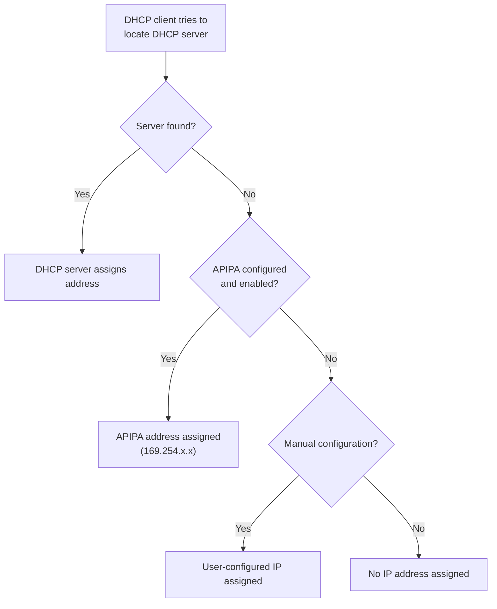
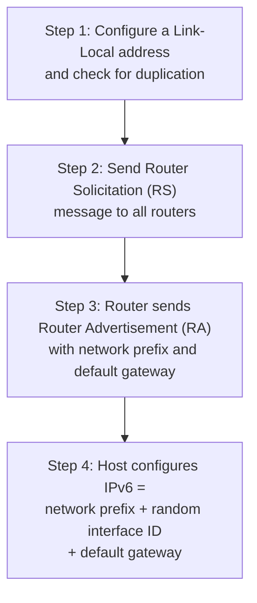

# عناوين الـ IP — Lecture 3: IP Addressing (IPv4 & IPv6)

> [!NOTE]
> المحاضرة دي من أهم محاضرات المادة وفيها **مسائل**. هنراجع الأول **النظام الثنائي (binary)**، وبعدين **IPv4**: تركيبه، والـ **subnet mask**، وحساب **عدد الـ hosts**، والـ **classes** (A, B, C, D, E)، والـ **private addresses**، والـ **DHCP** والـ **APIPA**. وبعدين **IPv6**: تركيبه وتبسيطه، وأنواعه (Global، Unique Local، Link-Local، Loopback، Compatibility)، وطرق الـ **6to4** و **ISATAP** و **Teredo**، والـ **SLAAC**.

**أهداف المحاضرة (Objectives):**
- فهم تركيب IPv4 و IPv6.
- فهم الـ subnet mask وحساب عدد الـ hosts في شبكة.
- التعرف على classes الـ IPv4.
- إزاي الجهاز بياخد IP (v4 و v6).
- الفرق بين unicast و multicast و broadcast و anycast.
- أنواع الـ unicast في IPv6 وأنواع الـ Compatibility Address.

---

## 1. مراجعة الأنظمة العددية — Numeral Systems

> A **numeral system** is a mathematical notation for representing numbers. The four common systems are **Binary, Octal, Decimal, and Hexadecimal**.

**العناصر الخمسة لأي نظام عددي:**

| العنصر | المعنى |
|---|---|
| **Digits** | الأرقام المستخدمة في النظام |
| **Base** | **عدد** الأرقام المستخدمة |
| **Order** | **مكان (position)** الرقم في العدد (من اليمين، بيبدأ من 0) |
| **Weight** | **Base ^ Order** |
| **Value** | الرقم اللي في المكان × الـ weight بتاعه |

### 1.1 النظام الثنائي — Binary

- **Digits:** 0 و 1 بس · **Base = 2**.

> [!EXAMPLE]
> **(1011)₂ = ?**
>
> | Binary | 1 | 0 | 1 | 1 |
> |---|---|---|---|---|
> | **Order** | 3 | 2 | 1 | 0 |
> | **Weight** | 2³ = 8 | 2² = 4 | 2¹ = 2 | 2⁰ = 1 |
> | **Value** | 8 | 0 | 2 | 1 |
>
> **= 8 + 0 + 2 + 1 = (11)₁₀**

> [!EXAMPLE]
> **Binary ← Decimal: (11101)₂ = ?**
>
> = 1×2⁴ + 1×2³ + 1×2² + 0×2¹ + 1×2⁰ = 16 + 8 + 4 + 0 + 1 = **(29)₁₀**

### 1.2 من Decimal لـ Binary

**الطريقة:** اقسم على 2 بشكل متكرر، واكتب **الباقي (remainder)**، وبعدين **اقرا البواقي من تحت لفوق**.

> [!EXAMPLE]
> **(13)₁₀ = ?**
>
> | القسمة | الناتج | الباقي |
> |---|---|---|
> | 13 ÷ 2 | 6 | **1** |
> | 6 ÷ 2 | 3 | **0** |
> | 3 ÷ 2 | 1 | **1** |
> | 1 ÷ 2 | 0 | **1** |
>
> من تحت لفوق: **(13)₁₀ = (1101)₂**

### 1.3 الـ Bit والـ Byte

- **Bit** = 0 أو 1 · **Byte = 8 bits**، وأكبر قيمة فيه = **255** (11111111).
- أوزان الـ byte من الشمال لليمين: **128، 64، 32، 16، 8، 4، 2، 1** (لازم تحفظها).

> [!EXAMPLE]
> **(10001011)₂ = 128 + 8 + 2 + 1 = (139)₁₀**

---

## 2. عنوان IPv4

> **IPv4** is a **32-bit Dotted Decimal Notation** assigned to each device connected to a network that uses **TCP/IP**. Each device in the same network should have a **unique** IP address.

- **32 bits** مقسمين لـ **4 أجزاء**، كل جزء اسمه **Octet = 8 bits** وقيمته من **0 لـ 255**، وبينهم **نقط (dots)**.
- الجهاز **بيقرا** العنوان بالـ **binary (IP number)**، والإنسان بيقراه بالـ **decimal (IP address)**.

| | 192 | 168 | 10 | 5 |
|---|---|---|---|---|
| **Binary** | 11000000 | 10101000 | 00001010 | 00000101 |

### 2.1 الـ Subnet Mask

- عنوان الـ IPv4 مكوّن من **جزئين**:
  - **Network ID:** بيحدد **الشبكة** اللي الجهاز فيها.
  - **Host ID:** بيحدد **الجهاز نفسه** جوه الشبكة.
- الـ **Subnet Mask** = رقم **32-bit** بيحدد الجزئين دول: **بتات الشبكة كلها 1** و **بتات الـ host كلها 0**.

| Host | IP address | Subnet mask | Network ID | Shortcut IP/Mask |
|---|---|---|---|---|
| PC1 | 192.168.10.3 | **255.255.0.0** | **192.168.0.0** | 192.168.10.3**/16** |
| PC2 | 192.168.10.5 | **255.255.255.0** | **192.168.10.0** | 192.168.10.5**/24** |

> [!TIP]
> الـ **/16** و **/24** (CIDR notation) = **عدد الـ 1s** في الـ subnet mask. 255 = 8 ones، فـ 255.255.0.0 = **/16**.

### 2.2 الـ Subnet Mask بيشتغل إزاي؟ (AND)

بنعمل **AND** بين الـ IP والـ subnet mask **bit by bit** (1 AND 1 = 1، وأي حاجة AND 0 = 0):

| | Binary |
|---|---|
| **IP** 192.168.10.5 | 11000000.10101000.00001010.00000101 |
| **Mask** 255.255.255.0 | 11111111.11111111.11111111.00000000 |
| **AND ← Network ID** 192.168.10.0 | 11000000.10101000.00001010.00000000 |

### 2.3 حساب عدد الـ Hosts

$$\text{No. of hosts} = 2^{\text{no. of host bits}} - 2$$

> [!IMPORTANT]
> **ليه بنطرح 2؟** لأن الـ host ID **مينفعش يبقى كله أصفار** (ده **الـ Network ID**) و**مينفعش يبقى كله 1s / 255** (ده **عنوان الـ Broadcast**).

> [!EXAMPLE]
> **جهاز IP بتاعه 172.16.10.9 والـ subnet mask = 255.255.255.0. الشبكة تشيل كام host؟**
>
> - الـ mask فيه 24 one ← الـ host bits = 32 − 24 = **8 bits**.
> - عدد الـ hosts = 2⁸ − 2 = 256 − 2 = **254 hosts**.

### 2.4 فئات IPv4 — IPv4 Classes

| Class | أول bits | مدى أول octet | Default Mask | Networks | Hosts/Network | الاستخدام |
|---|---|---|---|---|---|---|
| **A** | **0** | **1 – 126** | 255.0.0.0 (/8) | **126** | **16,777,214** | شبكات **كبيرة جدًا** |
| **B** | **10** | **128 – 191** | 255.255.0.0 (/16) | **16,384** | **65,534** | شبكات **متوسطة لكبيرة** |
| **C** | **110** | **192 – 223** | 255.255.255.0 (/24) | **2,097,152** | **254** | شبكات **صغيرة (LANs)** |
| **D** | **1110** | **224 – 239** | N/A | N/A | — | **Multicasting** |
| **E** | **1111** | **240 – 255** | N/A | N/A | — | **Research / Experimental** |

- **Class A:** أول octet للشبكة (أول bit **دايمًا 0** + 7 bits)، والـ **24 bit** الباقيين للـ hosts ← 2²⁴ − 2 = **16,777,214**.
- **Class B:** أول **اتنين octet** للشبكة (أول bitين **دايمًا 10**)، والـ **16 bit** للـ hosts ← 2¹⁶ − 2 = **65,534**، وعدد الشبكات 2¹⁴ = **16,384**.
- **Class C:** أول **3 octets** للشبكة (أول 3 bits **دايمًا 110** + 21 bit)، والـ **8 bits** للـ hosts ← **254**، وعدد الشبكات 2²¹ = **2,097,152**.
- **Class D:** **مش بيتدي لـ hosts**؛ للـ **multicasting**: host واحد يبعت **stream واحد لآلاف الأجهزة** في نفس الوقت (زي **بث الصوت والفيديو، IP-based cable TV**).
- **Class E:** **مش بيتدي لـ hosts** ومش للاستخدام العام؛ **محجوز للأبحاث**.

> [!WARNING]
> **127.x.x.x مش في أي class للأجهزة!** من **127.0.0.1 لـ 127.255.255.255** دي **عناوين اختبار الشبكة (Loopback)**؛ **virtual** ومينفعش تتدي لجهاز. وعشان كده Class A بيقف عند **126**.

> [!EXAM]
> **حدد الـ class من أول octet:**
> - 10.5.3.1 ← **A** · 172.16.0.1 ← **B** · 192.168.1.1 ← **C** · 230.1.1.1 ← **D** · 245.0.0.1 ← **E** · 127.0.0.1 ← **Loopback**.

### 2.5 العناوين الخاصة — Private IP Addresses

- في كل class فيه عناوين **محجوزة للاستخدام الداخلي بس (private/internal)**.
- **مينفعش تستخدم على أجهزة متوصلة بالإنترنت مباشرة** لأنها **non-routable**.
- بتتدي للأجهزة **جوه البيت أو الشركة** (workstations، printers، file servers).

| Class | Private Range |
|---|---|
| **A** | **10.0.0.0 – 10.255.255.255** |
| **B** | **172.16.0.0 – 172.31.255.255** |
| **C** | **192.168.0.0 – 192.168.255.255** |
| **APIPA** | **169.254.0.0 – 169.254.255.254** |

### 2.6 إزاي الجهاز بياخد IPv4؟

| الطريقة | الشرح |
|---|---|
| **Statically** | المستخدم **بيكتب الـ IP بنفسه** في نافذة الـ IP configuration |
| **DHCP** (Dynamic Host Configuration Protocol) | بيوزّع IPs **أوتوماتيك وديناميك**؛ الجهاز ممكن ياخد **IP مختلف كل مرة** يتصل |
| **APIPA** (Automatic Private IP Addressing) | ميزة في **Windows**: لو **مفيش DHCP server**، الجهاز **يدي نفسه** IP من **169.254.x.x** |

**الـ DHCP بيشتغل إزاي؟** الجهاز **بيبعت طلب** IP ← الـ **DHCP server** بيستلمه و**بيرد بعنوان** ← وممكن **ياخده تاني بعد مدة معينة** عشان يديه لجهاز تاني.

> [!TIP]
> لو لقيت جهازك واخد **169.254.x.x** ← معناها إنه **ملقاش DHCP server** (وغالبًا مفيش نت).

### 2.7 أنواع إرسال IPv4

| النوع | المعنى |
|---|---|
| **Unicast** | **One to One** |
| **Multicast** | **One to Many** |
| **Broadcast** | **One to All** |

### ✅ ملخص IPv4

- كل رقم من الأربعة = **Octet (8 bits)** من **0 لـ 255** · العنوان = **Network ID + Host ID**.
- الـ **Subnet mask** بيفصل الجزئين.
- **Hosts = 2ⁿ − 2** (كله أصفار = network ID · كله 255 = broadcast).
- **A (1–126) · B (128–191) · C (192–223) · D (224–239) multicast · E (240–255) research**.
- **Private:** 10.0.0.0 · 172.16.0.0 · 192.168.0.0 · 169.254.0.0 (APIPA).

---

## 3. عنوان IPv6

> **IPv6** is a **128-bit Hexadecimal Notation** divided into **eight blocks** separated by **colons (:)**. Each block (**quartet**) has **four hexadecimal digits (16 bits)**, and each hex digit (4 bits) is called a **nibble**.

| المصطلح | الحجم |
|---|---|
| **Nibble** | hex digit واحد = **4 bits** |
| **Quartet (block)** | 4 hex = **16 bits** |
| **العنوان كله** | 8 quartets = **32 hex = 128 bits** |
| **Network ID** | أول **64 bits** (16 hex) |
| **Interface (Host) ID** | آخر **64 bits** (16 hex) |

| | IPv4 | IPv6 |
|---|---|---|
| الحجم | **32 bits** | **128 bits** |
| الكتابة | **Dotted Decimal** | **Hexadecimal** بـ **colons** |
| الأجزاء | 4 octets (8 bits) | 8 quartets (16 bits) |
| Broadcast | ✅ | ❌ (اتشال واتبدل بـ multicast) |

### 3.1 تبسيط IPv6

**القاعدة 1: شيل الأصفار اللي على الشمال (leading 0s)** في كل quartet:

`fe80:0000:0000:0000:05ee:0000:0000:47b1` ← `fe80:0:0:0:5ee:0:0:47b1`

**القاعدة 2: مجموعة واحدة متتالية من الـ quartets الصفرية** تتكتب **`::`**:

`fe80:0:0:0:5ee:0:0:47b1` ← `fe80::5ee:0:0:47b1` **أو** `fe80:0:0:0:5ee::47b1`

> [!WARNING]
> **❌ `fe80::5ee::47b1` غلط!** الـ **`::` تتستخدم مرة واحدة بس** في العنوان، وإلا مش هنعرف كل `::` كانت بتمثل كام block.

> [!TIP]
> بتشيل الأصفار **اللي على الشمال بس**: `05ee` ← `5ee` صح، لكن `47b0` **مينفعش** تبقى `47b`.

### 3.2 أنواع إرسال IPv6

| النوع | المعنى |
|---|---|
| **Unicast** | **One to One** |
| **Multicast** | **One to Many** |
| **Anycast** | **One to Closest node** (أقرب جهاز) |
| ~~Broadcast~~ | **مش موجود في IPv6**، **واتبدل بالـ Multicast** |

### 3.3 أنواع عناوين الـ Unicast في IPv6

| النوع | بيبدأ بـ | يقابله في IPv4 | الوصف |
|---|---|---|---|
| **Global Unicast** | **2000 – 3fff** | **Public IP** | **routable على الإنترنت** |
| **Unique Local** | **fd** | **Private IP** | بيحدده **الـ administrator**، و**مش routable** على الإنترنت |
| **Link-Local** | **fe80** | **APIPA** | للتواصل مع **الأجهزة الجيران على نفس الـ link**، ومش routable |
| **Loopback** | **::1** (0:0:0:0:0:0:0:1) | **127.0.0.1** | للـ **troubleshooting والاختبار** |
| **Compatibility** | **2002** (6to4) | — | **للانتقال (migration)** من IPv4 لـ IPv6 |

#### Global Unicast Address

| الجزء | الحجم | مين بيحدده |
|---|---|---|
| **Global routing prefix** (site prefix) | **48 bits** | **IANA** ثم الـ **local registry** |
| **Subnet ID** | **16 bits** | **المؤسسة** (للـ subnetting) |
| **Interface ID** | **64 bits** | المؤسسة، **manually أو DHCP** |

#### Unique Local Address

- **8-bit prefix** (**fd**) + **40 bits** يحددها **الـ network administrator** + **16-bit subnet ID** + **64-bit interface ID**.

#### Link-Local Address

- **10-bit prefix** (بيبدأ **دايمًا بـ fe80**) + **54 bits كلها أصفار** + **Interface ID عشوائي (randomized)** 64-bit.
- **كل node بتاخد Link-Local address** أوتوماتيك.

### 3.4 عناوين التوافق — Compatibility Addresses

بتستخدم في **الانتقال من IPv4 لـ IPv6**، وفيه 3 طرق:

| الطريقة | الفكرة | بيبدأ بـ | الـ IPv4 بيتحط فين؟ |
|---|---|---|---|
| **6to4** | الـ IPv4 **بيتغلّف (encapsulated)** جوه IPv6، والـ **6to4 router** بيعمل **tunnel** | **2002** | في **الـ Network ID** |
| **ISATAP** (Intra-Site Automatic Tunnel Addressing Protocol) | الـ IPv4 بيتحط في **الـ Interface ID**، و**للاستخدام الداخلي (Intranet) بس** | **0:5efe** (في الـ interface ID) | في **الـ Interface ID** |
| **Teredo** | بيخلّي **IPv4 hosts توصل لـ IPv6 hosts** باستخدام **IPv4 UDP tunnels** اللي **بتعدّي من الـ NAT** | **2001:0000** | (مشفّر بـ XOR) في الـ Interface ID |

#### 6to4

- الـ **6to4 router** بيستخدم الـ IPv4 المتغلّف عشان يعمل **tunnel**: الـ **IPv6 datagram** بيتشال كـ **payload** جوه **IPv4 datagram** بين الـ IPv4 routers (**"packet within a packet"**).

> [!EXAMPLE]
> **حوّل IPv4 = 192.0.10.100 لعنوان 6to4.**
>
> 1. حوّل كل octet لـ **2 hex digits**:
>
> | 192 | 0 | 10 | 100 |
> |---|---|---|---|
> | **c0** | **00** | **0a** | **64** |
>
> 2. اجمعهم في **quartetين (32 bits)**: **c000:0a64**.
> 3. حط قبلهم الـ **prefix 2002** (16 bits):
>
> **2002:c000:0a64**:[16-bit subnet]:[64-bit interface ID]

#### ISATAP

> [!EXAMPLE]
> **نفس الـ IPv4 = 192.0.10.100 بـ ISATAP:**
>
> الـ Interface ID = **0000:5efe** (ISATAP prefix) + **c000:0a64** (الـ IPv4)
>
> العنوان = [أي 64-bit prefix] : **0:5efe:c000:a64**

#### Teredo

**تركيب عنوان Teredo:**

| Teredo prefix | Teredo server IPv4 | Flags | Obfuscated UDP port | Obfuscated host IPv4 |
|---|---|---|---|---|
| **32 bits (2001:0000)** | 32 bits | 16 bits | 16 bits | 32 bits |

**"Obfuscated"** يعني **متشفّر بـ XOR مع ffff** (يعني كل bit بيتقلب).

> [!EXAMPLE]
> **(من السلايد)** Host IPv4 = **131.107.0.1**، و UDP port = **5000**:
>
> | القيمة | Hex | XOR ffff… | الناتج |
> |---|---|---|---|
> | Host 131.107.0.1 | 83.6b.00.01 | XOR ffffffff | **7c94:fffe** |
> | Port 5000 | 1388 | XOR ffff | **ec77** |
>
> وفي السلايد كمان الـ server **195.140.195.140** = c3.8c.c3.8c ← XOR ← **3c73:3c73**.
>
> العنوان: **2001:0000:3c73:3c73:[flags]:ec77:7c94:fffe**

> [!WARNING]
> السلايد كاتب في السؤال إن عنوان الـ Teredo server = **94.245.121.251**، بس في الحل استخدم **195.140.195.140** وعمله XOR. **ركّز على طريقة الحل**: تحويل كل octet لـ hex ثم **XOR مع f** (يعني كل hex digit = **f ناقص الرقم**: 8←7، 3←c، 6←9، b←4). وفي معيار Teredo الحقيقي، عنوان الـ server بيتكتب **من غير تشفير**، والمتشفّر هو **الـ port وعنوان الـ host بس**.

> [!TIP]
> **حيلة سريعة للـ XOR مع f:** كل hex digit يتحول لـ **(15 − الرقم)**: 0↔f · 1↔e · 3↔c · 6↔9 · 8↔7 · b(11)↔4.

### 3.5 الـ Multicast في IPv6

- بيبدأ بـ **ff** (8-bit prefix) + flags + scope + **112-bit Group ID**.
- **ff02::1** ← **All nodes** multicasting.
- **ff02::2** ← **All routers** multicasting.
- بيستخدم في **Neighbor Discovery**.

### 3.6 إزاي الجهاز بياخد IPv6؟

| الطريقة | الشرح |
|---|---|
| **Stateful Address Autoconfiguration** | الجهاز بياخد العنوان من **DHCPv6** أو **manually** |
| **Stateless Address Autoconfiguration (SLAAC)** | الجهاز **بيكوّن عنوانه بنفسه** باستخدام **Neighbor Discovery Protocol**، **من غير DHCP** (ممكن DHCP يدي معلومات **زيادة** زي الـ **DNS**) |

**خطوات الـ SLAAC:**

> [!NOTE]
> الـ router كمان **بيبعت RA messages على فترات منتظمة** من غير ما حد يطلب.

### ✅ ملخص IPv6

- **128 bits = 32 hex** في **8 quartets** (كل quartet = 4 hex = 16 bits)، وكل hex = **nibble**.
- **Global unicast** = **2000–3fff** (routable) · **Link-Local** = **fe80** (local بس) · **Unique local** = **fd** (private) · **Loopback** = **::1**.
- **6to4** ← **2002** والـ IPv4 في الـ **network ID** · **ISATAP** ← **0:5efe** والـ IPv4 في الـ **interface ID** · **Teredo** ← **2001:0000** عبر **NAT**.
- **Multicast** = **ff** (ff02::1 all nodes، ff02::2 all routers) للـ **neighbor discovery**.
- **Stateful** (DHCPv6/manual) vs **SLAAC** (RS ← RA، من غير DHCP).
