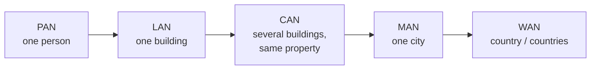
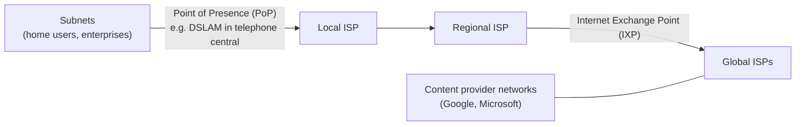

# مقدمة في شبكات الحاسب — Lecture 1: Introduction to Computer Networks

> [!NOTE]
> أول محاضرة في الشبكات: يعني إيه **شبكة**، وأنواعها (PAN، LAN، MAN، WAN...)، والـ **Topologies**، و**أجهزة الشبكة** (NIC، Hub، Switch، Router...) والـ **MAC address**، وتاريخ الإنترنت، والـ **Protocols** والـ **Ports**، وهيكل الإنترنت، وأنواع الاتصال بالإنترنت.

**أهداف المحاضرة (Objectives):**
- فهم معنى الشبكة وأنواعها.
- فهم الـ network topologies.
- التعرف على أجهزة الشبكة ووظايفها.
- فهم تطور الإنترنت، وتعريف الـ protocols، وهيكل الإنترنت.
- أنواع الاتصال بالإنترنت وخصائصها.

---

## 1. يعني إيه شبكة حاسب؟ — What is a Computer Network?

> A **collection of computers, servers, mainframes, network devices, or other devices** connected to one another allowing for **data to be shared and used**.

يعني **مجموعة أجهزة متوصلة ببعض** عشان **تشارك البيانات وتستخدمها**.

---

## 2. أنواع الشبكات — Network Types

| النوع | الاسم الكامل | النطاق | الوصف |
|---|---|---|---|
| **PAN** | Personal Area Network | **شخص واحد** في مبنى واحد | شبكة حوالين **شخص واحد** (مكتب صغير أو بيت): كمبيوتر، تليفون، طابعة، أجهزة ألعاب |
| **LAN** | Local Area Network | **مبنى واحد** | بتوصّل السيرفرات والأجهزة **جوه نفس المبنى** |
| **CAN** | Campus Area Network | **أكتر من مبنى في نفس المكان** | **مجموعة LANs** بتوصّل مباني في **نفس الـ property** (زي جامعة) |
| **MAN** | Metropolitan Area Network | **مدينة** | **مجموعة LANs أو CANs** بتوصّل مباني في **أماكن مختلفة جوه نفس المدينة** |
| **WAN** | Wide Area Network | **دولة أو دول** | LANs أو CANs أو MANs متوصلة **في نفس الدولة أو دول مختلفة** |
| **VPN** | Virtual Private Network | — | **اتصال آمن** بالـ WAN، بيحمي البيانات والجهاز من الهجمات |
| **EPN** | Enterprise Private Network | — | شبكة **بتتحكم فيها مؤسسة واحدة بالكامل** لتوصيل **فروعها** (main office + branches) |
| **SAN** | Storage Area Network | — | شبكة **مخصصة لأجهزة التخزين** بتقدّم **pool تخزين مشترك** للسيرفرات، وده بيسهّل الإدارة والحماية والـ disaster recovery |

> [!TIP]
> رتّبهم من الأصغر للأكبر: **PAN < LAN < CAN < MAN < WAN**.
> - **CAN** = مجموعة **LANs** (نفس الأرض/الحرم).
> - **MAN** = مجموعة **LANs أو CANs** (نفس المدينة).

---

## 3. طوبولوجيات الشبكات — Network Topologies

> **Network topology** is the **shape** of a LAN or other communications system; in other words, **the ways of connecting computers**.

### 3.1 الـ Bus Topology

- كل الأجهزة متوصلة بـ **سلك واحد (the bus)** ليه **طرفين**.
- **قطع واحد في الكابل بيوقّع الشبكة كلها**.
- الأطراف المقطوعة **مفيهاش termination**، فيحصل **انعكاس للإشارة (reflection)**.
- لازم **Terminators** في كل طرف عشان تمنع **ارتداد الإشارة (bouncing)**.

### 3.2 الـ Ring Topology

- كل الأجهزة متوصلة في **حلقة كابل**.
- البيانات بتلف **من جهاز للتاني في نفس الاتجاه**.
- **مفيش أطراف للكابل**، **فمش محتاجة termination**.
- **قطع في الحلقة بيكسر الدايرة** ويوقف تدفق البيانات.

### 3.3 الـ Star Topology

- كل الأجهزة متوصلة عن طريق **وحدة تحكم مركزية (central control unit)**.
- **قطع كابل واحد** بيوقف **جهاز واحد بس**.
- **عطل الوحدة المركزية** بيوقف **الشبكة كلها**.

### 3.4 الـ Hybrid Topology

- أي تكنولوجيا بتجمع **physical topology** مع **signaling topology** اسمها **hybrid topology**.
- **فيه نوعين hybrid بس:**
  - **Star-Ring topology**: الـ **ring متصغّرة** جوه صندوق صغير.
  - **Star-Bus topology**: الـ **bus متصغّر** جوه صندوق صغير.

### 3.5 الـ Mesh Topology

- **كل جهاز متوصل بكل الأجهزة التانية**.
- **Fully meshed:** كل جهاز متوصل **مباشرة** بكل جهاز **من غير routes بينهم**.
- **Partially meshed:** كل جهاز متوصل بالباقي عن طريق **routes اتنين أو أكتر**.

### 3.6 الـ Point-to-Multipoint Topology

- **نظام واحد** بيبقى **المصدر المشترك** اللي كل الأعضاء بيتواصلوا من خلاله.
- **شبه الـ star فيزيائيًا**، **لكن الفرق** إنه **محتاج جهاز ذكي (intelligent device) في النص**.

### 3.7 الـ Point-to-Point Topology

- **جهازين متوصلين مباشرة** **من غير أي جهاز مركزي**.
- بيتطبق في الشبكات **السلكية واللاسلكية**.

| الـ Topology | لو كابل اتقطع | ملاحظات |
|---|---|---|
| **Bus** | **الشبكة كلها تقع** | محتاج **terminators** |
| **Ring** | **الدايرة تتكسر** والبيانات تقف | **مفيش termination**، والبيانات في اتجاه واحد |
| **Star** | **جهاز واحد بس** يقع | لو الـ **central unit** وقعت ← الكل يقع |
| **Mesh** | فيه **مسارات بديلة** | Fully / Partially meshed |
| **Point-to-Multipoint** | — | زي الـ star بس **الجهاز المركزي ذكي** |
| **Point-to-Point** | — | **جهازين مباشرة** من غير جهاز مركزي |

> [!EXAM]
> - "A single break takes down the **entire network**" ← **Bus**.
> - "A single break takes down **one computer** only" ← **Star**.
> - "Requires **no termination**" ← **Ring**.
> - الـ hybrid topologies **اتنين بس**: **star-ring** و **star-bus**.

---

## 4. أجهزة الشبكة — Network Devices

| الجهاز | الوظيفة |
|---|---|
| **Modem** | بيستخدم في **اتصالات الـ dial-up** على **خطوط التليفون الـ analog العادية**، وممكن يبقى **داخلي أو خارجي** |
| **NIC** (Network Interface Card) | **بيوصّل الجهاز بوسيط الشبكة الفيزيائي**، ممكن يبقى **مدمج في المازربورد** أو **كارت توسعة**، و**سلكي أو لاسلكي** |
| **Repeater** | بيعالج مشكلة **ضعف الإشارة (attenuation)**: ياخد إشارة **ضعيفة** من port ويطلّعها **قوية** من التاني |
| **Hub** | **Multi-port repeater**: ياخد الإشارة من port ويبعتها **لكل الـ ports التانية** |
| **Bridge** | بيوصّل **جهازين أو segmentين من نفس الـ LAN** بيستخدموا **نفس البروتوكول** |
| **Switch** | **Multi-port bridge**: بيوصّل **أكتر من جهاز** ببعض |
| **Router** | بيوصّل **شبكتين مختلفتين أو أكتر** ببعض |
| **Wireless Access Point (WAP)** | **زي الـ Hub بالظبط**، بس الاتصال **عن طريق الهوا** بدل الكابل |

> [!EXAM]
> - **Hub = multi-port repeater**.
> - **Switch = multi-port bridge**.
> - **WAP = Hub لاسلكي**.
> - **Router** ← **شبكات مختلفة** · **Bridge** ← **segments من نفس الـ LAN**.

### 4.1 النظام السداسي عشر — Hexadecimal

النظام الـ **hexadecimal** فيه **16 رقم**: **0–9 و A–F** (حيث **A=10، B=11، C=12، D=13، E=14، F=15**)، والأساس (**base**) = **16**.

- **Weight** = (Base)^position · **Value** = (الرقم في المكان ده) × (الـ weight بتاعه).
- القيمة العشرية = **مجموع كل الـ values**.

> [!EXAMPLE]
> **(7DE)₁₆ = ?**
>
> | الرقم | 7 | D (=13) | E (=14) |
> |---|---|---|---|
> | **Weight** | 16² = 256 | 16¹ = 16 | 16⁰ = 1 |
> | **Value** | 7 × 256 = **1792** | 13 × 16 = **208** | 14 × 1 = **14** |
>
> **(7DE)₁₆ = 1792 + 208 + 14 = (2014)₁₀**

### 4.2 عنوان الـ MAC

- جوه كل **NIC**، محروق على **ROM chip**، فيه **firmware** فيه **معرّف فريد بطول 48-bit** اسمه **MAC address** (Media Access Control).
- الـ MAC = **12 hexadecimal characters**. كل hex char = **4 bits**، يعني 12 × 4 = **48 bits = 6 Bytes**.

| مثال: `E0-69-95-90-8B-C3` | |
|---|---|
| **أول 6 digits** (`E0-69-95`) | **رقم الشركة المصنّعة** للـ NIC (**OUI**)، ومحدش غيرها يستخدمه |
| **آخر 6 digits** (`90-8B-C3`) | **الرقم التسلسلي الفريد** للـ NIC من الشركة |

> [!EXAM]
> **MAC = 48 bits = 6 bytes = 12 hex digits** · **أول 3 bytes = manufacturer** · **آخر 3 bytes = serial**.

---

## 5. يعني إيه الإنترنت؟ — What is the Internet?

- الـ **Internet** = **مجموعة عالمية من الشبكات المنفصلة لكن المتوصلة ببعض**، بيستخدمها ملايين الناس يوميًا للمعلومات والترفيه.
- الـ **Internet** (بحرف **I كبير**) = اسم **محدد** لشبكة الاتصالات المكوّنة من **مئات الآلاف من الشبكات المترابطة**.

### تاريخ الإنترنت (Timeline)

| السنة | الحدث |
|---|---|
| **1969** | **ARPANET** (Advanced Research Projects Agency Network) من **وزارة الدفاع الأمريكية** مع **MIT**، بعد ما روسيا أطلقت **Sputnik** (أول قمر صناعي) |
| **1971** | **Ray Tomlinson** عمل أول برامج **e-mail**: **SNDMSG** و **READMAIL** |
| **1973–1975** | **Robert Metcalfe** عمل نظام بيستبدل الإرسال بالراديو بـ **كابل** فيه bandwidth أكبر (ملايين bits/sec بدل آلاف). اسمه الأصلي **Alto Aloha network**، وبعدين بقى **Ethernet** |
| **1974** | **Bob Kahn و Vint Cerf** اخترعوا **TCP** (Transmission Control Protocol)، وبقى البروتوكول القياسي على ARPANET |
| **1982–1983** | ARPANET اتقسمت: **MILNET** (للدفاع والجيش) و **ARPANET** (للأكاديميين والباحثين)، وكانت **أول خطوة للتجارية** |
| **1984** | **Paul Mockapetris و Jon Postel و Craig Partridge** عملوا **DNS** (Domain Name System) لتقسيم الأسماء بين host names (`x.com`) و usernames (`user@x.com`) |
| **1988** | **IANA** (Internet Assigned Numbers Authority) اتأسست عشان **توزّع أرقام IP** |
| **1990** | أول **ISP**: **World.Std.com** |
| **1998** | **ICANN** (Internet Corporation for Assigned Names and Numbers): بتنسّق إدارة **العناصر التقنية للـ DNS**، و**هي اللي بتدير IANA** |

> [!EXAM]
> - **ARPANET = 1969** (وزارة الدفاع الأمريكية + MIT، بعد Sputnik).
> - **TCP = 1974** (Bob Kahn & Vint Cerf).
> - **Ethernet** = Robert Metcalfe (اسمه الأول **Alto Aloha**).
> - **DNS = 1984** · **IANA = 1988** · **ICANN = 1998** (وهي اللي بتدير IANA).

### 5.1 الـ Protocols والـ Ports

> A **protocol** is a **set of rules and instructions** used for transmitting data between two devices.

**الـ protocol بيحدد:**
- نوع **error checking**.
- طريقة **ضغط البيانات** (لو فيه).
- إزاي الجهاز المرسل **يوضّح إنه خلص** إرسال الرسالة.
- إزاي الجهاز المستقبل **يوضّح إنه استلم** الرسالة.

> A **port** is a **location where information is sent through**. Example: **HTTP uses port 80**.

### أمثلة على البروتوكولات

| البروتوكول | الخصائص |
|---|---|
| **TCP** (Transmission Control Protocol) | **One-to-One**، و **Connection-Oriented**، و **segment sequencing**، و **Reliable**، و **acknowledgement** |
| **UDP** (User Datagram Protocol) | **Connectionless**، و**مفيش acknowledgement**، و **Unreliable**، و**مفيش sequencing** |
| **HTTP** (Hyper Text Transfer Protocol) | نقل **صفحات الويب** من الـ web server للـ browser |
| **FTP** (File Transfer Protocol) | **تحميل ورفع الملفات** من وإلى server |

| | **TCP** | **UDP** |
|---|---|---|
| الاتصال | **Connection-oriented** | **Connectionless** |
| الاعتمادية | **Reliable** | **Unreliable** |
| Acknowledgement | ✅ | ❌ |
| Sequencing | ✅ | ❌ |
| مثال | تصفح، e-mail، تحميل ملفات | بث فيديو مباشر، ألعاب، مكالمات |

### 5.2 هيكل الإنترنت — Internet Structure: Network of Networks

| المصطلح | الشرح |
|---|---|
| **Point of Presence (PoP)** | المعدات (زي **DSLAM** في السنترال) اللي بتوصّل المشتركين بالـ **local ISP** |
| **IXP** (Internet Exchange Point) | النقطة اللي الـ ISPs بتتبادل فيها الترافيك مع **Global ISPs** |
| **Content provider networks** | شركات زي **Google و Microsoft** بتشغّل **شبكاتها الخاصة** عشان تقرّب المحتوى للمستخدمين |
| **ISP** (Internet Service Provider) | شركات بتقدّم **خدمة الإنترنت**، وأول ISP سنة **1990** كان **World.Std.com** |

---

## 6. أنواع الاتصال بالإنترنت — Types of Internet Connection

| النوع | السرعة | ✅ المميزات | ❌ العيوب |
|---|---|---|---|
| **Dial-up** | **max 56 Kbps** (~7.2 KB/s) | هاردوير **رخيص**، وسهل، ومتاح في كل حتة | **بطيء جدًا**، و**مينفعش تعمل أو تستقبل مكالمات** وإنت متصل |
| **Cable** | **لحد 100 Mbps** (~12.5 MB/s) **upload = download** (fixed bandwidth)، ومحتاج **cable modem** | أسرع، و**مش محتاج خط تليفون** | السرعة **بتقل وقت الذروة**، و**غالي شوية** |
| **BoF** (Broadband over Fiber) | **15–150 Mbps** (~1.87–18.75 MB/s) | **bandwidth عالي جدًا**، و**مسافات أطول** من النحاس، و**مقاوم للتداخل الكهرومغناطيسي** | الألياف **زجاج فهي هشة**، و**صعبة التركيب**، والضوء **بيضعف ويتشتت** مع المسافة |
| **DSL / ADSL** | **لحد 24 Mbps** (~3 MB/s) | منتشر (على خط التليفون الأرضي)، وتكلفة معقولة | لازم تبقى **قريب من السنترال (في حدود 5 km)**، وبطيء وقت الذروة، وجودة النحاس بتأثر |
| **VDSL** | **70–100 Mbps** (~8.75–12.5 MB/s) | **fiber node قريب** من المستخدم، ومنتشر، وتكلفة معقولة | السرعة **بتعتمد على طول النحاس** للبيت، وبطيء وقت الذروة |
| **Satellite** (Starlink، Viasat) | **25–220 Mbps** (~3.1–27.5 MB/s) | **توافر أعلى** من DSL و cable، و**بينفع في الأماكن اللي مفيهاش بدائل** | **غالي جدًا** ($50–$1500 شهريًا + معدات $300–$600)، و**صعب في الصيانة**، و**بيتأثر بالجو**، و **latency عالي** |
| **Mobile internet** | **4G: 3–15 Mbps** · **5G: 100–1000 Mbps** | **إنترنت وإنت بتتحرك**، ومش محتاج هاردوير زيادة | **الإشارة الضعيفة** = اتصال ضعيف، وتكلفة باقات البيانات |

> [!TIP]
> **تحويل السرعات:** **1 Byte = 8 bits**، يعني تقسم على 8:
> - 56 Kbps ÷ 8 = **7 KB/s**
> - 100 Mbps ÷ 8 = **12.5 MB/s**
> - 24 Mbps ÷ 8 = **3 MB/s**

> [!EXAM]
> - **Dial-up** = أبطأ حاجة (**56 Kbps**)، ومينفعش تكلم في التليفون وإنت متصل.
> - **DSL/ADSL** ← لازم **في حدود 5 km من السنترال**.
> - **Satellite** ← **latency** بسبب المسافة للقمر الصناعي.
> - **Fiber** ← **مقاوم للـ electromagnetic interference** بس **هش**.

---

## 🧠 الـ Mind-Map بتاع المحاضرة

---

## ✅ خلاصة المحاضرة في 10 نقط

1. **الشبكة** = أجهزة متوصلة ببعض **لمشاركة البيانات**.
2. الأنواع: **PAN** (شخص) < **LAN** (مبنى) < **CAN** (مباني نفس الأرض) < **MAN** (مدينة) < **WAN** (دول)، ومعاهم **VPN** و **EPN** و **SAN**.
3. **Bus** (قطع = الكل يقع، و terminators) · **Ring** (مفيش termination) · **Star** (قطع = جهاز واحد، والمركز يقع = الكل).
4. **Hybrid** نوعين بس: **star-ring** و **star-bus** · **Mesh**: fully و partially · **P2MP** (جهاز ذكي في النص) · **P2P** (جهازين).
5. الأجهزة: **Modem** (dial-up) · **NIC** · **Repeater** (attenuation) · **Hub = multi-port repeater** · **Bridge** · **Switch = multi-port bridge** · **Router** (شبكات مختلفة) · **WAP** (hub لاسلكي).
6. **MAC** = **48-bit = 12 hex = 6 bytes**، وأول 6 hex للشركة وآخر 6 serial · **Hex**: (7DE)₁₆ = 2014.
7. **ARPANET 1969** · email 1971 · **TCP 1974** · **Ethernet** (Metcalfe، Alto Aloha) · MILNET 1983 · **DNS 1984** · **IANA 1988** · أول ISP 1990 · **ICANN 1998**.
8. **Protocol** = قواعد نقل البيانات · **Port** = مكان مرور المعلومات (**HTTP = 80**).
9. **TCP** (connection-oriented، reliable، ack، sequencing) vs **UDP** (connectionless، unreliable) · **HTTP** (ويب) · **FTP** (ملفات).
10. هيكل الإنترنت: subnets ← **PoP** ← local ISP ← regional ISP ← **IXP** ← global ISP · والاتصال: **Dial-up 56K، Cable 100M، Fiber، DSL 24M (5 km)، VDSL، Satellite (latency)، Mobile (4G/5G)**.
