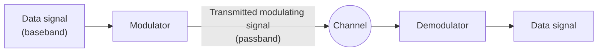
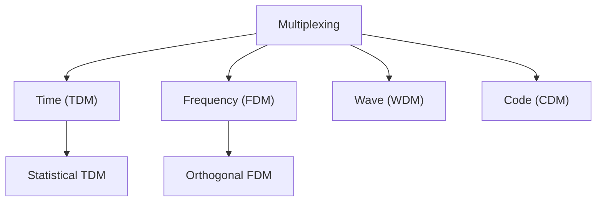

# الإشارات ووسائط النقل — Lecture 2: Transmission & Physical Media

> [!NOTE]
> المحاضرة دي عن **إزاي البيانات بتتنقل فعليًا**. هنبدأ بالإشارات **Analog و Digital** وخصائصها (wavelength، frequency، amplitude، phase)، وبعدين الـ **Digital Modulation** (ASK، FSK، PSK)، وبعدين **أداء الشبكة** وحساباته (bandwidth، throughput، latency)، وبعدين **أنماط الاتصال** والـ **Multiplexing**، وفي الآخر **الكابلات والـ connectors** و**شبكات الوصول (Access Networks)**.

**أهداف المحاضرة (Objectives):**
- التفريق بين الإشارة الـ analog والـ digital.
- فهم الفرق بين wavelength و frequency و amplitude و phase.
- حل مسائل الـ frequency و bandwidth و throughput و latency.
- تعريف تقنيات الـ Digital Modulation.
- فهم أداء الشبكة وأنماط الاتصال وأنواع الـ Multiplexing.
- التعرف على الكابلات والـ connectors وطرق الوصول للشبكة.

---

## 1. يعني إيه إشارة؟ — What is a Signal?

> A **signal** is an **electromagnetic wave or electrical current** used for **carrying data through a physical medium** from one system or network to another.

يعني الإشارة هي **"العربية" اللي بتشيل البيانات** على السلك أو في الهوا. وفيه نوعين: **Analog** و **Digital**.

---

## 2. الإشارة التناظرية — Analog Signal

- إشارة **مستمرة (continuous wave)** بتتغير مع الوقت، و**الـ frequency والـ amplitude بتاعتها متغيرين**.
- ممكن تاخد **أي قيمة (infinite values)** بين الـ max والـ min (مثلًا من **+5V لـ -5V**).
- الموجة الناتجة اسمها **sine wave (موجة جيبية)**.

### 2.1 الطول الموجي والتردد — Wavelength & Frequency

| المصطلح | التعريف |
|---|---|
| **Wavelength** | **المسافة بين قمتين (crests) أو قاعين (troughs) متتاليين**، يعني **دورة كاملة (Full Cycle)** |
| **Period (T)** | **الزمن** اللي بتاخده الموجة عشان تعمل **دورة كاملة** |
| **Frequency (f)** | **عدد الدورات في الثانية الواحدة**، ووحدته **Hertz (Hz)** |

$$f = \frac{1}{T}$$

> [!IMPORTANT]
> **الـ frequency عكس الـ wavelength (inversely proportional):** كل ما الـ **frequency تعلى**، الـ **wavelength يقصر**.

### وحدات الزمن والتردد

| وحدة الزمن | تساوي | وحدة التردد | تساوي |
|---|---|---|---|
| Seconds (s) | 1 s | Hertz (Hz) | 1 Hz |
| Milliseconds (ms) | 10⁻³ s | Kilohertz (kHz) | 10³ Hz |
| Microseconds (µs) | 10⁻⁶ s | Megahertz (MHz) | 10⁶ Hz |
| Nanoseconds (ns) | 10⁻⁹ s | Gigahertz (GHz) | 10⁹ Hz |

> [!EXAMPLE]
> **الـ period بتاع إشارة = 100 ms. التردد كام kHz؟**
>
> 1. نحوّل لثواني: 100 ms = 100 × 10⁻³ = **10⁻¹ s**.
> 2. $f = \frac{1}{T} = \frac{1}{10^{-1}} = 10 \text{ Hz}$
> 3. نحوّل لـ kHz (1 Hz = 10⁻³ kHz): 10 × 10⁻³ = **10⁻² kHz**.

### 2.2 السعة — Amplitude

- الـ **Amplitude** = **أقصى إزاحة** لنقط الموجة عن **وضع الاتزان (equilibrium position)**، وهو الخط المستقيم اللي بيمثله **محور x**.
- في الإشارات الكهربية، الـ **peak amplitude** بيتقاس بالـ **Volts**.

### 2.3 الطور — Phase

- الـ **Phase** بيوصف **مكان الموجة بالنسبة للزمن صفر (time 0)**؛ يعني الموجة **متزحزحة لقدام ولا لورا** على محور الزمن. بيوضّح **حالة أول دورة**.

| الـ Phase | الإزاحة | البداية عند time 0 |
|---|---|---|
| **0°** | **مش متزحزحة** | amplitude = صفر **وبتزيد** |
| **90°** | متزحزحة لليسار **¼ cycle** | amplitude في **القمة** وبتقل |
| **180°** | متزحزحة لليسار **½ cycle** | amplitude = صفر **وبتقل** |

### 2.4 الإشارة المركّبة — Composite Signal

> A **composite signal** is made of **many simple sine waves** with **different frequencies, amplitudes, and phases**.

---

## 3. الإشارة الرقمية — Digital Signal

- إشارة ليها **قيم منفصلة (discrete values)**، يعني **عدد محدود (finite)** من القيم.
- عادةً بتتمثل بالـ **binary**: **1 = on (up)** و **0 = off (down)**.
- شكلها **square wave (موجة مربعة)**.

### 3.1 الـ Clock والـ Cycle

| المصطلح | التعريف |
|---|---|
| **Clock** | **موجة مربعة** بتستخدم عشان **تزامن (synchronize)** كل مكونات الكمبيوتر |
| **Cycle** | **الوقت بين two clocks** |
| **Clock Speed / Clock Rate** | **عدد الـ cycles في الثانية**، وبيتقاس بالـ **Hertz** |

### 3.2 معدل البتات — Bit Rate

- الـ **Bit rate** = **عدد البتات اللي بتتبعت في ثانية واحدة**، بوحدة **bps (bits per second)**.
- بيعتمد على **مدة البت الواحد (bit time = T_B)**:

$$R = \frac{1}{T_B}$$

- الإشارة الرقمية ممكن يبقى ليها **أكتر من مستويين (levels)**، وساعتها كل مستوى بيشيل **أكتر من bit**:

$$\text{Bits per level} = \log_2(L)$$

> [!EXAMPLE]
> **إشارة رقمية ليها 8 مستويات. كل مستوى محتاج كام bit؟**
>
> $\log_2 8 = 3 \text{ bits}$
>
> وكمان: 4 مستويات ← log₂4 = **2 bits** · مستويين ← log₂2 = **1 bit**.

### 3.3 الفرق بين Analog و Digital

| Analog Signal | Digital Signal |
|---|---|
| **مستمرة (continuous)** وبتتغير مع الوقت | **قيم منفصلة (discrete)** |
| بتشتغل على **continuous data** | **time separated signals** |
| عادةً **sine wave** | عادةً **square wave** |
| الدقة **بتتأثر بالـ noise** | **مقاومة للـ noise (immune)** |
| مناسبة لـ **الصوت والفيديو** | مناسبة لـ **الكمبيوتر والإلكترونيات الرقمية** |

---

## 4. التعديل الرقمي — Digital Modulation

> **Modulation** is the process of **imposing the data signal** into a **high-frequency carrier wave**.

يعني بنـ"ركّب" إشارة البيانات (الضعيفة والمنخفضة التردد) على **موجة حاملة (carrier wave)** عالية التردد.

**ليه بنحتاج Modulation؟**
1. إشارة البيانات **ترددها منخفض** فبتتأثر بالـ **interference** بسهولة، عكس الموجة العالية التردد.
2. نقدر **نفصل أنواع البيانات** باستخدام **carrier frequencies مختلفة**، فنمنع التداخل أو نبعت على **قنوات متعددة (multiple channels)**.
3. الموجة العالية التردد **ليها bandwidth أكبر**، فبتشيل **بيانات أكتر**.
4. إشارة البيانات **بتستخبى جوه الـ carrier**، وده بيخليها **أقوى ضد بعض أنواع الـ noise**.

| المصطلح | التعريف |
|---|---|
| **Baseband signal** | الإشارة **قبل** الـ modulation، وترددها **أقل بكتير** من الـ carrier |
| **Passband signal** | الإشارة **بعد** الـ modulation (اللي بتتبعت)، وترددها **حوالين تردد الـ carrier** |
| **Demodulation** | **العملية العكسية**: بيطلّع إشارة البيانات من الـ carrier ويوصّلها للمستقبل |

### أنواع الـ Digital Modulation

| التقنية | إيه اللي بيتغير في الـ carrier؟ | الفكرة |
|---|---|---|
| **ASK** (Amplitude Shift Keying) | **الـ Amplitude** | الـ 1 والـ 0 بيغيروا **ارتفاع** الموجة |
| **FSK** (Frequency Shift Keying) | **الـ Frequency** | الـ 1 والـ 0 بيغيروا **سرعة تذبذب** الموجة (أكثف/أوسع) |
| **PSK** (Phase Shift Keying) | **الـ Phase** | الـ frequency **ثابتة**، والـ 1 والـ 0 بيغيروا **طور** الموجة |

> [!TIP]
> اربطها بالحرف الأول: **A**SK = **A**mplitude · **F**SK = **F**requency · **P**SK = **P**hase.

---

## 5. أداء الشبكة — Network Performance

### 5.1 الـ Bandwidth (بالـ Hz)

> The **range of frequencies** contained in a composite signal; the **difference between the highest and lowest frequencies**.

$$B = f_{high} - f_{low}$$

> [!EXAMPLE]
> **إشارة اتفكّت لخمس موجات بترددات 100 و 300 و 500 و 700 و 900 Hz. الـ bandwidth كام؟**
>
> $B = 900 - 100 = 800 \text{ Hz}$
>
> (الـ amplitude = 10V **ملهوش دعوة** بالحساب؛ ده تشتيت بس.)

### 5.2 الـ Bandwidth (بالـ bits/second)

- **كمية البيانات** اللي ممكن تتنقل من نقطة لنقطة في **وقت معين**، بوحدة **bps**.
- مثال: **Fast Ethernet** = **max 100 Mbps**.
- **العلاقة:** **زيادة الـ bandwidth بالـ Hz ← زيادة الـ bandwidth بالـ bps**.
- مثال: خط التليفون bandwidth بتاعه **4 kHz**، وممكن ينقل بيانات لحد **56,000 bps** باستخدام **modem**.

### 5.3 الـ Throughput

> **Throughput** is a measure of **how fast we can ACTUALLY send data** through a network.

| | **Bandwidth** | **Throughput** |
|---|---|---|
| المعنى | **أقصى قدرة ممكنة (potential)** للـ link | **السرعة الفعلية (actual)** |
| العلاقة | B | **T دايمًا أقل من B** |

- مثال: link بـ **1 Mbps**، بس الأجهزة اللي على طرفه تقدر تتعامل مع **200 kbps** بس ← مش هتقدر تبعت أكتر من **200 kbps**.

$$\text{Throughput} = \frac{\text{data successfully transmitted}}{\text{total time}}$$

> [!EXAMPLE]
> **شبكة bandwidth بتاعها 10 Mbps، بتعدّي في المتوسط 12,000 frame في الدقيقة، وكل frame فيه 10,000 bit. الـ throughput كام؟**
>
> $$T = \frac{12{,}000 \times 10{,}000}{60} = 2{,}000{,}000 \text{ bps} = 2 \text{ Mbps}$$
>
> يعني الـ throughput تقريبًا **خُمس (1/5)** الـ bandwidth.

### 5.4 الـ Latency (Delay)

> **Latency** = how long it takes for an **entire message** to **completely arrive** at the destination **from the time the first bit is sent**.

$$\text{Latency} = T_{propagation} + T_{transmission} + T_{queuing} + T_{processing}$$

| المكوّن | التعريف | القانون / ملاحظات |
|---|---|---|
| **Propagation time** | الوقت اللي **بت واحد** بياخده عشان **يسافر** من المصدر للهدف | $\frac{\text{Distance (m)}}{\text{Propagation speed (m/s)}}$ · السرعة بتعتمد على **الوسط** و**تردد الإشارة** |
| **Transmission time** | الوقت بين **خروج أول بت** و**وصول آخر بت** (بيعتمد على **حجم الرسالة** و **bandwidth**) | $\frac{\text{Message size (bit)}}{\text{Bandwidth (bps)}}$ |
| **Queuing time** | الوقت اللي الجهاز (زي **router**) **بيمسك فيه الرسالة** قبل ما يعالجها | **مش ثابت**: بيزيد مع **الزحمة (heavy traffic)** |
| **Processing delay** | وقت الـ router عشان **يعالج الـ header**: يقرر يبعت فين، ويحدّث الـ **TTL**، ويحسب الـ **header checksum** | **few microseconds** |

> [!EXAMPLE]
> **(1) المسافة بين نقطتين 12,000 km، وسرعة الانتشار في الكابل 2.4 × 10⁸ m/s. الـ propagation time كام؟**
>
> $$T_p = \frac{12{,}000 \times 1000}{2.4 \times 10^8} = 0.05 \text{ s} = 50 \text{ ms}$$
>
> يعني البت يقدر يعدّي **المحيط الأطلنطي في 50 ms** بس لو فيه كابل مباشر.

> [!EXAMPLE]
> **(2) رسالة e-mail حجمها 2.5 KB، والـ bandwidth = 1 Gbps، والمسافة 12,000 km، والسرعة 2.4 × 10⁸ m/s. احسب الـ propagation والـ transmission time.**
>
> $$T_p = \frac{12{,}000 \times 1000}{2.4 \times 10^8} = 0.05 \text{ s} = 50 \text{ ms}$$
>
> $$T_t = \frac{2.5 \times 1000 \times 8}{1 \times 10^9} = \frac{20{,}000}{10^9} = 0.00002 \text{ s} = 0.020 \text{ ms}$$
>
> الـ **propagation هو المسيطر** هنا لأن الرسالة صغيرة والمسافة كبيرة.

> [!WARNING]
> في السلايد مكتوب ناتج الـ transmission time = **0.0000020 s = 0.0020 ms**، وده **غلط حسابي**: 20,000 ÷ 10⁹ = **2 × 10⁻⁵ s = 0.020 ms** (20 µs). لو جالك نفس السؤال في الامتحان، احسبها صح بنفسك.

### 5.5 فقد الحزم — Packet Loss

- الـ **queue (buffer)** ليها **سعة محدودة (finite capacity)**.
- أي packet توصل و**الـ queue مليانة** ← **بتتشال (dropped/lost)**.
- ممكن **يتعاد إرسالها** من الـ node اللي قبلها، أو من المصدر، **أو متتبعتش خالص**.

---

## 6. أساسيات النقل — Transmission Basics

### 6.1 أنماط الاتصال — Communication Modes

| النمط | الاتجاه | في نفس الوقت؟ | مثال |
|---|---|---|---|
| **Simplex** | **اتجاه واحد (unidirectional)**، والمستقبل **مايقدرش يرد** | — | الكيبورد، الراديو، التليفزيون |
| **Half duplex** | **الاتجاهين (bidirectional)** | **❌ واحد في المرة** | الـ walkie-talkie |
| **Full duplex** | **الاتجاهين (bidirectional)** | **✅ في نفس الوقت (simultaneously)** | التليفون |

> [!TIP]
> في السلايد: **Half-duplex = OR** (يا ده يا ده) · **Full-duplex = AND** (الاتنين مع بعض).

### 6.2 الـ Multiplexing

- **Multiplexing** = **دمج إشارات كتير** في **إشارة واحدة** على **وسط مشترك (shared medium)**، وبيحصل عند **المرسل** باستخدام **Multiplexer (MUX)**.
- **De-multiplexing** = العملية **العكسية** عند **المستقبل** باستخدام **DEMUX**، عشان يطلّع الإشارات الأصلية.

| النوع | الفكرة | أهم نقطة |
|---|---|---|
| **TDM** (Time Division) | الوقت بيتقسم **slots ثابتة الحجم** بتتوزع على الأنشطة بالدور | كل نشاط ليه **slot** حتى لو مش محتاجه |
| **STDM** (Statistical TDM) | بيحلل **إحصائيات** كل نشاط (احتياجه أو أولويته) ويقرر كل واحد ياخد وقت قد إيه | بيحسّن استغلال الـ link: **statistical multiplexing gain** |
| **FDM** (Frequency Division) | إشارات **بترددات مختلفة** بتتبعت **في نفس الوقت** على وسط واحد | بينهم **guard bands** تمنع التداخل |
| **OFDM** (Orthogonal FDM) | الإشارات **متعامدة (orthogonal)** على بعض | **مش محتاج guard band**، ويستخدم في **Wi-Fi 802.11ac و 4G و 5G و WiMAX والـ satellite** |
| **WDM** (Wave Division) | نفس فكرة الـ FDM بس على **fiber optic** وبترددات **عالية جدًا**؛ بيدمج **أشعة ضوء كتير في شعاع واحد** | منتشر بسبب الـ **bandwidth العالي** للألياف |
| **CDM** (Code Division) | كل مجموعة مستخدمين ليها **كود مشترك**، والمكالمات بتتشفّر في **digital sequence** | في **الاتصالات اللاسلكية**؛ واللي معاه **الكود** بس يقدر يوصل للبيانات |

> [!EXAM]
> - **Guard bands** ← **FDM** · **مفيش guard band** ← **OFDM** (orthogonal).
> - **WDM** = **FDM على الـ fiber** (ضوء).
> - **Statistical multiplexing gain** ← **STDM**.
> - **CDM** ← كل مستخدم ليه **code**.

---

## 7. الوسائط الفيزيائية — Physical Media (Cabling & Connectors)

### 7.1 الكابل المحوري — Coaxial Cable

- مكوّن من: **قلب نحاس (inner copper core)** ← **عازل داخلي (dielectric)** ← **شبكة معدنية (shielded wire mesh / braid)** ← **عازل خارجي (PVC jacket)**.
- **أقصى مسافة 185 m** · **سرعة لحد 10 Mbps** · بيستخدم **BNC connector**.

### 7.2 الـ Twisted Pair

- **سلكين معزولين** **ملفوفين حوالين بعض**.
- اللف بيقلل الـ **crosstalk** والـ **electromagnetic induction**.

| النوع | الوصف |
|---|---|
| **STP** (Shielded Twisted Pair) | كل سلك عليه **طبقة عازلة (shield)** بتحمي من الـ **electromagnetic interference** داخل أو خارج الكابل |
| **UTP** (Unshielded Twisted Pair) | **الأشهر**: سلكين **من غير shield** ملفوفين حوالين بعض |

### فئات الـ Twisted Pair — Categories (CAT)

| الفئة | أقصى سرعة | أقصى طول | الاستخدام |
|---|---|---|---|
| CAT1 | 1 Mbps | — | خطوط التليفون القديمة |
| CAT2 | 4 Mbps | — | Token Ring |
| **CAT3** | **10 Mbps** | 100 m | Token Ring و 10BASE-T Ethernet |
| CAT4 | 16 Mbps | 100 m | Token Ring |
| **CAT5** | **100 Mbps** | 100 m | Ethernet و Fast Ethernet |
| **CAT5e** | **1 Gbps** (1000 Mbps) | 100 m | Gigabit Ethernet |
| **CAT6** | **10 Gbps** | 100 m | 10G Ethernet (لحد 55 m) |
| CAT6a | 10 Gbps | 100 m | 10G Ethernet |
| CAT7 | 10 Gbps | 100 m | 10G Ethernet (لحد 100 m) |

> [!EXAM]
> الأشهر: **CAT3 = 10 Mbps · CAT5 = 100 Mbps · CAT5e = 1000 Mbps · CAT6 = 10 Gbps**. **كلهم لحد 100 m** قبل الـ attenuation، وبيستخدموا **RJ45 connector**.

### 7.3 الألياف الضوئية — Fiber Optic Cable

- مجموعة **خيوط زجاج** بتنقل البيانات بـ **نبضات ضوء (light pulses)** بدل الكهربا.
- **bandwidth أكبر** من الكابلات المعدنية، و**أقل تأثرًا بالتداخل**، و**سريعة جدًا لمسافات طويلة**.
- نوعين: **Multi-mode** و **Single-mode**.

| | **Multi-Mode** | **Single-Mode** |
|---|---|---|
| قطر الـ core | **كبير** (أكبر بكتير من الطول الموجي) | **صغير** (حوالي 10 أضعاف الطول الموجي) |
| الطول الموجي | **850 nm** | **1310 nm أو 1550 nm** |
| أنواع شائعة | **50/125 و 62.5/125** | **9/125** |
| مصدر الضوء | **LED** | **Laser** |
| المسافة | **قصيرة، جوه المباني** | **طويلة، برّه وبين المباني** |

### Fiber-Optic Connectors

فيه **أكتر من 100 نوع** connector، **أشهر 4**:

| الـ Connector | الاستخدام |
|---|---|
| **FC** (Ferrule Core) | مع **single-mode** في التليفونات والـ links السريعة؛ زي الـ ST بس **بيتربط بقلاووظ (threaded)** فمناسب لأماكن **الاهتزاز العالي** |
| **LC** (Lucent Connector) | في الشبكات الخاصة والعامة، مصمم للـ **duplex fiber**، وبقى **الـ standard للـ SFP modules** ومعظم الأجهزة الحديثة |
| **SC** (Subscriber Connector) | للتطبيقات **عالية الكثافة (high-density)** والتركيبات في المباني |
| **ST** (Straight Tip) | مع **single-mode و multi-mode**، **جوه وبين المباني** |

| الكابل | Connector |
|---|---|
| Coaxial | **BNC** |
| Twisted Pair | **RJ45** |
| Fiber | **ST، SC، LC، FC** |

---

## 8. شبكات الوصول — Access Networks

**إزاي الأجهزة الطرفية (end systems) بتوصل لأول router (edge router)؟**
- **Residential access nets** (البيوت).
- **Institutional access networks** (مدارس، شركات).
- **Mobile access networks**.

**خلي بالك من:** الـ **bandwidth** بتاع شبكة الوصول، وهل هي **shared ولا dedicated**.

| شبكة الوصول | الشرح |
|---|---|
| **Ethernet** | **أكتر تكنولوجيا LAN سلكية منتشرة**، بتستخدم coaxial أو twisted pair، وفي البيوت والشركات والجامعات. السرعات: **10 Mbps، 100 Mbps، 1 Gbps، 10 Gbps**، والأجهزة بتتوصل بـ **Ethernet switch** |
| **DSL / ADSL** | تقدر **تستخدم النت وتتكلم في التليفون في نفس الوقت**. الـ DSL modem بيستخدم خط التليفون ويتعامل مع **DSLAM**. السرعة **24 Mbps downstream و 2.5 Mbps upstream** |
| **VDSL** | تكنولوجيا أحدث زي ADSL بس **أسرع بحوالي الضعف** |
| **FTTH** (Fiber To The Home) | **fiber من السنترال (CO) لحد المبنى مباشرة**؛ **أسرع** اختيار، و**أغلى** واحد، و**future-proof** |
| **Wireless LANs** | بتوصّل أجهزة **لاسلكيًا جوه مبنى (30.5 m)** بموجات راديو عالية التردد وغالبًا فيها **access point**. السرعات **11، 54، 450 Mbps** |
| **Wide-area wireless** | بيبعت ويستقبل عن طريق **base station** قريبة (**في حدود عشرات الكيلومترات**) تابعة لشركة المحمول: **3G، 4G LTE** |

> [!WARNING]
> في المحاضرة الأولى: dial-up **مينفعش** تكلم وإنت متصل. لكن هنا: **DSL تقدر** تستخدم النت والتليفون **في نفس الوقت** (بفضل الـ **splitter**). متلخبطش بينهم.

---

## ✅ خلاصة المحاضرة في 10 نقط

1. **Signal** = موجة كهرومغناطيسية أو تيار بيشيل البيانات · **Analog** (مستمرة، sine، بتتأثر بالـ noise) vs **Digital** (منفصلة، square، immune).
2. **Wavelength** = مسافة دورة · **Frequency** = دورات/ثانية = **1/T** · الاتنين **عكس بعض**.
3. **Amplitude** = أقصى إزاحة (Volts) · **Phase**: 0° (مفيش إزاحة)، 90° (¼ cycle)، 180° (½ cycle) · **Composite** = موجات جيبية كتير.
4. **Clock** = square wave للتزامن · **Bit rate** = bps = **1/T_B** · **bits/level = log₂ L** (8 levels = 3 bits).
5. **Modulation** = تركيب البيانات على carrier عالي التردد · **ASK** (amplitude) · **FSK** (frequency) · **PSK** (phase) · baseband قبل، passband بعد.
6. **Bandwidth (Hz)** = f_high − f_low · **Bandwidth (bps)** = القدرة الممكنة · **Throughput** = الفعلي (**دايمًا أقل**).
7. **Latency** = propagation (d/v) + transmission (size/B) + queuing (بيزيد مع الزحمة) + processing (µs) · **Packet loss** = buffer مليان.
8. **Simplex** (اتجاه واحد) · **Half duplex** (الاتنين، واحد في المرة) · **Full duplex** (الاتنين مع بعض).
9. **Multiplexing**: TDM (slots) · STDM (إحصائي) · FDM (guard bands) · OFDM (مفيش guard band، Wi-Fi/4G/5G) · WDM (ضوء على fiber) · CDM (codes).
10. **الكابلات**: Coax (185 m، 10 Mbps، BNC) · Twisted pair UTP/STP (100 m، RJ45، CAT3/5/5e/6) · Fiber (multi-mode: LED، 850 nm، قصير / single-mode: laser، 1310/1550 nm، طويل) · **Access**: Ethernet، DSL (24/2.5 Mbps)، VDSL، **FTTH** (الأسرع والأغلى)، WLAN (30.5 m)، 3G/4G.
