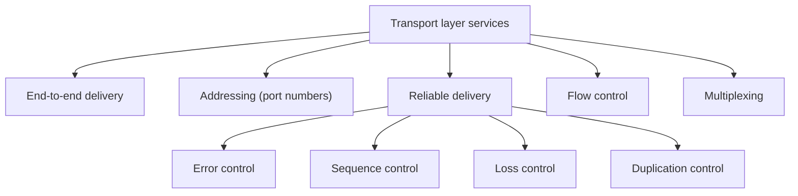
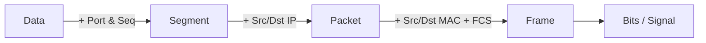

# نماذج الشبكات والـ Encapsulation — Lecture 5: Network Models (OSI & TCP/IP)

> [!NOTE]
> المحاضرة دي عن **إزاي البيانات بتتحضّر عشان تتبعت على الشبكة**. هنشرح **نموذج OSI** بطبقاته السبعة ووظيفة كل طبقة، وبعدين **نموذج TCP/IP** والفرق بينهم، وبعدين **الـ Encapsulation والـ De-encapsulation**، وإزاي الـ **frame** بيتنقل من المصدر للهدف عن طريق الـ switches والـ routers.

**أهداف المحاضرة (Objectives):**
- فهم أنواع نماذج الشبكات (Network Models).
- فهم وظيفة كل طبقة في نموذج OSI.
- التفريق بين OSI و TCP/IP.
- تعريف الـ data encapsulation وإزاي بيحصل.
- فهم إزاي الـ frames بتتنقل من المصدر للهدف.

---

## 1. يعني إيه Network Model؟

> **Network models** are **reference models** for how applications can communicate over a network. There are two common models: the **OSI seven-layer model** and the **TCP/IP model**.

يعني الـ model هو **"خريطة"** بتقسّم عملية الاتصال لـ **طبقات (layers)**، كل طبقة ليها **وظيفة محددة**، والـ **protocols** اللي شغالة فيها بتقدّم حلول للوظيفة دي.

---

## 2. نموذج OSI ذو الطبقات السبعة — OSI Seven-Layer Model

**OSI = Open Systems Interconnection**. لما بنشرح الطبقات **من 7 لـ 1** ده اسمه **"Top-down approach"**.

| رقم الطبقة | الطبقة | الوظيفة باختصار | وحدة البيانات (PDU) |
|---|---|---|---|
| **7** | **Application** | واجهة المستخدم مع الشبكة | Data |
| **6** | **Presentation** | ترجمة، ضغط، تشفير | Data |
| **5** | **Session** | فتح وإدارة وقفل الجلسات | Data |
| **4** | **Transport** | توصيل موثوق process-to-process | **Segment** |
| **3** | **Network** | العنونة المنطقية (IP) والتوجيه | **Packet** |
| **2** | **Data-Link** | MAC addresses، frames، اكتشاف الأخطاء | **Frame** |
| **1** | **Physical** | تحويل البتات لإشارات على الوسط | **Bits / Signal** |

> [!TIP]
> **جملة للحفظ (من فوق لتحت):** **A**ll **P**eople **S**eem **T**o **N**eed **D**ata **P**rocessing = Application · Presentation · Session · Transport · Network · Data-Link · Physical.
>
> **ومن تحت لفوق:** **P**lease **D**o **N**ot **T**hrow **S**ausage **P**izza **A**way.

---

### 2.1 الطبقة 7: Application Layer

- **أعلى طبقة** في OSI.
- بتعمل **process-to-process communication** وبتقدم **خدمات للمستخدم (user services)**.
- هي **الواجهة (interface)** بين **تطبيقات المستخدم** والشبكة اللي تحتها.
- الطبقة اللي فيها **تفاعل الإنسان** مع البرامج.
- **مثال:** فتح صفحة ويب محتاج **HTTP/HTTPS** · الإيميل محتاج **POP3 أو IMAP** (استقبال) و **SMTP** (إرسال).

| النوع | البروتوكولات |
|---|---|
| **Browsing** (تصفح) | **HTTP، HTTPS** |
| **File Transfer** (نقل ملفات) | **FTP، FTPS** |
| **Email** | **POP3، SMTP** (و IMAP) |
| **Remote Administration** (إدارة عن بعد) | **Telnet** |
| **Network Management** (إدارة الشبكة) | **SNMP** |

### 2.2 الطبقة 6: Presentation Layer

بتعمل **ترجمة وضغط وتشفير** للبيانات قبل الإرسال:

| الوظيفة | الشرح | أمثلة |
|---|---|---|
| **Translation** (ترجمة) | البيانات بتبقى حروف وأرقام، ولازم **تتحول لـ bitstreams** قبل الإرسال | **ASCII، EBCDIC، Unicode** |
| **Data Compression** (ضغط) | **تقليل عدد البتات** المطلوب إرسالها، وده **بيحسّن الـ throughput** | **Lossless، Lossy** |
| **Encryption / Decryption** (تشفير) | للأمان: **encryption** عند الإرسال و **decryption** عند المستقبل | **SSL** (Secure Socket Layer) |

### 2.3 الطبقة 5: Session Layer

- مسؤولة عن **فتح (establishing)** و**إدارة (managing)** و**التحقق (authenticating)** و**قفل (terminating)** الجلسات.
- زي ما في الشكل: العميل **يطلب** ← السيرفر يعمل **Authentication** و **Authorization** ← **Session established**.

### 2.4 الطبقة 4: Transport Layer

> The transport layer provides **reliable process-to-process message delivery** and **error recovery**.

| الخدمة | الشرح |
|---|---|
| **End-to-end delivery** | **TCP (connection-oriented):** بيتأكد إن **كل البيانات وصلت صح** · **UDP (connectionless):** **مش فارق معاه** لو البيانات وصلت كلها، **ومش بيعيد** الإرسال |
| **Addressing** | بيضيف **Port number** لكل segment عشان يعرف أنهي **تطبيق (process)** |
| **Segmentation + Sequencing** | بيقسّم البيانات لـ **segments** ويدي كل واحد **sequence number**؛ المستقبل يعرف **العدد الكلي** و**يرتّبهم** تاني |
| **Flow control** | بيظبط السرعة: سيرفر **100 Mbps** بيبعت لجهاز **10 Mbps** ← بيبطّأ لـ **10 Mbps** |
| **Reliable delivery** | لو segment **ضاع** ← **Automatic Repeat Request (ARQ)**، ويشمل error و sequence و loss و duplication control |
| **Multiplexing / Demultiplexing** | بيجمّع بيانات من **تطبيقات كتير** (Facebook، Google، email، web) على نفس الاتصال، وكل segment فيه **source port و destination port** |

### 2.5 الطبقة 3: Network Layer

- بتعمل **Logical addressing**: بتقسّم الـ segments لـ **packets** وتضيف **header** فيه **IP address المرسل والمستقبل**.

| الوظيفة | الشرح |
|---|---|
| **Logical Addressing** | **IPv4، IPv6** (source & destination) |
| **Path Determination** | تحديد **سلسلة الـ routers** اللي الـ packet هتعدّي عليها من المصدر للهدف |
| **Forwarding** | عملية **العبور من نقطة تبادل واحدة (single interchange)** |

### 2.6 الطبقة 2: Data-Link Layer

- بتضمن إن الـ packets **تتنقل من غير أخطاء**، وبتحدد **البروتوكول الفيزيائي المناسب**.
- ليها **طبقتين فرعيتين (sublayers)**:

| الـ Sublayer | الوظيفة |
|---|---|
| **LLC** (Logical Link Control) | بتتكلم مع **نظام التشغيل** (عن طريق الـ **device drivers**) للـ **synchronization** و **flow control** و **error checking** |
| **MAC** (Media Access Control) | **تحويل الـ IP packets لـ frames** بإضافة **MAC address المرسل والمستقبل** و **FCS** (Frame Check Sequence)، و **CSMA/CD** (Carrier Sense Multiple Access with Collision Detection) |

> [!IMPORTANT]
> الـ **Frame** = **MAC header** + **IP header** + **Port/Seq** + **Data** + **FCS** (في الآخر، **trailer** لاكتشاف الأخطاء).

### 2.7 الطبقة 1: Physical Layer

- بتعمل **encoding/decoding** للبتات لـ **إشارات فيزيائية** وتبعتها على الوسط.

| الوظيفة | الشرح |
|---|---|
| **Modulation** | تحويل البيانات لموجات بإضافة **carrier signal** |
| **Multiplexing** | تقسيم قناة الاتصال لـ **قنوات منطقية** |
| **Transmission** | **نمط الاتصال (communication mode)**: اتجاه تدفق البيانات (simplex/half/full duplex) |
| **Physical media** | نوع الوسط: **Copper** (إشارة كهربية) · **Fiber-Optic** (إشارة ضوئية) · **Air** (إشارة راديو) |

> [!NOTE]
> لاحظ إن **Modulation و Multiplexing و Transmission modes و Physical media** هي **بالظبط** مواضيع المحاضرة التانية، يعني المحاضرة التانية كلها **شغل الـ Physical layer**.

---

## 3. نموذج TCP/IP (Internet Model)

> The **TCP/IP model** is a **compact design** of the OSI model consisting of **four layers**, where the **5th, 6th and 7th layers** of OSI are represented by the **Application layer** in TCP/IP.

| OSI | TCP/IP | البروتوكولات |
|---|---|---|
| Application + Presentation + Session | **Application** | **HTTP، FTP، SMTP، DNS، SNMP، Telnet، POP3** |
| Transport | **Transport** | **TCP، UDP** |
| Network | **Network** (Internet) | **IP، IGMP، ICMP، ARP** |
| Data-Link + Physical | **Link** (Network Access) | **Ethernet، ATM، Frame relay** |

> [!NOTE]
> السلايد بيرسم الـ TCP/IP بـ **Link و Physical** منفصلين، لكن التعريف بيقول **"4 layers"**: Application، Transport، Network، و Link (اللي بتشمل الـ Data-Link والـ Physical).

| | **OSI** | **TCP/IP** |
|---|---|---|
| عدد الطبقات | **7** | **4** |
| Application/Presentation/Session | 3 طبقات منفصلة | **طبقة واحدة (Application)** |
| النوع | **Reference model** نظري | **Compact**، وهو اللي **الإنترنت شغال بيه** |

---

## 4. الـ Data Encapsulation

> **Encapsulation** is how network protocols work together in layers by **dividing data into packets** and **attaching extra information (headers)** to each packet in order to transmit data. It takes place on the **sender's side**.
>
> **De-encapsulation** occurs at the **receiver's side**, where the attached information is **removed** to obtain the original data (the **reverse** of encapsulation).

> [!EXAMPLE]
> **تشبيه الجواب:** إنت بتكتب جواب (Application) ← تترجمه وتغلّفه (Presentation) ← تتفق مع المكتب (Session) ← قسم البريد يديله **tracking number** (Transport) ← يتحدد **العنوان والمسار** (Network) ← يتحط في عربية/طيارة (Data-Link) ← يتنقل فعليًا (Physical). وعند المستقبل بيحصل العكس.

### 4.1 الـ Encapsulation في OSI (المرسل: User1 بيبعت إيميل)

| الطبقة | اللي بيحصل |
|---|---|
| **Application** | **Send email** |
| **Presentation** | **Translate · compress · encrypt** (01001101) |
| **Session** | **Session established** |
| **Transport** | **Add Port No. & sequence No.** ← **Segment** |
| **Network** | **Add source & destination IP** ← **Packet** |
| **Data-Link** | **Add source & destination MAC & FCS** ← **Frame** |
| **Physical** | **Signal** على الوسط |

### 4.2 الـ De-encapsulation (المستقبل: User2)

| الطبقة | اللي بيحصل |
|---|---|
| **Physical** | استقبال الـ signal |
| **Data-Link** | **Remove source & destination MAC & check FCS** |
| **Network** | **Remove source & destination IP** |
| **Transport** | **Remove Port No. & check sequence No.** |
| **Session** | **Session terminated** |
| **Presentation** | **Translate · decompress · decrypt** |
| **Application** | **Receive email** |

### 4.3 جدول الـ Encapsulation

| OSI Model | TCP/IP Model | اسم البيانات (Encapsulation term) | الشكل |
|---|---|---|---|
| Application | Application | **Data** | Data |
| Presentation | ↑ | **Data** | Data |
| Session | ↑ | **Data** | Data |
| Transport | Transport | **Segment** | Segment header + Data |
| Network | Network | **Packet** | Packet header + Segment header + Data |
| Data-Link | Data-Link | **Frame / Datagram** | Frame header + Packet header + Segment header + Data + **Frame trailer** |
| Physical | Physical | **Signal (bits in a wire)** | 0101… |

> [!EXAM]
> **Data ← Segment ← Packet ← Frame ← Bits**
> - **Port number** ← Transport (Segment).
> - **IP address** ← Network (Packet).
> - **MAC address + FCS** ← Data-Link (Frame).

---

## 5. انتقال الـ Frame من المصدر للهدف — Frame Switching

> [!IMPORTANT]
> لما الـ frame بيعدّي على **router**:
> - **الـ IP (source & destination) بيفضل ثابت** من المصدر للهدف.
> - **الـ MAC (source & destination) بيتغير في كل hop**؛ كل router بيشيل الـ frame header القديم ويحط **MAC بتاعه كـ source** و **MAC الجهاز اللي بعده كـ destination**.

| الجهاز | الطبقات اللي بيشتغل لحدها | بيبص على |
|---|---|---|
| **Switch** | **Link + Physical** (Layer 2) | **MAC address** |
| **Router** | **Network + Link + Physical** (Layer 3) | **IP address** و **routing table** |
| **Host** (المصدر/الهدف) | **الـ 5 طبقات** كلها | كل حاجة |

**المثال في الشكل:**
- المصدر **10.5.2.10**: الـ message (M) ← segment (Hₜ M) ← packet (Hₙ Hₜ M) ← frame (Hₗ Hₙ Hₜ M).
- الـ **switch** بيفك لحد الـ **link** بس ويبعت.
- الـ **router** بيفك لحد الـ **network**، يبص على الـ **routing table** ويختار الـ interface، ويعمل frame جديد.
- الهدف **172.16.10.50** بيفك كل حاجة لحد الـ message.

### الـ Routing Table

| Network Destination | CIDR | Gateway | Interface | Metric |
|---|---|---|---|---|
| 172.16.0.0 | /16 | 10.5.2.4 | Eth01 | 10 |
| 10.0.0.0 | /8 | 172.16.10.1 | Eth02 | 5 |

**الـ Metric** (تكلفة المسار) بيعتمد على **واحد أو أكتر** من: **Hop count · Path reliability · Path speed · Load · Bandwidth · Latency**.

---

## ✅ خلاصة المحاضرة في 10 نقط

1. **Network models** = نماذج مرجعية للاتصال: **OSI (7 طبقات)** و **TCP/IP (4 طبقات)** · الشرح من 7 لـ 1 = **Top-down approach**.
2. **Application (7):** واجهة المستخدم · HTTP/HTTPS · FTP/FTPS · POP3/SMTP · Telnet · SNMP.
3. **Presentation (6):** **Translation** (ASCII، EBCDIC، Unicode) · **Compression** (lossless/lossy) · **Encryption** (SSL).
4. **Session (5):** establish · manage · authenticate · terminate الجلسات.
5. **Transport (4):** process-to-process · **segments + sequence + port** · **TCP** (reliable) / **UDP** · flow control · ARQ · multiplexing.
6. **Network (3):** **logical addressing (IP)** · **path determination** · **forwarding** ← **packet**.
7. **Data-Link (2):** **LLC** (OS/drivers، sync، flow، error) + **MAC** (MAC addresses + **FCS** + **CSMA/CD**) ← **frame**.
8. **Physical (1):** modulation · multiplexing · transmission mode · media (copper/fiber/air) ← **bits**.
9. **TCP/IP:** Application (= 5+6+7) · Transport (TCP/UDP) · Network (IP، ICMP، IGMP، ARP) · Link (Ethernet، ATM، Frame relay).
10. **Encapsulation** (عند المرسل): Data ← Segment ← Packet ← Frame ← Bits · **De-encapsulation** عكسها · الـ **IP ثابت** والـ **MAC بيتغير** كل hop · Switch = L2 · Router = L3 · **Metric**: hop count، reliability، speed، load، bandwidth، latency.
