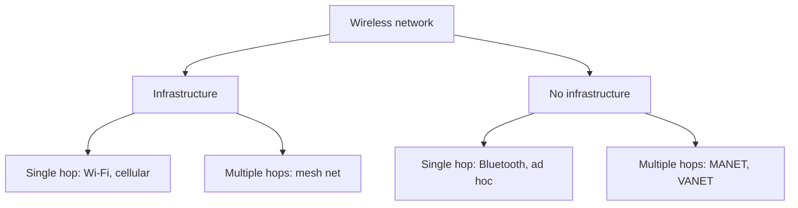
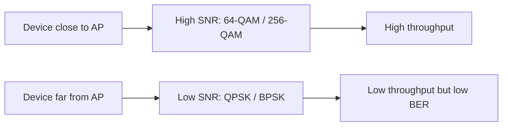
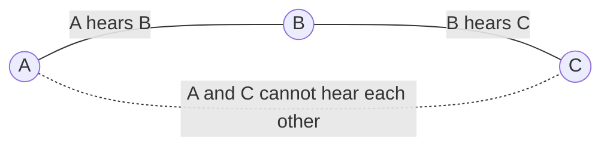

# الشبكات اللاسلكية — Lecture 10: Wireless Networks

> [!NOTE]
> المحاضرة دي عن **الشبكات اللاسلكية (Wireless Networks)**: إزاي بنستخدم **موجات الراديو (RF)** بدل الكابلات. هنبدأ بالـ **electromagnetic spectrum** وليه اخترنا الـ RF، وبعدين نقارن **2.4 GHz** بـ **5 GHz**، وبعدين **عناصر الشبكة اللاسلكية**، وخصائص الـ **wireless link** (الـ SNR والـ BER والـ multipath)، وأنواع الـ **modulation**، ومشكلة الـ **hidden terminal**، وفي الآخر **معايير Wi-Fi (802.11)**.

**أهداف المحاضرة (Objectives):**
- فهم الـ electromagnetic spectrum ونطاقات الـ Radio Frequency.
- التفريق بين نطاق **2.4 GHz** و **5 GHz**.
- التعرف على عناصر الشبكة اللاسلكية.
- فهم الـ **wireless modulation**.
- تعريف **Wi-Fi: 802.11 wireless LANs**.

> [!WARNING]
> قائمة الأهداف في أول السلايدات فيها كمان: **active vs passive scanning** و **wireless frame addressing** و **personal area networks** و **cellular networks**. **بس مفيش ولا سلايد في المحاضرة بتشرحهم**، عشان كده مش موجودين هنا. (عنوان الـ unit اتعدّل لـ "Wireless Networks" بس.)

---

## 1. يعني إيه شبكة لاسلكية؟ — What is a Wireless Network?

> A **wireless network** is a computer network that makes use of **Radio Frequency (RF)** connections between nodes in the network.

- عدد مشتركي **الموبايل (wireless)** بقى أكتر من مشتركي التليفون السلك بنسبة **5 لـ 1**.
- عدد الأجهزة **اللاسلكية** المتصلة بالإنترنت بقى **بيساوي** عدد الأجهزة السلك.

فيه **تحديين مهمين (مختلفين)**:

| التحدي | المعنى |
|---|---|
| **Wireless** | الاتصال نفسه عن طريق **link لاسلكي** (الهوا) |
| **Mobility** | التعامل مع المستخدم **المتحرك** اللي بيغيّر **نقطة اتصاله** بالشبكة |

---

## 2. الطيف الكهرومغناطيسي — Electromagnetic Spectrum

الموجات الكهرومغناطيسية بتترتب حسب **التردد (frequency)** من الأقل للأعلى:

| النوع | الاستخدام |
|---|---|
| **Radio / TV Broadcast** | بث الراديو والتلفزيون |
| **Microwave** (من **3 GHz** لـ **300 GHz**) | Radar، الطبخ، الاتصالات |
| **Infrared** | الحرارة من الشمس والنار والأجسام والإنسان |
| **Visible light** | بتخلّي العين تشوف |
| **Ultraviolet** | بيتمتص في الجلد · بيتستخدم في لمبات الفلورسنت |
| **X-Rays** | تصوير جوه الجسم والأجسام |
| **Gamma Rays** | الاستخدامات الطبية |

### ليه بنستخدم RF للاتصال؟ — Why RF Waves?

- الـ **Ionosphere** منطقة **مشحونة كهربيًا** في الغلاف الجوي العالي، فيها تركيز كبير من **الأيونات (ions)** و**الإلكترونات الحرة**.
- هي **بتمنع** الـ **UV و X-Rays و Gamma rays** إنها توصل الأرض.
- موجات الـ **RF** **مش ضارة** للإنسان.
- الـ ionosphere **بتعكس** موجات الـ RF (طبقتي **E** و **F**)، فالموجة بتفضل **ترتد** بين سطح الأرض والـ ionosphere آلاف الكيلومترات.

| نوع الموجة | الوصف |
|---|---|
| **Skywaves** | موجات بترتد بين الأرض والـ ionosphere **آلاف الكيلومترات** |
| **Space waves** | **Microwaves** بتتستخدم للاتصال بالأقمار الصناعية أو أي حاجة **برا الغلاف الجوي** |
| **Ground wave** | موجات **Low و Medium frequency** بتمشي **على سطح الأرض** (TV/AM/FM broadcast) |

### أنواع موجات الـ RF — Types of RF Waves

| النطاق (Band) | التردد | الطول الموجي | الاستخدام |
|---|---|---|---|
| **ELF** (Extremely Low) | 3–30 Hz | 100000–10000 km | اتصالات تحت الماء |
| **SLF** (Super Low) | 30–300 Hz | 10000–1000 km | تيار AC |
| **VLF** (Very Low) | 3–30 kHz | 100–10 km | الملاحة والإنذارات |
| **LF** (Low) | 30–300 kHz | 10–1 km | AM radio |
| **MF** (Medium) | 300–3000 kHz | 1 km–100 m | الطيران |
| **HF** (High) | 3–30 MHz | 100–10 m | Shortwave radio |
| **VHF** (Very High) | 30–300 MHz | 10–1 m | FM radio |
| **UHF** (Ultra-High) | 300–3000 MHz | 1 m–10 cm | التلفزيون، الموبايل، GPS |
| **SHF** (Super High) | 3–30 GHz | 10–1 cm | الأقمار الصناعية، الاتصالات اللاسلكية |
| **EHF** (Extremely High) | 30–300 GHz | 1 cm–1 mm | Remote sensing، الفلك |

> [!TIP]
> **كل ما التردد يزيد، الطول الموجي يقل**: λ = c / f. بنفحص بالأرقام: عند **300 MHz** الطول = 3×10⁸ ÷ 3×10⁸ = **1 متر** (بداية UHF)، وعند **3 MHz** = **100 متر** (بداية HF). الجدول متسق مع المعادلة دي.

> [!TIP]
> **ترتيب النطاقات (من الأقل للأعلى):** ELF · SLF · VLF · LF · MF · HF · VHF · UHF · SHF · EHF.
> الـ **Wi-Fi** شغال في **UHF/SHF** (2.4 و 5 GHz).

### الموجات التانية — Other Electromagnetic Waves

| الموجة | استخدامها في الاتصال |
|---|---|
| **Infrared** | من **الحرارة** · مش مرئي للعين · للاتصال **القصير/المتوسط**: ريموت التلفزيون، التحكم في الروبوتات، الميكروفون اللاسلكي، السماعات، المودمات |
| **Visible light** | في **الـ fiber-optic**: نبضات ضوء بتتحرك جوه ألياف زجاج من مصدر لمستقبل |
| **Ultraviolet** | **ضار** بجسم الإنسان · **مش بيتستخدم في الاتصالات** (للمجالات الصناعية) |
| **X-rays & Gamma** | **ضارة جدًا** (بتسبب طفرات في الجينات) · **مش بتتستخدم في الاتصالات**، بتتستخدم في الطب |

---

## 3. نطاق 2.4 GHz مقابل 5 GHz — 2.4 GHz vs 5 GHz Bands

### 3.1 نطاق 2.4 GHz

- النطاق مقسوم لـ **14 قناة (channels)** ثابتة التردد، **عرض كل قناة 20 MHz**.
- بيدي **إشارة أحسن على المسافات الطويلة** وبيخترق **الأجسام الصلبة** (الحيطان) أحسن.
- **العيوب (Cons):** **نطاق ضيق (Narrow band)** · **زحمة وتشويش (congestion and noise)** · **تداخل (interference)** مع أجهزة تانية.

> [!WARNING]
> **تنبيه على كلام السلايد:** السلايد بيقول "القنوات 12 و 13 مسموحة في العالم كله بس في أمريكا بـ low power". الصيغة دي مش دقيقة: **القنوات 1–11** هي المسموحة في **أمريكا**، **12 و 13** مسموحين في **معظم دول العالم**، و**القناة 14** **اتحظرت** في أمريكا ومعظم العالم ومسموحة في **اليابان** بس (ده الجزء اللي السلايد صح فيه). وكمان: القنوات متباعدة 5 MHz بس وعرضها 20 MHz، فالقنوات **متداخلة** وعمليًا **1 و 6 و 11** بس هم اللي **مش بيتداخلوا**.

### 3.2 نطاق 5 GHz

- النطاق مقسوم لـ **24 قناة non-overlapping** (مش متداخلة)، **عرض كل واحدة 20 MHz**.
- منظمة في مجموعات: **U-NII-1** · **U-NII-2A** · **U-NII-2C** (U-NII-2 Extended) · **U-NII-3** · **ISM**.
  - **U-NII = Unlicensed National Information Infrastructure** · **ISM = Industrial, Scientific, and Medical**.
- بتقدر تجمّع القنوات لـ **40 MHz** و **80 MHz** و **160 MHz** (سرعة أعلى).
- **العيب:** بيغطي **مسافة أقل** و**أضعف في اختراق** الأجسام الصلبة من 2.4 GHz.

| وجه المقارنة | **2.4 GHz** | **5 GHz** |
|---|---|---|
| عدد القنوات | **14** (متداخلة) | **24 non-overlapping** |
| المدى (Range) | **أطول** | **أقصر** |
| اختراق الحيطان | **أحسن** | **أضعف** |
| الزحمة والتداخل | **أكتر** | **أقل** |
| الطول الموجي (تقريبًا) | ≈ **12.5 cm** | ≈ **6 cm** |

> [!EXAM]
> السؤال الكلاسيكي: **أنهي نطاق بيغطي مسافة أطول ويخترق الحيطان أحسن؟** ← **2.4 GHz** (لكنه **أكتر زحمة**). **5 GHz** ← **قنوات أكتر، تشويش أقل، مدى أقصر**.

---

## 4. عناصر الشبكة اللاسلكية — Elements of a Wireless Network

### 4.1 الأجهزة اللاسلكية — Wireless Hosts

- **Laptop, smartphone, IoT**.
- بتشغّل **تطبيقات (applications)**.
- ممكن تكون **ثابتة (stationary / non-mobile)** أو **متحركة (mobile)**.
- **Wireless مش دايمًا معناه Mobility** (مثلًا PC ثابت بيتصل Wi-Fi).

### 4.2 محطة الاتصال — Base Station

- غالبًا **متوصلة بالشبكة السلك (wired network)**.
- **Relay**: مسؤولة عن إرسال الـ packets بين **الشبكة السلك** والأجهزة **اللاسلكية** في **منطقتها (area)**.
- **أمثلة:** **cell towers** و **802.11 access points**.

### 4.3 الـ Wireless Link

- بتوصّل **الأجهزة المتحركة** بالـ **base station**، وممكن تتستخدم كمان كـ **backbone link**.
- **Multiple access protocol** بينسّق الوصول للـ link (مين يبعت إمتى).
- فيه **سرعات ومسافات ونطاقات ترددات** مختلفة.

### 4.3 أوضاع التشغيل — Network Modes

**(أ) Infrastructure mode**

- الـ **base station** هي اللي **بتوصّل** الأجهزة بالشبكة السلك.
- **Handoff:** الجهاز المتحرك **بيغيّر** الـ base station اللي بتوفّر له الاتصال بالشبكة السلك.

**(ب) Ad-hoc mode**

- **مفيش base stations**.
- الـ nodes بتبعت **بس للـ nodes اللي في مدى الـ link**.
- الـ nodes **بتنظّم نفسها** في شبكة وتعمل **routing بين بعض**.

### 4.4 تصنيف الشبكات اللاسلكية — Wireless Network Taxonomy

| | **Single hop** | **Multiple hops** |
|---|---|---|
| **Infrastructure** (فيه APs) | الجهاز بيتصل بـ **base station** (Wi-Fi, cellular) اللي متصلة بالإنترنت الأكبر | الجهاز ممكن يضطر **يعدّي من عدة nodes لاسلكية** عشان يوصل للإنترنت: **mesh net** |
| **No infrastructure** | **مفيش base station** ولا اتصال بالإنترنت (**Bluetooth**, ad hoc nets) | **مفيش base station** ولا إنترنت، وممكن يحتاج **relay** لحد ما يوصل لـ node: **MANET, VANET** |

---

## 5. خصائص الـ Wireless Link — Wireless Link Characteristics

الـ wireless link **مختلف عن الـ wired** في 3 حاجات مهمة بتخلّي الاتصال **أصعب** (حتى لو point-to-point):

| الخاصية | المعنى |
|---|---|
| **Decreased signal strength** | الإشارة **بتضعف (attenuates / path loss)** وهي بتعدّي في المادة |
| **Interference from other sources** | التردد (زي 2.4 GHz) **مشترك** بين أجهزة كتير (Wi-Fi, cellular, motors) |
| **Multipath propagation** | الإشارة **بتنعكس** على الأجسام والأرض وبتوصل للمستقبل **في أوقات مختلفة شوية** |

### الـ SNR والـ BER — SNR vs BER

- **SNR = Signal-to-Noise Ratio**: **كل ما يكبر، أسهل نفصل الإشارة عن الـ noise** (حاجة كويسة).
- **BER = Bit Error Rate**.
- لطبقة فيزيائية (physical layer) معيّنة: **نزوّد القدرة (power) ← SNR يزيد ← BER يقل**.
- لـ SNR معيّن: **اختار الـ physical layer اللي بيحقق الـ BER المطلوب** ويدّي **أعلى throughput**.
- الـ SNR **بيتغير مع الحركة (mobility)** ← لازم **تتأقلم الـ physical layer ديناميكيًا** (modulation technique, rate).

| Modulation | السرعة (في السلايد) |
|---|---|
| **BPSK** | 1 Mbps |
| **QAM16** | 4 Mbps |
| **QAM256** | 8 Mbps |

> [!IMPORTANT]
> **المقايضة (Trade-off):** الـ modulation **الأسرع (QAM256)** محتاج **SNR عالي** (إشارة نضيفة). لو الـ SNR وقع بسبب بُعد الجهاز، الجهاز **بينزل لـ modulation أبطأ** (زي BPSK) عشان يحافظ على **BER** مقبول.

---

## 6. الـ Wireless Modulation

**Modulation** = تحميل **البتات الرقمية** على **موجة حاملة (Carrier Wave)** عشان تتبعت.

- في أبسط صورة: **بت واحد لكل symbol** (**One bit per symbol**) (زي **PSK/BPSK**).

### 6.1 QPSK — Quadrature Phase Shift Keying

- **2 bits per symbol**: البيانات بتتشفّر كـ **واحدة من 4 phases**.
- بتنقل **ضعف** البيانات اللي بينقلها **PSK**.

| Symbol (البتات) | الـ Phase |
|---|---|
| **11** | 45° |
| **01** | 135° |
| **00** | 225° |
| **10** | 315° |

> [!NOTE]
> في السلايد الأرقام اللي ظاهرة بوضوح: **135° = 01** · **225° = 00** · **315° = 10**، والرابع **11** على **45°** (الدائرة بتتقسم 4 أجزاء كل **90°**).

### 6.2 QAM — Quadrature Amplitude Modulation

- **QAM** = modulation **متقدم** مستخدم على نطاق واسع في **Wi-Fi**.
- **بيجمع بين Phase modulation و Amplitude modulation**.
- في **16-QAM**: بتاخد **4 bits** وبتتقسم: **2 bits** للـ **phase** و **2 bits** للـ **amplitude**، فبيطلع **16 symbol** مختلف.

| الـ Modulation | عدد الـ symbols | Bits per symbol |
|---|---|---|
| **BPSK** | 2 | **1** |
| **QPSK** | 4 | **2** |
| **16-QAM** | 16 | **4** |
| **64-QAM** | 64 | **6** |
| **256-QAM** | 256 | **8** |

> [!TIP]
> **bits per symbol = log₂(عدد الـ symbols)**. (راجعتها بالحساب: log₂ 16 = 4، log₂ 64 = 6، log₂ 256 = 8.)

### التأقلم مع البُعد — Rate Adaptation

- لما الجهاز **يبعد** عن المصدر وبيئة الـ RF تبقى **أصعب**: **بيقلل الـ modulation rate** (يستخدم symbols أقل) **عشان يحافظ على الـ BER** المطلوب.
- زي ما بيحصل لما تبعد عن الراوتر: السرعة بتقل بس الاتصال بيفضل شغال.

---

## 7. مشكلة الـ Hidden Terminal

لما يبقى فيه **أكتر من sender و receiver** بيظهروا مشاكل **زيادة** غير الـ multiple access:

- **B و A** بيسمعوا بعض.
- **B و C** بيسمعوا بعض.
- **A و C مش بيسمعوا بعض** (بعيد عن بعض أو بسبب **signal attenuation**) ← **A و C مش عارفين** إنهم **بيعملوا interference عند B**.

> [!EXAMPLE]
> **A** بتبعت لـ **B**، وفي نفس الوقت **C** مش سامع A فبيفتكر الوسط فاضي ويبعت لـ **B**. الاتنين بيوصلوا عند **B** **في نفس الوقت** ← **collision**. ده اسمه **Hidden terminal problem**، وده سبب إن Wi-Fi بيستخدم **CSMA/CA** (تجنّب التصادم) بدل **CSMA/CD**.

---

## 8. معايير Wi-Fi: 802.11 Wireless LANs

| المعيار IEEE 802.11 | السنة | أقصى سرعة | المدى | التردد |
|---|---|---|---|---|
| **802.11a** (Wi-Fi 2) | 1999 | **54 Mbps** | 70 m | **5 GHz** |
| **802.11b** (Wi-Fi 1) | 1999 | **11 Mbps** | 30 m | **2.4 GHz** |
| **802.11g** (Wi-Fi 3) | 2003 | **54 Mbps** | 30 m | **2.4 GHz** |
| **802.11n** (Wi-Fi 4) | 2009 | **600 Mbps** | 70 m | **2.4 و 5 GHz** |
| **802.11ac** (Wi-Fi 5) | 2013 | **1.3 Gbps** | 70 m | **5 GHz** |
| **802.11ax** (Wi-Fi 6) | 2019 | **10 Gbps** | 70 m | **2.4 و 5 GHz** |
| **802.11af** | 2014 | **35–560 Mbps** | **1 Km** | unused **TV bands** (54–790 MHz) |
| **802.11ah** | 2017 | **347 Mbps** | **1 Km** | **900 MHz** |

- **كلهم** بيستخدموا **CSMA/CA** للـ multiple access.
- كلهم عندهم نسخة **base-station (infrastructure)** ونسخة **ad-hoc**.

> [!NOTE]
> بعض خانات الجدول (أرقام الأجيال والسنين) مش واضحة في نسخة الـ PDF الممسوحة، فاتكمّلت من المعلومات المعروفة للمعايير دي واتأكدت إنها متسقة مع باقي الجدول.

> [!EXAM]
> **للحفظ:** **b = 11 Mbps / 2.4** · **a = 54 / 5** · **g = 54 / 2.4** · **n = 600 / (2.4+5)** · **ac = 1.3 Gbps / 5** · **ax = 10 Gbps / (2.4+5)**. **af و ah** هم الوحيدين بمدى **1 Km**.
> الأجيال: **b=Wi-Fi 1 · a=Wi-Fi 2 · g=Wi-Fi 3 · n=Wi-Fi 4 · ac=Wi-Fi 5 · ax=Wi-Fi 6**.
