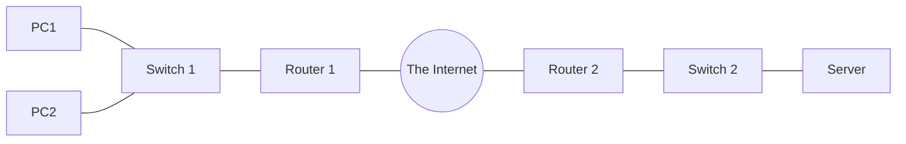

# Section 1: أجهزة الشبكة والكابلات — Network Devices

> [!NOTE]
> السكشن ده مقدمة عملية عن **مكونات الشبكة**: يعني إيه network، الفرق بين **Client** و **Server**، وظيفة كل جهاز (**Switch** و **Router** و **Firewall**)، وبعدين الـ **interfaces والكابلات** والـ **Ethernet** وليه محتاجين **protocols/standards**.

---

## 1. يعني إيه شبكة؟ — What is a Network?

> **A computer network is a digital telecommunications network which allows nodes to share resources.**
> يعني شبكة اتصالات رقمية بتخلّي الـ **nodes** تتشارك الموارد.

- الأجهزة بتتبادل البيانات عن طريق **connections (data links)** بين الـ nodes.
- الـ data links ممكن تتعمل على **cable media** (أسلاك نحاس أو **optic cables**) أو **wireless media** زي **Wi-Fi**.

**الأجهزة اللي ممكن تتواجد في الشبكة:** **end hosts / endpoints** (PC, laptop, client, server) و **switch** و **router** و **firewall**.

---

## 2. الـ Client والـ Server

| | التعريف |
|---|---|
| **Client** | جهاز **بيستخدم (يطلب)** خدمة بيوفّرها server |
| **Server** | جهاز **بيوفّر وظائف أو خدمات** للـ clients |

> [!EXAMPLE]
> - **PC1** بيقول: "Give me image.jpg, please" ← **PC2 (server)** يرد: "Here you are" ويبعتله الصورة.
> - جهازك (**client**) بيطلب فيديو من **YouTube Server** عن طريق **The Internet** ← السيرفر يبعتله الفيديو.

> [!IMPORTANT]
> **نفس الجهاز ممكن يكون client في موقف، و server في موقف تاني.**

---

## 3. الـ Switches

مثال السلايدات: فيه فرعين (**New York Branch** و **Tokyo Branch**). كل فرع فيه **LAN (Local Area Network)** فيها PCs و servers متوصلين على **Switch** (Sw1 و Sw2)، والفرعين بيتصلوا ببعض عن طريق **Routers** و **The Internet**.

**الـ Switches:**
- عندها **interfaces/ports كتير** لتوصيل الـ end hosts (عادةً **24+**).
- بتوفّر اتصال بين الأجهزة **جوه نفس الـ LAN**.
- **مبتوفرش** اتصال **بين الـ LANs** أو **على الإنترنت**.
- أمثلة: **Catalyst 7200** و **Catalyst 3650**.

## 4. الـ Routers

**الـ Routers:**
- عندها **interfaces أقل** من الـ switches.
- بتتستخدم لتوفير اتصال **بين الـ LANs**.
- عشان كده بتتستخدم في **إرسال البيانات على الإنترنت**.
- أمثلة: **ISR 1000** و **ISR 700** و **ISR 4000**.

| | **Switch** | **Router** |
|---|---|---|
| عدد الـ ports | **كتير** (24+) | **أقل** |
| الاتصال | **جوه نفس الـ LAN** | **بين الـ LANs / الإنترنت** |

---

## 5. الـ Firewalls

السلايدات بتوضح مثال فيه **Attacker** بيحاول يوصل للشبكة الداخلية، والـ **Firewall** (EWL) بيقعد بين الـ Router والشبكة الخارجية ويقرر إيه اللي يعدّي وإيه اللي يتحجب.

**الـ Firewalls:**
- **بتراقب وتتحكم في الـ network traffic** على حسب **قواعد (rules)** متظبطة.
- ممكن تتحط **جوه الشبكة (inside)** أو **برا الشبكة (outside)**.
- بتتسمى **Next-Generation Firewalls** لما يبقى فيها **إمكانيات filtering أحدث وأكثر تقدمًا**.
- أمثلة: **ASA 5500-X** و **Firepower 2100**.

| | التعريف |
|---|---|
| **Network firewalls** | **أجهزة hardware** بتفلتر الـ traffic **بين الشبكات** |
| **Host-based firewalls** | **برامج (software)** بتفلتر الـ traffic الداخل والخارج من **جهاز واحد** زي PC |

> [!TIP]
> سؤال السلايد: "What about the firewall on your computer?" ← ده **host-based firewall** (زي Windows Firewall).

---

## 6. الـ Interfaces والكابلات — Interfaces and Cables

الـ **Transmission Medium** هو الوسط اللي البيانات بتعدّي فيه، والـ **interfaces/ports** هي نقط التوصيل.

- في الـ switch بتلاقي **10/100/1000Base-T Ports (1–24)**، والـ ports دي **Auto-MDIX** (الجهاز بيعرف لوحده نوع الكابل المناسب) · وفيه **LEDs**: **Link/Act** (حالة الـ link والنشاط) و **Spd** (السرعة).
- الـ connector المستخدم في كابلات الإيثرنت اسمه **RJ-45** (**Registered Jack**).

> [!NOTE]
> الـ **Base-T** معناها كابل **twisted-pair**. الأرقام **10/100/1000** هي السرعات بـ **Mbps** اللي الـ port بيدعمها.

---

## 7. الـ Ethernet

- **Ethernet** هو **مجموعة من الـ network protocols/standards**.
- في الدرس ده بنركّز بس على **أنواع الكابلات** زي ما بتحددها **Ethernet standards**.

### ليه محتاجين Network Protocols/Standards؟

- من غير standards، كل شركة هتعمل **connectors وكابلات وإشارات** بشكل مختلف وأجهزتنا مش هتتفاهم مع بعض.
- مثال السلايد: "**Sorry, your cable doesn't fit**" ← لو الكابل مش على الـ standard، مش هينفع يتوصّل بالـ switch.
- الـ **protocols** بتحدد **قواعد موحدة** (شكل الـ connector، الإشارات، طريقة تبادل البيانات) عشان أي جهازين من أي شركتين يشتغلوا مع بعض.

> [!EXAM]
> **للحفظ:**
> - **Switch** = ports كتير · جوه نفس **LAN** · **Router** = ports أقل · بين **LANs** والإنترنت.
> - **Firewall** = بيراقب ويتحكم في الـ traffic بـ **rules** · **Network** (hardware) vs **Host-based** (software).
> - **Client** = بيطلب · **Server** = بيوفّر · نفس الجهاز ممكن يعمل الاتنين.
> - **RJ-45** = connector الإيثرنت · **Ethernet** = مجموعة standards.
