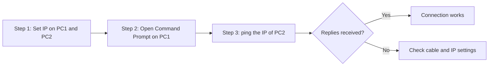
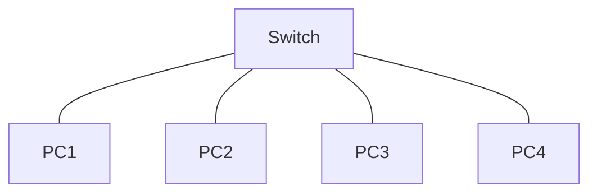

# Section 2: الكابلات وإعداد الـ IP والـ Topologies — Cables & Topologies

> [!NOTE]
> السكشن ده بيشرح **أنواع الكابلات في Packet Tracer (PT)** وإمتى بنستخدم كل واحد، وإزاي **تعمل IP لجهاز كمبيوتر** وتختبر الاتصال بـ **ping**، وأول **topology**: الـ **Star topology**.

---

## 1. أنواع الكابلات في Packet Tracer — Types of Cables in PT

| # | الكابل | الاستخدام |
|---|---|---|
| 1 | **Copper straight-through** | يوصّل **PC بـ Switch أو Hub**، ويوصّل **Router بـ Switch** (أجهزة مختلفة النوع) |
| 2 | **Copper crossover** | يوصّل **جهازين PCs من غير switch أو hub**، وبيعمل **direct link بين switchين** (أجهزة من نفس النوع) |
| 3 | **Fiber optic** | **اتصالات لمسافات طويلة** في الـ data centers |
| 4 | **Console cable** | **إعداد وحل مشاكل (configuring and troubleshooting)** أجهزة الشبكة · الـ **initial setup** و **recovery** للأجهزة |
| 5 | **Serial DCE/DTE** | **توصيل routers** في شبكة serial · وتوصيل switches عن طريق serial interface |
| 6 | **Ethernet crossover** | بيتستخدم في **إعدادات الشبكات الحديثة** |
| 7 | **Rolled cable** | **الإعداد الأولي والـ recovery** لجهاز الشبكة · **وصول مباشر لـ command-line interface (CLI)** للجهاز لما الـ network connectivity تضيع |

> [!TIP]
> **قاعدة سريعة للحفظ:**
> - **أجهزة مختلفة** (PC ↔ Switch، Router ↔ Switch) ← **Straight-through**.
> - **أجهزة نفس النوع** (PC ↔ PC، Switch ↔ Switch) ← **Crossover**.
> - **للـ CLI/إعداد الجهاز** ← **Console (Rolled)**.
> - **مسافات طويلة** ← **Fiber**.

> [!NOTE]
> في الأجهزة الحديثة، الـ **Auto-MDIX** بيخلّي الـ port يتأقلم لوحده فمش بتفرق كتير، لكن في الامتحان والـ lab اتبع القاعدة اللي فوق.

---

## 2. إعداد IP لجهاز كمبيوتر — Setting up an IP Address for a Computer

**الطريقة الأولى (من الـ Config):**
1. اضغط على الـ **Computer**.
2. اضغط على **Config**.
3. اختار **FastEthernet**.
4. في نافذة **IP Configuration** اكتب الـ IP في خانة **IPv4 address**.

**الطريقة التانية (من الـ Desktop):**
1. اضغط على **Desktop**.
2. اختار **IP Configuration**.
3. اكتب الـ IP في **IPv4**، مثال: `192.168.1.10` وبعدين اضغط **Enter**.

---

## 3. اختبار الاتصال بين جهازين — Testing the Connection

### الطريقة 1: باستخدام ping
1. اضغط على الـ **Computer**.
2. اضغط على **Desktop**.
3. اختار **Command Prompt**.
4. اكتب: `ping <IP الجهاز التاني>` ← مثال: `PC> ping 192.168.1.1`

### الطريقة 2: بإرسال packet (Simulation)
1. اضغط على **أيقونة الـ mail** (الظرف).
2. اضغط على **الجهاز الأول** وبعدين **الجهاز التاني**.
3. اضغط على **Simulation** في **أسفل يمين** الشاشة.
4. اضغط على **أيقونة Start (play)**.

> [!EXAMPLE]
> `PC1 = 192.168.1.10` و `PC2 = 192.168.1.1`، من **PC1** تكتب `ping 192.168.1.1` — لو جالك **Reply** يبقى الاتصال شغال.

> [!WARNING]
> لازم **الجهازين يبقوا في نفس الـ network** (نفس الـ network portion) عشان الـ ping يشتغل من غير router.

---

## 4. الـ Topologies — شكل الشبكة وإزاي متصلة ببعض

**الـ Topology** = **شكل الشبكة** وإزاي الأجهزة متوصلة ببعض.

### Star Topology
- **كل الأجهزة (computers) متوصلة على نفس الـ switch**، وبتتواصل عن طريقه.
- الـ **Switch** هو **المركز (center)** والأجهزة حواليه زي النجمة.

