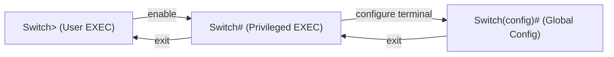

# Section 3: إعداد الـ Switch والفرق بين Hub و Switch — Switch Configuration

> [!NOTE]
> السكشن ده عن **إزاي تدخل على الـ switch وتضبطه من الـ CLI**: الاتصال بـ **console cable**، الـ **command modes** الأساسية، والتنقل بينهم، وتغيير الـ **hostname**، وحماية الـ console بـ **password**. وفي الآخر مقارنة **Hub vs Switch**.

---

## 1. خطوات الدخول على الـ Switch — Switch Configuration

1. وصّل الـ **PC** من منفذ **RS232** بـ **Console Cable** على **Console port** بتاع الـ switch.
2. افتح الـ **PC** ← **Desktop** ← **Terminal**.
3. اضغط **OK** وبعدين **Enter**.

---

## 2. الـ Command Modes الأساسية — Primary Command Modes

| # | الـ Prompt | اسم الـ Mode | الوصف |
|---|---|---|---|
| 1 | `Switch>` | **User EXEC mode** | أول mode بتدخله · **بيسمح بوصول لعدد محدود من الأوامر الأساسية (limited basic commands)** · نفس الكلام في الـ **Router** |
| 2 | `Switch#` | **Privileged EXEC mode** | تقدر تشوف **كل الـ commands** فيه |
| 3 | `Switch(config)#` | **Global Configuration mode** | تقدر تعمل **كل الـ configurations** الموجودة |



### التنقل بين الـ Modes

| من | إلى | الأمر |
|---|---|---|
| `Switch>` | `Switch#` | `enable` |
| `Switch#` | `Switch(config)#` | `configure terminal` (أو `conf t`) |
| `Switch(config)#` | `Switch#` | `exit` |
| `Switch#` | `Switch>` | `exit` |

> [!TIP]
> **كل `exit` بيرجّعك mode واحد لورا.** و `enable` بينقلك من الأول للتاني، و `conf t` من التاني للتالت.

---

## 3. أوامر مهمة

### تغيير اسم الـ Switch — hostname
```
Switch(config)# hostname <الاسم الجديد>
```
- لازم **مسافة (space)** بعد `hostname` وبعدين الاسم.
- عشان **ترجّع الاسم الأصلي**: اكتب `no hostname` (من غير اسم) وده بيرجّع الاسم الافتراضي `Switch`.

### حماية الـ Console بـ Password
```
Switch(config)# line console 0
Switch(config-line)# password <الباسورد>
Switch(config-line)# login
Switch(config-line)# exit
```
- `line console 0` بتدخلك على إعدادات الـ **console line**.
- `password` بتحدد **الباسورد**.
- `login` بتخلّي الـ switch **يطلب الباسورد** وقت الدخول (من غير `login` الباسورد مش هيتطلب).
- `exit` بيرجّعك لورا.

> [!WARNING]
> لو كتبت `password` ونسيت `login`، الباسورد **مش هيتفعّل**: لازم الاتنين.

---

## 4. مقارنة Hub و Switch — Hub vs Switch

| | **Hub** | **Switch** |
|---|---|---|
| الطبقة | بيشتغل على **Physical layer** | بيشتغل على **Data Link layer** |
| نوع الإرسال | **Broadcast** type transmission | **Unicast** و **Multicast** و **Broadcast** |
| عدد الـ ports | **4–12 ports** | **24 لـ 48 port** |

> [!EXAM]
> **Hub = Layer 1 = broadcast لكل الـ ports (4–12 ports)**، و **Switch = Layer 2 = unicast/multicast/broadcast (24–48 ports)**.
