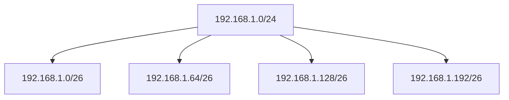

# Section 4: IP Configuration — البروتوكولات والـ IPv4 والـ Subnetting

> [!NOTE]
> السكشن ده بيغطي: **الـ protocol suites** (TCP/IP) ووظيفة أهم البروتوكولات (**HTTP, TCP, IP, Ethernet**)، والفرق بين **MAC** و **IP**، وبعدين **عنوان IPv4** والـ **subnet mask** والـ **prefix length**، والـ **classes (A, B, C)**، وإزاي تحسب **Network ID** و**first/last host** و**broadcast** وعدد الـ hosts، وأخيرًا **الـ Subnetting**.

---

## 1. الـ Protocol Suites

**الـ protocol suite** = مجموعة بروتوكولات بتشتغل مع بعض. فيه أكتر من واحدة:

| الـ Suite | التفاصيل |
|---|---|
| **Internet Protocol Suite أو TCP/IP** | **الأكتر استخدامًا** · بتتدار بواسطة **IETF** (Internet Engineering Task Force) |
| **OSI protocols** | اتطورت بواسطة **ISO** و **ITU** |
| **AppleTalk** | **proprietary** من شركة **Apple Inc.** |
| **Novell NetWare** | **proprietary** من شركة **Novell Inc.** |

### أمثلة بروتوكولات TCP/IP لكل Layer

| الـ Layer | بروتوكول |
|---|---|
| **Application** | **HTTP** (Hypertext Transfer Protocol) |
| **Transport** | **TCP** (Transmission Control Protocol) |
| **Internet** | **IP** (Internet Protocol) |
| **Network Access** | **Ethernet** |

---

## 2. وظيفة أهم البروتوكولات — Protocols

1. **HTTP (Hyper Text Transfer Protocol):** بيستخدم عشان **يفتح أي website** ويعرض الـ **content** بتاعه.
2. **TCP (Transmission Control Protocol):** **بيدير المحادثات الفردية (manages individual conversations)** بين الأجهزة.
3. **IP (Internet Protocol):** أي جهاز عايز يتوصل بالـ **Internet** بيكون ليه **رقم مميز** ده اللي بيحدد **العنوان بتاعه في العالم** وبيخلي أي حد يقدر يتواصل معاك من خلاله.
4. **Ethernet:** ده البروتوكول اللي **بيوصل الأجهزة جوه الـ LAN**.

### الفرق بين MAC و IP

| **MAC** | **IP** |
|---|---|
| **Local Identification** | **Global Identification** |
| بيستخدم **جوه الـ LAN** (الأجهزة في نفس المكان تتواصل ببعض) | بيستخدم **على مستوى العالم/الإنترنت** |

---

## 3. عنوان IPv4 — IPv4 Address

- **IPv4 address = 32-bit** address متكوّن من جزئين: **Network portion** و **Host portion**.
- **Subnet mask:** بيتستخدم **لتحديد الـ network والـ host portions**.

> [!EXAMPLE]
> `IP = 192.168.10.10` و `Subnet = 255.255.255.0`
>
> كل رقم هو **8 bits**، يعني الـ 32 bit = 4 أرقام × 8.

### إزاي نطلّع الـ Network IP؟ — عملية AND

بنعمل **AND** بين الـ **IP** والـ **Subnet mask** بالـ binary:

| | Binary | Decimal |
|---|---|---|
| **IP** | `11000000.10101000.00001010.00001010` | 192.168.10.10 |
| **Subnet** | `11111111.11111111.11111111.00000000` | 255.255.255.0 |
| **Network IP** | `11000000.10101000.00001010.00000000` | **192.168.10.0** |

> [!TIP]
> **قاعدة الـ AND:** أي حاجة مع **1** بتنزل زي ما هي، وأي حاجة مع **0** بتنزل **صفر**. يعني **الجزء اللي الـ subnet فيه 1 = Network**، و**الجزء اللي فيه 0 = Host**.

### الـ Prefix Length

- الـ **subnet mask** ممكن نكتبه كـ **/عدد الـ 1s**: مثلًا `255.255.255.0` فيه **24 واحد** من الـ 32 bit، فنكتبه **/24** (ده اسمه **prefix length**).
- مثال: **/16** ← `255.255.0.0`.
- مثال: **/27** ← 27 واحد، والباقي أصفار ← `255.255.255.224` (لأن **111** في آخر octet = 128+64+32 = **224**).

| Prefix | Subnet mask |
|---|---|
| /8 | 255.0.0.0 |
| /16 | 255.255.0.0 |
| /24 | 255.255.255.0 |
| /27 | 255.255.255.224 |

---

## 4. الـ IPv4 Classes

بنحدد الـ class من **أول 8 bits** (الـ first octet):

| Class | Range | أول bits | Network bits (default) |
|---|---|---|---|
| **A** | `0.0.0.0/8` ← `127.0.0.0/8` | `0NNNNNNN` | **8** |
| **B** | `128.0.0.0/16` ← `191.255.0.0/16` | `10NNNNNN` | **16** |
| **C** | `192.0.0.0/24` ← `223.255.255.0/24` | `110NNNNN` | **24** |

- **Class A:** الـ first octet من **0 ← 127**، والـ subnet الافتراضي **/8** (أول 8 bits بس للـ network).

> [!EXAMPLE]
> **`IP = 120.15.6.7/8`** ← الرقم **120** بين 0 و 127 ← **Class A** ← الـ subnet **/8**.
> عشان تجيب الـ **Network IP**: بتنزّل **أول 8 bits** (الـ network portion) زي ما هي، والباقي **أصفار** ← **`120.0.0.0`**.
> (راجعتها بالحساب: `120.15.6.7/8` ← network = `120.0.0.0`.)

> [!WARNING]
> **تنبيه على الملاحظات:** الـ prefix في المثال ده مكتوب بخط اليد بشكل بيتقري **"/18"**، لكن الشرح اللي جنبه واضح إن الـ network هي **أول 8 bits** والنتيجة `120.0.0.0`، يعني **/8** (الـ default بتاع Class A). المراجعة بالحساب بتأكد ده.

> [!NOTE]
> نطاق **127.x.x.x** في Class A محجوز عمليًا للـ **loopback** (زي 127.0.0.1)، فمش بيتوزّع على أجهزة.

---

## 5. إيجاد First Host و Last Host و Broadcast

**مثال: `192.168.1.0/24`**

الخطوات (بتبدأ من الـ **Network ID**):
1. **Network ID (NWID):** `192.168.1.0`
2. **First host:** أول حاجة بعد الـ NWID ← **`192.168.1.1`**
3. **Last host:** اللي **قبل الأخير** (لأن آخر رقم 255 هو الـ broadcast) ← **`192.168.1.254`**
4. **Broadcast:** آخر عنوان ← **`192.168.1.255`**

### عدد الـ Hosts

- بنشوف عدد **host bits** (الأصفار في الـ mask): هنا `32 − 24 = 8`.
- **عدد الـ hosts = 2^h − 2** (بنطرح **2**: واحد للـ **NWID** وواحد للـ **broadcast**).
- هنا: **2⁸ − 2 = 254 host**.

```python
# تحقق من الحساب
2**8 - 2   # = 254
```

---

## 6. الـ Subnetting

**السيناريو:** عندك network واحدة وعايز **تقسمها لـ 4 شبكات** (subnetting).

**مثال:** `192.168.1.0/24`

### الخطوات
1. عشان تقسم، لازم **تاخد bits زيادة من الـ host portion**. عدد الـ bits **n** بيتحسب من: **2ⁿ ≥ عدد الشبكات**.
2. هنا الشبكات = 4 ← **2ⁿ ≥ 4** ← **n = 2 bits**.
3. الـ prefix الجديد = `24 + 2` = **/26**.
4. الـ **2 bits** دول ليهم **4 احتمالات**: `00` `01` `10` `11` ← دول الـ **4 networks**.

| الشبكة | آخر octet (binary) | Network ID |
|---|---|---|
| **First network** | `00 000000` | `192.168.1.0/26` |
| **Second network** | `01 000000` | `192.168.1.64/26` |
| **Third network** | `10 000000` | `192.168.1.128/26` |
| **Fourth network** | `11 000000` | `192.168.1.192/26` |

> [!TIP]
> **حجم كل subnet = 2^(host bits)** = 2⁶ = **64**، عشان كده الـ Network IDs بتزيد **64 كل مرة**: 0، 64، 128، 192.
> وعدد الـ hosts في كل subnet = **2⁶ − 2 = 62**.



> [!EXAM]
> **للحفظ:**
> - **Network ID = IP AND Mask.**
> - **Hosts = 2^h − 2.**
> - **Subnetting:** `2ⁿ ≥ عدد الشبكات` ← **prefix جديد = القديم + n**.
> - **Classes:** A = **0–127** (/8) · B = **128–191** (/16) · C = **192–223** (/24).
> - **MAC = local** · **IP = global**.
