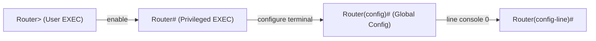

# Section 5: إعداد الراوتر — Router Configuration

> [!NOTE]
> السكشن ده عن **أوامر الـ CLI الأساسية للراوتر**: تسمية الجهاز، تأمين الـ **privileged mode** والـ **user mode**، تشفير الباسوردات، وأوامر **show** اللي بتعرض الـ IPs والـ interfaces وجدول الـ routing.

---

## الأوامر — Commands

### 1. تسمية الجهاز — Configure Device Name
```
Router(config)# hostname <الاسم>
```
- بعد `hostname` بتحط **مسافة (space)** وبعدين **الاسم** اللي عايزه.

### 2. تأمين الـ Privileged EXEC Mode — Secure Privileged EXEC Mode
```
Router(config)# enable secret <password>
```
- لو عايز **تحط باسورد على الـ privileged mode**.

### 3. تشفير كل الباسوردات النصية — Encrypt All Plain-Text Passwords
```
Router(config)# service password-encryption
```
- **بيشفّر الباسوردات** اللي مكتوبة plain text في الـ configuration.

### 4. تأمين الـ User EXEC Mode — Secure User EXEC Mode
```
Router(config)# line console 0
Router(config-line)# password <password>
Router(config-line)# login
```
- `line console 0` ← بتدخل على إعدادات **الـ console line** (رقمها **0**).
- `password` ← بتحط **الباسورد**.
- `login` ← بتخلّي الراوتر **يطلب الباسورد** عند الدخول.

> [!TIP]
> الـ `enable secret` بيحمي **الـ privileged mode (`Router#`)**، لكن `line console 0` + `password` + `login` بيحميوا **الدخول من الـ console (`Router>`)**. دول حاجتين مختلفين.

---

### 5. الـ Interface Configuration (أوامر العرض — show)

| الأمر | بيعمل إيه |
|---|---|
| `Router# show ip interface brief` | **بيوريك الـ IPs** بتاعة الـ interfaces في الراوتر |
| `Router# show interfaces` | **بيجيبلك كل الـ IPs/interfaces** المتوصلة بالراوتر بالتفصيل |
| `Router# show ip route` | **بيوريك الـ Gateways وجداول الـ Routing (routing tables)** |

> [!WARNING]
> أوامر `show` بتتكتب من **`Router#`** (privileged EXEC) **مش** من `Router(config)#` (من الـ config mode محتاج تكتب `do` قبل الأمر).



> [!EXAM]
> **للحفظ:**
> - **اسم الجهاز** ← `hostname`
> - **باسورد الـ privileged mode** ← `enable secret`
> - **تشفير الباسوردات** ← `service password-encryption`
> - **باسورد الـ console** ← `line console 0` + `password` + `login`
> - **عرض** ← `show ip interface brief` · `show interfaces` · `show ip route`
