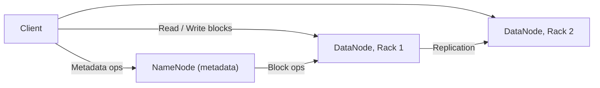
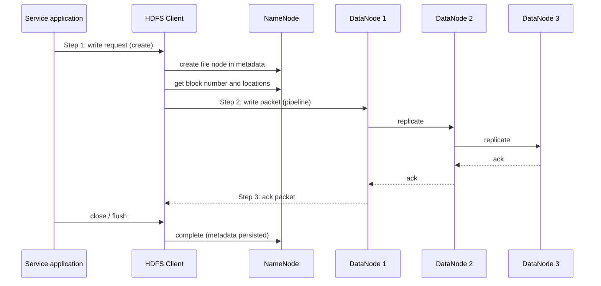
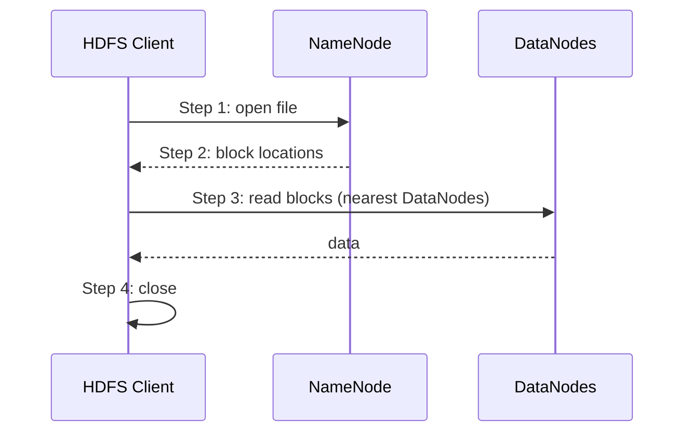
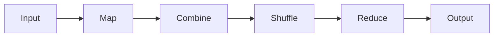

# البيانات الضخمة — Big Data

> [!NOTE]
> المحاضرة دي عن **الـ Big Data**: يعني إيه **Data**، **تعريف الـ Big Data** وخصائصها (**3Vs / 4Vs / 5Vs**)، **مصادرها**، الفرق بينها وبين **معالجة البيانات التقليدية**، **تحديات** التقنيات التقليدية، وبعدين **Hadoop**: نظام الملفات الموزع **HDFS**، و**MapReduce** و**YARN** ومثال **WordCount**.

---

## 1. يعني إيه Data؟

- البيانات بتتكون من **Objects** (Samples / Individuals) و**Attributes** (Dimensions / Features / Variables).

| ID | Height | Weight | Age |
|---|---|---|---|
| Student 1 | 189 cm | 81 kg | 24 |
| Student 2 | 210 cm | 90 kg | 26 |
| Student 3 | 191 cm | 92 kg | 27 |
| … | … | … | … |
| Student N | 162 cm | 71 kg | 21 |

- **الصفوف = Objects (العينات)** · **الأعمدة = Attributes (الخصائص / الأبعاد)**.

---

## 2. تعريف الـ Big Data

- **بالمعنى الضيق (narrow sense):** الـ Big Data = **حجم العينة (sample size)** بس.
- **بالمعنى الواسع (broad sense):** الـ Big Data = **حجم العينة + الـ dimensionality** (عدد الـ attributes).

> **تعريف Wikipedia:** Big data هي **مجموعات بيانات كبيرة ومعقدة لدرجة إن برامج معالجة البيانات التقليدية مش كفاية للتعامل معاها**.

### الـ Vs


| النسخة | الخصائص |
|---|---|
| **3Vs** | **Volume · Velocity · Variety** |
| **4Vs** | + **Value** (قيمة البيانات قليلة بالنسبة للحجم: **low data value density**) |
| **5Vs** | **Volume · Velocity · Variety · Veracity · Value** |

| الـ V | المعنى |
|---|---|
| **Volume** | **حجم** البيانات (كمية ضخمة) |
| **Velocity** | **سرعة إنتاج ومعالجة** البيانات |
| **Variety** | **تنوع** البيانات (من مصادر وأنواع مختلفة) |
| **Veracity** | **دقة وموثوقية** البيانات (trustworthy) |
| **Value** | **قيمة** البيانات |

> [!TIP]
> **للحفظ:** 3 = **VVV** (Volume, Velocity, Variety) · +Value = 4 · +Veracity = 5.

### إزاي نعرف إنها Big Data؟

- **من وجهة نظر Computer Scientist:** لو **الذاكرة مش كفاية** للتعامل مع البيانات، أو البيانات **أكتر من 2TB** ومش عارف تخزنها فين ← **Big Data**. يعني لو عندك **مشكلة في معالجة البيانات** على جهازك فالسبب Big Data.
- **من وجهة نظر Statistician:** لو الحساب **مبينتهيش** (مستني 10 سنين!) أو الـ **dimensionality عالية جدًا** ومش قادر تبني نموذج إحصائي ← **Big Data**. يعني لو عندك مشكلة في **تحليل** البيانات.

---

## 3. مصادر الـ Big Data

- **2.8 مليار** مستخدم smartphone في العالم.
- **أكتر من 300 مليون** مستخدم نشط يوميًا (social).
- **أكتر من 200 مليون** رسالة يوميًا.
- **مئات الملايين** من أجهزة الـ **GPS** بتتباع كل سنة.
- **Facebook:** بيولّد **50 TB log data** كل يوم، ومنها أكتر من **100 TB** بيانات تحليل مشتقة.

| نوع المصدر | أمثلة |
|---|---|
| **Machine data** | أجهزة GPS، sensors |
| **Social data** | Facebook، الرسائل، المستخدمين |

### أهداف تحليل الـ Big Data


### علاقتها بـ Smart Cities والـ IoT

- **IoT** بيوفّر **البنية التحتية لجمع البيانات**، و**Smart Cities** تطبيق مهم.
- مثال السلايد: **Hong Kong** رقم **1** في ترتيب World Economic Forum للبنية التحتية، ومشروع **East Kowloon** لتحويل المدينة لـ Smart City.

---

## 4. معالجة البيانات التقليدية مقابل Big Data

تشبيه السلايد: **"Pond fishing" مقابل "Sea fishing"**، والسمك = البيانات اللي هتتعالج.

| وجه المقارنة | **Database (تقليدي)** | **Big Data** |
|---|---|---|
| **Data scale** | **صغيرة** (MB, GB) | **كبيرة** (GB, TB, PB) |
| **Data type** | **نوع واحد** (غالبًا structured) | **أنواع مختلفة**: structured, semi-structured, unstructured |
| **العلاقة بين النماذج والبيانات** | **النموذج الأول، البيانات بعدين** (الأحواض قبل السمك) | **البيانات الأول**، والنماذج **بتتطور باستمرار** مع زيادة البيانات |
| **الشيء المعالَج** | البيانات (السمك في الأحواض) | نحدد وجود أنواع تانية من **السمك** عن طريق سمك معين |
| **أداة المعالجة** | **One size fits all** | **No size fits all** |

> [!NOTE]
> كلمة "Modes" في السلايد المقصود بيها **Models** (النماذج).

### مثال تطبيق: التعليم — Big Data in Education

تحليل الـ Big Data اتطبق في **التعليم العام الأمريكي** وبقى قوة مهمة لإصلاحه. البيانات المحللة بتشمل: **متوسط الوقت للإجابة على كل سؤال**، **تسلسل الإجابة** في الامتحان، **مدة وتكرار التفاعل مع المدرسين**، **مدة وصحة الإجابة**، **عدد مرات رفع اليد** في الفصل، **صحة الواجبات**... وبتتربط بـ: **الأداء الأكاديمي**، **نسبة الالتحاق**، **نسبة التسرب**، **نسبة القبول في المدارس العليا**، **دقة القراءة والكتابة (literacy)**.

---

## 5. تحديات التقنيات التقليدية — Challenges of Traditional Technologies

الإطار التقليدي: **midrange computer + disk array + commercial data warehouse**.

| التحدي | الشرح |
|---|---|
| **Scalability** | **محدودية القابلية للتوسع** · فجوة بين متطلبات معالجة البيانات وأداء الـ hardware |
| **High cost** | **تكلفة عالية** لتخزين البيانات الضخمة |
| **Insufficient batch processing** | معالجة الـ batch **غير كافية** |
| **No streaming processing** | **نقص في معالجة البيانات المتدفقة (streaming)** |
| **Single data source** | **مصدر بيانات واحد** |
| **External data assets** | نقص في **قيمة الأصول البيانية الخارجية** |


### البرمجة للأنظمة الموزعة التقليدية

- **تبادل البيانات يحتاج synchronization**.
- **النطاق الترددي (bandwidth) محدود**.
- **التعامل مع الفشل الجزئي (partial failure)** للنظام **معقد**.
- **الفشل** هو الفرق بين **البرمجة الموزعة** و**المحلية**، فلازم **تصمم النظام الموزع بتوقع حدوث فشل**.

---

## 6. Hadoop و HDFS


> **HDFS (Hadoop Distributed File System)** اتطور على أساس **Google File System (GFS)** وبيشتغل على **commodity hardware** (أجهزة عادية رخيصة).

**مميزات الـ HDFS:**
- **High fault tolerance**: بيحل مشكلة عدم موثوقية الـ hardware.
- **High throughput**: بيدعم التطبيقات اللي فيها **كمية بيانات كبيرة**.
- **Open source**.
- **High Availability**.
- **Large file storage**: بيدعم تخزين بيانات بمستوى **TB و PB**.
- **Streaming data access**.

| **HDFS مناسب لـ** | **HDFS غير مناسب لـ** |
|---|---|
| تخزين **ملفات كبيرة** | تخزين **ملفات صغيرة كتير** |
| **Streaming data access** | **Random write** |
| | **Low-delay read** (قراءة بتأخير قليل) |

> [!NOTE]
> **Streaming data access:** بعد توليد الـ data set بيتعمل عليها تحليلات كتير لفترة طويلة، وكل تحليل بيشمل **أغلب أو كل** الـ data set. فـ **زمن قراءة الـ data set كلها أهم من زمن قراءة أول سجل**. عكسه الـ **random access** اللي بيحتاج **latency أقل** وبيناسب القراءة والكتابة المتعددة، **والـ relational database مناسبة له**.

> [!WARNING]
> **تنبيه:** صياغة السلايد في الفقرة دي مش واضحة (مكتوب "Flow data access corresponds to random data access"). المقصود: **streaming access** عكس **random access**. الـ streaming للـ HDFS، والـ random للـ relational database.

### معمارية الـ HDFS — HDFS Architecture

بتتكون من **3 أجزاء**:

| المكون | الدور | العدد |
|---|---|---|
| **NameNode** | بيخزّن ويولّد **الـ metadata** (الاسم، عدد النسخ replicas، ...) للـ file system | **instance واحدة** في الـ HDFS |
| **DataNode** | بيخزّن **البيانات الفعلية** ويبلّغ الـ NameNode بالـ blocks اللي بيديرها | **عدة instances** |
| **Client** | بيسمح للخدمات بالوصول للـ HDFS ويرجّع البيانات من NameNode و DataNodes | **عدة clients** |

- البيانات بتتقسم لـ **blocks** وبتتعمل ليها **replication** على DataNodes في **racks** مختلفة (مثال السلايد: metadata = `/home/foo/data, 3, ...` يعني **3 replicas**).



### عملية الكتابة في HDFS — HDFS Data Write Process



**الخطوات:**
1. الـ service application بتستدعي API من الـ **HDFS Client** لطلب الكتابة. الـ Client بيتصل بالـ **NameNode** وهو بيعمل **file node في الـ metadata**، وبعدين الـ application بتستدعي **write API**.
2. الـ Client بياخد من الـ NameNode **رقم الـ block ومكانه**، ويتصل بالـ DataNodes ويعمل **pipeline** بين DataNodes. بيكتب في **DataNode 1** وبعدين بينسخ من **DataNode 1 → DataNode 2 → DataNode 3**.
3. بعد الكتابة الـ DataNodes بترجّع **تأكيد (ack)** للـ Client. بعد تأكيد كل الكتابة الخدمة بتنادي **close**.
4. بعد **close و flush** الـ Client بيتصل بالـ NameNode ليأكد إن الكتابة اكتملت وتخلّي الـ **metadata persistent**.

### عملية القراءة في HDFS — HDFS Data Read Process



**الخطوات:**
1. الـ application بتستدعي API لـ **فتح ملف** (open).
2. الـ Client بيتصل بالـ **NameNode** ويجيب **معلومات الملف** (الـ data blocks ومكان الـ DataNodes).
3. الـ application بتستدعي **read API**، والـ Client بيتصل بالـ DataNodes ويدوّر على **أقرب blocks**.
4. الـ Client بيتصل بـ **عدة DataNodes** لقراءة الـ blocks، وبعد القراءة **close**.

> [!EXAM]
> **الكتابة:** NameNode بيعمل file node → Client بيكتب في **pipeline** (DN1 → DN2 → DN3) → ack → close → NameNode يأكد.
> **القراءة:** open → NameNode يرجّع block locations → Client يقرا من **أقرب** DataNodes → close.

---

## 7. MapReduce


- **MapReduce** اتطور على أساس ورقة بحثية من **Google**، وبيتستخدم في **الحوسبة المتوازية (parallel computing)** لمجموعات بيانات ضخمة (**أكبر من 1 TB**).
- **مميزاته:**
  - **Easy to program:** المبرمج بيوصف **ماذا يعمل** بس، والـ framework بينفّذ.
  - **Outstanding scalability:** تزوّد قدرات الـ cluster **بإضافة nodes**.
  - **High fault tolerance:** بيحسّن توافر الـ cluster وتحمّل الأخطاء بسياسات زي **نقل الحوسبة أو البيانات**.

### الـ Shuffle Mechanism

مراحل: **Combine → Spill/Merge → Copy → Sort/Merge → Reduce**.

> **Shuffle** = عملية نقل البيانات **بين مرحلة Map ومرحلة Reduce**، وفيها الـ Reduce tasks بتجيب **MOF files** من الـ Map tasks وبتعمل ليها **sort و merge**.



### YARN

> **YARN (Yet Another Resource Negotiator)** = **resource manager** جديد لـ Hadoop. بيوفّر **إدارة وجدولة موحدة للموارد** للتطبيقات العليا، فبيحسّن **استخدام موارد الـ cluster** والـ **data sharing** بشكل ملحوظ.

---

## 8. مثال WordCount

**المدخلات (3 جمل):**
1. `Hello World Bye World`
2. `Hello Hadoop Bye Hadoop`
3. `Bye Hadoop Hello Hadoop`

### Map Process
كل جملة بتروح لـ **Map task** بتخرّج **`<word, 1>`** لكل كلمة:
- الجملة 1: `<Hello,1> <World,1> <Bye,1> <World,1>`
- الجملة 2: `<Hello,1> <Hadoop,1> <Bye,1> <Hadoop,1>`
- الجملة 3: `<Bye,1> <Hadoop,1> <Hello,1> <Hadoop,1>`

### Reduce Process
بعد الـ **Combine** (جمع محلي في كل map) ثم **Shuffle** (تجميع نفس الكلمة مع بعض) بيعمل **Reduce** المجموع:

| الكلمة | Reduce Input | **Reduce Output** |
|---|---|---|
| **Bye** | `<Bye, 1 1 1>` | **3** |
| **Hadoop** | `<Hadoop, 2 2>` | **4** |
| **Hello** | `<Hello, 1 1 1>` | **3** |
| **World** | `<World, 2>` | **2** |

```python
from collections import Counter
lines = ["Hello World Bye World", "Hello Hadoop Bye Hadoop", "Bye Hadoop Hello Hadoop"]
print(Counter(w for l in lines for w in l.split()))
# Counter({'Hadoop': 4, 'Hello': 3, 'Bye': 3, 'World': 2})  <- نفس نتيجة السلايد
```

> [!EXAM]
> **WordCount:** Bye = **3** · Hadoop = **4** · Hello = **3** · World = **2**. الـ **Combine** بيجمع محليًا قبل الـ **Shuffle** عشان يقلل البيانات المنقولة.
