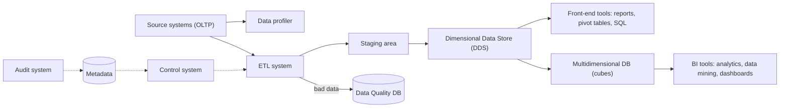
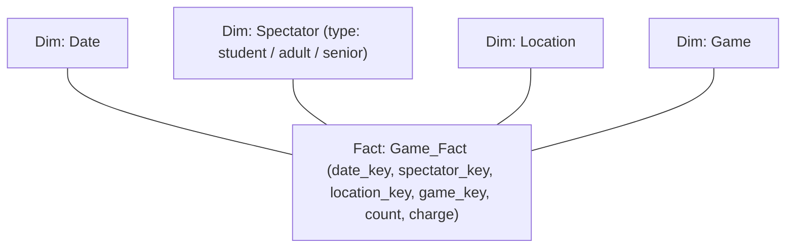

# مستودع البيانات — Chapter 3: Data Warehouse & Data Warehouse Processing

> [!NOTE]
> الشابتر ده عن **الـ Data Warehouse (DW)**: يعني إيه، **مكوناته** (Source systems, ETL, Staging, DDS, Metadata, Cubes...)، إزاي بيعمل **Retrieve** و **Consolidate** للبيانات **Periodically**، و**الـ Dimensional Data Store** وأنواع الـ schemas (**Star و Snowflake و Galaxy**).
> المرجع: *Building a Data Warehouse With Examples in SQL Server*.

---

## 1. يعني إيه Data Warehouse؟

> **A data warehouse** is a system that **retrieves and consolidates data periodically** from the **source systems** into a **dimensional or normalized data store**. It usually keeps **years of history** and is queried for **business intelligence** or other analytical activities. It is typically updated in **batches**, not every time a transaction happens in the source system.

| الكلمة المفتاحية | المعنى |
|---|---|
| **Retrieves** | بيسحب البيانات من الـ source systems (بـ **ETL**) |
| **Consolidates** | بيجمّع ويدمج البيانات من أنظمة مختلفة |
| **Periodically** | دوريًا (يوميًا أو كذا مرة في اليوم) وبـ **batches** |
| **Years of history** | بيحتفظ بتاريخ سنين |
| **BI / analytical** | بيتسأل لأغراض **business intelligence** وتحليل |

---

## 2. مكونات الـ Data Warehouse System

| المكون | الوصف |
|---|---|
| **Source systems (OLTP)** | الأنظمة اللي فيها البيانات المراد تحميلها. **OLTP = Online Transaction Processing**: نظام هدفه الأساسي **التقاط وتخزين المعاملات** |
| **Data profiler** | أداة بتحلل بيانات الـ source (كام صف في كل جدول؟ كام صف فيه NULL؟) عشان تفهم خصائصها |
| **ETL (Extract, Transform, Load)** | نظام بيتصل بالـ sources، **يقرأ** البيانات، **يحوّلها**، و**يحمّلها** في الـ target. بيجيب البيانات لـ **staging area** وبعدين يدمجها ويحمّلها في الـ DDS |
| **DDS (Dimensional Data Store)** | **database بتخزن بيانات الـ DW بشكل مختلف عن الـ OLTP** (dimensional) |
| **Data Quality (DQ) database** | بتتحط فيها **البيانات الوحشة** (bad data) عشان تتعمل ليها تقارير وتتصلح في الـ source |
| **Metadata** | database فيها معلومات عن **بنية البيانات ومعناها واستخدامها وقواعد جودتها** |
| **Control system** | بيدير الـ ETL حسب التسلسل والقواعد المخزنة في الـ metadata |
| **Audit system** | جزء من الـ ETL بيراقب **العمليات التشغيلية** ويسجّل إحصائياتها في الـ metadata، لفهم اللي حصل أثناء الـ ETL |
| **Front-end tools** | spreadsheets, pivot tables, reporting tools, SQL query tools |
| **MDB / Cubes** | **multidimensional databases** بتتحمّل من الـ DDS للتطبيقات اللي بتشتغل بالشكل متعدد الأبعاد |

### ليه نسأل الـ DDS مش الـ source مباشرة؟
1. البيانات في الـ DDS **مرتبة dimensional**، **أنسب للتحليل**.
2. الـ DDS فيه **بيانات متكاملة (integrated)** من عدة source systems.

عند التحميل، **data quality rules** بتعمل فحوصات، والبيانات الوحشة تتحط في الـ DQ database، وممكن **تتصلح أوتوماتيك أو تتحمل** لو في حدود مسموحة.

### الـ Multidimensional Database (Cube)

> قاعدة بيانات بتخزن البيانات في **خلايا (cells)** وموقع كل خلية بتحدده **dimensions**. **كل خلية = حدث business** وقيم الـ dimensions بتقول **إمتى وفين** حصل.

> [!EXAMPLE]
> cube بـ **3 أبعاد**: Time و Store و Customer، كل بُعد **100 segment** ← **100 × 100 × 100 = 1,000,000 خلية**. كل خلية = عميل اشترى حاجة من فرع في وقت معين، وفيها **3 أرقام**: **Sales Value** و **Cost** و **Profit** (= Sales − Cost).

- أدوات زي **analytics applications, data mining, scorecards, dashboards, multidimensional reporting** بتسحب البيانات من الـ MDB لفهم أعمق للأعمال (مثلًا تحليل المبيعات حسب الزمن والعميل والمنتج).

### أبسط شكل لـ DW
مش كل الـ DW فيها كل المكونات. **الحد الأدنى = ETL system + Dimensional Data Store فقط** (الـ source مش جزء من الـ DW). لو شلت مكون تاني **مش هيبقى data warehouse**. وحتى من غير front-end ممكن المستخدمين يسألوا الـ DDS بـ **SQL SELECT** مباشرة.

---

## 3. Retrieves Data — الـ ETL

- **ETL** = مجموعة عمليات بتسحب من الـ sources، **تحوّل**، وتحمّل في الـ target.
- **التحويل (Transformation)** ممكن يكون: تغيير الشكل ليناسب الـ target، **اشتقاق قيم جديدة**، أو **التحقق (validation)** من البيانات.

### تنظيف البيانات — Data Cleansing
- عملية **تحديد وتصحيح البيانات الوحشة (dirty data)** بـ **data quality rules**.
- بعد الـ extract وقبل الـ load، البيانات بتتفحص:
  - **صحيحة** ← تتحمّل.
  - **غلط** ← **3 اختيارات**: **Reject** (ترفض) أو **Correct** (تصلّح) أو **Allow** (تسمح بتحميلها). القرار بيعتمد على الموقف ومستوى المخاطرة ونوع القاعدة (**error** أو **warning**).

### ELT — البديل
**Extract, Load, Transform**: البيانات بتتحمّل **الأول في الـ warehouse بشكلها الخام (raw)**، والـ transformations والـ lookups والـ deduplication بتتم **جوه الـ warehouse**.
- **مش محتاج ETL server**.
- بيتنفذ للاستفادة من محركات قوية زي **MPP (massively parallel processing)**.

| | **ETL** | **ELT** |
|---|---|---|
| الترتيب | Extract → **Transform** → Load | Extract → **Load** → Transform |
| مكان التحويل | في **ETL server / staging** | **جوه الـ DW** |
| ETL server | **محتاج** | **مش محتاج** |

---

## 4. Consolidates Data — دمج البيانات

لازم ناخد في الاعتبار 5 حاجات:

| المشكلة | الشرح | مثال |
|---|---|---|
| **Data availability** | بيانات موجودة في نظام ومش في التاني | system A فيه **7 address fields**، و system B مفيهوش address3 والـ country ← نسيب address3 فاضي ونحط country افتراضي · الـ order عندها مستويين في A وأربعة في B ← ندمج في مستويين (header + line) |
| **Time ranges** | نفس البيانات بفترات زمنية مختلفة | متوسط تكلفة المورّد weekly في A و monthly في B ← مينفعش ندمجهم، نرجع للمكونات الأساسية ونجمعها الأول |
| **Definitions** | نفس الاسم بمعنى مختلف | "Total Order Value" فيه الضرايب والتوصيل في A ومفيهوش التوصيل في B · "weekly traffic" = زوار فريدين في A وغير فريدين في B |
| **Conversion** | وحدات قياس/عملات مختلفة | سعر العملة بيتغير يوميًا ← لازم نعرف **تاريخ المعاملة** · فرق التوقيت بيتأثر بـ **daylight savings** |
| **Matching** | تحديد هل بيانات نظامين تخص **نفس الكيان** | هل customer 1 في A هو customer 1 في B؟ المعيار ممكن بسيط (**customer ID**) أو معقد (**name + email + address**) |

> [!WARNING]
> لو **تطابقت بيانات العميل الغلط**، معاملات عميل هتتخلط ببيانات عميل تاني. ولو اتجمعت وحدات مختلفة من غير تحويل ← **بيانات غلط** في الـ warehouse.

## 5. Periodically — دوريًا

- الـ retrieval والـ consolidation **بيحصلوا كتير** (يوميًا أو كذا مرة في اليوم) وإلا البيانات **هتبقى قديمة (obsolete)**.
- الفترة بتتحدد حسب **متطلبات الـ business** و**تكرار تحديث الـ source**: **لازم تساوي تكرار تحديث الـ source**. لو الـ source بيتحدث مرة في اليوم ← الـ retrieval مرة في اليوم.

---

## 6. الـ Dimensional Data Store والـ Schemas

- الـ DW ممكن يكون **dimensional** أو **normalized**.
- **DDS** = database أو أكتر فيها مجموعة **dimensional data marts**.
- **Dimensional data mart** = مجموعة **fact tables** مرتبطة + **dimension tables** المقابلة، فيها **قياسات (measurements)** أحداث الـ business مصنفة حسب الـ dimensions.

### الأنواع الثلاثة

| الـ Schema | الوصف | الميزة |
|---|---|---|
| **Star schema** | الـ dimension **مفيهاش subtable** (sub-dimension) | **أبسط**، فـ ETL أسهل في التحميل |
| **Snowflake schema** | الـ dimension **ممكن يكون ليه sub-dimension** (تطبيع للـ dimension tables) لتقليل التكرار | **تكرار أقل** ← **مساحة أقل**، وبعض الـ analytics apps بتشتغل أحسن معاه |
| **Galaxy (Fact constellation)** | **fact table أو أكتر** مرتبطين، محاطين بـ **common dimensions** | نمذجة **أدق** لأحداث الـ business بـ fact tables متعددة |

### Star Schema

- **الـ fact table** في **المنتصف** (فيه **measures** زي المبيعات) و**الـ dimension tables** حواليه ومربوطة بيه (**Time, Product, Customer, Store...**).

### مثال محلول — Star Schema Example

> **السؤال:** data warehouse فيه **4 dimensions**: **date, spectator, location, game**، و **measures**: **count** و **charge** (سعر التذكرة اللي بيدفعه المتفرج لمشاهدة لعبة في تاريخ معين). المتفرجين: **students, adults, seniors** ولكل فئة سعر. ارسم الـ star schema.

### Snowflake Schema

> **Snowflake** = **variation من الـ star** فيه **normalization للـ dimension tables**.

| | **Star** | **Snowflake** |
|---|---|---|
| Dimension | **denormalized**، من غير sub-dimensions | **normalized**، ليها sub-dimensions |
| التعقيد | **أبسط** | **أعقد** |
| التكرار | **أكتر** | **أقل** |

> [!EXAM]
> - **DW** = يسحب ويدمج **دوريًا** من الـ source، يحتفظ بـ **سنين**، بيتحدث بـ **batches**.
> - **الحد الأدنى للـ DW** = **ETL + DDS**.
> - **ETL vs ELT** · **5 مشاكل دمج**: availability, time ranges, definitions, conversion, matching.
> - **Star** (بسيط) · **Snowflake** (تكرار أقل) · **Galaxy** (أكتر من fact table).
> - **بيانات وحشة**: Reject / Correct / Allow.
