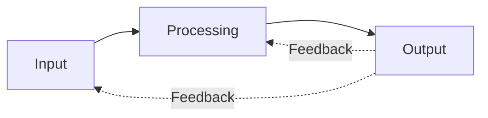
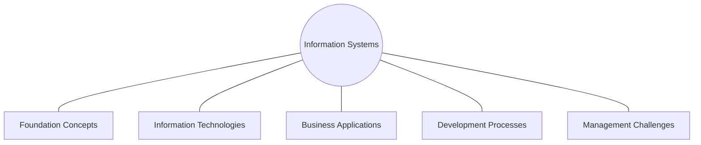

# مقدمة في نظم المعلومات — Lecture 1: Introduction to Information Systems

> [!NOTE]
> المحاضرة دي عن **يعني إيه Information System (IS)**: الفرق بين **Data و Information و Knowledge**، **صفات المعلومة القيّمة**، **عناصر النظام (Input / Processing / Output / Feedback)**، **مكونات الـ CBIS**، **أدوار الـ IS في الـ Business**، **الـ e-business والـ e-commerce**، و**أنواع نظم المعلومات**.

**الأهداف:**
- فهم ليه بنتعلم نظم المعلومات في المنظمات.
- التفريق بين البيانات والمعلومات والمعرفة.
- معرفة صفات المعلومة القيّمة وقيمتها.
- فهم مكونات النظام والـ CBIS.
- معرفة أدوار وأنواع الـ IS.

---

## 1. ليه بنتعلم نظم المعلومات؟ — Why Learn About IS?

- نظم المعلومات بتتستخدم تقريبًا في **كل مهنة**:
  - **صاحب مشروع صغير** بيوصل لعملاء في كل العالم.
  - **مندوب المبيعات** بيعلن عن المنتجات ويتواصل مع العملاء ويحلل **اتجاهات المبيعات (sales trends)**.
  - **المدير** بياخد قرارات بملايين الدولارات (يبني مصنع؟ يبحث عن دواء؟).
- من محل موسيقى صغير لشركة متعددة الجنسيات: **مفيش business يعيش من غير IS** في المحاسبة والتسويق والإدارة والمالية.

---

## 2. تعريف نظام المعلومات — What is an Information System?

> **An information system (IS)** is a set of **interrelated components** that **collect, manipulate, store, and disseminate** data and information and provide a **feedback mechanism** to meet an objective.

- الـ **feedback mechanism** هو اللي بيساعد المنظمة توصل لأهدافها (زيادة الأرباح، تحسين خدمة العملاء).
- الشركات بتستخدم الـ IS **لزيادة الإيرادات وتقليل التكاليف**.

---

## 3. البيانات والمعلومات والمعرفة — Data, Information, Knowledge

| المصطلح | التعريف | مثال |
|---|---|---|
| **Data** (بيانات) | **حقائق خام (raw facts)** | رقم موظف، ساعات الشغل في الأسبوع، أرقام قطع المخزن، أوامر البيع |
| **Information** (معلومات) | حقائق **منظمة ومعالجة** بحيث ليها **قيمة إضافية** أكبر من قيمة كل حقيقة لوحدها | المدير بيهمه **إجمالي المبيعات الشهرية** أكتر من عدد مبيعات كل مندوب |
| **Knowledge** (معرفة) | **الوعي والفهم** لمجموعة معلومات وإزاي نستفيد منها **لدعم مهمة أو اتخاذ قرار** | |

---

## 4. صفات المعلومة القيّمة — Characteristics of Valuable Information

> لو معلومات المنظمة **مش دقيقة أو ناقصة**، الناس ممكن تاخد **قرارات غلط** تكلّف آلاف أو ملايين الدولارات. وحسب نوع البيانات، **بعض الصفات بتبقى أهم من غيرها**.

| الصفة | المعنى | مثال |
|---|---|---|
| **Accessible** (متاحة) | سهل توصلها للمستخدمين **المصرّح لهم** بالشكل والوقت المناسبين | |
| **Accurate** (دقيقة) | **من غير أخطاء**. الخطأ غالبًا من بيانات غلط داخلة: **GIGO** (Garbage In, Garbage Out) | |
| **Complete** (كاملة) | فيها **كل الحقائق المهمة** | تقرير استثمار من غير كل التكاليف = ناقص |
| **Economical** (اقتصادية) | **تكلفة إنتاجها** معقولة · لازم نوازن بين قيمتها وتكلفتها | |
| **Flexible** (مرنة) | تتستخدم في **أغراض متعددة** | مخزون قطعة: المندوب بيقفل صفقة، مدير الإنتاج بيحدد يطلب تاني، المدير المالي بيحسب قيمة المخزون |
| **Relevant** (ذات صلة) | **مهمة لمتخذ القرار** | انخفاض أسعار الخشب مش مهم لمصنع شرائح كمبيوتر |
| **Reliable** (موثوقة) | المستخدم **يقدر يثق فيها** · بتعتمد على طريقة جمع البيانات ومصدرها | إشاعة من مصدر مجهول عن ارتفاع أسعار البترول |
| **Secure** (آمنة) | **محمية** من المستخدمين غير المصرّح لهم | |
| **Simple** (بسيطة) | مش معقدة · **information overload** لو كمية كبيرة جدًا | |
| **Timely** (في وقتها) | بتوصل **لما تتطلب** | طقس الأسبوع اللي فات مش هيفيدك تختار جاكيت النهارده |
| **Verifiable** (قابلة للتحقق) | تقدر **تتأكد إنها صح**، مثلًا بمقارنة مصادر كتير | |

> [!TIP]
> **للحفظ:** **A**ccessible · **A**ccurate · **C**omplete · **E**conomical · **F**lexible · **R**elevant · **R**eliable · **S**ecure · **S**imple · **T**imely · **V**erifiable = **11 صفة**.

### قيمة المعلومة — The Value of Information

- قيمة المعلومة **مرتبطة مباشرة بمدى مساعدتها** لمتخذي القرار في تحقيق أهداف المنظمة.
- المعلومة القيّمة بتخلّي الناس والمنظمات **تؤدي المهام بكفاءة وفعالية أعلى**.

> [!EXAMPLE]
> تنبؤ سوقي بيقول إن فيه **طلب عالي** على منتج جديد. لو طوّرت المنتج وكسبت **10,000$ زيادة**، فـ **قيمة المعلومة = 10,000$ − تكلفة الحصول عليها**.

---

## 5. تعريف النظام وعناصره — System Elements

> **System** = مجموعة عناصر أو مكونات **بتتفاعل** عشان تحقق أهدافًا. العناصر نفسها والعلاقات بينها هي اللي بتحدد إزاي النظام بيشتغل. وللنظام: **inputs, processing mechanisms, outputs, feedback**.

| العنصر | الوصف | مثال |
|---|---|---|
| **Input** (المدخلات) | **تجميع والتقاط البيانات الخام** | في الـ payroll: عدد ساعات كل موظف قبل حساب المرتب · في نظام الدرجات: الدكاترة يسلموا الدرجات قبل التقرير |
| **Processing** (المعالجة) | **تحويل البيانات** لمخرجات مفيدة: حسابات، مقارنات، تخزين · يدوي أو بالكمبيوتر | **ساعات × أجر الساعة = gross pay**، + overtime لو أكتر من **40 ساعة**، − الضرائب والتأمينات = **net pay** |
| **Output** (المخرجات) | **معلومات مفيدة** غالبًا مستندات وتقارير | شيكات المرتبات، تقارير المديرين |
| **Feedback** (التغذية الراجعة) | معلومات من النظام **تُستخدم لتعديل المدخلات أو المعالجة** | لو اتدخلت **400** ساعة بدل **40**، النظام بيتحقق إن القيمة في **range** (0–100) ويرجّع feedback لتصحيحها |

- الـ feedback مهم كمان للمديرين: مثلًا نظام مصنع أثاث بيبيّن إن مخزون **الماهوجني والبلوط** قليل ← المدير يطلب خشب أكتر من المورد.
- **Control** = **مراقبة وتقييم الـ feedback** لتحديد هل النظام ماشي ناحية هدفه.

> [!EXAM]
> **مثال الـ 400 ساعة** متكرر: بيوضح **Feedback**. و**Processing** في الـ payroll: gross pay ← overtime (> 40) ← deductions ← net pay.

### نظم يدوية ومحوسبة — Manual vs Computerized

| النوع | مثال |
|---|---|
| **Manual IS** | محللو الاستثمار بيرسموا **charts و trend lines** يدويًا |
| **Computerized IS** | بتتابع **مؤشرات البورصة** وتقترح إمتى تشتري أو تبيع كميات كبيرة من الأسهم |

---

## 6. النظم القائمة على الكمبيوتر — Computer-Based Information Systems (CBIS)

> **CBIS** = مجموعة واحدة من **hardware, software, databases, telecommunications, people, procedures** متظبطة لتجميع وتعديل وتخزين ومعالجة البيانات لمعلومات.
> أمثلة: نظام **payroll** أو **order entry** أو **inventory control**.

| المكون | الوصف |
|---|---|
| **Hardware** | **المعدات** اللي بتعمل input و processing و output |
| **Software** | **البرامج** اللي بتتحكم في تشغيل الكمبيوتر (payroll، الفواتير، معلومات للمديرين) |
| **Databases** | **مجموعة منظمة** من الحقائق والمعلومات، عادةً **ملفين بيانات مترابطين أو أكتر** (عملاء، موظفين، مخزون...) |
| **Telecommunications** | **النقل الإلكتروني للإشارات** للاتصال، بيخلي المنظمات تشتغل عن طريق شبكات |
| **Networks** | بتربط الكمبيوترات والمعدات في مبنى أو دولة أو العالم |
| **People** | **أهم عنصر** غالبًا: **IS personnel** (بيديروا ويشغّلوا ويبرمجوا ويصونوا) + **Users** (بيشتغلوا مع النظام للحصول على نتائج) |
| **Procedures** | **الاستراتيجيات والسياسات والطرق والقواعد** لاستخدام الـ CBIS (التشغيل، الصيانة، الأمان)، مثلًا: إمتى يتشغّل كل برنامج، مين يدخل على الـ database، وإيه اللي نعمله لو حصلت **كارثة** |

---

## 7. إطار المعرفة وأدوار الـ IS في الـ Business

**الإطار (Figure 1.2)** بيحدد المعرفة المطلوبة لمتخصصي الأعمال: **Foundation Concepts** · **Information Technologies** · **Business Applications** · **Development Processes** · **Management Challenges**.

### الأدوار الأساسية الثلاثة — Fundamental Roles of IS

1. **Support of business processes and operations** (دعم العمليات والتشغيل).
2. **Support of decision making** by employees and managers (دعم اتخاذ القرار).
3. **Support of strategies for competitive advantage** (دعم الاستراتيجيات للميزة التنافسية).

---

## 8. الـ e-Business والـ e-Commerce

- الإنترنت والتقنيات المرتبطة غيّرت طريقة شغل الشركات، فكتير منها بتعمل **Web-enable** لعملياتها وبتبني **e-business applications**.

| الشبكة | التعريف |
|---|---|
| **Internet** | **أكبر شبكة حاسب في العالم**، آلاف الشبكات المترابطة بتتبادل المعلومات بحرية |
| **Intranet** | **شبكة داخلية** بتقنيات الويب بتسمح للناس **جوه المنظمة** يتبادلوا المعلومات ويشتغلوا على مشاريع |
| **Extranet** | شبكة بتقنيات الويب بتسمح لـ **أشخاص مختارين من برا** (شركاء، عملاء) بالوصول لموارد مصرح بيها من الـ intranet · بنستخدمها لتتبع الشحنات وطلب منتجات من الموردين |

> [!IMPORTANT]
> **E-business** = استخدام تقنيات الإنترنت **لتمكين العمليات التجارية والـ e-commerce والتعاون** جوه الشركة ومع العملاء والموردين. بشكل عام هو **تبادل قيمة online** (معلومات، فلوس، موارد، خدمات).

الشركات بتعتمد على e-business لـ:
1. **إعادة هندسة العمليات الداخلية (Reengineer)**.
2. تنفيذ **e-commerce** مع العملاء والموردين.
3. تعزيز **التعاون (collaboration)** بين الفرق.

- **Enterprise collaboration systems:** أدوات برمجية لدعم **التواصل والتنسيق والتعاون** بين أعضاء الفرق على الشبكات.
- **E-commerce:** **بيع وشراء وتسويق وخدمة** المنتجات والخدمات والمعلومات عبر شبكات الكمبيوتر (من الإعلان والمبيعات ودعم العملاء لحد الأمان ووسائل الدفع). أمثلة: مواقع بيع online، وصول العملاء الكبار لقواعد المخزون عبر extranet، ومندوبين بيستخدموا intranet للوصول لسجلات العملاء (**CRM**).
- **Supply chain management:** procurement, distribution, logistics · **Customer relationship management:** marketing, sales, customer service.

---

## 9. أنواع نظم المعلومات — Types of Information Systems

### أ) Operations Support Systems

| النوع | الوظيفة | أمثلة |
|---|---|---|
| **Transaction processing systems (TPS)** | بتعالج بيانات المعاملات، تحدّث قواعد بيانات التشغيل، تنتج مستندات | المبيعات والمخزون والمحاسبة |
| **Process control systems** | **تراقب وتتحكم** في العمليات الصناعية | تكرير البترول، توليد الطاقة، الصلب |
| **Enterprise collaboration systems** | دعم التواصل والتعاون | email, chat, videoconferencing |

**طريقتين لمعالجة المعاملات:**
- **Batch processing:** المعاملات **بتتجمّع** لفترة وتتعالج **دوريًا**.
- **Real-time (online) processing:** البيانات بتتعالج **فورًا** بعد حدوث المعاملة.

### ب) Management Support Systems

| النوع | الوظيفة | أمثلة |
|---|---|---|
| **MIS** (Management Information Systems) | معلومات في شكل **تقارير وعروض محددة مسبقًا** | تحليل المبيعات، أداء الإنتاج، اتجاهات التكلفة |
| **DSS** (Decision Support Systems) | دعم **تفاعلي (ad hoc)** لقرارات المديرين | تسعير المنتجات، توقع الربحية، تحليل المخاطر |
| **EIS** (Executive Information Systems) | معلومات حرجة من MIS و DSS ومصادر أخرى **مصممة لاحتياجات التنفيذيين** | أداء الأعمال، أفعال المنافسين، التطورات الاقتصادية للتخطيط الاستراتيجي |

### ج) فئات تانية — Other Categories

| النوع | الوظيفة | أمثلة |
|---|---|---|
| **Expert systems** | قائمة على المعرفة، بتدي **نصيحة خبير** | مستشار طلبات الائتمان، الصيانة التشخيصية |
| **Knowledge management systems** | دعم **إنشاء وتنظيم ونشر** المعرفة | intranet لأفضل الممارسات |
| **Strategic information systems** | بتدي الشركة **منتجات وخدمات وقدرات استراتيجية** للميزة التنافسية | تداول الأسهم online، تتبع الشحنات، مواقع e-commerce |
| **Functional business systems** | دعم الوظائف الأساسية | المحاسبة، المالية، التسويق، الإنتاج، الموارد البشرية |

---

## 10. النجاح والفشل — Success and Failure with IT

نجاح الـ IS **مش بيتقاس بالكفاءة (efficiency) بس** (تقليل التكلفة والوقت والموارد) لكن كمان بـ **الفعالية (effectiveness)**: دعم استراتيجيات المنظمة، وتمكين العمليات، وتحسين الهياكل والثقافة، وزيادة **قيمة العميل والـ business**.

## 11. تطوير حلول الـ IS — Developing IS Solutions

- أغلب الـ CBIS بتتصمم وتتنفذ بـ **عملية تطوير منهجية (systematic development process)**.
- **المستخدمين النهائيين وأخصائيي المعلومات** بيصمموا التطبيقات بناءً على **تحليل متطلبات الـ business**.

### النظام التنظيمي ومكونات الـ IS

- الـ business نظام تنظيمي: **موارد اقتصادية (input)** تتحول بالعمليات **(processing)** لـ **سلع وخدمات (output)**، والـ IS بتدي **feedback** عن التشغيل للإدارة عشان **control**.

كل الـ IS بتستخدم **5 موارد**: **People · Hardware · Software · Data · Network**، لتنفيذ أنشطة: **input, processing, output, storage, control**.

### الـ Software Resources
| النوع | الوصف |
|---|---|
| **System software** | بيتحكم ويدعم تشغيل الكمبيوتر · Windows, Unix |
| **Application software** | برامج لاستخدام معين للمستخدم النهائي · sales analysis, payroll, word processing |
| **Procedures** | **تعليمات التشغيل** للناس · ملء استمارة ورقية، استخدام برنامج |

### الـ Data Resources

- أشكال البيانات: **alphanumeric** (أرقام وحروف)، **text**، **image**، **audio**.
- بتتنظم وتتخزن في:
  - **Databases:** بتحتفظ بالبيانات المعالجة والمنظمة.
  - **Knowledge bases:** بتحتفظ بالمعرفة (حقائق، قواعد، حالات نجاح).

> [!WARNING]
> **تنبيه:** السلايدات بتعرّف الـ **Procedures** مرتين: ضمن مكونات الـ CBIS (استراتيجيات وسياسات وقواعد) وضمن الـ Software Resources (تعليمات تشغيل للناس). المعنيين متقاربين، والاتنين صح.
