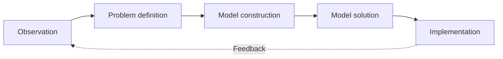

# مقدمة في البرمجة الخطية — Lecture 1: An Introduction to Linear Programming

> [!NOTE]
> المحاضرة دي مقدمة **Operations Research (بحوث العمليات)**: خطوات **الطريقة العلمية لحل المشاكل**، وبعدين أول مثال **Linear Programming (LP)** كامل: مصنع الفخار **Beaver Creek Pottery**، وإزاي نكتب **الموديل الرياضي (Model Formulation)** في 3 خطوات، وإزاي نلاقي الحل الأمثل.

---

## 1. خطوات حل المشكلات بالطريقة العلمية — Problem Solving


خطوات الطريقة العلمية (Scientific Method) بالترتيب:
1. **Observation** (الملاحظة).
2. **Problem definition** (تعريف المشكلة).
3. **Model construction** (بناء الموديل).
4. **Model solution** (حل الموديل) باستخدام **management science techniques**.
5. **Implementation** (التنفيذ) ← وبيطلع **Information** ← و**Feedback** يرجع للمراحل اللي قبله.



---

## 2. مثال: Beaver Creek Pottery Company

الشركة بتنتج **منتجين**: **Bowl (سلطانية)** و **Mug (كوب)**. المتاح يوميًا: **Labor = 40 ساعة** و **Clay = 120 رطل**.

| المنتج | Labor (ساعة/وحدة) | Clay (رطل/وحدة) | Profit (\$/وحدة) |
|---|---|---|---|
| **Bowl** | 1 | 4 | 40 |
| **Mug** | 2 | 3 | 50 |

### خطوات صياغة الموديل — LP Model Formulation Steps

| الخطوة | المطلوب | في المثال |
|---|---|---|
| **Step 1** | تعريف **Decision variables** (متغيرات القرار) | x₁ = عدد الـ bowls، x₂ = عدد الـ mugs |
| **Step 2** | تعريف **Objective function** (دالة الهدف) | Maximize Z = 40x₁ + 50x₂ (إجمالي الربح اليومي) |
| **Step 3** | تعريف **Constraints** (القيود): الموارد المتاحة | قيد العمل وقيد الطين |

**الموديل الكامل:**

```
Maximize Z = 40 x1 + 50 x2
subject to
    1 x1 + 2 x2 <= 40     (labor, hours)
    4 x1 + 3 x2 <= 120    (clay, lb)
    x1, x2 >= 0           (non-negativity)
```

> [!IMPORTANT]
> **عناصر أي LP:** (1) **Decision variables** (2) **Objective function** (max أو min) (3) **Constraints** (قيود الموارد) (4) **Non-negativity** (x ≥ 0). والدوال كلها **خطية (linear)**.

---

## 3. الحل — Solution


نجرّب النقاط الركنية (**corner points**) ونحسب Z عند كل واحدة:

| x₁ (bowls) | x₂ (mugs) | Z = 40x₁ + 50x₂ |
|---|---|---|
| 0 | 0 | 0 |
| 30 | 0 | 1200 |
| 0 | 20 | 1000 |
| **24** | **8** | **1360** ← **الأفضل** |

> [!EXAMPLE]
> الحل الأمثل: **24 bowl و 8 mugs** والربح = **40×24 + 50×8 = 960 + 400 = 1360\$**.
> **تحقق من القيود:** labor: 24 + 2×8 = **40** ✓ (مستنفد) · clay: 4×24 + 3×8 = **120** ✓ (مستنفد). يعني **القيدين binding**.

```python
# تحقق بالحساب
from scipy.optimize import linprog
r = linprog([-40,-50], A_ub=[[1,2],[4,3]], b_ub=[40,120])
print(r.x, -r.fun)   # [24. 8.]  1360.0
```

> [!NOTE]
> نقطة (30, 0) و (0, 20) هما تقاطع القيود مع المحاور، ونقطة (24, 8) هي **تقاطع قيدي العمل والطين**: بنحلهم سوا: x₁ + 2x₂ = 40 و 4x₁ + 3x₂ = 120 ⇒ x₂ = 8، x₁ = 24.

> [!EXAM]
> **أي LP عنده 3 أجزاء:** decision variables + objective + constraints. **الحل الأمثل بيكون على corner point** لمنطقة الحلول الممكنة. مثال بيفكرك: **(24, 8) ⇒ 1360\$**.
