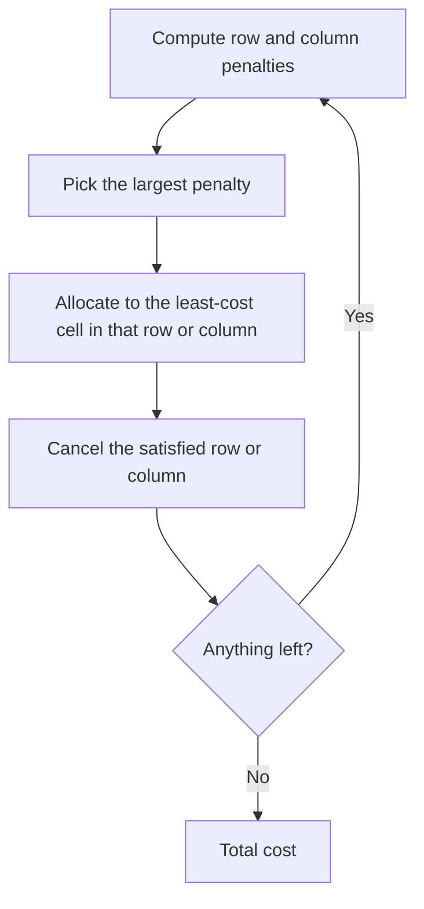

# طريقة فوجل — Lecture 6: Transportation Problem: Vogel's Approximation Method (VAM)

> [!NOTE]
> المحاضرة دي بتشرح **Vogel's Approximation Method (VAM)** خطوة بخطوة على نفس مثال المحاضرة اللي فاتت. الـ VAM بيستخدم **penalties (غرامات / فروقات)** عشان يختار أنهي صف/عمود يتخصص فيه الأول، وغالبًا بيدي **حل ابتدائي أقرب للأمثل**.

---

## 1. فكرة الـ VAM

بنحسب لكل صف وعمود **الـ penalty = الفرق المطلق بين أصغر تكلفتين** (**least** و **second least**). الصف/العمود اللي له **أكبر penalty** هو اللي بنخصص فيه الأول (لأن لو ما خدناش أقل تكلفة فيه هندفع فرق كبير).

**الخطوات:**
1. لكل **صف**: اطرح أصغر تكلفة من ثاني أصغر تكلفة = **Row difference**.
2. لكل **عمود**: نفس الشيء = **Column difference**.
3. اختار **أكبر penalty** (لو فيه تعادل اختار أي واحد).
4. في الصف/العمود المختار، اختار **أقل تكلفة** وخصص **min(supply, demand)**.
5. ألغِ الصف أو العمود اللي خلص (عرضه/طلبه = 0) وأعد حساب الـ penalties للباقي.
6. كرر لحد ما **كل العرض والطلب يخلص**. (لما يفضل صف أو عمود واحد بس، خصص باقي الخلايا حسب التكلفة.)



---

## 2. تطبيق على المثال

| | D1 | D2 | D3 | D4 | Supply |
|---|---|---|---|---|---|
| **O1** | 3 | 1 | 7 | 4 | 300 |
| **O2** | 2 | 6 | 5 | 9 | 400 |
| **O3** | 8 | 3 | 3 | 2 | 500 |
| **Demand** | 250 | 350 | 400 | 200 | |

### Iteration 1


- **Row penalties:** O1: (1, 3) ⇒ **2** · O2: (2, 5) ⇒ **3** · O3: (2, 3) ⇒ **1**.
- **Column penalties:** D1: (2, 3) ⇒ **1** · D2: (1, 3) ⇒ **2** · D3: (3, 5) ⇒ **2** · D4: (2, 4) ⇒ **2**.
- **أكبر penalty = 3 (الصف O2)**. أقل تكلفة في O2 = **2** عند **(O2, D1)**. الطلب 250 < العرض 400 ⇒ نخصص **250**، **نلغي D1**، وباقي O2 = 150.

### Iteration 2
- Row: O1 ⇒ (1, 4) = **3** · O2 ⇒ (5, 6) = 1 · O3 ⇒ (2, 3) = 1. Column: D2 = 2 · D3 = 2 · D4 = 2.
- **أكبر = 3 (الصف O1)**. أقل تكلفة **1** عند **(O1, D2)** ⇒ نخصص **300**، **نلغي O1**، وباقي طلب D2 = 50.

### Iteration 3
- Row: O2 ⇒ 1 · O3 ⇒ 1. Column: D2 ⇒ (3, 6) = **3** · D3 ⇒ (3, 5) = 2 · D4 ⇒ (2, 9) = **7**.
- **أكبر = 7 (العمود D4)**. أقل تكلفة في D4 = **2** عند **(O3, D4)** ⇒ نخصص **200**، **نلغي D4**، وباقي O3 = 300.

### Iteration 4
- Row: O2 ⇒ (5, 6) = 1 · O3 ⇒ (3, 3) = 0. Column: D2 ⇒ **3** · D3 ⇒ 2.
- **أكبر = 3 (العمود D2)**. أقل تكلفة في D2 = **3** عند **(O3, D2)** ⇒ نخصص **50**، **نلغي D2**، باقي O3 = 250.

### Iteration 5 و 6
- فاضل **عمود واحد (D3)**: نختار أقل تكلفة فيه: **(O3, D3) = 3** ⇒ نخصص **250** ثم الخلية الأخيرة **(O2, D3)** ⇒ **150**.


| | D1 | D2 | D3 | D4 |
|---|---|---|---|---|
| **O1** | | **300** | | |
| **O2** | **250** | | **150** | |
| **O3** | | **50** | **250** | **200** |

```
Total cost = 300*1 + 250*2 + 50*3 + 250*3 + 200*2 + 150*5
           = 300 + 500 + 150 + 750 + 400 + 750 = 2850
```

> [!EXAMPLE]
> **التكلفة بالـ VAM = 2850** (نفس الـ Least Cost وأحسن بكتير من الـ NW = 4400). وده كمان **الحل الأمثل** للمسألة (راجعته بحل LP كامل).

---

## 3. مقارنة الطرق الثلاثة على نفس المثال

| الطريقة | الأساس | التكلفة |
|---|---|---|
| **Northwest Corner** | الموقع (الركن) من غير تكلفة | 4400 |
| **Least Cost** | أقل تكلفة في الجدول | 2850 |
| **VAM** | الـ penalties | 2850 |

> [!TIP]
> الـ VAM **أكتر حسابات** لكنه **غالبًا أقرب للأمثل**، وبيحتاج iterations أقل لما نكمل بـ MODI.

> [!WARNING]
> الـ penalty لما يفضل صف/عمود واحد بس: خصص مباشرة من غير penalties. وعند **تعادل** في الـ penalties ممكن تختلف النتيجة النهائية حسب الاختيار (كلها حلول ابتدائية صحيحة).

> [!EXAM]
> **خطوات VAM:** penalties للصفوف والأعمدة ← أكبر penalty ← أقل تكلفة فيه ← خصص ← ألغِ ← كرر. **المثال: 2850.**
