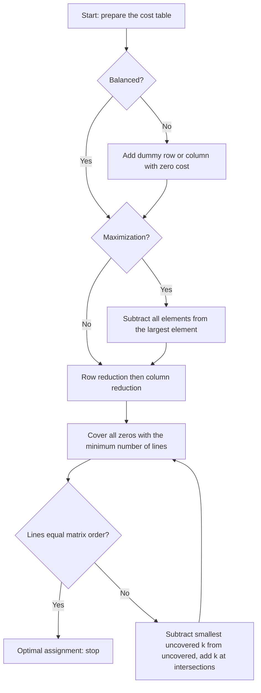

# مشكلة التخصيص — Lecture 7: Assignment Problem & Hungarian Method

> [!NOTE]
> المحاضرة دي عن **Assignment Problem**: تخصيص **n مهمة (jobs)** على **n عامل/ماكينة (facilities)** بحيث **كل عامل ياخد مهمة واحدة** و**كل مهمة لعامل واحد** وبأقل تكلفة (أو أعلى ربح). بنحلها بـ **Hungarian Method**، ونغطي حالة **Maximization** وحالة **Unbalanced**.

---

## 1. الموديل الرياضي — The Assignment Model

> الـ assignment حالة خاصة من الـ transportation: **كل العرض والطلب = 1**.

لو xᵢⱼ = **1** لو facility i اتخصص لـ job j، و **0** غير كده:

```
Minimize Z = ΣΣ cij xij
subject to  Σj xij = 1   (i = 1..n)   كل facility ياخد job واحد
            Σi xij = 1   (j = 1..n)   كل job يتعمل بـ facility واحد
            xij = 0 or 1
```

> لو استبدلنا xᵢⱼ ∈ {0,1} بـ xᵢⱼ ≥ 0 نحصل على **transportation model** بكل العرض والطلب = 1.

---

## 2. خوارزمية Hungarian Method




### الخطوات (Steps)

| الخطوة | الوصف |
|---|---|
| **Balance** | لو **عدد الصفوف = عدد الأعمدة** المسألة balanced. لو لأ لازم نوازنها (dummy) قبل الخوارزمية |
| **Step 1** | **اطرح أصغر عنصر في كل صف** من كل عناصر الصف (كل صف لازم فيه **صفر على الأقل**) |
| **Step 2** | **اطرح أصغر عنصر في كل عمود** من كل عناصر العمود (كل عمود فيه صفر على الأقل) |
| **Step 3** | **Assign zeros:** افحص الصفوف: صف فيه **صفر واحد غير معلّم** ← **حط حواليه دايرة (خصص)** و**اشطب باقي الأصفار في عموده**. وبعدين الأعمدة بنفس الشكل (اشطب باقي أصفار صفه) |
| **Step 4** | **Optimal test:** الحل أمثل لو **كل صف وعمود فيه صفر واحد محاط بدايرة بالظبط**. لو لأ كمل للخطوة 5 |
| **Step 5** | **ارسم أقل عدد خطوط** تغطي كل الأصفار: (a) علّم الصفوف **اللي مفيهاش تخصيص** (b) علّم الأعمدة اللي فيها أصفار في الصفوف المعلّمة (c) علّم الصفوف اللي فيها تخصيص في الأعمدة المعلّمة (d) كرر (b) و(c) لحد ما مفيش جديد. **ارسم خطوط** على الصفوف **غير المعلّمة** والأعمدة **المعلّمة**. لو **عدد الخطوط = order المصفوفة** ⇒ optimal |
| **Step 6** | **أصغر عنصر k غير مغطى بخط:** اطرحه من **كل العناصر غير المغطاة**، واجمعه على **العناصر عند تقاطع خطين**، والباقي زي ما هو |
| **Step 7** | كرر الخطوات 3 ← 6 لحد ما نلاقي التخصيص الأمثل |

---

## 3. مثال 1: Minimization (5 رجال × 5 مهام)

> المصفوفة = **زمن التشغيل بالساعات** لكل رجل على كل مهمة:

| | I | II | III | IV | V |
|---|---|---|---|---|---|
| **1** | 20 | 15 | 18 | 20 | 25 |
| **2** | 18 | 20 | 12 | 14 | 15 |
| **3** | 21 | 23 | 25 | 27 | 25 |
| **4** | 17 | 18 | 21 | 23 | 20 |
| **5** | 18 | 18 | 16 | 19 | 20 |

**المسألة balanced (5 × 5).**

**Step 1 (row reduction)** — أصغر عنصر في كل صف: (15, 12, 21, 17, 16):

| | I | II | III | IV | V |
|---|---|---|---|---|---|
| 1 | 5 | **0** | 3 | 5 | 10 |
| 2 | 6 | 8 | **0** | 2 | 3 |
| 3 | **0** | 2 | 4 | 6 | 4 |
| 4 | **0** | 1 | 4 | 6 | 3 |
| 5 | 2 | 2 | **0** | 3 | 4 |

**Step 2 (column reduction)** — أصغر عنصر في كل عمود: (0, 0, 0, 2, 3):

| | I | II | III | IV | V |
|---|---|---|---|---|---|
| 1 | 5 | **0** | 3 | 3 | 7 |
| 2 | 6 | 8 | **0** | **0** | **0** |
| 3 | **0** | 2 | 4 | 4 | 1 |
| 4 | **0** | 1 | 4 | 4 | **0** |
| 5 | 2 | 2 | **0** | 1 | 1 |


**Step 3 (assign zeros):** الصف 1 فيه صفر واحد ← (1, II). الصف 3 ← (3, I). الصف 5 ← (5, III) (الصفر الوحيد غير المشطوب)، والصف 2 يبقى (2, IV)، والصف 4 يبقى (4, V).

**Step 4:** كل صف وعمود فيه **صفر واحد محاط بدايرة** ⇒ **الحل أمثل**.

| الرجل | المهمة | الزمن |
|---|---|---|
| 1 | II | 15 |
| 2 | IV | 14 |
| 3 | I | 21 |
| 4 | V | 20 |
| 5 | III | 16 |
| **المجموع** | | **86 ساعة** |

> [!EXAMPLE]
> **التخصيص الأمثل:** 1←II، 2←IV، 3←I، 4←V، 5←III ⇒ **Z = 15 + 14 + 21 + 20 + 16 = 86 ساعة**.

```python
from scipy.optimize import linear_sum_assignment
import numpy as np
M=np.array([[20,15,18,20,25],[18,20,12,14,15],[21,23,25,27,25],[17,18,21,23,20],[18,18,16,19,20]])
r,c=linear_sum_assignment(M); print(c+1, M[r,c].sum())   # [2 4 1 5 3]  86
```

---

## 4. حالة الـ Maximization

> لو المسألة **تعظيم ربح**: بنحولها لـ **minimization** بـ **طرح كل عناصر المصفوفة من أكبر عنصر** فيها (opportunity loss). وبعدين نكمل Hungarian عادي.

### مثال 2 (Max): ربح كل عامل على كل job

| Work \\ Job | I | II | III | IV |
|---|---|---|---|---|
| A | 42 | 35 | 28 | 21 |
| B | 30 | 25 | 20 | 15 |
| C | 30 | 25 | 20 | 15 |
| D | 24 | 20 | 16 | 12 |

**التحويل (أكبر عنصر = 42):**

| | I | II | III | IV |
|---|---|---|---|---|
| A | 0 | 7 | 14 | 21 |
| B | 12 | 17 | 22 | 27 |
| C | 12 | 17 | 22 | 27 |
| D | 18 | 22 | 26 | 30 |

- **Row reduction** (أصغر عنصر في الصفوف: 0, 12, 12, 18) ثم **column reduction** (أصغر عنصر في الأعمدة: 0, 4, 8, 12) والنتيجة بعد الخطوتين:

| | I | II | III | IV |
|---|---|---|---|---|
| A | 0 | 3 | 6 | 9 |
| B | 0 | 1 | 2 | 3 |
| C | 0 | 1 | 2 | 3 |
| D | 0 | 0 | 0 | 0 |

- **Step 3:** عدد التخصيصات = **2 فقط** (A←I و D←II) ≠ 4 ⇒ **مش optimal**.
- **Step 5:** نعلّم الصفوف B و C (مفيهاش تخصيص) ← العمود I (فيه صفر في B) ← الصف A (تخصيص في عمود I). نرسم خطوط على **الصف D** و **العمود I** (عدد الخطوط **2 ≠ 4**).
- **Step 6:** أصغر عنصر غير مغطى **k = 1**: نطرحه من غير المغطى ونضيفه عند التقاطع ⇒ يظهر صف جديد ويبقى عدد التخصيصات 3.
- نكرر (خطوط على الصف D والأعمدة I و II) فيبقى **k = 1** تاني ⇒ المصفوفة:

| | I | II | III | IV |
|---|---|---|---|---|
| A | 0 | 2 | 4 | 7 |
| B | 0 | 0 | 0 | 1 |
| C | 0 | 0 | 0 | 1 |
| D | 2 | 1 | 0 | 0 |


**الحل الأمثل (4 تخصيصات):**

| Work | Job | الربح |
|---|---|---|
| A | I | 42 |
| B | II | 25 |
| C | III | 20 |
| D | IV | 12 |
| **المجموع** | | **99** |

> [!EXAMPLE]
> **أقصى ربح = 99** (A←I, B←II, C←III, D←IV). (B و C ليهم نفس الأرقام، فيه حل بديل بتبديلهم.)

---

## 5. Unbalanced Assignment Problem

> لو **عدد الصفوف ≠ عدد الأعمدة** ← نضيف **dummy rows/columns بتكلفة 0** لحد ما المصفوفة تبقى **مربعة**.

**مثال (Min):** 5 عمال (A..E) × 4 مهام (I..IV):

| | I | II | III | IV |
|---|---|---|---|---|
| A | 9 | 14 | 19 | 15 |
| B | 7 | 17 | 20 | 19 |
| C | 9 | 18 | 21 | 18 |
| D | 10 | 12 | 18 | 19 |
| E | 10 | 15 | 21 | 16 |

عدد الصفوف = 5 والأعمدة = 4 ⇒ **نضيف عمود dummy (J₅)** كله أصفار فتبقى 5 × 5، ونكمل بالـ Hungarian.

**الحل الأمثل:**

| Work | Job | التكلفة |
|---|---|---|
| A | III | 19 |
| B | I | 7 |
| C | dummy | 0 (مفيش مهمة) |
| D | II | 12 |
| E | IV | 16 |
| **Total** | | **54** |

> [!WARNING]
> في صفحة الحل بالسلايد الأرقام الرومانية مكتوبة بشكل مش واضح (OCR)؛ التخصيص ده من حسابي (Hungarian بـ scipy) والتكلفة **54** هي نفسها اللي في السلايد. والعامل **C** بياخد الـ dummy يعني **مفيش مهمة له**.

> [!EXAM]
> - **Assignment** = transportation بعرض وطلب = 1 · **n × n** · **Hungarian**: row red. ← col red. ← cover zeros ← (lines = n ؟ stop : adjust by k).
> - **Max** ← اطرح من أكبر عنصر · **Unbalanced** ← dummy بتكلفة صفر.
> - الأمثلة: **86** (min 5×5) · **99** (max 4×4) · **54** (unbalanced).
