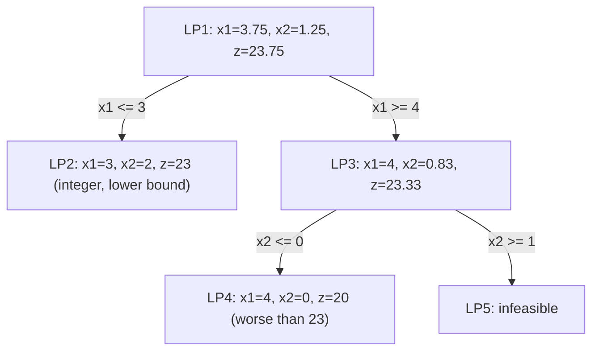

# البرمجة الصحيحة — Lecture 8: Integer Programming (Branch & Bound and Cutting Plane)

> [!NOTE]
> المحاضرة دي عن **Integer Programming (IP)**: متى نحتاج متغيرات صحيحة، أنواع الـ ILP، فكرة الـ **LP relaxation**، وطريقتين لحلها: **Branch-and-Bound (B&B)** و **Cutting-Plane**.

---

## 1. تعريفات أساسية

| المصطلح | التعريف |
|---|---|
| **Integer linear program (ILP)** | LP فيه شرط إضافي إن **متغير أو أكتر لازم يكون integer** |
| **All-integer (Pure) ILP** | **كل** متغيرات القرار integer |
| **Mixed-integer LP** | **بعض** (مش كل) المتغيرات integer |
| **0–1 (Binary) ILP** | المتغيرات الصحيحة مسموح لها بالقيم **0 أو 1** بس |
| **LP relaxation** | الـ LP الناتج من **إسقاط شرط الـ integer** |

> [!IMPORTANT]
> حل الـ **IP أصعب بكتير** من حل الـ LP.

### استراتيجية خوارزميات الـ ILP (3 خطوات)
1. **Relax**: احذف شرط الـ integer (وأي متغير binary Y نستبدله بـ 0 ≤ Y ≤ 1) ⇒ نحصل على LP عادي.
2. **Solve** الـ LP وحدد الـ **continuous optimum**.
3. من نقطة الـ continuous optimum **أضف قيود خاصة** بالتدريج تعدّل الـ solution space لحد ما نحصل على **extreme point optimum يحقق شرط الـ integer**.

**طريقتين لتوليد القيود الخاصة:** (1) **Branch-and-Bound (B&B)** (2) **Cutting-Plane method**.

> [!TIP]
> **ليه مينفعش نقرّب حل الـ LP لأقرب integer؟** الأمثلة تحت بتوضح إن الحل الصحيح ممكن يكون **بعيد** عن تقريب حل الـ LP.

---

## 2. الـ Branch-and-Bound

### المثال
```
Maximize z = 5 x1 + 4 x2
s.t.   x1 +  x2 <= 5
      10x1 + 6x2 <= 45
      x1, x2 nonnegative integers
```

**LP1 (الـ relaxation):** x₁ = **3.75**، x₂ = **1.25**، **z = 23.75** (حل مش integer).

**Branching على x₁** (قيمته 3.75 مش integer): بنقسم لمسألتين:
- **LP2:** نضيف **x₁ ≤ 3** ⇒ الحل **x₁ = 3, x₂ = 2, z = 23** ← **integer feasible**، نخليه **Lower bound = 23**.
- **LP3:** نضيف **x₁ ≥ 4** ⇒ الحل **x₁ = 4, x₂ = 0.83, z = 23.33** (مش integer).


LP3 فيه z = 23.33 > 23 ⇒ **مش مفروض نقطعه (fathom)**، نتفرع على **x₂** (0.83):
- **LP4 (x₂ ≤ 0):** x₁ = 4, x₂ = 0 ⇒ **z = 20** (integer لكن **أقل** من 23 ⇒ لا يحسّن).
- **LP5 (x₂ ≥ 1):** **no feasible solution**.




> [!NOTE]
> ترقيم الـ LPs في شجرة السلايد (LP4..LP8) مختلف عن الترقيم المبسط هنا لأن الشجرة بتعرض ترتيب تفرع بديل، لكن النتيجة واحدة: أفضل integer = 23 عند (3, 2).

> [!EXAMPLE]
> **الحل الأمثل للـ ILP: x₁ = 3، x₂ = 2، z = 23.** (وده مختلف عن تقريب الـ LP: (4, 1) مش feasible لأن 10×4 + 6×1 = 46 > 45.)

```python
best = max((5*a+4*b,a,b) for a in range(6) for b in range(6) if a+b<=5 and 10*a+6*b<=45)
print(best)   # (23, 3, 2)
```

### ملخص خوارزمية B&B (لمسألة Max)

نبدأ بـ **lower bound z = −∞**، i = 0.

**Step 1 (Fathoming / bounding):** اختار LPi وحلّه، ونحاول نقطعه (**fathom**) لو تحقق **واحد** من:
- (a) قيمة z المثلى **ما تقدرش تدي أحسن** من الـ lower bound الحالي.
- (b) LPi بيدي **حل integer أحسن** من الـ lower bound (فنحدّث الـ bound).
- (c) LPi **مفيهوش حل ممكن**.

- لو LPi اتقطع وبقى فيه حل أحسن ← **حدّث الـ lower bound**. ولو **كل المسائل اتقطعت** ← نقف: الحل الأمثل هو المرتبط بالـ lower bound الحالي (ولو مفيش bound محدد ← مفيش حل ممكن).
- لو LPi **ما اتقطعش** ← **Step 2**.

**Step 2 (Branching):** اختار متغير integer xⱼ **قيمته في حل LPi مش integer (= x̄ⱼ)**، وشيل المنطقة **⌊x̄ⱼ⌋ < xⱼ < ⌊x̄ⱼ⌋ + 1** بعمل **مسألتين**: **xⱼ ≤ ⌊x̄ⱼ⌋** و **xⱼ ≥ ⌊x̄ⱼ⌋ + 1**. ثم i = i + 1 وارجع لـ Step 1.

> الخطوات للـ **Max**. للـ **Min** نستبدل الـ lower bound بـ **upper bound** (قيمته الابتدائية +∞). ولـ **mixed problems** المتغير المستمر **مبنتفرعش عليه**.

---

## 3. مثال: ليه الـ LP حل مش integer؟

**المسألة:** Max z = 3x₁ + 2x₂ ، s.t. x₁ + 2x₂ ≤ 6 ، 4x₁ + x₂ ≤ 8 ، x₁, x₂ ≥ 0.

| Corner | (x₁, x₂) | z |
|---|---|---|
| O | (0, 0) | 0 |
| A | (2, 0) | 6 |
| **B** | **(1.43, 2.29)** | **8.86** ← LP optimum (مش integer) |
| C | (0, 3) | 6 |

ولو أضفنا قيود تانية زي **x₁ ≤ 1** ⇒ B(1, 2.5) ⇒ z = 8؛ و **x₂ ≤ 2** (مع x₁ ≤ 1) ⇒ B(1, 2) ⇒ **z = 7**؛ و **x₂ ≥ 3** ⇒ الحل (0, 3) ⇒ **z = 6**؛ و **x₁ ≥ 2** ⇒ (2, 0) ⇒ **z = 6**. (كل واحد بيدي منطقة حلول أصغر.)

---

## 4. طريقة الـ Cutting Plane

> بدل التفرع، بنضيف **قيود (cuts)** بتقطع جزء من الـ solution space **من غير ما تشيل أي نقطة integer feasible**، لحد ما extreme point الأمثل يبقى integer.

### مثال 1
```
max z = x1 + 2 x2
s.t. -x1 + 2x2 <= 2
      x1 +  x2 <= 5
      x1       <= 3
      x1, x2 >= 0, x1, x2 integer
```


| Point | x₁ | x₂ | z |
|---|---|---|---|
| A | 0 | 0 | 0 |
| B | 3 | 0 | 3 |
| C | 3 | 2 | 7 |
| **D** | **8/3** | **7/3** | **22/3 ≈ 7.33** ← LP optimum (مش integer) |
| E | 0 | 1 | 2 |

الـ LP optimum عند **D (8/3, 7/3)**. بنضيف **cut: x₂ ≤ 2** (بيقطع D ومعندوش نقاط integer) ⇒ الـ optimum الجديد عند **C (3, 2)** و **z = 7** ⇒ **integer** ✓.


> [!EXAMPLE]
> الحل الأمثل للـ ILP: **x₁ = 3، x₂ = 2، z = 7**. (راجعته: LP بالقيد الإضافي x₂ ≤ 2 بيدي (3, 2).)

### مثال 2
```
max z = x1 + x2
s.t.  x1 + 2x2 <= 10
     2x1 +  x2 <= 10
     x1, x2 >= 0 integer
```
- الـ LP optimum عند **(10/3, 10/3)** بـ **z = 20/3 ≈ 6.67**.
- بعد إضافة cuts مناسبة ← الحل الأمثل للـ ILP: **z = 6** ولينا حلّين: **(4, 2)** و **(2, 4)**.


> [!NOTE]
> التعويض: (4,2): 4+4 = 8 ≤ 10 ✓ و 8+2 = 10 ≤ 10 ✓ ⇒ z = 6 ✓. و(2,4): 2+8 = 10 ✓ و 4+4 = 8 ✓ ⇒ z = 6 ✓. ولا يوجد integer بـ z = 7 (راجعتها بالعد).

> [!EXAM]
> - **ILP أنواع:** pure / mixed / 0-1 · **LP relaxation** = نشيل شرط integer.
> - **B&B:** relax ← solve ← branch على متغير كسري (≤ ⌊x⌋ و ≥ ⌊x⌋+1) ← fathom بـ 3 شروط ← lower bound (للـ max).
> - المثال: LP = (3.75, 1.25) 23.75 ← ILP = **(3, 2) ⇒ 23**.
> - **Cutting plane:** نضيف قطع لحد ما الـ optimum يبقى integer.
