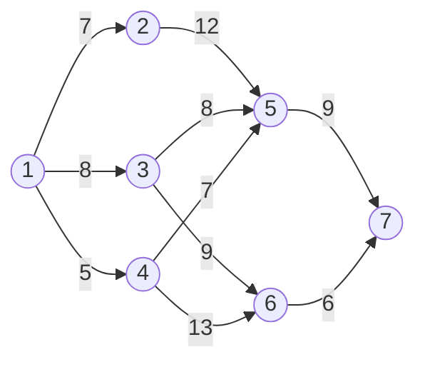

# البرمجة الديناميكية — Lecture 9: Dynamic Programming (Shortest-Route Problem)

> [!NOTE]
> المحاضرة دي عن **Dynamic Programming (DP)**: تعريفها وفكرة **المراحل (stages)**، وبعدين مثال **أقصر مسار (Shortest-Route Problem)** باستخدام **Forward recursion**.

---

## 1. تعريف الـ Dynamic Programming

> **Dynamic programming** = أسلوب لحل المشاكل بـ **تفكيك مشكلة كبيرة صعبة لعدد من المشاكل الأصغر الأسهل**. بعد حل كل المشاكل الصغيرة بنحصل على **الحل الأمثل للمشكلة الكبيرة**.

- كل مشكلة صغيرة مرتبطة بـ **stage (مرحلة)** في خطوات الحل، فالتقنية بتتطبق على **مشاكل القرار متعددة المراحل (multistage)**.
- غالبًا بتتعدد المراحل لأن **سلسلة قرارات** لازم تتاخد على مدى الزمن.

> **مثال:** قرار أمثل على أفق **سنة** ممكن يتقسم لـ **12 مرحلة**، كل مرحلة قرار أمثل لأفق **شهر**. المشاكل الصغيرة **مش مستقلة تمامًا** عن بعض، وهنا DP بتفيد.

---

## 2. مشكلة أقصر مسار — A Shortest-Route Problem

**الشبكة:** 7 عقد (nodes) من **1 (البداية)** لـ **7 (النهاية)**، مقسمة لـ **3 مراحل (stages)**:


| الـ Stage | العقد النهائية للمرحلة |
|---|---|
| **Stage 1** | 2, 3, 4 (من العقدة 1) |
| **Stage 2** | 5, 6 |
| **Stage 3** | 7 |

**المسافات (miles):**

| من → إلى | المسافة |
|---|---|
| 1 → 2 | 7 |
| 1 → 3 | 8 |
| 1 → 4 | 5 |
| 2 → 5 | 12 |
| 3 → 5 | 8 |
| 4 → 5 | 7 |
| 3 → 6 | 9 |
| 4 → 6 | 13 |
| 5 → 7 | 9 |
| 6 → 7 | 6 |

### المعادلة التكرارية — Forward Recursion

لو **fᵢ(xᵢ)** = أقصر مسافة للعقدة xᵢ في المرحلة i، و **d(xᵢ₋₁, xᵢ)** = المسافة من xᵢ₋₁ إلى xᵢ:

```
f_i(x_i) = min over (x_{i-1}, x_i) routes { d(x_{i-1}, x_i) + f_{i-1}(x_{i-1}) },   i = 1, 2, 3
```

> الفكرة: نحسب **أقصر مسافة تراكمية** لكل عقدة نهائية في المرحلة، ونستخدمها كمدخل للمرحلة التالية. نبدأ من العقدة 1 (f₀ = 0).

---

## 3. الحل مرحلة بمرحلة


### Stage 1
ملخص: أقصر مسافة من 1 إلى:
- العقدة **2** = **7** (من 1)
- العقدة **3** = **8** (من 1)
- العقدة **4** = **5** (من 1)

### Stage 2
**العقدة 5** ممكن توصلها من 2 أو 3 أو 4:
```
f(5) = min { 7 + 12 = 19  (via 2),
             8 +  8 = 16  (via 3),
             5 +  7 = 12  (via 4) }  = 12  (from node 4)
```
**العقدة 6** ممكن توصلها من 3 و 4 بس:
```
f(6) = min { 8 +  9 = 17  (via 3),
             5 + 13 = 18  (via 4) }  = 17  (from node 3)
```
ملخص: أقصر مسافة للعقدة **5 = 12** (من 4)، وللعقدة **6 = 17** (من 3).

### Stage 3
العقدة **7** تتوصل من 5 أو 6:
```
f(7) = min { 12 + 9 = 21  (via 5),
             17 + 6 = 23  (via 6) }  = 21  (from node 5)
```

> [!EXAMPLE]
> **أقصر مسافة بين العقدة 1 و 7 = 21 ميل.**
> **المسار (Traceback):** المرحلة 3 بتربط 7 بـ 5، والمرحلة 2 بتربط 5 بـ 4، والمرحلة 1 بتربط 4 بـ 1 ⇒ **المسار الأمثل: 1 → 4 → 5 → 7**.



```python
d={(1,2):7,(1,3):8,(1,4):5,(2,5):12,(3,5):8,(4,5):7,(3,6):9,(4,6):13,(5,7):9,(6,7):6}
f={1:0}
for n in [2,3,4,5,6,7]:
    f[n]=min(f[a]+w for (a,b),w in d.items() if b==n)
print(f)   # {1:0, 2:7, 3:8, 4:5, 5:12, 6:17, 7:21}
```

| العقدة | أقصر مسافة من 1 | جاية من |
|---|---|---|
| 2 | 7 | 1 |
| 3 | 8 | 1 |
| 4 | 5 | 1 |
| 5 | 12 | 4 |
| 6 | 17 | 3 |
| **7** | **21** | **5** |

> [!NOTE]
> أرقام المسافات في الجدول فوق استنتجتها من حسابات الـ recursion اللي في السلايد (7+12، 8+8، 5+7، 8+9، 5+13، 12+9، 17+6) لأن الرسم نفسه (شكل الشبكة) صورة، فراجع الأرقام على الشكل.

> [!EXAM]
> - **DP** = تفكيك لـ stages · الـ recursion: **f_i(x_i) = min { d(x_{i-1}, x_i) + f_{i-1}(x_{i-1}) }**.
> - مثال المحاضرة: أقصر مسافة **21** والمسار **1 → 4 → 5 → 7**.
