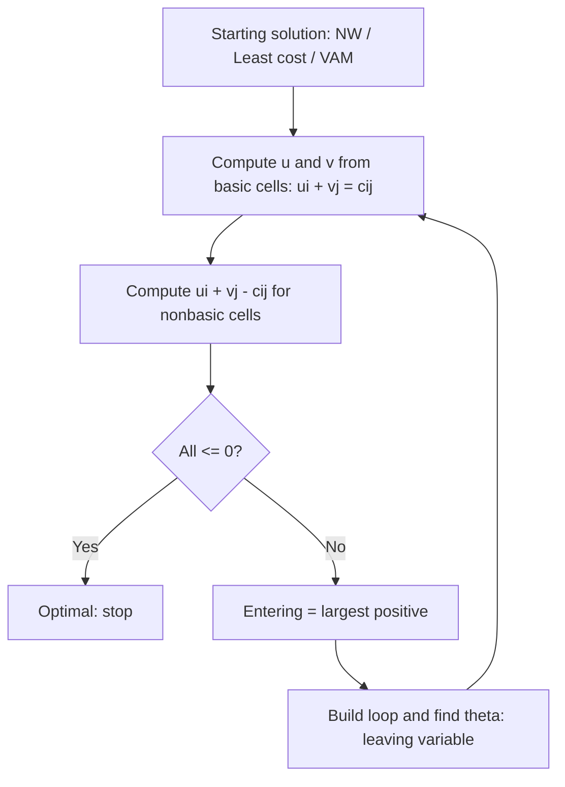

# نموذج النقل ومتغيراته — Transportation Model and Its Variants (Chapter 5)

> [!NOTE]
> الشابتر ده (من كتاب Taha) بيشرح **Transportation model** بالتفصيل: التعريف ومثال **MG Auto**، **الموازنة بـ dummy**، **تطبيقات غير تقليدية** (إدارة الإنتاج والمخزون وشحذ الأدوات)، **خوارزمية النقل** (Northwest-corner و Least-cost و Vogel ثم تحسين الحل بـ **MODI / u–v method**)، و**Assignment model**، و**Transshipment model**.
>
> **الفكرة العامة:** خطوات transportation algorithm هي **نفسها خطوات simplex** لكن على جدول مختصر (كانت للحساب اليدوي).

---

## 1. تعريف نموذج النقل

> **m مصادر و n وجهات**، كل واحد **node**. القوس (i, j) بيحمل: **تكلفة الوحدة cᵢⱼ** و**الكمية المشحونة xᵢⱼ**. **العرض aᵢ** في المصدر i و**الطلب bⱼ** في الوجهة j. الهدف: تحديد xᵢⱼ بحيث **تتقلل التكلفة الكلية** مع تحقيق كل قيود العرض والطلب.

```
Minimize  Z = Σi Σj cij xij
s.t.      Σj xij = ai   (supply of source i)
          Σi xij = bj   (demand of destination j)
          xij >= 0
```

### مثال 5.1-1: MG Auto
3 مصانع (**Los Angeles, Detroit, New Orleans**) بإنتاج **1000, 1500, 1200** عربية، و2 مراكز توزيع (**Denver, Miami**) بطلب **2300, 1400**. تكلفة نقل العربية:

| | Denver (1) | Miami (2) | Supply |
|---|---|---|---|
| **Los Angeles (1)** | \$80 | \$215 | 1000 |
| **Detroit (2)** | \$100 | \$108 | 1500 |
| **New Orleans (3)** | \$102 | \$68 | 1200 |
| **Demand** | 2300 | 1400 | |

**الموديل:** Min Z = 80x₁₁ + 215x₁₂ + 100x₂₁ + 108x₂₂ + 102x₃₁ + 68x₃₂.
**القيود كلها معادلات** لأن العرض الكلي (1000+1500+1200 = **3700**) = الطلب الكلي (2300+1400 = **3700**).


> [!EXAMPLE]
> **الحل الأمثل:** LA→Denver **1000** · Detroit→Denver **1300** · Detroit→Miami **200** · New Orleans→Miami **1200**.
> **التكلفة** = 1000×80 + 1300×100 + 200×108 + 1200×68 = 80,000 + 130,000 + 21,600 + 81,600 = **\$313,200**.

---

## 2. موازنة النموذج — Balancing

> خوارزمية النقل **بتفترض إن النموذج balanced** (الطلب الكلي = العرض الكلي). لو لأ نضيف **dummy source** أو **dummy destination**.

| الحالة | الحل | تكلفة الـ dummy |
|---|---|---|
| **العرض < الطلب** | نضيف **dummy source (مصنع وهمي)** عرضه = الفرق | **صفر** |
| **العرض > الطلب** | نضيف **dummy destination** طلبه = الفرق | **صفر** |

**مثال 5.1-2:** لو إنتاج Detroit بقى **1300** (العرض = 3500 < الطلب 3700) ⇒ بنضيف **dummy plant** بسعة **200 = 3700 − 3500**. الحل: الـ dummy بيشحن **200 لـ Miami** يعني Miami ناقصها **200 عربية**.

> [!TIP]
> لو عايز وجهة معينة **متتأثرش بالنقص**، حط تكلفة نقل **عالية جدًا** من الـ dummy ليها (عشان الـ dummy ما يشحنش لها).

> الحل الأمثل بعد dummy (تحقق بالحساب): LA→Denver 1000 · Detroit→Denver 1300 · New Orleans→Miami 1200 · Dummy→Miami 200 ⇒ **\$291,600**.

---

## 3. تطبيقات غير تقليدية — Nontraditional Models

### 3.1 مثال 5.2-1: Production-Inventory Control (شركة Boralis)

شركة بتصنع شنط ظهر. **الطلب (مارس–يونيو):** 100, 200, 180, 300. **الطاقة الإنتاجية:** 50, 180, 280, 270.
الطلب ممكن يتلبي بـ: (1) إنتاج الشهر نفسه **40\$/شنطة**، (2) فائض من شهر **أسبق** + **holding cost 0.50\$/شنطة/شهر**، (3) إنتاج شهر **لاحق** (backorder) + **penalty 2.00\$/شنطة/شهر تأخير**.

**التماثل مع Transportation:**
- **Source i** = إنتاج الشهر i (عرضه = الطاقة).
- **Destination j** = طلب الشهر j.
- **التكلفة cᵢⱼ:**
  - i = j: **40\$** (إنتاج)
  - i < j: **40 + 0.5(j − i)** (holding)
  - i > j: **40 + 2(i − j)** (penalty)

| | Mar (1) | Apr (2) | May (3) | Jun (4) | Supply |
|---|---|---|---|---|---|
| **Mar** | 40 | 40.5 | 41 | 41.5 | 50 |
| **Apr** | 42 | 40 | 40.5 | 41 | 180 |
| **May** | 44 | 42 | 40 | 40.5 | 280 |
| **Jun** | 46 | 44 | 42 | 40 | 270 |
| **Demand** | 100 | 200 | 180 | 300 | |

(مثلًا c₁₃ = 40 + 0.5×2 = **41**، و c₄₂ = 40 + 2×2 = **44**.) العرض الكلي = 780 = الطلب الكلي ⇒ **balanced**.

> [!EXAMPLE]
> **التكلفة المثلى = \$31,455.** (حلّ Taha و راجعته بـ LP: Mar←Mar 50 · Apr←Apr 180 · May: 50 لمارس و 20 لأبريل و 180 لمايو و 30 ليونيو · Jun←Jun 270.)

### 3.2 مثال 5.2-2: Tool Sharpening (مصنع خشب Arkansas Pacific)
**طلب الشفرات (blades) اليومي:** Mon 24 · Tue 12 · Wed 14 · Thu 20 · Fri 18 · Sat 14 · Sun 22 (المجموع **124**).
**الخيارات:** (1) شراء شفرة جديدة **12\$** (2) **overnight sharpening 6\$** (متاحة بعد يوم أو يومين) (3) **2-day sharpening 3\$** (متاحة بعد 3 أيام).

**النموذج:** 8 مصادر و7 وجهات:
- **Source 1** = شفرات جديدة (عرض كافي لتغطية 124).
- **Sources 2–8** = الأيام، **عرض كل يوم = عدد الشفرات المستعملة آخر اليوم** (= طلب اليوم).
- **Destinations** = أيام الأسبوع السبعة + **عمود Disposal (dummy)** للموازنة.
- **التكلفة:** 12 / 6 / 3 حسب مصدر الشفرة.

> [!EXAMPLE]
> **التكلفة المثلى = \$840** (فيه alternative optima). (راجعتها بـ LP.) ولو افترضنا أن الأسبوع بيدور (rotational) والأيام بتغذي الأسبوع اللي بعده تبقى التكلفة **\$372** والحل بيستخدم **2-day service** بس.

---

## 4. خوارزمية النقل — The Transportation Algorithm

**الخطوات (نفس السمبلكس):**
1. حدد **starting basic feasible solution**.
2. استخدم **optimality condition** لتحديد **entering variable** من الـ nonbasic. لو محققة ← **stop**.
3. استخدم **feasibility condition** لتحديد **leaving variable** وجد الحل الجديد. ارجع للخطوة 2.

> **عدد الـ basic variables = m + n − 1** لأن أحد قيود الـ m + n **redundant** (النموذج balanced).

### مثال 5.3-1: SunRay Transport
3 صوامع (silos) بعرض **15, 25, 10** شاحنة و4 مطاحن (mills) بطلب **5, 15, 15, 15**. التكاليف بمئات الدولارات:


| | Mill 1 | Mill 2 | Mill 3 | Mill 4 | Supply |
|---|---|---|---|---|---|
| **Silo 1** | 10 | 2 | 20 | 11 | 15 |
| **Silo 2** | 12 | 7 | 9 | 20 | 25 |
| **Silo 3** | 4 | 14 | 16 | 18 | 10 |
| **Demand** | 5 | 15 | 15 | 15 | 50 |

عدد الـ basic variables في البداية = 3 + 4 − 1 = **6**.

### الحل الابتدائي (3 طرق) — نتائج مراجعة بالحساب

| الطريقة | التخصيص | التكلفة |
|---|---|---|
| **Northwest-corner** | x₁₁=5, x₁₂=10, x₂₂=5, x₂₃=15, x₂₄=5, x₃₄=10 | **520** |
| **Least-cost** | x₁₂=15, x₂₃=15, x₂₄=10, x₃₁=5, x₃₄=5 | **475** |
| **Vogel (VAM)** | نفس تخصيص Least-cost في المثال ده | **475** |
| **الأمثل** | x₁₂=5, x₁₄=10, x₂₂=10, x₂₃=15, x₃₁=5, x₃₄=5 | **435** |

> الـ 3 طرق بتختلف في **جودة** الحل: الـ NW الأبعد، الـ VAM غالبًا الأقرب. ولو **صف وعمود خلصوا في نفس الوقت** بنشطب واحد بس (عشان نحافظ على m+n−1 basic variables، وممكن نخلي basic بقيمة 0).


### تحسين الحل: MODI (u–v method)

**Optimality test:** نحسب **u** لكل صف و **v** لكل عمود من الـ **basic cells** بالمعادلة **uᵢ + vⱼ = cᵢⱼ** (بنحط u₁ = 0). بعدين لكل **nonbasic** نحسب **uᵢ + vⱼ − cᵢⱼ**؛ **لو كلها ≤ 0 ⇒ optimal** (للـ minimization). وإلا نختار **الأكبر موجب** كـ **entering variable**.

**على الحل الابتدائي (NW = 520):** u = (0, 5, 3) و v = (10, 2, 4, 15):

| Nonbasic | uᵢ + vⱼ − cᵢⱼ |
|---|---|
| x₁₃ | 0 + 4 − 20 = **−16** |
| x₁₄ | 0 + 15 − 11 = **+4** |
| x₂₁ | 5 + 10 − 12 = **+3** |
| **x₃₁** | 3 + 10 − 4 = **+9** ← الأكبر (entering) |
| x₃₂ | 3 + 2 − 14 = **−9** |
| x₃₃ | 3 + 4 − 16 = **−9** |

**Entering = x₃₁.** نكوّن **loop** (دورة) من الخلايا الـ basic ونحسب أكبر كمية θ نقدر نحطها (**أصغر قيمة في الخلايا اللي بتنقص**)، ونعدّل الحل ونكرر لحد ما كل القيم ≤ 0.

**على الحل الأمثل (435):** u = (0, 5, 7)، v = (−3, 2, 4, 11): كل قيم uᵢ + vⱼ − cᵢⱼ للـ nonbasic = (−13, −16, −10, −4, −5, −5) **كلها سالبة** ⇒ **optimal** ✓.



> [!NOTE]
> تفاصيل iterations الـ MODI في الكتاب (Tables 5.20–5.25) مش معروضة هنا كاملة؛ اللي فوق هو **أول** اختبار optimality ونتيجة الاختبار على الحل **الأمثل** النهائي (435)، وكلاهما راجعته بالحساب.

---

## 5. نموذج التخصيص — The Assignment Model

> **Assignment** حالة خاصة من الـ transportation: **n عامل و n وظيفة**، كل **عرض وطلب = 1**، والهدف **أقل تكلفة** لـ **تخصيص واحد لواحد**.

- لو عدد العمال ≠ عدد الوظائف نضيف **fictitious** عمال أو وظائف (تكلفة صفر).
- بنحله بـ **Hungarian Method**: (1) اطرح **أصغر عنصر في كل صف** (2) اطرح **أصغر عنصر في كل عمود** (3) التخصيص الأمثل من **الأصفار** (4) لو مفيش تخصيص كامل: غطّي الأصفار بأقل خطوط، واطرح **أصغر عنصر غير مغطى** من غير المغطى وأضفه عند التقاطع، وكرر.
- **مثال Klyne:** 3 أطفال × 3 مهام (جز العشب، غسيل العربية، دهان باب الجراج): التخصيص الأمثل **تكلفته \$27 (= 9 + 10 + 8)** حسب الكتاب.
- **لماذا الـ Hungarian بيشتغل؟** الخطوتين الأولين بيطرحوا ثوابت من الصفوف والأعمدة، فالـ objective بيتغير بـ **ثابت** بس، فالحل الأمثل (قيم xᵢⱼ) **بيفضل نفسه**.

(الشرح التفصيلي والأمثلة الرقمية في Lec 7.)

---

## 6. نموذج الـ Transshipment

> في الـ **transshipment** البضاعة ممكن **تعدّي بـ nodes وسيطة** قبل الوصول للوجهة النهائية. الـ node اللي ليه **arcs داخلة وخارجة** بيشتغل كـ **source وdestination في نفس الوقت** وبيسمّى **transshipment node**.


**مثال:** مصنعين **T1, T2** (عرض **1000, 1200**) بيشحنوا لـ 3 تجار **D1, D2, D3** (طلب **800, 900, 500**) وممكن عن طريق nodes وسيطة.

**التحويل لنموذج نقل عادي (Table 5.44):**
1. كل node (مصدر أو وجهة أو وسيط) بيبقى **source وdestination**.
2. نضيف **buffer B** = **إجمالي العرض (أو الطلب) للنموذج** (هنا 2200) لكل node وسيط: عرضه = (العرض الأصلي + B)، وطلبه = (الطلب الأصلي + B).
3. **تكلفة الشحن من node لنفسه = 0** (عشان الكمية اللي "فاضلة" في الـ buffer تفضل ثابتة).
4. بنحله بالـ transportation algorithm العادي.

> [!EXAM]
> - **Transportation:** m+n−1 basic variables · balanced ← dummy بتكلفة 0.
> - **MG Auto:** 313,200 · **Boralis:** 31,455 · **Tool sharpening:** 840 · **SunRay:** NW 520, LC/VAM 475, optimal **435**.
> - **MODI:** uᵢ + vⱼ = cᵢⱼ للـ basic · entering = أكبر (uᵢ + vⱼ − cᵢⱼ) موجب · optimal لو كلها ≤ 0.
> - **Assignment** = transportation بعرض/طلب = 1 · **Transshipment** = nodes وسيطة + buffer.
