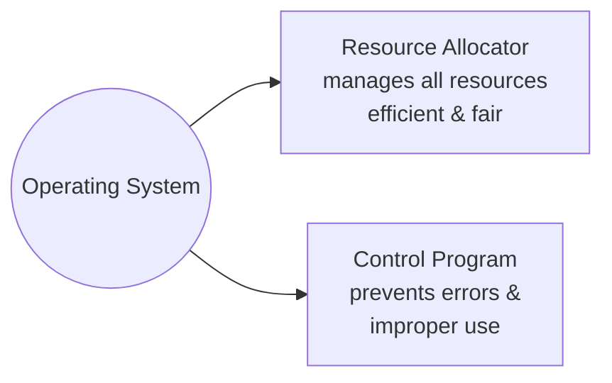
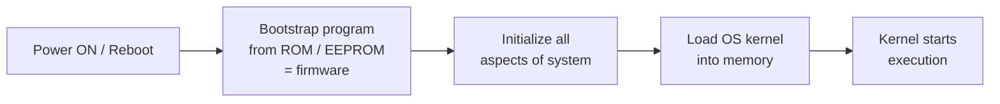
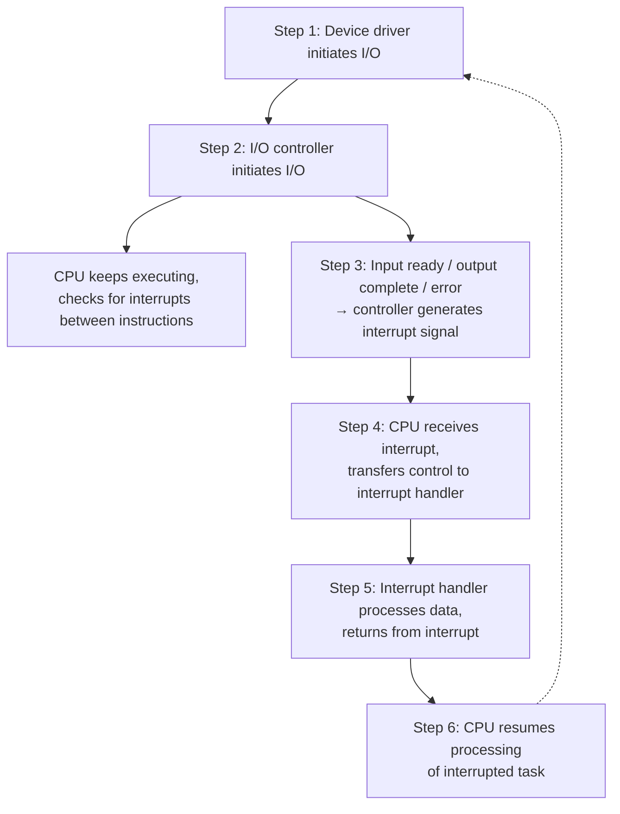
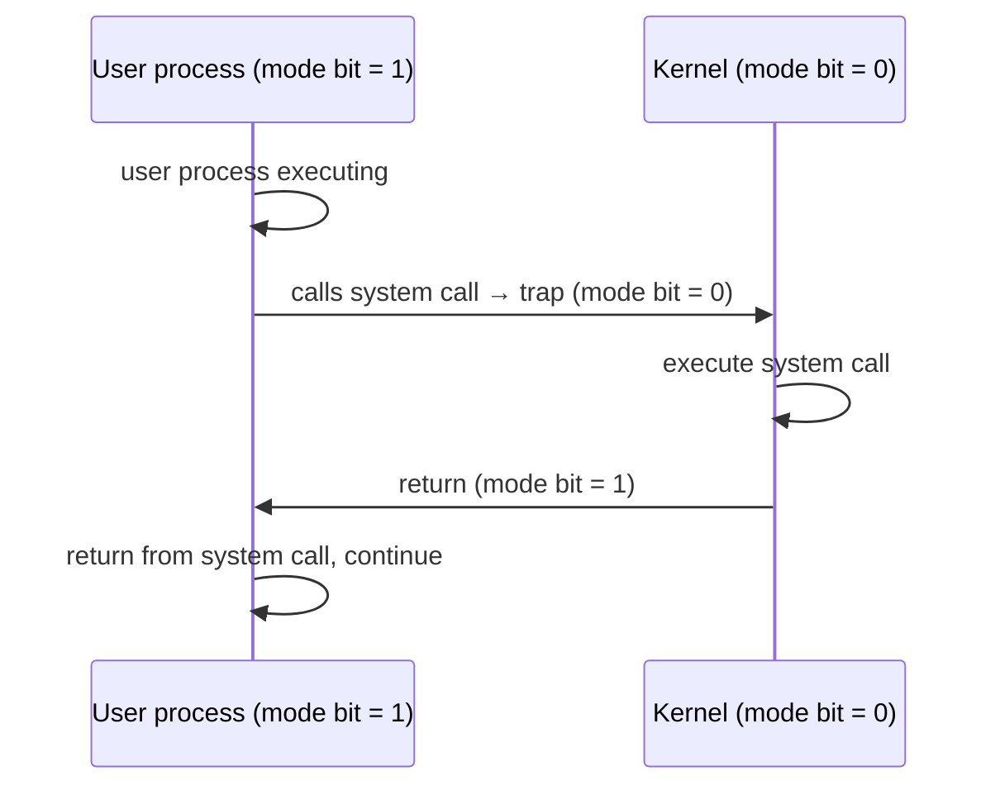
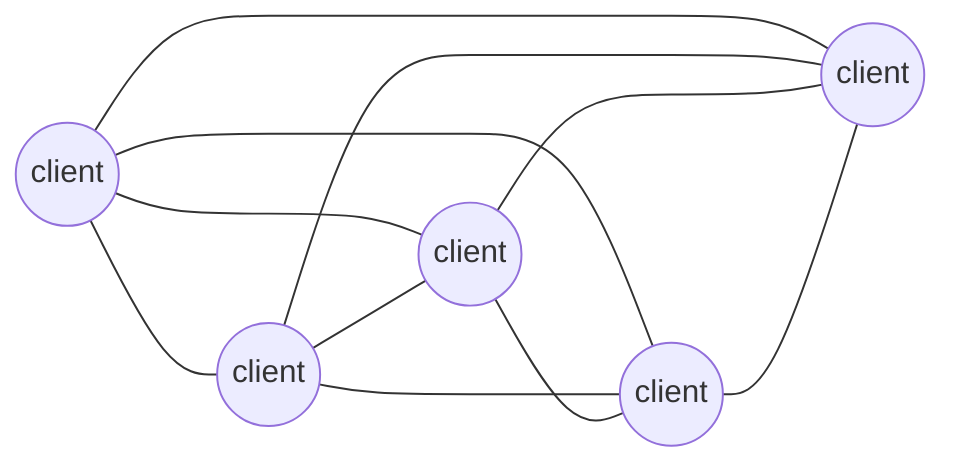
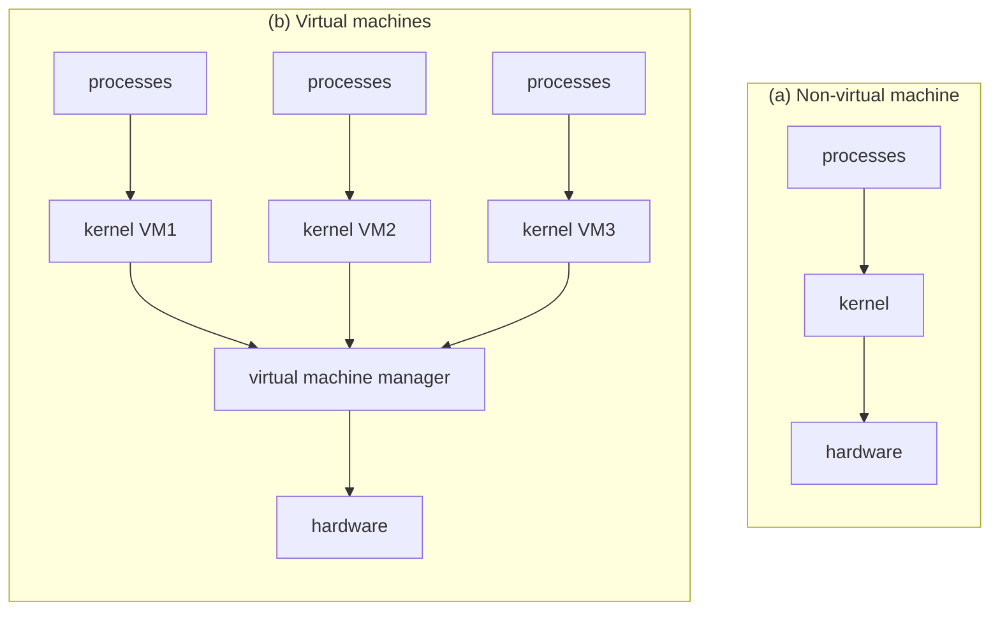

# مقدمة عن نظم التشغيل — Chapter 1: Introduction

> [!NOTE]
> المحاضرة دي هي الأساس اللي المادة كلها مبنية عليه. هنفهم يعني إيه **Operating System**، والكمبيوتر بيشتغل إزاي من جوه (Interrupts وStorage وMultiprocessing)، وبعدين نشوف الـ OS بيحمي نفسه إزاي (Dual-mode) وأنواع بيئات الحوسبة (Computing Environments).

**خريطة المحاضرة:**

1. مكونات أي نظام كمبيوتر (Computer System Structure)
2. تعريف نظام التشغيل وأهدافه (What is an OS?)
3. الـ OS بيعمل إيه؟ (User View و System View)
4. تنظيم الكمبيوتر (Bootstrap و Interrupts)
5. هرم التخزين (Storage Structure)
6. الأنظمة متعددة المعالجات (Multiprocessing)
7. هيكل وعمليات الـ OS (Multiprogramming و Timesharing و Dual-mode)
8. الحماية والأمان (Protection and Security)
9. بيئات الحوسبة (Client-Server و P2P و Virtualization و Cloud)

---

## 1. مكونات نظام الكمبيوتر — Computer System Structure

أي نظام كمبيوتر بيتقسم لـ **4 مكونات (four components)**:

| المكون | بالعربي | دوره | أمثلة |
|---|---|---|---|
| **Hardware** | العتاد | بيوفر موارد الحوسبة الأساسية (basic computing resources) | CPU, memory, I/O devices |
| **Operating System** | نظام التشغيل | بيتحكم وينسّق (controls and coordinates) استخدام الهاردوير بين البرامج والمستخدمين المختلفين | Windows, Linux, macOS |
| **Application Programs** | البرامج التطبيقية | بتحدد إزاي موارد النظام هتتستخدم عشان تحل مشاكل المستخدم | Word processors, compilers, web browsers, database systems, video games |
| **Users** | المستخدمين | اللي بيستخدموا النظام | People, machines, other computers |

> [!TIP]
> بص على الشكل من تحت لفوق: **Hardware** ← فوقه **Operating System** ← فوقه **System & Application Programs** ← فوقهم **Users**. يعني الـ OS هو "الطبقة الوسيطة" اللي محدش من فوق بيكلم الهاردوير غير من خلالها.

> [!EXAM]
> خد بالك إن الـ **Users** مش لازم يكونوا بني آدمين بس. التعريف بيقول: *People, machines, other computers*. وده سؤال MCQ بييجي كتير.

---

## 2. يعني إيه نظام تشغيل؟ — What is an Operating System?

### التعريف

> An **operating system** is a program that **manages the computer's hardware**. It also provides a **basis for application programs** and acts as an **intermediary between the computer user and the computer hardware**.

يعني نظام التشغيل هو **برنامج** بيعمل 3 حاجات:
1. **بيدير الهاردوير** (manages hardware).
2. **بيوفر أساس** تشتغل عليه البرامج التطبيقية (basis for application programs).
3. **وسيط (intermediary)** بين المستخدم والهاردوير.

> [!EXAMPLE]
> تخيل الـ OS زي **مدير مطعم**. الزبون (User) مش بيدخل المطبخ ويكلم الطباخ والثلاجة والفرن (Hardware) بنفسه. هو بيطلب من الجرسون والمدير، والمدير هو اللي ينظم مين يستخدم الفرن إمتى، وإزاي الطلبات متتلخبطش.

### أهداف نظام التشغيل (Operating System Goals)

| الهدف | بالعربي |
|---|---|
| Execute user programs and make solving user problems **easier** | تشغيل برامج المستخدم وتسهيل حل مشاكله |
| Make the computer system **convenient** to use | إن الجهاز يبقى مريح وسهل في الاستخدام |
| Use the computer hardware in an **efficient** manner | استخدام الهاردوير بكفاءة |

> [!EXAM]
> الكلمات المفتاحية للأهداف: **easier – convenient – efficient**. في الامتحان ممكن يجيبلك اختيار زي "To provide network services" وده **مش** من الأهداف الأساسية.

---

## 3. الـ OS بيعمل إيه؟ — What Operating Systems Do?

بنبص على الـ OS من **زاويتين (two views)**:

### أ) من وجهة نظر المستخدم — User View

- المستخدم عايز **convenience** و **ease of use** و **good performance**.
- المستخدم العادي **مش فارق معاه resource utilization**، يعني مش مهتم الموارد بتتوزع إزاي، المهم الجهاز يشتغل بسرعة وسهولة.
- **لكن** في الأجهزة المشتركة (shared computer) زي **mainframe** أو **minicomputer**، الـ OS لازم **يرضي كل المستخدمين** (keep all users happy)، فهنا توزيع الموارد بيبقى مهم جدًا.

### ب) من وجهة نظر النظام — System View

من وجهة نظر الكمبيوتر نفسه، الـ OS هو البرنامج **الأقرب للهاردوير** (most intimately involved with the hardware). وهنا بنشوفه بدورين:

| الدور | معناه |
|---|---|
| **Resource Allocator** (موزّع الموارد) | بيدير كل الموارد (CPU time, memory space, file-storage space, I/O devices)، وبيقرر بين الطلبات المتعارضة (conflicting requests) بطريقة **efficient and fair** |
| **Control Program** (برنامج تحكم) | بيتحكم في تنفيذ البرامج عشان يمنع **الأخطاء** و**الاستخدام الغلط** للكمبيوتر (prevent errors and improper use) |

### النواة — The Kernel

> The operating system is **the one program running at all times** on the computer — usually called the **kernel**.

يعني التعريف الأشهر للـ OS هو **الـ Kernel**: البرنامج الوحيد اللي **شغال طول الوقت**.

جنب الـ kernel في نوعين تانيين من البرامج:

| النوع | الوصف | مثال |
|---|---|---|
| **Kernel** | شغال طول الوقت، قلب الـ OS | Linux kernel |
| **System programs** | مرتبطة بالـ OS **بس مش لازم تبقى جزء من الـ kernel** | File manager, Task manager |
| **Application programs** | كل البرامج اللي **ملهاش علاقة** بتشغيل النظام | Chrome, Word, Games |

> [!WARNING]
> الفرق بين **System programs** و **Kernel** بييجي كتير: الـ System programs *associated with the OS* لكن *not necessarily part of the kernel*.

---

## 4. تنظيم نظام الكمبيوتر — Computer System Organization

الكمبيوتر الحديث (modern general-purpose computer) بيتكون من:
- **CPU واحد أو أكتر**
- عدد من الـ **device controllers** (متحكمات الأجهزة)
- كلهم متوصلين ببعض عن طريق **common bus** (ناقل مشترك) بيوصلهم بـ **shared memory** (ذاكرة مشتركة).

> [!NOTE]
> كل **device controller** مسؤول عن نوع معين من الأجهزة (مثلًا: disk controller للهارد، USB controller للماوس والكيبورد والطابعة، graphics adapter للشاشة). الـ CPU والـ controllers ممكن يشتغلوا **في نفس الوقت (concurrently)** وبيتنافسوا على الوصول للـ memory.

### 4.1 تشغيل الكمبيوتر — Computer Startup (Bootstrap)

لما تدوس زرار الباور (power-up) أو تعمل restart (reboot)، أول برنامج بيشتغل اسمه **bootstrap program**:

| النقطة | التفاصيل |
|---|---|
| **متخزن فين؟** | في **ROM** أو **EEPROM** (electrically erasable programmable read-only memory)، وده بنسميه **firmware** |
| **بيعمل إيه؟** | بيعمل **initialize** لكل أجزاء النظام (CPU registers, device controllers, memory) |
| **وبعدين؟** | بيحمّل الـ **OS kernel** في الميموري ويبدأ تشغيله (loads OS kernel and starts execution) |

> [!EXAMPLE]
> لما بتفتح اللابتوب وتلاقي لوجو الشركة (HP / Dell) والكلام بتاع "Press F2 for Setup"، ده الـ **firmware / bootstrap** بيشتغل من الـ ROM. بعدها تلاقي لوجو Windows، وده معناه إن الـ kernel اتحمّل في الميموري (OS loading in memory).

> [!EXAM]
> ليه الـ bootstrap متخزن في **ROM** مش RAM؟ لأن الـ RAM **volatile** (بتتمسح لما الكهربا تقطع)، فوقت التشغيل بتبقى فاضية. لكن الـ ROM **nonvolatile**، فالبرنامج بيفضل موجود.

### 4.2 المقاطعات — Interrupts

الـ **Interrupt** هو **إشارة** بتقول للـ CPU إن فيه **حدث (event)** محتاج اهتمامه دلوقتي.

الـ interrupt ممكن ييجي من مصدرين:

| المصدر | إزاي | مثال |
|---|---|---|
| **Hardware** | الهاردوير يبعت **signal** للـ CPU في أي وقت، غالبًا عن طريق **system bus** | الكيبورد لما تدوس زرار، الهارد لما يخلص نقل بيانات |
| **Software** | البرنامج ينفذ عملية خاصة اسمها **system call** (وبتتسمى كمان **monitor call**) | برنامج عايز يقرا ملف فبيطلب من الـ OS |

#### إزاي الـ Interrupt بيتعالج؟

1. الـ interrupt بينقل التحكم لـ **Interrupt Service Routine (ISR)**، وده الكود المسؤول عن التعامل مع النوع ده من الـ interrupts.
2. ده بيتم غالبًا عن طريق **interrupt vector**، وهو **جدول** فيه **عناوين (addresses) كل الـ service routines**.
3. الـ interrupt architecture لازم **تحفظ عنوان الـ instruction اللي اتقطعت** (save the address of the interrupted instruction) عشان ترجع تكمّل منها بعد ما تخلص.

> [!IMPORTANT]
> **Trap** أو **Exception** = **software-generated interrupt**، يعني interrupt جاي من السوفتوير، وسببه واحد من اتنين:
> - **خطأ (error)**: زي القسمة على صفر (division by zero).
> - **طلب من المستخدم (user request)**: زي طلب خدمة من الـ OS.

> [!EXAM]
> جملة مهمة جدًا: **"An operating system is interrupt driven"**، يعني الـ OS شغله كله قايم على الـ interrupts. لو مفيش interrupts ولا برامج شغالة، الـ OS بيفضل مستني.

#### التعامل مع المقاطعة — Interrupt Handling

- الـ OS بيحفظ **حالة الـ CPU** (state of the CPU) عن طريق تخزين الـ **registers** والـ **program counter**.
- بيحدد **نوع الـ interrupt** اللي حصل.
- فيه **segments of code منفصلة** بتحدد الإجراء المناسب لكل نوع interrupt.

#### الخط الزمني للمقاطعة — Interrupt Timeline

خطوات الشكل ده ببساطة:
1. البرنامج يطلب **I/O request**، والجهاز يبدأ **transferring** (ينقل البيانات).
2. في الوقت ده الـ CPU **مش بيستنى**. هو بيكمّل شغله في الـ **user program**.
3. الجهاز يخلص (**transfer done**) فيبعت **interrupt signaled**.
4. الـ CPU يسيب اللي في إيده ويروح يعمل **I/O interrupt processing** (**interrupt handled**).
5. يرجع يكمّل الـ user program.

#### دورة الـ I/O بالمقاطعات — Interrupt-Driven I/O Cycle

---

## 5. هيكل التخزين — Storage Structure

### مراجعة سريعة على وحدات التخزين

| الوحدة | القيمة |
|---|---|
| **bit** | أصغر وحدة: 0 أو 1 |
| **byte** | 8 bits، وأصغر وحدة "عملية" للتخزين (معظم الأجهزة مفيهاش instruction تنقل bit لوحده، لكن فيها instruction تنقل byte) |
| **word** | الوحدة الطبيعية للبيانات في معمارية الجهاز، ويتكون من byte أو أكتر (مثلًا جهاز 64-bit ← الـ word = 8 bytes) |
| **KB** (kilobyte) | 1,024 bytes |
| **MB** (megabyte) | 1,024² bytes |
| **GB** (gigabyte) | 1,024³ bytes |
| **TB** (terabyte) | 1,024⁴ bytes |
| **PB** (petabyte) | 1,024⁵ bytes |

> [!NOTE]
> الشركات بتقرّب الأرقام وتقول 1 MB = مليون byte و 1 GB = مليار byte. وقياسات **الشبكات** استثناء، لأنها بتتقاس بالـ **bits** (لأن الشبكة بتنقل البيانات bit by bit).

### الذاكرة الرئيسية والتخزين الثانوي — Main Memory vs Secondary Storage

| | **Main Memory** (الذاكرة الرئيسية) | **Secondary Storage** (التخزين الثانوي) |
|---|---|---|
| التعريف | الوسيط الكبير **الوحيد** اللي الـ CPU يقدر يوصله **مباشرة** (directly) | امتداد للـ main memory بيوفر سعة كبيرة |
| نوع الوصول | **Random access** | — |
| بيتمسح لما الكهربا تقطع؟ | **Volatile** (غالبًا) | **Nonvolatile** |
| أمثلة | RAM | Hard disk, SSD |

### الهارد ديسك والـ SSD

- **Hard disks**: أطباق (**platters**) معدنية أو زجاجية مغطية بمادة مغناطيسية.
  - سطح الديسك متقسم منطقيًا لـ **tracks** (مسارات)، وكل track متقسم لـ **sectors** (قطاعات).
  - الـ **disk controller** هو اللي بيحدد التعامل المنطقي بين الجهاز والكمبيوتر.
- **Solid-state disks (SSD)**: **أسرع** من الهارد و **nonvolatile**، وبتستخدم تقنيات مختلفة، واستخدامها بيزيد.

### هرم التخزين — Storage Hierarchy

أنظمة التخزين متنظمة في **هرم (hierarchy)** حسب 3 حاجات: **Speed – Cost – Volatility** (السرعة، التكلفة، والتطاير).

| المستوى (من فوق لتحت) | النوع | Volatile؟ |
|---|---|---|
| Registers | primary | ✅ volatile |
| Cache | primary | ✅ volatile |
| Main memory | primary | ✅ volatile |
| Nonvolatile memory (SSD / flash) | secondary | ❌ nonvolatile |
| Hard-disk drives | secondary | ❌ nonvolatile |
| Optical disk | tertiary | ❌ nonvolatile |
| Magnetic tapes | tertiary | ❌ nonvolatile |

> [!TIP]
> احفظ القاعدة دي: **كل ما تطلع لفوق ← أسرع (faster)، أغلى (more expensive)، أصغر (smaller)، و volatile.**
> **وكل ما تنزل لتحت ← أبطأ (slower)، أرخص، أكبر (larger)، و nonvolatile.**
> الترتيب من الأسرع للأبطأ: **Registers → Cache → Main memory → Disk**

### مقارنة تفصيلية — Levels of Storage

| Level | 1 | 2 | 3 | 4 | 5 |
|---|---|---|---|---|---|
| **Name** | registers | cache | main memory | solid state disk | magnetic disk |
| **Typical size** | < 1 KB | < 16 MB | < 64 GB | < 1 TB | < 10 TB |
| **Implementation technology** | custom memory with multiple ports CMOS | on-chip or off-chip CMOS SRAM | CMOS SRAM | flash memory | magnetic disk |
| **Access time (ns)** | 0.25 – 0.5 | 0.5 – 25 | 80 – 250 | 25,000 – 50,000 | 5,000,000 |
| **Bandwidth (MB/sec)** | 20,000 – 100,000 | 5,000 – 10,000 | 1,000 – 5,000 | 500 | 20 – 150 |
| **Managed by** | compiler | hardware | operating system | operating system | operating system |
| **Backed by** | cache | main memory | disk | disk | disk or tape |

> [!EXAM]
> أسئلة بتيجي من الجدول ده:
> - **مين بيدير الـ registers؟** ← الـ **compiler**
> - **مين بيدير الـ cache؟** ← الـ **hardware**
> - **مين بيدير الـ main memory والديسكات؟** ← الـ **operating system**

لما بيانات (زي متغير A) تتنقل بين المستويات بتمشي كده:

### الكمبيوتر الحديث شغال إزاي — How a Modern Computer Works

> [!IMPORTANT]
> **DMA (Direct Memory Access)**: بيستخدم مع أجهزة الـ I/O **السريعة** (high-speed I/O devices). الـ device controller بينقل **block كامل** من البيانات **مباشرة** من/إلى الـ memory **من غير ما الـ CPU يتدخل** في كل byte، وبيعمل **interrupt واحد بس لكل block** بدل interrupt لكل byte. كده الـ CPU بيفضى لشغل تاني.

---

## 6. الأنظمة متعددة المعالجات — Multiprocessing Architecture

**Multiprocessor systems** (وبتتسمى كمان **parallel systems**) استخدامها وأهميتها بيزيدوا.

### مميزاتها: 3 مزايا (Advantages)

| الميزة | الشرح |
|---|---|
| **1. Increased throughput** (زيادة الإنتاجية) | لما تزوّد عدد المعالجات بتخلص شغل أكتر في وقت أقل |
| **2. Economy of scale** (اقتصاد الحجم) | أرخص من أجهزة منفصلة كتير بمعالج واحد، لأنهم **بيشاركوا** الـ peripherals والـ mass storage والـ power supplies |
| **3. Increased reliability** (زيادة الاعتمادية) | لو معالج وقع الباقي يكمّل، وده اسمه **graceful degradation** أو **fault tolerance** |

> [!TIP]
> احفظهم بـ **T – E – R**: **T**hroughput, **E**conomy of scale, **R**eliability.

### نوعين (Two types)

| النوع | الوصف |
|---|---|
| **Asymmetric Multiprocessing** (غير متماثل) | كل معالج متخصص في **مهمة معينة** (each processor is assigned a specific task) |
| **Symmetric Multiprocessing — SMP** (متماثل) | كل معالج بيعمل **كل المهام** (each processor performs all tasks) |

### معالجات متعددة الأنوية — Multi-chip and Multicore

> [!NOTE]
> الفرق: **Multi-chip** يعني أكتر من شريحة معالج منفصلة. **Multicore** يعني أكتر من core **على نفس الشريحة**، وده أسرع في التواصل بينهم وبيستهلك طاقة أقل.

---

## 7. هيكل نظام التشغيل — Operating-System Structure

### 7.1 تعدد البرامج — Multiprogramming (Batch System)

ليه محتاجينه؟ عشان **الكفاءة (efficiency)**. مستخدم واحد مش هيقدر يخلّي الـ CPU والـ I/O devices مشغولين طول الوقت.

| النقطة | الشرح |
|---|---|
| الفكرة | الـ multiprogramming بينظم الـ **jobs** (code + data) بحيث الـ CPU **يبقى دايمًا عنده job ينفّذه** |
| في الميموري | **جزء (subset)** من كل الـ jobs بيبقى محمّل في الميموري |
| الاختيار | job واحد بيتختار ويشتغل عن طريق **job scheduling** |
| لو استنى | لما الـ job يضطر يستنى (مثلًا I/O)، الـ OS **يبدّل (switches)** لـ job تاني |

> [!EXAM]
> في الـ multiprogramming الـ CPU **بيبدّل لـ job تاني لما الـ job الحالي يستنى I/O** (Current job waits for I/O). مش لما يخلص، ومش لما الـ timer يخلص.

### 7.2 مشاركة الوقت — Timesharing (Multitasking)

الـ **Timesharing** هو **امتداد منطقي (logical extension)** للـ multiprogramming. الـ CPU بيبدّل بين الـ jobs **بسرعة جدًا**، لدرجة إن المستخدمين يقدروا **يتفاعلوا** مع كل job وهو شغال، وده اسمه **interactive computing**.

| النقطة | المصطلح |
|---|---|
| **Response time** لازم يبقى **أقل من ثانية (< 1 second)** | Response time |
| كل مستخدم عنده على الأقل برنامج واحد شغال في الميموري | ← **process** |
| لو كذا job جاهزين يشتغلوا في نفس الوقت | ← **CPU scheduling** |
| لو الـ processes مش مكفيها الميموري، بننقلها من وإلى الديسك | ← **swapping** |
| تشغيل process **مش محمّلة كلها** في الميموري | ← **virtual memory** |

| | **Multiprogramming** | **Timesharing (Multitasking)** |
|---|---|---|
| الهدف | استغلال الـ CPU (efficiency) | التفاعل مع المستخدم (interactive) |
| إمتى بيبدّل؟ | لما الـ job يستنى (I/O) | بسرعة جدًا وبشكل دوري |
| التفاعل مع المستخدم | مفيش (batch) | فيه (response < 1 sec) |

---

## 8. عمليات نظام التشغيل — Operating-System Operations

### 8.1 الـ OS شغال بالمقاطعات — Interrupt Driven

الـ OS **interrupt driven** (hardware and software):
- **Hardware interrupt**: من أحد الأجهزة.
- **Software interrupt** (**exception** أو **trap**) وأسبابه:
  - **Software error** (مثلًا **division by zero**).
  - **Request for operating system service** (طلب خدمة من الـ OS).
  - مشاكل تانية في الـ processes: **infinite loop**، أو processes بتعدّل في بعض أو في الـ OS نفسه.

### 8.2 التشغيل بوضعين — Dual-Mode Operation

الـ **Dual-mode** بيسمح للـ OS إنه **يحمي نفسه** ويحمي باقي مكونات النظام.

| الوضع | أسماؤه | الـ mode bit |
|---|---|---|
| **User mode** | — | **1** |
| **Kernel mode** | **supervisor mode**, **system mode**, **privileged mode** | **0** |

- **Mode bit**: bit متضاف **للهاردوير** بيوضح الوضع الحالي: **kernel (0)** أو **user (1)**.
  - بيخلّينا نعرف النظام بينفّذ **user code** ولا **kernel code**.
  - في instructions متسمية **privileged**، **مينفعش تتنفذ غير في kernel mode**.
  - الـ **system call** بيغيّر الوضع لـ **kernel**، والرجوع من الـ call بيرجّعه **user**.

> [!EXAM]
> احفظ الأرقام: **Kernel = 0** و **User = 1**. ممكن السؤال يبدّلهم في الاختيارات عشان يلخبطك.
> والـ **privileged instructions** بتتنفذ في **kernel mode بس**.

---

## 9. الحماية والأمان — Protection and Security

| | **Protection** (الحماية) | **Security** (الأمان) |
|---|---|---|
| التعريف | أي **آلية (mechanism)** للتحكم في وصول الـ processes أو المستخدمين للموارد اللي الـ OS عرّفها | **الدفاع** عن النظام ضد الهجمات **الداخلية والخارجية** (internal and external attacks) |
| أمثلة | صلاحيات الملفات (permissions) | denial-of-service, worms, viruses |

> [!TIP]
> طريقة سهلة تفرق بينهم: **Protection = مين مسموحله يوصل لإيه (control access)**. **Security = حماية من الهجمات (defense against attacks)**.

---

## 10. بيئات الحوسبة — Computing Environments

### 10.1 الاتجاه الحالي (Current Trend)

- الاتجاه إننا نوفر **طرق أكتر للوصول** لبيئات الحوسبة.
- الشركات بتعمل **portals** بتوفر **Web accessibility** لسيرفراتها الداخلية.
- **Network computers** (أو **thin clients**): أجهزة طرفية (terminals) بتفهم الـ web-based computing، وبتستخدم مكان الأجهزة التقليدية لما نكون محتاجين **أمان أكتر أو صيانة أسهل**.
- الأجهزة المحمولة (**mobile computers**) بتتواصل عن طريق **wireless networks**.

### 10.2 الحوسبة الموزعة — Distributed Computing

**تجميعة (collection)** من أنظمة **منفصلة**، ممكن تكون **مختلفة (heterogeneous)**، ومتوصلة ببعض بشبكة (networked together).

- الـ **Network** هي مسار تواصل (communications path)، والأشهر **TCP/IP**.

| نوع الشبكة | الاسم الكامل | النطاق |
|---|---|---|
| **LAN** | Local Area Network | مبنى أو مكان صغير |
| **WAN** | Wide Area Network | بلاد / العالم |
| **MAN** | Metropolitan Area Network | مدينة |
| **PAN** | Personal Area Network | حواليك (Bluetooth مثلًا) |

- **Network Operating System**: بيوفر features **بين الأنظمة عبر الشبكة**.

### 10.3 العميل والخادم — Client-Server Computing

### 10.4 الند للند — Peer-to-Peer (P2P)

في الـ P2P **مفيش فرق بين client و server**. كل جهاز (peer) ممكن يبقى client أو server.

| | **Client-Server** | **Peer-to-Peer** |
|---|---|---|
| الأدوار | سيرفر بيقدّم الخدمة والـ clients بتطلبها | كل جهاز client و server في نفس الوقت |
| نقطة الضعف | لو السيرفر وقع الكل يقف | مفيش نقطة مركزية |

### 10.5 المحاكاة الافتراضية — Virtualization

الـ **Virtualization** تقنية بتسمح لأنظمة تشغيل إنها **تشتغل كتطبيقات جوه أنظمة تشغيل تانية**.

- الـ OS الأساسي اسمه **host**، والأنظمة اللي شغالة جواه اسمها **guest**.
- مثال: **VMware** شغال على Windows XP (host)، وجواه guests كل واحد عليه برامجه.
- **VMM (Virtual Machine Manager)**: هو اللي بيقدّم خدمات الـ virtualization.

### 10.6 الحوسبة السحابية — Cloud Computing

الـ **Cloud Computing** بيقدّم **computing و storage وحتى apps كخدمة (as a service)** عبر الشبكة.

**أنواع الـ Cloud حسب مين بيستخدمه:**

| النوع | الوصف |
|---|---|
| **Public cloud** | متاح عبر الإنترنت **لأي حد مستعد يدفع** |
| **Private cloud** | شركة شغّلاه **لاستخدامها الخاص** |
| **Hybrid cloud** | فيه مكونات **public و private** مع بعض |

**أنواع الخدمات:**

| الخدمة | بتقدّم إيه | مثال من المحاضرة |
|---|---|---|
| **SaaS** (Software as a Service) | تطبيق أو أكتر متاحين على الإنترنت | **word processor** (زي Google Docs) |
| **PaaS** (Platform as a Service) | **Software stack** جاهز للتطبيقات عبر الإنترنت | **database server** |
| **IaaS** (Infrastructure as a Service) | **Servers أو storage** على الإنترنت | **storage available for backup use** (تخزين للنسخ الاحتياطي) |

> [!EXAM]
> اربط كل خدمة بمثالها: **SaaS ← word processor** · **PaaS ← database server** · **IaaS ← storage for backup**.

---

## ✅ خلاصة المحاضرة في 10 نقط

1. نظام الكمبيوتر = **Hardware + OS + Application programs + Users**.
2. الـ OS **برنامج** بيدير الهاردوير ووسيط بين المستخدم والهاردوير، وأهدافه: **easier, convenient, efficient**.
3. من **System view** الـ OS هو **Resource allocator** و **Control program**، والـ **kernel** هو البرنامج الشغال على طول.
4. الـ **bootstrap** متخزن في **ROM/EEPROM (firmware)** وبيحمّل الـ kernel.
5. الـ OS **interrupt driven**. والـ **trap/exception** هو software interrupt سببه error أو user request. والـ **interrupt vector** فيه عناوين الـ ISRs.
6. الـ **Main memory** هي الوحيدة اللي الـ CPU يوصلها مباشرة، وهي **volatile**.
7. هرم التخزين: **Registers → Cache → Main memory → SSD → HDD → Optical → Tape** (من الأسرع للأبطأ).
8. **Multiprocessors** مميزاتها: **throughput, economy of scale, reliability**. ونوعين: **Asymmetric** و **Symmetric**.
9. **Multiprogramming** للكفاءة (يبدّل لما الـ job يستنى I/O)، و **Timesharing** للتفاعل (response < 1 sec).
10. **Dual-mode**: **kernel = 0**، **user = 1**. والـ privileged instructions بتتنفذ في kernel mode بس.
