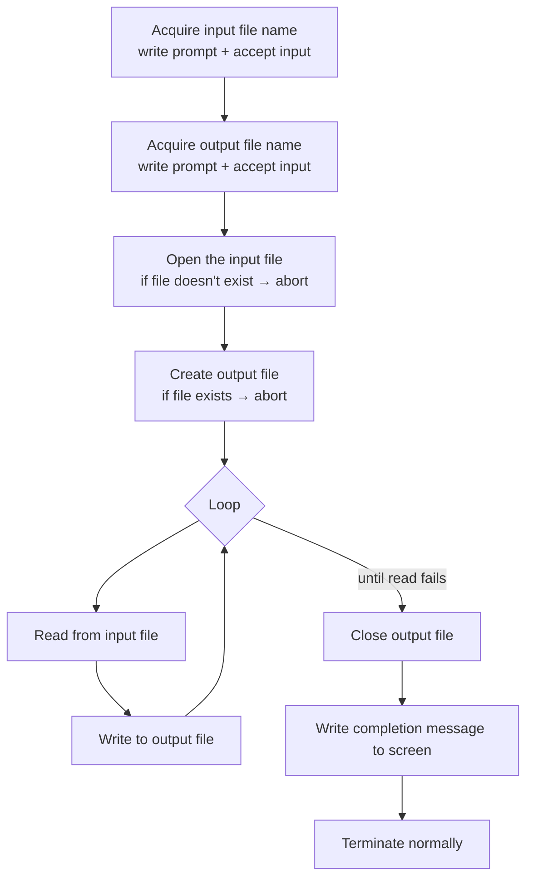
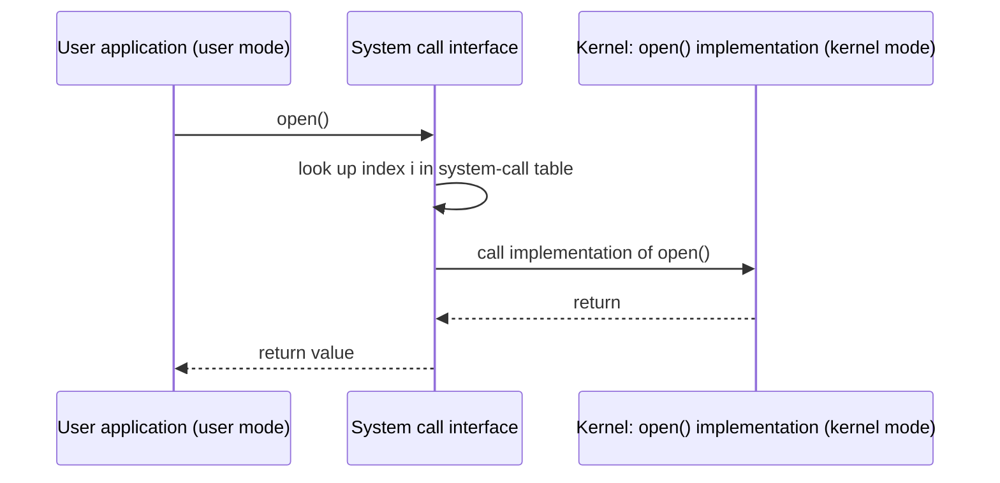
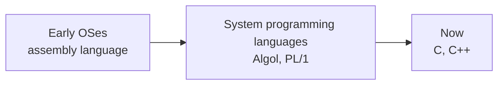
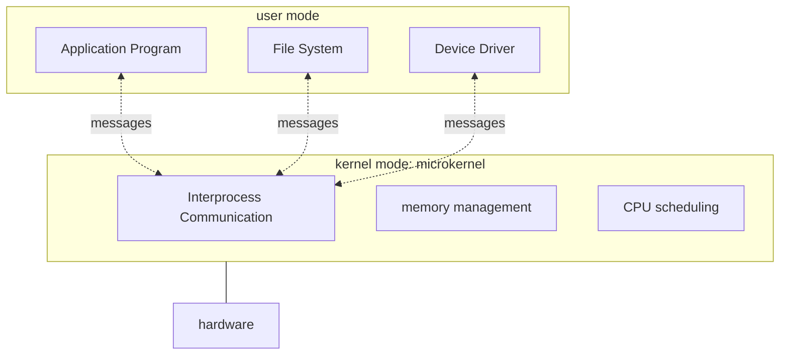

# هيكل نظام التشغيل — Chapter 2: Operating-System Structures

> [!NOTE]
> في Ch1 عرفنا الـ OS هو إيه. في Ch2 هنعرف **بيقدّم خدمات إيه**، و**إزاي البرامج بتكلمه** (System Calls)، و**إزاي بيتبني من جوه** (Structure).

**خريطة المحاضرة:**

1. خدمات نظام التشغيل (Operating System Services)
2. واجهات المستخدم (User Operating System Interface): CLI و GUI و Touchscreen
3. استدعاءات النظام (System Calls) والـ API
4. أنواع الـ System Calls الستة (Types of System Calls)
5. برامج النظام (System Programs)
6. تصميم وتنفيذ الـ OS (Design and Implementation)
7. هيكل الـ OS (Structure): Simple و UNIX و Layered و Microkernel

---

## 1. خدمات نظام التشغيل — Operating System Services

نظام التشغيل بيوفر **بيئة لتنفيذ البرامج (environment for execution of programs)**، وبيقدّم **خدمات (services)** للبرامج وللمستخدمين.


الخدمات دي بتتقسم **مجموعتين**:

### المجموعة الأولى: خدمات مفيدة للمستخدم (helpful to the user)

| الخدمة | الشرح |
|---|---|
| **User interface (UI)** | تقريبًا كل الأنظمة ليها واجهة مستخدم، وبتختلف بين **CLI** (Command-Line) و **GUI** (Graphics User Interface) و **Batch** |
| **Program execution** | النظام لازم يقدر **يحمّل البرنامج في الميموري ويشغّله**، وينهي التنفيذ بشكل **طبيعي (normally)** أو **غير طبيعي (abnormally)** يعني بخطأ |
| **I/O operations** | البرنامج الشغال ممكن يحتاج I/O، سواء **ملف** أو **جهاز I/O** |
| **File-system manipulation** | البرامج محتاجة **تقرا وتكتب** ملفات وفولدرات، و**تعمل وتمسح** و**تدوّر** فيها، و**تعرض معلومات** الملف، و**تدير الصلاحيات** (permission management) |
| **Communications** | الـ processes ممكن تتبادل معلومات **على نفس الجهاز** أو **بين أجهزة على شبكة**، عن طريق **shared memory** أو **message passing** (packets بينقلها الـ OS) |
| **Error detection** | الـ OS لازم يبقى **واخد باله باستمرار** من الأخطاء اللي ممكن تحصل في الـ CPU أو الميموري أو أجهزة الـ I/O أو برنامج المستخدم، ويتصرف التصرف المناسب لكل نوع. وأدوات الـ **Debugging** بتساعد المستخدم والمبرمج جدًا |

### المجموعة التانية: خدمات لكفاءة النظام نفسه (efficient operation of the system itself via resource sharing)

| الخدمة | الشرح |
|---|---|
| **Resource allocation** | لما يكون فيه مستخدمين كتير أو jobs كتير شغالين مع بعض، لازم الموارد تتوزع عليهم (CPU cycles, main memory, file storage, I/O devices) |
| **Accounting** | تتبّع **مين استخدم قد إيه ونوع إيه** من موارد الكمبيوتر |
| **Protection and security** | أصحاب المعلومات عايزين يتحكموا في استخدامها، والـ processes اللي شغالة مع بعض **متتدخلش في بعض**. **Protection**: كل وصول للموارد يبقى متحكَّم فيه. **Security**: حماية من الغرباء عن طريق **user authentication**، وحماية أجهزة الـ I/O الخارجية من محاولات الوصول الغلط |

> [!TIP]
> طريقة تحفظ بيها: **المجموعة الأولى (6)** = U-P-I-F-C-E: **U**ser interface, **P**rogram execution, **I**/O, **F**ile-system, **C**ommunications, **E**rror detection.
> **المجموعة التانية (3)** = R-A-P: **R**esource allocation, **A**ccounting, **P**rotection & security.

> [!EXAM]
> سؤال مشهور: "أنهي خدمة **مش** من الخدمات المفيدة للمستخدم؟" والإجابة **Resource allocation** أو **Accounting**، لأنهم لكفاءة **النظام** مش المستخدم.

---

## 2. واجهات المستخدم — User Operating System Interface

### 2.1 واجهة الأوامر — CLI (Command Interpreter)

الـ **CLI** أو **command interpreter** بيسمح للمستخدم يكتب الأوامر **مباشرة (direct command entry)**.

- ساعات بيكون **جوه الـ kernel**، وساعات بيكون **system program**.
- ساعات بيبقى فيه **أكتر من نوع (multiple flavors)**، وكل نوع اسمه **shell** (زي bash و Bourne shell).
- شغله الأساسي: **ياخد أمر من المستخدم ويشغّله** (fetches a command from user and executes it).
- الأوامر ساعات **built-in** (جوه الـ interpreter نفسه)، وساعات **مجرد أسماء برامج** (just names of programs).


### 2.2 الواجهة الرسومية — GUI (Graphics User Interface)

- واجهة سهلة الاستخدام بتعتمد على فكرة **سطح المكتب** (user-friendly **desktop metaphor**).
- غالبًا بتستخدم **mouse, keyboard, monitor**.
- **Icons** (أيقونات) بتمثّل ملفات وبرامج وأوامر.
- أزرار الماوس على العناصر بتعمل حاجات مختلفة: تعرض معلومات أو اختيارات، أو تنفّذ وظيفة، أو تفتح **directory** (اللي بنسميه **folder**).
- **أنظمة كتير دلوقتي فيها CLI و GUI الاتنين.**

### 2.3 شاشات اللمس — Touchscreen Interfaces

- أجهزة اللمس محتاجة واجهات جديدة:
  - الماوس **مش ممكن أو مش مرغوب**.
  - الأوامر والاختيار بتتم عن طريق **gestures** (إيماءات/حركات).
  - **Virtual keyboard** لكتابة النص.
- كمان فيه **Voice commands** (أوامر صوتية).

| | **CLI** | **GUI** | **Touchscreen** |
|---|---|---|---|
| الإدخال | كتابة أوامر | ماوس وكيبورد وأيقونات | لمس و gestures وكيبورد افتراضي |
| مثال | Bourne shell, bash | Mac OS X, Windows | iPad, موبايلات |
| الميزة | سريع وقوي للمحترفين | سهل للمبتدئين | مناسب للأجهزة المحمولة |

---

## 3. استدعاءات النظام — System Calls

### التعريف

> System calls are the **programming interface to the services provided by the OS**.

يعني الـ System Calls هي **الطريقة اللي البرامج بتطلب بيها خدمة من الـ OS**.

| النقطة | التفاصيل |
|---|---|
| مكتوبة بإيه؟ | غالبًا بلغة **high-level** زي **C أو C++** |
| البرامج بتستخدمها إزاي؟ | في الغالب عن طريق **API (Application Programming Interface)** high-level، **مش بشكل مباشر** |

### أشهر 3 APIs

| الـ API | النظام |
|---|---|
| **Win32 API** | Windows |
| **POSIX API** | الأنظمة المبنية على POSIX، وده يشمل تقريبًا كل نسخ **UNIX و Linux و Mac OS X** |
| **Java API** | الـ **Java Virtual Machine (JVM)** |

> [!EXAM]
> اربط كويس: **Win32 ← Windows** · **POSIX ← UNIX / Linux / Mac OS X** · **Java API ← JVM**.

### مثال: نسخ ملف لملف تاني

حتى عملية بسيطة زي نسخ ملف بتحتاج **system calls كتير**:




> [!TIP]
> الفكرة من المثال: البرنامج اللي شكله "سطر واحد" بيعمل **عشرات** الـ system calls (open, read, write, close, ...). عشان كده بنستخدم **API** بيخبّي التفاصيل دي.

### مثال على Standard API: الدالة `read()`


```c
#include <unistd.h>

ssize_t read(int fd, void *buf, size_t count);
```

| الجزء | المعنى |
|---|---|
| `ssize_t` | **return value**: عدد الـ bytes اللي اتقرت. لو **0** يبقى end of file، ولو **-1** يبقى حصل error |
| `read` | **function name** |
| `int fd` | **file descriptor**: رقم الملف اللي هنقرا منه |
| `void *buf` | **buffer**: المكان اللي البيانات هتتحط فيه |
| `size_t count` | **أقصى عدد bytes** هيتقرا في الـ buffer |

### العلاقة بين الـ API والـ System Call والـ OS




- كل system call ليه **رقم (index)**.
- الـ **system call interface** بيحتفظ بـ **جدول** متفهرس بالأرقام دي.
- البرنامج **مش محتاج يعرف** الـ system call متنفّذ إزاي. كل اللي محتاجه إنه يلتزم بالـ API ويفهم الـ OS هيعمل إيه كنتيجة.

### مثال: printf بتنادي write


> [!IMPORTANT]
> **`printf()`** دي **library call** مش system call. هي **بتنادي** الـ **system call `write()`**. يعني الـ library وسيط بين البرنامج والـ kernel.

---

## 4. أنواع الـ System Calls الستة — Types of System Calls

| # | النوع | أمثلة |
|---|---|---|
| 1 | **Process control** (التحكم في العمليات) | create / terminate process · end, abort · load, execute · get/set process attributes · wait for time · wait event, signal event · allocate and free memory · Debugger (single step execution) · **Locks** for shared data |
| 2 | **File management** (إدارة الملفات) | create / delete file · open / close file · read, write, reposition · get / set file attributes |
| 3 | **Device management** (إدارة الأجهزة) | request / release device · read, write, reposition · get / set device attributes · logically attach or detach devices |
| 4 | **Information maintenance** (صيانة المعلومات) | get / set time or date · get / set system data · get / set process, file, or device attributes |
| 5 | **Communications** (الاتصالات) | create / delete communication connection · send, receive messages (message passing، لـ host name أو process name) · من client لـ server · shared-memory: create and gain access to memory regions · transfer status information · attach / detach remote devices |
| 6 | **Protection** (الحماية) | control access to resources · get and set permissions · allow and deny user access |

> [!TIP]
> احفظهم بالجملة: **"P-F-D-I-C-P"** = **P**rocess, **F**ile, **D**evice, **I**nformation, **C**ommunications, **P**rotection.

### أمثلة حقيقية: Windows و Unix

| النوع | Windows | Unix |
|---|---|---|
| **Process Control** | `CreateProcess()` · `ExitProcess()` · `WaitForSingleObject()` | `fork()` · `exit()` · `wait()` |
| **File Manipulation** | `CreateFile()` · `ReadFile()` · `WriteFile()` · `CloseHandle()` | `open()` · `read()` · `write()` · `close()` |
| **Device Manipulation** | `SetConsoleMode()` · `ReadConsole()` · `WriteConsole()` | `ioctl()` · `read()` · `write()` |
| **Information Maintenance** | `GetCurrentProcessID()` · `SetTimer()` · `Sleep()` | `getpid()` · `alarm()` · `sleep()` |
| **Communication** | `CreatePipe()` · `CreateFileMapping()` · `MapViewOfFile()` | `pipe()` · `shmget()` · `mmap()` |
| **Protection** | `SetFileSecurity()` · `InitializeSecurityDescriptor()` · `SetSecurityDescriptorGroup()` | `chmod()` · `umask()` · `chown()` |

> [!EXAM]
> أسئلة بتيجي على الجدول ده:
> - `fork()` ← **Process control** (بتعمل process جديدة في Unix)
> - `getpid()` ← **Information maintenance**
> - `chmod()` ← **Protection**
> - `pipe()` و `shmget()` ← **Communication**
> - `ioctl()` ← **Device manipulation**

---

## 5. برامج النظام — System Programs

**System programs** بتوفر **بيئة مريحة لتطوير البرامج وتشغيلها** (convenient environment for program development and execution).

| النوع | بيعمل إيه |
|---|---|
| **File management** | create, delete, copy, rename, print, dump, list، وفي العموم التعامل مع الملفات والفولدرات |
| **Status information** | فيه برامج بتسأل النظام عن معلومات (date, time, available memory, disk space, number of users)، وفيه برامج بتدّي معلومات تفصيلية عن الأداء (**performance, logging, debugging**)، وغالبًا بتطبع النتيجة على الـ terminal |
| **File modification** | **Text editors** لعمل وتعديل الملفات، وأوامر خاصة **للبحث في محتوى الملفات** أو تحويل النص |
| **Programming-language support** | **Compilers, assemblers, debuggers, interpreters** |
| **Program loading and execution** | تحميل البرامج وتشغيلها (loaders, linkers) |
| **Communications** | بتعمل **virtual connections** بين الـ processes والمستخدمين والأجهزة: رسايل بين الشاشات، browse web pages، e-mail، remote login، نقل ملفات بين الأجهزة |
| **Background services** | بتشتغل **وقت الإقلاع (boot time)**: فيه منها اللي يشتغل للإقلاع وبس وبعدين يقفل، وفيه اللي يفضل شغال **من الإقلاع للإطفاء**. بتقدم حاجات زي disk checking و process scheduling و error logging و printing |
| **Application programs** | **ملهاش علاقة بالنظام** (don't pertain to system)، المستخدم هو اللي بيشغلها، و**مش بتعتبر جزء من الـ OS** في العادة |

> [!NOTE]
> الـ **Background services** في Linux اسمها **daemons**، وفي Windows اسمها **services**. ومثال عليها الـ print spooler اللي بيستنى أوامر الطباعة.

---

## 6. تصميم وتنفيذ الـ OS — Design and Implementation

### التصميم (Design)

- تصميم وتنفيذ الـ OS **مش مسألة ليها حل واحد** (not "solvable")، لكن فيه أساليب **أثبتت نجاحها**.
- **الهيكل الداخلي** للأنظمة المختلفة ممكن **يختلف جدًا**.
- التصميم بيبدأ بـ **تحديد الأهداف والمواصفات** (defining goals and specifications).
- بيتأثر بـ **نوع الهاردوير** و**نوع النظام**.

### نوعين أهداف — User goals و System goals

| | **User goals** (أهداف المستخدم) | **System goals** (أهداف النظام) |
|---|---|---|
| مين؟ | اللي بيستخدم الـ OS | اللي بيصمّم ويصون الـ OS |
| الـ OS لازم يكون | **convenient** to use, **easy to learn**, **reliable**, **safe**, **fast** | **easy to design, implement, and maintain**، و **flexible, reliable, error-free, efficient** |

> [!EXAM]
> "easy to **design, implement, maintain**" ← دي **System goals**.
> "easy to **learn**, safe, fast" ← دي **User goals**.
> وكلمة **reliable** موجودة في الاتنين.

- تحديد وتصميم الـ OS **مهمة إبداعية جدًا (highly creative task)** في هندسة البرمجيات.

### التنفيذ (Implementation): اتكتب بإيه؟



**وفي الواقع غالبًا خليط من اللغات (mix of languages):**

| الجزء | اللغة |
|---|---|
| **أقل المستويات** (lowest levels) | **Assembly** |
| **الجسم الرئيسي** (main body) | **C** |
| **System programs** | C، C++، ولغات scripting زي **PERL و Python و shell scripts** |

---

## 7. هيكل نظام التشغيل — Operating System Structure

الـ **General-purpose OS** برنامج **كبير جدًا**، وفيه طرق مختلفة لتنظيمه:

| الهيكل | المثال |
|---|---|
| **Simple structure** | **MS-DOS** |
| **More complex** | **UNIX** |
| **Layered** | (طبقات) |
| **Microkernel** | **Mach** |

### 7.1 الهيكل البسيط — Simple Structure (MS-DOS)


> [!WARNING]
> في MS-DOS **مفيش فصل كويس بين المستويات**. الـ application program يقدر **يوصل مباشرة** لـ ROM BIOS device drivers. ده معناه إن أي برنامج فيه مشكلة ممكن **يوقّع النظام كله**، وده عيب كبير في الهيكل البسيط.

### 7.2 هيكل UNIX — More Complex

الـ UNIX OS بيتكوّن من **جزئين منفصلين (two separable parts)**:

1. **Systems programs**
2. **The kernel**:
   - بيتكون من **كل حاجة تحت الـ system-call interface وفوق الـ physical hardware**.
   - بيقدّم **file system و CPU scheduling و memory management** ووظايف تانية. يعني **عدد كبير جدًا من الوظايف في مستوى واحد** (a large number of functions for one level).


| الطبقة (من فوق لتحت) | محتواها |
|---|---|
| (the users) | المستخدمين |
| shells and commands · compilers and interpreters · system libraries | **System programs** |
| **system-call interface to the kernel** | الحد الفاصل |
| signals, terminal handling, character I/O · file system, swapping, block I/O, disk and tape drivers · CPU scheduling, page replacement, demand paging, virtual memory | **Kernel** |
| **kernel interface to the hardware** | الحد الفاصل |
| terminal controllers · device controllers (disks, tapes) · memory controllers (physical memory) | **Hardware** |

> [!NOTE]
> الـ kernel في UNIX اسمه **monolithic kernel** (نواة متجانسة)، لأن كل الوظايف محطوطة في مستوى واحد كبير. ميزته **السرعة**، وعيبه إنه **صعب في التنفيذ والصيانة**.

### 7.3 الهيكل الطبقي — Layered Approach


- الـ OS بيتقسم **عدد من الطبقات (layers)**، وكل طبقة **مبنية على اللي تحتها**.
- **Layer 0** = **hardware** (الأعمق).
- **Layer N** = **user interface** (الأعلى/الخارج).
- كل طبقة بتستخدم **وظايف وخدمات الطبقات اللي أقل منها بس**.

| المميزات | العيوب |
|---|---|
| سهولة البناء والـ **debugging** (تختبر كل طبقة لوحدها) | صعوبة **تحديد** كل طبقة فيها إيه بالظبط |
| | **أبطأ**، لأن الطلب لازم يعدّي على طبقات كتير |

### 7.4 الـ Microkernel

- الفكرة: **نقل أكبر قدر ممكن من الـ kernel لـ user space** (moves as much from the kernel into user space).
- **Mach** مثال على الـ microkernel.
- الـ kernel بتاع **Mac OS X** (اسمه **Darwin**) **مبني جزئيًا على Mach**.




- في الـ microkernel، الـ kernel فيه **أقل حاجة**: **IPC** (التواصل بين العمليات)، و **memory management** أساسية، و **CPU scheduling**.
- باقي الخدمات (File System, Device Drivers) شغالة في **user mode**، وبتتواصل مع بعض عن طريق **messages** من خلال الـ microkernel.

| | **Monolithic (UNIX)** | **Microkernel (Mach)** |
|---|---|---|
| الخدمات فين؟ | كلها في kernel mode | أغلبها في user mode |
| حجم الـ kernel | كبير | صغير |
| السرعة | **أسرع** (مفيش messages كتير) | **أبطأ** (overhead من الـ messages) |
| الاعتمادية والأمان | لو خدمة وقعت ممكن النظام كله يقع | **أكثر اعتمادية وأمانًا**، لأن الخدمة اللي تقع في user space مش بتوقّع الـ kernel |
| سهولة التطوير | أصعب | **أسهل** في إضافة خدمات ونقل النظام لهاردوير تاني |

> [!EXAM]
> - **MS-DOS ← Simple** · **UNIX ← More complex (monolithic)** · **Mach ← Microkernel** · **Mac OS X (Darwin) ← partly based on Mach**.
> - تعريف الـ microkernel اللي بييجي: **"Moves as much from the kernel into user space"**.

---

## ✅ خلاصة المحاضرة في 10 نقط

1. الـ OS بيوفر **environment for execution of programs** وبيقدّم services.
2. خدمات للمستخدم: **UI, Program execution, I/O, File-system manipulation, Communications, Error detection**.
3. خدمات لكفاءة النظام: **Resource allocation, Accounting, Protection & security**.
4. الواجهات: **CLI** (shells)، **GUI** (desktop metaphor, icons, folders)، **Touchscreen** (gestures, virtual keyboard)، و voice commands.
5. **System calls** = programming interface لخدمات الـ OS، مكتوبة بـ C/C++، والبرامج بتوصلها عن طريق **API**.
6. الـ APIs: **Win32** (Windows)، **POSIX** (UNIX/Linux/Mac OS X)، **Java API** (JVM).
7. أنواع الـ system calls: **Process control, File management, Device management, Information maintenance, Communications, Protection**.
8. `printf()` library call بتنادي الـ system call `write()`.
9. **User goals**: convenient, easy to learn, reliable, safe, fast. و **System goals**: easy to design/implement/maintain, flexible, reliable, error-free, efficient.
10. الهياكل: **Simple (MS-DOS)** · **UNIX (monolithic)** · **Layered** (layer 0 = hardware، layer N = UI) · **Microkernel (Mach)** ينقل الخدمات لـ user space.
