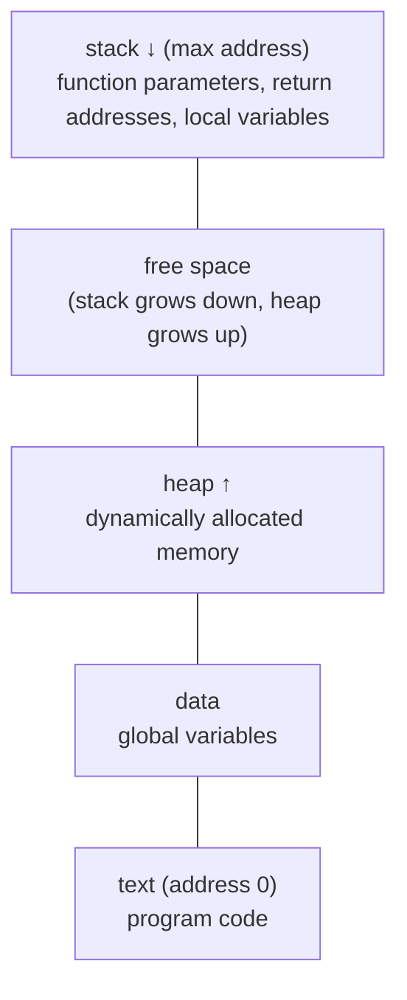
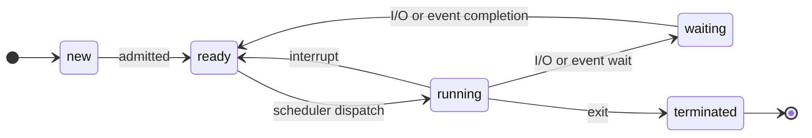
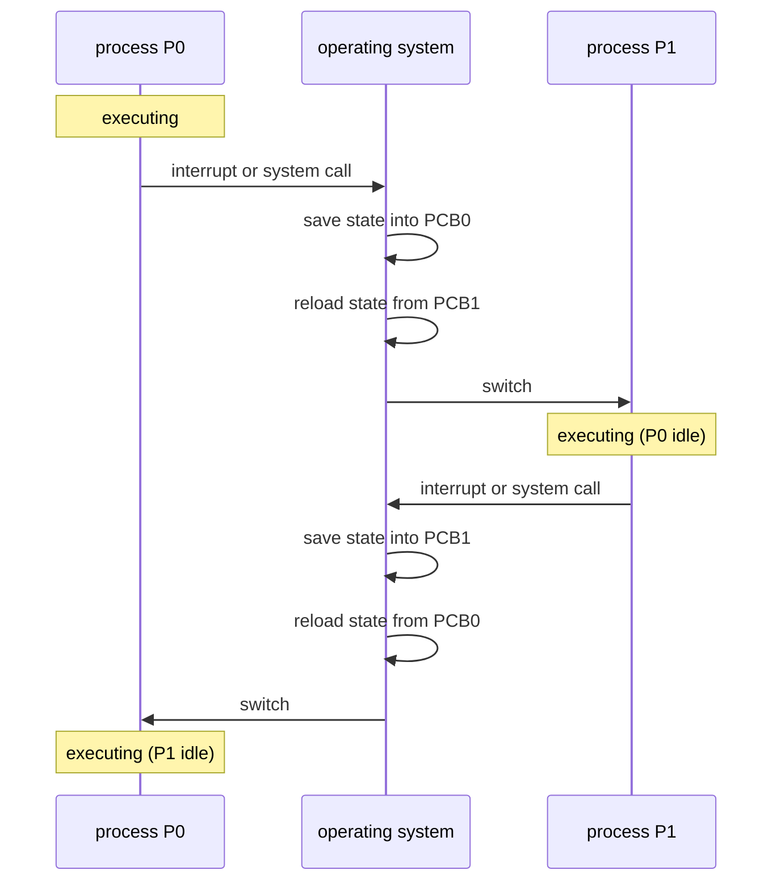
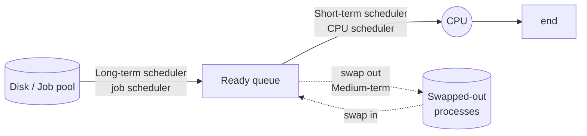
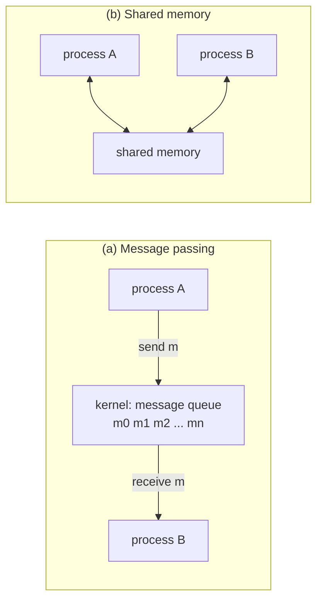

# العمليات — Chapter 3: Processes

> [!NOTE]
> المحاضرة دي عن **أهم مفهوم في المادة كلها**: الـ **Process** (العملية). هنعرف هي إيه، وشكلها جوه الميموري، والـ OS بيتابعها إزاي (PCB)، وبتمر بأنهي حالات (States)، وإزاي الـ OS بيجدولها (Scheduling)، وإزاي الـ processes بتتواصل مع بعض (IPC).

**خريطة المحاضرة:**

1. مفهوم العملية (Process Concept) والفرق بين Program و Process
2. مكونات العملية في الميموري (Process Elements)
3. الـ Process Control Block (PCB)
4. حالات العملية (Process State)
5. التبديل بين العمليات (CPU Switch / Context Switch)
6. جدولة العمليات (Process Scheduling): الـ Queues والـ Schedulers
7. التواصل بين العمليات (Interprocess Communication: IPC)

---

## 1. مفهوم العملية — Process Concept

### الفرق بين Program و Process

| | **Program** (برنامج) | **Process** (عملية) |
|---|---|---|
| الطبيعة | **Passive entity** (كيان سلبي) | **Active entity** (كيان نشط) |
| فين؟ | ملف متخزن على الـ **disk** فيه قائمة instructions، ودايمًا اسمه **executable file** | متحمّل في الـ **memory** وشغال |
| مثال | `chrome.exe` على الهارد | Chrome وهو مفتوح قدامك |

> A program becomes a process when an **executable file is loaded into the memory**.

يعني **البرنامج بيتحول لـ process لما الـ executable file يتحمّل في الميموري**.

> [!EXAMPLE]
> الـ **Program** زي **وصفة الأكل** المكتوبة في كتاب: ثابتة على الرف ومبتعملش حاجة. الـ **Process** زي **الطبّاخ وهو بيطبخ الوصفة فعلًا**: بيستخدم أدوات ومكونات وبيتحرك من خطوة لخطوة. وممكن طبّاخين اتنين يطبخوا نفس الوصفة في نفس الوقت، يعني **برنامج واحد يعمل أكتر من process**، زي لما تفتح نافذتين Chrome.

### الـ Process Management

- **المهمة الأساسية** (fundamental task) لأي نظام تشغيل هي **process management** (إدارة العمليات).
- الـ process مش بس الكود (**text**)، دي كمان فيها **مجموعة موارد (set of resources)** زي:
  - **open files** (ملفات مفتوحة)
  - **pending signals** (إشارات مستنية)
  - **internal kernel data**
  - **processor state** (حالة المعالج)
  - **address space** (مساحة عناوين)
  - **data section**

### الـ OS لازم يعمل إيه مع الـ processes؟

| المهمة | بالعربي |
|---|---|
| **Allocate resources** to processes | يوزّع عليها الموارد |
| **Enable sharing** of information | يسمحلها تشارك معلومات |
| **Protect resources** | يحمي الموارد |
| **Enable synchronization** among processes | يسمح بالتزامن بينها |


---

## 2. مكونات العملية — Process Elements

الـ process في الميموري بتتقسم **4 أجزاء (segments)**:

| الجزء | فيه إيه | ملاحظة |
|---|---|---|
| **Text Section** | **كود البرنامج** (program code) | غالبًا **read-only**، وممكن تشترك فيه كذا process |
| **Data Section** | **المتغيرات العامة** (global variables) | |
| **Heap** | ميموري بتتحجز **ديناميكيًا** أثناء التشغيل (dynamically allocated during run time) | زي `malloc` في C أو `new` في Java |
| **Stack** | **بيانات مؤقتة** (temporary data) | **function parameters**, **return addresses**, **local variables** |




> [!IMPORTANT]
> الـ **Stack بيكبر لتحت** (من الـ max ناحية الـ heap)، والـ **Heap بيكبر لفوق** (ناحية الـ stack)، والمساحة الفاضية بينهم بيستخدمها الاتنين.

> [!EXAM]
> أسئلة بتيجي كتير:
> - المتغيرات العامة (**global variables**) ← **Data section**
> - المتغيرات المحلية (**local variables**) ← **Stack**
> - الحجز الديناميكي (**dynamic allocation**) ← **Heap**
> - كود البرنامج ← **Text section**

```c
int counter = 0;            // global → Data section

int square(int x) {         // x (parameter) → Stack
    int result = x * x;     // local variable → Stack
    return result;
}

int main() {
    int *arr = malloc(10 * sizeof(int));   // memory from malloc → Heap
    counter = square(5);                   // the code itself → Text section
}
```

---

## 3. الـ Process Control Block (PCB)

عشان الـ OS يتحكم في الـ processes كويس، لازم يراعي **سلوكها الديناميكي** (dynamic behaviors). عشان كده:

> Each process is represented in the OS by a **Process Control Block (PCB)**.

يعني **كل process ليها PCB**، وده زي **"البطاقة الشخصية"** أو **"الملف"** بتاعها عند الـ OS، وفيه كل المعلومات عنها.


### محتويات الـ PCB

| المجموعة | فيها إيه |
|---|---|
| **Process identification information** (معلومات التعريف) | **Process identifier (PID)**: رقم فريد للـ process · **User identifier**: المستخدم المسؤول عنها · **Identifier of the parent process** اللي عملتها |
| **Processor state information** | **Process state**: running, waiting, ... |
| **Program counter** | **عنوان الـ instruction الجاية** اللي هتتنفذ (location of instruction to next execute) |
| **CPU registers** | محتوى كل الـ registers الخاصة بالـ process |
| **CPU scheduling information** | **priorities** (الأولويات)، و **scheduling queue pointers** |
| **Memory-management information** | الميموري اللي اتحجزت للـ process |
| **Accounting information** | الـ CPU المستخدم، والوقت اللي عدّى من البداية، و **time limits** |
| **I/O status information** | أجهزة الـ I/O المحجوزة للـ process، و **list of open files** |

> [!TIP]
> احفظ الـ PCB بالسؤال: **"مين؟ فين؟ بيعمل إيه؟ بيستخدم إيه؟"**
> - **مين** ← identification (PID, user, parent)
> - **فين وصل** ← state + program counter + registers
> - **أولويته** ← scheduling info
> - **بيستخدم إيه** ← memory, I/O, open files, accounting

> [!EXAM]
> **Program counter** = **location of instruction to next execute**. مش الـ instruction الحالية، **الجاية**.

---

## 4. حالات العملية — Process State

الـ process وهي شغالة **بتغيّر حالتها (state)**:

| الحالة | المعنى |
|---|---|
| **new** | الـ process **بتتعمل** (being created) |
| **running** | الـ instructions **بتتنفذ** دلوقتي على الـ CPU |
| **waiting** | الـ process **مستنية حدث** يحصل (مثلًا I/O يخلص) |
| **ready** | الـ process **مستنية تاخد الـ CPU** (waiting to be assigned to a processor) |
| **terminated** | الـ process **خلصت** تنفيذها |




### الانتقالات بالتفصيل

| من | إلى | السبب |
|---|---|---|
| new | ready | **admitted**: الـ OS قبلها ودخّلها الميموري |
| ready | running | **scheduler dispatch**: الـ scheduler اختارها وإدّاها الـ CPU |
| running | ready | **interrupt**: اتقاطعت (مثلًا الوقت بتاعها خلص)، فترجع تستنى دورها |
| running | waiting | **I/O or event wait**: طلبت I/O أو مستنية حدث |
| waiting | ready | **I/O or event completion**: الـ I/O خلص فبقت جاهزة تاني |
| running | terminated | **exit**: خلصت |

> [!WARNING]
> الفخ المشهور: الـ process لما الـ I/O بتاعها يخلص بتروح **ready** مش **running**. يعني **waiting → ready** وبعدين تستنى الـ scheduler يختارها. **مفيش انتقال مباشر من waiting لـ running.**

> [!NOTE]
> في أي لحظة، على **كل processor** فيه **process واحدة بس** في حالة **running**. لكن ممكن يكون فيه processes كتير في حالة **ready** و **waiting**.

### رحلة الـ Process خطوة بخطوة (من السلايدات)

| الخطوة | اللي بيحصل |
|---|---|
| 1 | Process1 و Process2 متخزنين على الـ **H.D** (لسه programs) |
| 2 | الـ OS بيحمّل **Process1** في الـ **Memory** (← **new / ready**) |
| 3 | الـ OS بيعمل لها **PCB** في الميموري |
| 4 | Process1 بتاخد الـ **CPU** (← **running**) |
| 5 | Process1 بتطلب **I/O Device** (← **waiting**) |
| 6 | Process1 بتخلص، والـ PCB بتاعها بيتمسح (← **terminated**)، و Process2 تقدر تتحمّل في الميموري |

---

## 5. التبديل بين العمليات — CPU Switch From Process to Process

لما الـ CPU يبدّل من process لـ process تانية، لازم **يحفظ حالة القديمة** و**يرجّع حالة الجديدة**. ده اسمه **Context Switch**.




> [!IMPORTANT]
> - الـ **context** بتاع الـ process متخزن في الـ **PCB** بتاعها.
> - وقت الـ context switch النظام **مبيعملش شغل مفيد** (overhead)، وعشان كده لازم يكون **سريع**.
> - لاحظ في الشكل: وقت ما P0 **executing**، الـ P1 بتبقى **idle**، والعكس.

---

## 6. جدولة العمليات — Process Scheduling

### 6.1 الطوابير — Scheduling Queues

| الطابور | فيه إيه |
|---|---|
| **Job queue** | **كل** الـ processes اللي في النظام (set of all processes in the system) |
| **Ready queue** | الـ processes اللي **في الميموري الرئيسية** وجاهزة ومستنية تتنفذ (residing in main memory, ready and waiting to execute) |
| **Device queues** | الـ processes اللي **مستنية جهاز I/O** معين |

- الـ processes **بتتنقل (migrate)** بين الطوابير دي.


### 6.2 مخطط الطوابير — Queueing Diagram


لما الـ process تاخد الـ CPU، ممكن يحصل واحد من دول:

| الحدث | اللي بيحصل |
|---|---|
| **I/O request** | تروح **I/O queue** ← تاخد الـ I/O ← ترجع **ready queue** |
| **time slice expired** | وقتها خلص ← ترجع **ready queue** على طول |
| **fork a child** | تعمل process ابن (child) ← الـ child يتنفذ ← ترجع **ready queue** |
| **wait for an interrupt** | تستنى interrupt ← الـ interrupt يحصل ← ترجع **ready queue** |

### 6.3 أنواع الـ Schedulers

| | **Short-term scheduler** | **Long-term scheduler** | **Medium-term scheduler** |
|---|---|---|---|
| اسمه التاني | **CPU scheduler** | **Job scheduler** | — |
| بيعمل إيه | بيختار **أنهي process تتنفذ** دلوقتي ويدّيها الـ **CPU** | بيختار **أنهي processes تدخل الـ ready queue** | **بيشيل process من الميموري** ويحطها على الديسك، وبعدين يرجّعها تكمّل، وده اسمه **swapping** |
| بيشتغل كل قد إيه | **كتير جدًا (milliseconds)** | **قليل (seconds, minutes)** | حسب الحاجة |
| السرعة | **لازم يكون سريع** (must be fast) | **ممكن يكون بطيء** (may be slow) | — |
| بيتحكم في | — | **degree of multiprogramming** (عدد الـ processes في الميموري) | بيستخدم لما نحتاج **نقلل** الـ degree of multiprogramming |




> [!EXAM]
> - **Short-term = CPU scheduler** ← milliseconds ← **must be fast**
> - **Long-term = Job scheduler** ← seconds/minutes ← **may be slow** ← بيتحكم في **degree of multiprogramming**
> - **Medium-term** ← **swapping**
>
> **Degree of multiprogramming** = **عدد الـ processes في الميموري**.

---

## 7. التواصل بين العمليات — Interprocess Communication (IPC)

الـ processes في النظام ممكن تكون:

| النوع | المعنى |
|---|---|
| **Independent** (مستقلة) | **مبتأثرش ولا بتتأثر** بأي process تانية |
| **Cooperating** (متعاونة) | **بتأثر أو بتتأثر** بالـ processes التانية، وده يشمل **مشاركة البيانات** |

- الـ **Cooperating processes** محتاجة **Interprocess Communication (IPC)**.
- فيه **نموذجين (two models)** للـ IPC:

| | **Shared Memory** (ذاكرة مشتركة) | **Message Passing** (تمرير رسائل) |
|---|---|---|
| الفكرة | بيتعمل **جزء ميموري مشترك** والـ processes تكتب وتقرا منه | الـ processes بتبعت **رسائل** لبعض عن طريق الـ **kernel** (message queue) |
| دور الـ kernel | بيتدخل بس **وقت إنشاء** المنطقة المشتركة | بيتدخل في **كل رسالة** |
| السرعة | **أسرع** | **أبطأ** (system call لكل رسالة) |
| السهولة | محتاج تنظيم عشان الـ processes متكتبش فوق بعض (synchronization) | **أسهل** وأنسب للبيانات الصغيرة وللأنظمة الموزعة |



> [!TIP]
> - **Shared memory** = لوحة إعلانات مشتركة: الكل يكتب ويقرا من نفس المكان.
> - **Message passing** = البريد: تبعت رسالة والـ kernel (البوسطجي) يوصّلها.

---

## ✅ خلاصة المحاضرة في 10 نقط

1. **Program = passive** (executable file على الديسك) · **Process = active** (اتحمّل في الميموري).
2. الـ **process management** هي المهمة الأساسية للـ OS: allocate, share, protect, synchronize.
3. أجزاء الـ process: **Text** (code) · **Data** (globals) · **Heap** (dynamic) · **Stack** (params, return addresses, locals).
4. كل process ليها **PCB** فيه: identification, state, **program counter** (الـ instruction الجاية), registers, scheduling, memory, accounting, I/O status.
5. الحالات: **new, ready, running, waiting, terminated**.
6. الانتقالات: admitted · scheduler dispatch · interrupt · I/O or event wait · I/O or event completion · exit.
7. **Context switch**: save state into PCB القديمة، و reload state from PCB الجديدة.
8. الطوابير: **Job queue** (الكل) · **Ready queue** (في الميموري وجاهزة) · **Device queues** (مستنية I/O).
9. **Short-term (CPU)** سريع (ms) · **Long-term (job)** بطيء ويتحكم في degree of multiprogramming · **Medium-term** = swapping.
10. **Independent** vs **Cooperating**، والـ IPC بنموذجين: **Shared memory** و **Message passing**.
