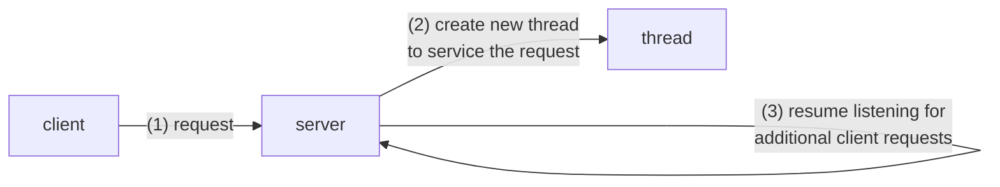
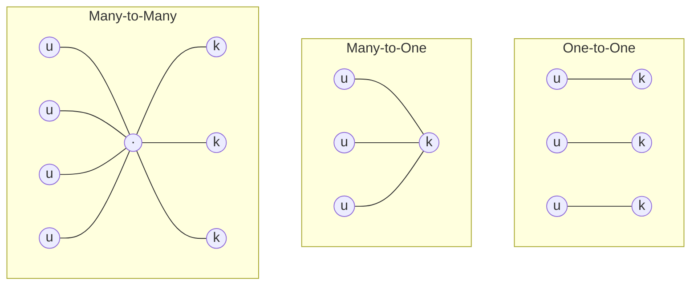

# الخيوط — Chapter 4: Threads

> [!NOTE]
> في Ch3 اتكلمنا عن الـ **process**. هنا هنقسّم الـ process لأجزاء أصغر بتشتغل مع بعض اسمها **threads**، ونعرف ليه ده مفيد، وإزاي الـ threads بتتربط بالـ kernel (Multithreading Models).

**خريطة المحاضرة:**

1. مقدمة: يعني إيه Thread؟ (Introduction)
2. الأنظمة متعددة الأنوية (Multicore Programming): Concurrency و Parallelism
3. نماذج تعدد الخيوط (Multithreading Models): One-to-One، Many-to-One، Many-to-Many، Two-level
4. فوائد الـ Threads (Benefits)
5. مكتبات الـ Threads (Thread Libraries)

---

## 1. يعني إيه Thread؟ — Introduction

### التعريف

> A **thread** is a **basic unit of CPU utilization**; it comprises a **thread ID**, a **program counter**, a **register set**, and a **stack**.

يعني الـ **Thread** هو **أصغر وحدة بتستخدم الـ CPU**، وكل thread **ليه لوحده**:

| خاص بكل Thread (Own) | مشترك بين الـ Threads في نفس الـ Process (Shared) |
|---|---|
| **Thread ID** | **Code section** |
| **Program counter** | **Data section** |
| **Register set** | **OS resources** زي **open files** و **signals** |
| **Stack** | |

> [!EXAM]
> السؤال المشهور: "أنهي حاجة **مش** مشتركة بين الـ threads؟" والإجابة: **Stack** أو **Registers** أو **Program counter**.
> والمشترك: **code، data، open files، signals**.

### ليه محتاجين Threads؟

> [!EXAMPLE]
> تخيل برنامج **مش قادر يرسم صور وهو بيقرا ضغطات الكيبورد في نفس الوقت**. البرنامج لازم يدّي **كل اهتمامه** للكيبورد، ومش هيقدر يتعامل مع **أكتر من حدث في نفس الوقت**.
>
> **الحل المثالي**: إن **جزئين أو أكتر من البرنامج يتنفذوا في نفس الوقت** بسلاسة (seamless execution)، والـ **Threads** هي اللي بتسمح بده.

### Single-threaded vs Multithreaded Process


| | **Single-threaded process** | **Multithreaded process** |
|---|---|---|
| عدد الـ threads | واحد | أكتر من واحد |
| code, data, files | مرة واحدة | **مرة واحدة ومشتركة** بين كل الـ threads |
| registers, stack | مجموعة واحدة | **لكل thread مجموعته** |
| يقدر يعمل كذا حاجة مع بعض؟ | لأ | آه |

### أمثلة من الحياة

معظم البرامج على الأجهزة الحديثة **multithreaded**. البرنامج بيتعمل كـ **process واحدة فيها كذا thread**:

| البرنامج | الـ Threads |
|---|---|
| **Web browser** | thread **يعرض** الصور والنص، و thread تاني **يجيب البيانات من الشبكة** |
| **Word processor** | thread **لعرض الجرافيكس**، و thread **للرد على ضغطات الكيبورد**، و thread تالت **للتدقيق الإملائي والنحوي في الخلفية** |

### Multithreaded Server Architecture




> [!TIP]
> الفكرة: الـ server **مبيخدمش الطلب بنفسه**. بيدّيه لـ **thread جديد**، ويرجع على طول **يستقبل طلبات تانية**. كده يقدر يخدم عملاء كتير في نفس الوقت.

- **أنوية أنظمة التشغيل (kernels)** نفسها بقت **multithreaded**: فيه threads كتير شغالة في الـ kernel، وكل واحد بيعمل **مهمة معينة** زي **managing devices** أو **managing memory** أو **interrupt handling**.

---

## 2. البرمجة على الأنوية المتعددة — Multicore Programming

الـ **Multithreaded programming** بيقدّم طريقة **لاستغلال الأنظمة multicore أو multiprocessor بكفاءة أكبر**.


| | **Concurrency** (التزامن) | **Parallelism** (التوازي) |
|---|---|---|
| فين؟ | **single-core** | **multi-core** |
| إزاي؟ | الـ threads **بتتبادل** على نفس الـ core بسرعة (T1 ← T2 ← T3 ← T4 ← T1 ...) | الـ threads بتشتغل **فعلًا في نفس اللحظة** على cores مختلفة |
| في الحقيقة | **وهم** إنهم شغالين مع بعض | شغالين مع بعض **بجد** |

> [!IMPORTANT]
> **Concurrency** = أكتر من task **بيتقدموا** (making progress) في نفس الفترة، حتى لو على core واحد.
> **Parallelism** = أكتر من task **بيتنفذوا فعلًا في نفس اللحظة**، وده محتاج **أكتر من core**.
> يعني ممكن يبقى فيه concurrency من غير parallelism، لكن العكس لأ.

---

## 3. نماذج تعدد الخيوط — Multithreading Models

### User Threads و Kernel Threads

دعم الـ threads ممكن يبقى على مستويين:

| | **User threads** | **Kernel threads** |
|---|---|---|
| مدعومة فين؟ | **فوق الـ kernel** (user level) | **مباشرة من الـ OS** |
| مين بيديرها؟ | بتتدار **من غير دعم الـ kernel** (thread library في user space) | الـ **kernel** بيديرها مباشرة |

- في الآخر **لازم يكون فيه علاقة (relationship)** بين الـ user threads والـ kernel threads.
- عندنا **3 نماذج مشهورة**: **One-to-One**، **Many-to-One**، **Many-to-Many** (وكمان **Two-level**).

### 3.1 الواحد لواحد — One-to-One Model


- بيربط **كل user thread بـ kernel thread** (maps each user thread to a kernel thread).
- بيسمح لـ **كذا thread يشتغلوا بالتوازي (in parallel)** على الـ **multiprocessors**.
- **العيب الوحيد (only drawback)**: إن عمل user thread **لازم يصاحبه عمل kernel thread**. ولأن الـ **overhead** بتاع عمل kernel threads ممكن **يتقّل أداء** البرنامج، فمعظم التطبيقات بتاعة النموذج ده **بتحدّد عدد الـ threads** اللي النظام يدعمها (restrict the number of threads supported by the system).
- **أمثلة**: **Linux** وعائلة **Windows**.

### 3.2 الكثير لواحد — Many-to-One Model


- بيربط **كذا user thread بـ kernel thread واحد**.
- إدارة الـ threads بتحصل في **user space** بواسطة thread library، فبتبقى **سريعة**.
- **العيوب**:
  - لو thread واحد عمل **blocking system call**، **الـ process كلها تقف**.
  - **thread واحد بس** يقدر يوصل للـ kernel في كل مرة، فـ **مينفعش الـ threads تشتغل بالتوازي على multicore**.

### 3.3 الكثير لكثير — Many-to-Many Model


- بيسمح إن **كذا user thread يتربطوا بكذا kernel thread** (many user-level threads mapped to many kernel threads).
- بيسمح للـ OS إنه **يعمل عدد كافي (sufficient number)** من الـ kernel threads.
- بيسمح للمطوّر **يعمل user threads قد ما هو عايز** (as many user threads as he/she wishes).

> [!WARNING]
> **ملحوظة مهمة على السلايد:** السلايد بتاع Many-to-Many كاتب إن المطوّر يقدر يعمل threads قد ما هو عايز، **"it does not result in true concurrency, because the kernel can schedule only one thread at a time"**.
> الجملة دي في الكتاب الأصلي (Silberschatz) بتوصف **Many-to-One**، مش Many-to-Many. في الـ Many-to-One المطوّر يعمل threads قد ما هو عايز، لكن **مفيش true concurrency** لأن الـ kernel بيجدول **thread واحد بس** في المرة.
> أما في الـ **Many-to-Many** فالـ kernel threads **تقدر تشتغل بالتوازي** على multiprocessor.
> **في الامتحان:** لو السؤال جاي بنص السلايد اختار زي ما هو مكتوب. ولو جاي بالمفهوم، اعرف إن **عدم وجود true concurrency = Many-to-One**.

### 3.4 النموذج ثنائي المستوى — Two-level Model


- **زي Many-to-Many**، **بس** بيسمح إن user thread معين يتربط (**bound**) بـ **kernel thread لوحده**.

### مقارنة النماذج

| النموذج | الربط | التوازي على multicore | Blocking call لو thread وقف | ملاحظات |
|---|---|---|---|---|
| **One-to-One** | 1 user ↔ 1 kernel | ✅ | الباقي يكمّل | overhead عالي، وعدد الـ threads محدود · Linux, Windows |
| **Many-to-One** | N user → 1 kernel | ❌ | **الكل يقف** | إدارة سريعة في user space |
| **Many-to-Many** | N user → M kernel (M ≤ N) | ✅ | الباقي يكمّل | مرن، والـ OS يعمل عدد كافي من الـ kernel threads |
| **Two-level** | Many-to-Many + **bound** | ✅ | الباقي يكمّل | thread مهم ياخد kernel thread لوحده |



---

## 4. فوائد الـ Threads — Benefits of Threads

| الفائدة | الشرح |
|---|---|
| **Responsiveness** (الاستجابة) | البرنامج **يقدر يكمّل شغل حتى لو جزء منه blocked**، وده **مهم جدًا لواجهات المستخدم** (user interfaces). مثلًا الأبلكيشن ميهنجش وهو بيحمّل حاجة |
| **Resource Sharing** (مشاركة الموارد) | الـ threads **بتشارك موارد الـ process** تلقائيًا، وده **أسهل من shared memory أو message passing** بين processes |
| **Economy** (التوفير) | **أرخص من عمل process جديدة**، والتبديل بين الـ threads (thread switching) **overhead بتاعه أقل من الـ context switching** بين processes |
| **Scalability** (قابلية التوسع) | الـ process تقدر **تستفيد من معمارية الـ multiprocessor** (كل thread على core) |

> [!TIP]
> احفظهم بـ **R-R-E-S**: **R**esponsiveness, **R**esource sharing, **E**conomy, **S**calability.

> [!EXAM]
> - "Threads share resources of process, **easier than shared memory or message passing**" ← **Resource Sharing**
> - "**Cheaper than process creation**, lower overhead than context switching" ← **Economy**
> - "Continued execution if part of process is blocked" ← **Responsiveness**
> - "Take advantage of **multiprocessor architectures**" ← **Scalability**

---

## 5. مكتبات الـ Threads — Thread Libraries

الـ **Thread library** بتوفر للمبرمج **API لعمل وإدارة الـ threads** (creating and managing threads).

**أشهر 3 مكتبات مستخدمة دلوقتي:**

| المكتبة | النظام |
|---|---|
| **POSIX Pthreads** | UNIX, Linux, Mac OS X |
| **Windows** threads | Windows |
| **Java** threads | Java (JVM) |

مثال بسيط بـ Python (زي السكاشن) يوضح فكرة الـ threads:

```python
import threading, time

def download():
    for i in range(3):
        print("downloading...", i)
        time.sleep(1)

def show_ui():
    for i in range(3):
        print("UI still responsive", i)
        time.sleep(1)

t1 = threading.Thread(target=download)
t2 = threading.Thread(target=show_ui)
t1.start(); t2.start()   # the two threads run concurrently
t1.join();  t2.join()    # wait for both to finish
```

> [!NOTE]
> الـ output هيطلع **متداخل** (downloading و UI مع بعض)، وده معناه إن الـ two threads شغالين **concurrently** جوه نفس الـ process. ودي فكرة **Responsiveness**.

---

## ✅ خلاصة المحاضرة في 10 نقط

1. الـ **Thread** = basic unit of CPU utilization، وليه: **thread ID, program counter, register set, stack**.
2. الـ threads في نفس الـ process **بيشاركوا**: **code section, data section, OS resources (open files, signals)**.
3. أمثلة: web browser (عرض + تحميل)، و word processor (جرافيكس + كيبورد + spelling)، و multithreaded server.
4. الـ kernels نفسها multithreaded (devices, memory, interrupt handling).
5. **Concurrency** على single-core (تبادل)، و **Parallelism** على multi-core (في نفس اللحظة).
6. **User threads**: فوق الـ kernel ومن غير دعمه · **Kernel threads**: الـ OS بيديرها مباشرة.
7. **One-to-One**: parallel على multiprocessors، والعيب overhead عمل kernel thread، ومثاله Linux و Windows.
8. **Many-to-One**: كذا user ← kernel thread واحد، ومفيش parallelism.
9. **Many-to-Many**: كذا user ← كذا kernel، والـ OS يعمل sufficient kernel threads · **Two-level**: + user thread **bound** لـ kernel thread.
10. الفوائد: **Responsiveness, Resource Sharing, Economy, Scalability** · والمكتبات: **POSIX Pthreads, Windows, Java**.
