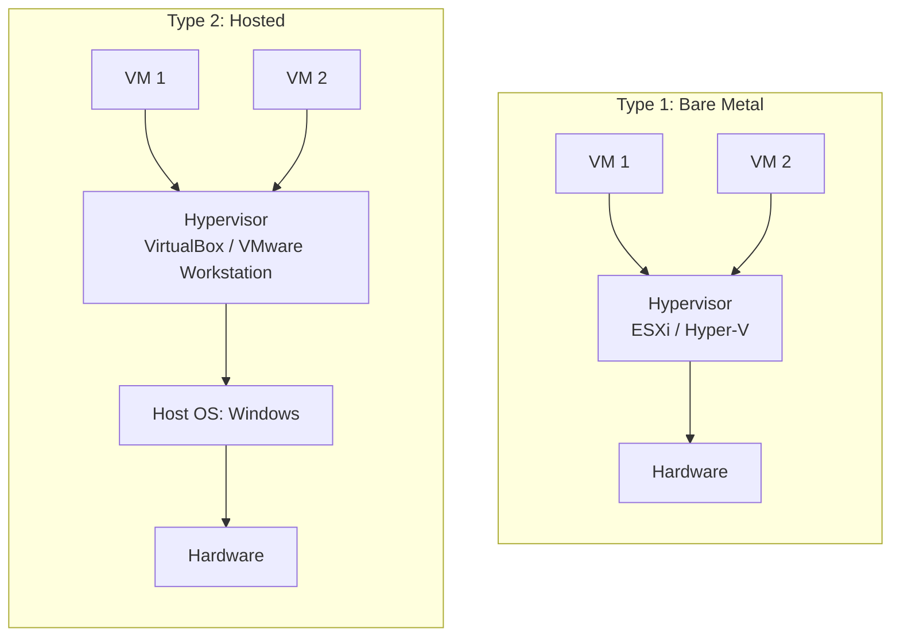

# سكشن 1: الـ Virtualization والـ VirtualBox — Lab 1

> [!NOTE]
> أول سكشن بيمهّد للمعمل: مراجعة سريعة على يعني إيه OS، والفرق بين Windows و Linux، وبعدين الـ **Virtualization** والـ **Hypervisors**، وإزاي نستخدم **VirtualBox** عشان نشغّل Ubuntu جوه Windows.

## 1. يعني إيه نظام تشغيل؟ (مراجعة)

الـ **Operating System** هو السوفتوير الأساسي اللي **بيدير موارد الهاردوير والسوفتوير**، وبيقدّم خدمات للبرامج، و**وسيط بين المستخدم والهاردوير**، وبيضمن إن البرامج تشتغل بسلاسة والموارد تتوزع بكفاءة.

### الوظايف الأساسية (Key Functions)

| الوظيفة | بتعمل إيه |
|---|---|
| **Process Management** | تشغيل البرامج، و multitasking، و CPU scheduling |
| **Memory Management** | حجز وتحرير الميموري للـ processes (allocate / deallocate) |
| **File System Management** | تنظيم وتخزين واسترجاع وحماية البيانات على أجهزة التخزين |
| **Device Management** | التحكم في أجهزة الـ I/O وتنسيقها |
| **Security & Access Control** | حماية البيانات، و authentication، وصلاحيات المستخدمين |
| **User Interface** | طرق تفاعل المستخدم مع النظام: **CLI أو GUI أو voice** |

## 2. مقارنة بين Windows و Linux

| الميزة | **Windows** | **Linux** |
|---|---|---|
| **Cost** (التكلفة) | رخصة مدفوعة (Paid license) | **مجاني ومفتوح المصدر** (Free & open-source) |
| **Ease of Use** (السهولة) | سهل جدًا ومناسب للمبتدئين | محتاج وقت أطول تتعلمه (steeper learning curve) |
| **Customization** (التخصيص) | اختيارات محدودة | **قابل للتخصيص جدًا** |
| **Security** (الأمان) | أكتر عرضة للفيروسات ومحتاج antivirus | **آمن جدًا** وأقل استهدافًا من الـ malware |
| **Performance** (الأداء) | محتاج موارد أعلى | **بيشتغل كويس حتى على أجهزة ضعيفة** |

### ليه Linux أكثر أمانًا؟

1. **Open-Source Nature**: الكود مفتوح، فأي ثغرة بتتكشف وتتصلح بسرعة.
2. **User Privileges by Default**: المستخدم العادي **ملوش صلاحيات root** افتراضيًا، فأي برنامج خبيث صلاحياته محدودة.
3. **Less Targeted by Malware**: عدد مستخدميه على الديسكتوب أقل، فالهاكرز بيستهدفوه أقل.
4. **Frequent Security Updates**: تحديثات أمنية كتير.
5. **Customizability & Control**: تحكم كامل في النظام.

## 3. مقدمة عن الـ Virtualization

| | |
|---|---|
| **التعريف** | عمل **نسخة افتراضية (virtual version)** من مورد حوسبة: OS أو server أو storage أو network |
| **الهدف** | تشغيل **أكتر من نظام تشغيل على جهاز فعلي واحد** (single physical machine) |

### أنواع الـ Virtualization

| النوع | مثال |
|---|---|
| **System / Hardware Virtualization** | الـ **VMs** (Virtual Machines) |
| **OS-level Virtualization** | الـ **containers** زي **Docker** |
| **Storage & Network Virtualization** | تخزين وشبكات افتراضية |

### الـ Hypervisor

الـ OS دوره في الـ virtualization إنه **يدير الـ hardware abstraction**. والـ **Hypervisor** هو **طبقة السوفتوير اللي بتخلّي الـ virtualization ممكن**:

| | **Type 1 (Bare Metal)** | **Type 2 (Hosted)** |
|---|---|---|
| بيشتغل فين؟ | **مباشرة على الهاردوير** | **فوق host OS** |
| أمثلة | **VMware ESXi**, **Microsoft Hyper-V** | **VirtualBox**, **VMware Workstation** |
| الاستخدام | السيرفرات وال data centers | الأجهزة الشخصية والتعلم |

> [!EXAM]
> **VirtualBox = Type 2 (Hosted)** لأنه بيشتغل فوق Windows أو macOS أو Linux.
> **ESXi و Hyper-V = Type 1 (Bare Metal)**.

### مميزات الـ Virtualization (Benefits)

- **Isolation** بين الـ VMs: لو VM وقعت أو اتصابت، التانية مش بتتأثر.
- **Resource efficiency**: مشاركة الـ CPU والـ RAM.
- **Easier testing and development**: تجرّب براحتك من غير ما تبوّظ جهازك.
- **Snapshot and rollback**: تحفظ حالة الـ VM وترجعلها لو حصلت مشكلة.

## 4. الـ Oracle VM VirtualBox

**VirtualBox** = **Type 2 hypervisor** مجاني ومفتوح المصدر من شركة **Oracle**.

| المميزات (Features) | |
|---|---|
| بيشتغل على | **Windows, macOS, Linux** |
| بيدعم Guest OSs | **Windows, Linux, BSD, Solaris** |
| **Snapshots** | حفظ حالة الـ VM |
| **Shared folders** | فولدرات مشتركة بين الـ host والـ guest |
| **Virtual networking** | **NAT** و **Bridged** و **Host-only** |

> [!TIP]
> أنواع الشبكة في VirtualBox باختصار:
> - **NAT**: الـ VM تطلع على الإنترنت من خلال الـ host (الافتراضي).
> - **Bridged**: الـ VM تبان كأنها جهاز مستقل على نفس الشبكة.
> - **Host-only**: الـ VM تكلم الـ host بس، من غير إنترنت.

### طرق تشغيل Ubuntu (من فيديوهات السكشن)

| الطريقة | الفكرة |
|---|---|
| **WSL** (Windows Subsystem for Linux) | تشغيل Linux جوه Windows مباشرة |
| **Dual boot** | Ubuntu جنب Windows، وتختار وقت الإقلاع |
| **VirtualBox / VMware** | Ubuntu كـ VM جوه Windows (الأسهل والأأمن للتعلم) |

## ✅ الخلاصة
- الـ OS بيعمل: Process, Memory, File System, Device management + Security + UI.
- Linux: مجاني، آمن، customizable، خفيف · Windows: سهل بس مدفوع ومحتاج موارد.
- **Virtualization** = نسخة افتراضية، والهدف كذا OS على جهاز واحد.
- **Type 1** على الهاردوير (ESXi, Hyper-V) · **Type 2** فوق OS (VirtualBox, VMware Workstation).
- **VirtualBox**: من Oracle، Type 2، و snapshots، و shared folders، و NAT / Bridged / Host-only.
