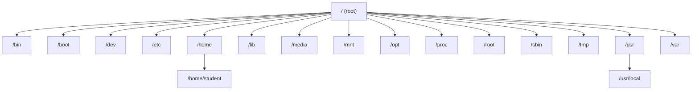

# سكشن 2 (Lab): شجرة ملفات Linux — File System Hierarchy

## 1. يعني إيه Linux File System؟

هو **الطريقة اللي الملفات والبيانات بتتنظم وتتخزن بيها** على جهاز Linux.

> [!IMPORTANT]
> في Linux **كل حاجة عبارة عن ملف (Everything is a file)**: المستندات، والأجهزة، والبرامج، وحتى الإعدادات.

### الهيكل العام (Structure Overview)

Linux بيستخدم **هيكل شجري (tree-like structure)** بيبدأ من **فولدر جذر واحد** اسمه **`/`** (اسمه **root**).




## 2. الفولدرات الأساسية (FHS)

| الفولدر | فيه إيه |
|---|---|
| `/bin` | **Essential user command binaries**: الأوامر الأساسية زي ls و cp |
| `/boot` | **Static files of the boot loader**: ملفات الإقلاع |
| `/dev` | **Device files**: الأجهزة كملفات (زي `/dev/sda` للهارد) |
| `/etc` | **Host-specific system configuration**: ملفات الإعدادات |
| `/home` | **User home directories**: فولدرات المستخدمين (`/home/student`) |
| `/lib` | **Essential shared libraries and kernel modules** |
| `/media` | **Mount point for removable media**: الفلاشات والـ CDs |
| `/mnt` | **Mount point for temporarily mounted filesystems** |
| `/opt` | **Add-on application software packages**: برامج إضافية |
| `/sbin` | **System binaries**: أوامر إدارة النظام (للـ root) |
| `/srv` | **Data for services** provided by this system |
| `/tmp` | **Temporary files**: ملفات مؤقتة |
| `/usr` | **Multi-user utilities and applications** (وفيه `/usr/local/bin` و `/usr/local/games`) |
| `/var` | **Variable files**: ملفات بتتغير زي الـ logs |
| `/root` | **Home directory for the root user** |
| `/proc` | **Virtual filesystem** بيعرض حالة الـ kernel والـ processes كملفات نصية (`/proc/1234`) |

> [!WARNING]
> **`/`** (root directory) غير **`/root`** (الـ home بتاع المستخدم root).

## 3. مفاهيم أساسية (Key Concepts)

| المفهوم | الشرح |
|---|---|
| **Everything is a file** | حتى الهاردوير (`/dev/sda`) والـ processes (`/proc/1234`) |
| **Permissions** | كل ملف ليه صلاحيات لـ **owner** و **group** و **others** |
| **Mounting** | الأجهزة (زي USB) لازم تتعمل لها **mount** على فولدر عشان توصلها |
| **Case-sensitive** | `File.txt` و `file.txt` **ملفين مختلفين** |

## 4. تركيب الأمر (Command Structure)

```
$ ls -F /
│  │   │  └── ARGUMENT  (what the command works on)
│  │   └───── OPTION    (changes the behavior)
│  └───────── COMMAND
└──────────── PROMPT
```

| الجزء | مثال | المعنى |
|---|---|---|
| **Prompt** | `$` | النظام مستني أمر |
| **Command** | `ls` | الأمر |
| **Option** | `-F` | بيعدّل طريقة عمل الأمر |
| **Argument** | `/` | الحاجة اللي الأمر هيشتغل عليها |

## ✅ الخلاصة
- Linux = **tree** بيبدأ من **`/`**، و **everything is a file**.
- `/home` للمستخدمين · `/etc` للإعدادات · `/dev` للأجهزة · `/tmp` مؤقت · `/var` logs · `/proc` processes · `/root` home الـ root.
- Permissions: owner/group/others · Mounting · Case-sensitive.
- الأمر = **prompt + command + option + argument**.
