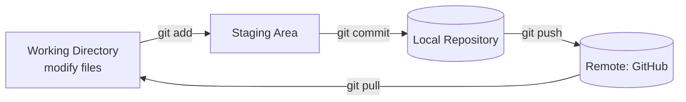
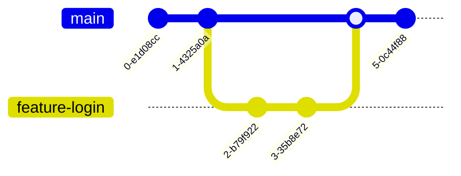

# سكشن 5: Git و GitHub — Version Control

## 1. يعني إيه Git؟

**Git** هو **distributed version control system** (نظام تحكم في النسخ موزّع) **بيتتبّع التغييرات في الكود**، وبيسمح لـ **كذا مطوّر يشتغلوا على نفس المشروع في نفس الوقت من غير تعارض**.

### ليه نستخدم Git؟

| الميزة | الشرح |
|---|---|
| **Version History** | تتبّع **كل تغيير** حصل في الكود، وترجع لأي نسخة |
| **Collaboration** | تشتغل مع زمايلك بسهولة |
| **Branching** | تجرّب **من غير ما تأثر على الكود الأساسي** |
| **Backup** | **مش هتضيّع شغلك** أبدًا |
| **Industry Standard** | مستخدم في **99% من الشركات** |

> [!NOTE]
> **Git** هو **الأداة** اللي على جهازك. أما **GitHub** فهو **موقع** بيستضيف الـ repositories على الإنترنت عشان تشاركها وتتعاون عليها.

## 2. التثبيت والإعداد (Installation & Setup)

```bash
sudo apt update
sudo apt install git -y
git --version
```

### الإعداد الأولي: لازم تعرّف نفسك (Required)

```bash
git config --global user.name "Your Name"
git config --global user.email "your.email@example.com"

# optional but useful
git config --global core.editor "nano"
git config --global init.defaultBranch main
git config --global color.ui auto

git config --list      # check your configuration
```

## 3. المفاهيم الأساسية: الحالات التلاتة (The Three States)

| الحالة | الوصف |
|---|---|
| **Working Directory** | المكان اللي **بتعدّل فيه** الملفات |
| **Staging Area** | ملفات **جاهزة تتعمل commit** |
| **Repository** | **snapshots** (لقطات) متسجلة من المشروع |



**الـ Workflow الأساسي:**
1. **عدّل** الملفات (Working Directory)
2. **Stage** التغييرات ← `git add`
3. **Commit** ← `git commit`
4. **Push** للـ remote ← `git push`

## 4. الأوامر الأساسية (Essential Commands)

### عمل Repository

```bash
mkdir my-project
cd my-project
git init                                             # create a new repository

git clone https://github.com/username/repository.git # or copy an existing one
```

### أوامر يومية

| الأمر | بيعمل إيه |
|---|---|
| `git status` | **حالة** الملفات (اتعدّلت؟ متعملها stage؟) |
| `git add <file>` | **stage** ملف معين |
| `git add .` | **stage كل** الملفات المتغيرة |
| `git commit -m "message"` | **commit** للتغييرات اللي في الـ staging |
| `git log` | **تاريخ** الـ commits |
| `git diff` | التغييرات اللي **لسه متعملهاش stage** |

### مثال عملي

```bash
echo "# My Project" > README.md   # create a file
git status                        # README.md is untracked
git add README.md                 # stage it
git commit -m "Add README file"   # commit
git log --oneline                 # view history in short form
```

## 5. الـ Branches والـ Merge

الـ **Branch** = **خط تطوير مستقل** (independent line of development). والـ branch الافتراضي اسمه غالبًا **main** أو **master**.

```bash
git branch                    # list all branches
git branch feature-login      # create a new branch
git checkout feature-login    # switch to it
git checkout -b feature-signup  # create and switch in one command
git branch -d feature-login   # delete a branch

git checkout main             # merging: go to main first
git merge feature-login       # merge feature into main
```



> [!WARNING]
> **دايمًا اعمل commit أو stash** لتغييراتك **قبل ما تبدّل الـ branch**.

## 6. الشغل مع GitHub

```bash
git remote add origin https://github.com/username/repo.git  # add remote
git remote -v                                               # verify
git push -u origin main                                     # first push

git pull origin main          # get latest changes
git add .
git commit -m "Add new feature"
git push origin main
```

| الأمر | بيعمل إيه |
|---|---|
| `git pull` | **Fetch + merge**: يجيب التغييرات من الـ remote ويدمجها |
| `git fetch` | **يحمّل** التغييرات **من غير merge** |
| `git push` | **يرفع** الـ commits بتاعتك للـ remote |
| `git clone` | **ينسخ** repository من GitHub |

> [!EXAM]
> **pull = fetch + merge**. والفرق إن `fetch` بيحمّل التغييرات بس من غير ما يدمجها في شغلك.

## ✅ الخلاصة
- Git = distributed version control · GitHub = استضافة أونلاين.
- الحالات: **Working Directory ← (add) ← Staging ← (commit) ← Repository ← (push) ← Remote**.
- `init` / `clone` · `status` · `add` · `commit -m` · `log` · `diff`.
- `branch` · `checkout -b` · `merge` · `branch -d`.
- `remote add origin` · `push -u origin main` · `pull` = fetch + merge.
