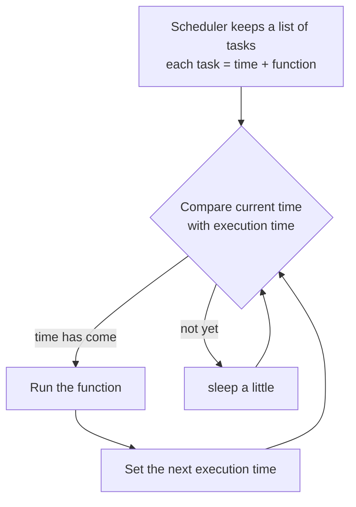

# سكشن 6: جدولة المهام في الكود — Task Scheduling

## 1. يعني إيه Task Scheduling في البرمجة؟

**Task Scheduling** = إنك تخلّي البرنامج **يشغّل مهام معينة لوحده في أوقات محددة أو بشكل متكرر**، **من غير تدخل يدوي**.

> [!EXAMPLE]
> فكّر فيه كـ **"تايمر ذكي (smart timer)"** جوه البرنامج:
> - شغّل process **كل 10 ثواني**
> - ابعت notification **كل ساعة**
> - اعمل **backup للبيانات يوميًا**
> - شغّل function **لما حدث معين يحصل**

### ليه مهم؟
- **يأتمت** الشغل المتكرر ويقلّل التدخل البشري.
- **يقلّل الأخطاء** ويضمن إن المهام تشتغل في وقتها بالظبط.
- **يحسّن الكفاءة**.
- مفيد لـ **background jobs**: تنظيف البيانات، ومراقبة الـ logs، وتحديث السجلات، وإرسال التقارير.

### بيتستخدم فين؟

| المجال | أمثلة |
|---|---|
| **Web Applications** | إرسال رسايل وإشعارات، و jobs يومية |
| **Data Engineering** | **ETL pipelines** وتحديث البيانات أوتوماتيك |
| **Networking** | إدارة تدفق الـ packets وجدولة الـ bandwidth |
| **Embedded Systems** | تشغيل sensors كل ثانية، وقراءة بيانات لحظية |

## 2. جدولة الـ OS مقابل جدولة الكود — OS Scheduling vs Coding Scheduling

| الميزة | **OS Scheduling** | **Coding Scheduling** |
|---|---|---|
| **Scope** (النطاق) | **النظام كله** | **جوه برنامج واحد** |
| **Manages** | **Processes + Threads** | **Functions + Tasks** |
| **Resource Control** | **CPU, RAM, I/O** | **Timer بس** |
| **Algorithms** | **RR, SJF, Priority** | غالبًا **timing-based** |
| **Complexity** | **عالي جدًا** | بسيط وسهل |
| **Purpose** | **Resource utilization** | تشغيل functions في أوقات محددة |

> [!NOTE]
> **RR** = Round Robin · **SJF** = Shortest Job First · **Priority** = حسب الأولوية. ودي خوارزميات الـ CPU scheduling اللي الـ **short-term scheduler** بيستخدمها (Ch3).

## 3. أنواع جدولة المهام في الكود

| النوع | الفكرة | مثال |
|---|---|---|
| **Static Scheduling** | المهام **متحددة مسبقًا** بجدول **ثابت** | شغّل function كل 10 ثواني |
| **Dynamic Scheduling** | المهام **بتتقرر وقت التشغيل** حسب **شروط** | لو الحرارة زادت ← شغّل المروحة |
| **Real-Time Scheduling** | لأنظمة فيها **deadlines** صارمة | **Airbags**، sensors، أجهزة طبية |

## 4. مكونات الـ Scheduler في الكود

| المكون | الشرح |
|---|---|
| **Tasks** | الـ **functions** اللي هتتنفذ (study, exercise, sleep) |
| **Scheduler** | **مكتبة** بتدير التوقيت (زي `schedule`) |
| **Resources** | **CPU time و memory** اللي البرنامج محتاجها |
| **Priority** | ترتيب المهام حسب الأهمية: High · Medium · Low |

## 5. الـ Scheduling في Python بمكتبة `schedule`

**الخطوات:**
1. عرّف الـ functions (tasks).
2. استخدم `schedule.every()` تحدد التوقيت.
3. شغّل **loop** عشان المهام تتنفذ في معادها.

```python
import schedule
import time
import datetime

def study():
    print(f"[{datetime.datetime.now()}] study task is running")

def exercise():
    print(f"[{datetime.datetime.now()}] exercise task is running")

def sleep():
    print(f"[{datetime.datetime.now()}] sleeping task is running")

schedule.every(0.1).minutes.do(study)      # 0.1 minute = 6 seconds
schedule.every(0.5).minutes.do(exercise)   # 0.5 minute = 30 seconds
schedule.every(2).minutes.do(sleep)        # 2 minutes = 120 seconds

while True:
    schedule.run_pending()   # run any task whose time has come
    time.sleep(0.2)          # avoid high CPU usage
```

| الجزء | المعنى |
|---|---|
| `.every(n)` | كل قد إيه |
| `.minutes` | وحدة الفترة بين كل تنفيذ والتاني |
| `.do(func)` | **شغّل الـ function** |
| `run_pending()` | **يشيّك** لو فيه task جه وقتها |
| `time.sleep(0.2)` | **يمنع استهلاك CPU عالي** في الـ loop |

> [!EXAM]
> احسب الوقت: **0.1 minute = 6 sec** · **0.5 minute = 30 sec** · **2 minutes = 120 sec**.

## 6. إزاي الـ Scheduler بيشتغل من جوه؟



## 7. المميزات والعيوب

| ✅ المميزات (Advantages) | ❌ العيوب (Limitations) |
|---|---|
| خفيف وبسيط (lightweight) | **مش مناسب للمهام التقيلة**: function طويلة أو بتاكل موارد بتعمل مشاكل |
| مثالي للمهام المتكررة | **إدارة CPU محدودة**: مش زي الـ OS |
| مفيد للأتمتة | **بيعتمد على loop واحدة**: أي مشكلة فيها توقف كل المهام |
| أقل تعقيدًا من OS scheduling | **المهام بتقف لو البرنامج اتقفل** |
| | **مش مناسب للـ real-time systems**: أي تأخير ممكن يعمل مشاكل خطيرة |

## ✅ الخلاصة
- Task scheduling = تشغيل مهام **أوتوماتيك** في أوقات محددة (smart timer).
- OS scheduling: النظام كله، processes و threads، و CPU/RAM/I/O، و RR/SJF/Priority · Coding scheduling: جوه البرنامج، functions، و timer.
- الأنواع: **Static** (ثابت) · **Dynamic** (شروط) · **Real-Time** (deadlines).
- `schedule.every(x).minutes.do(f)` + `while True: run_pending(); sleep(0.2)`.
