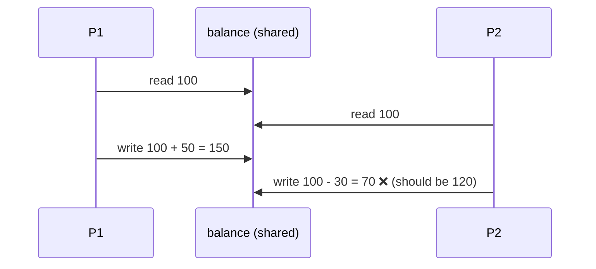
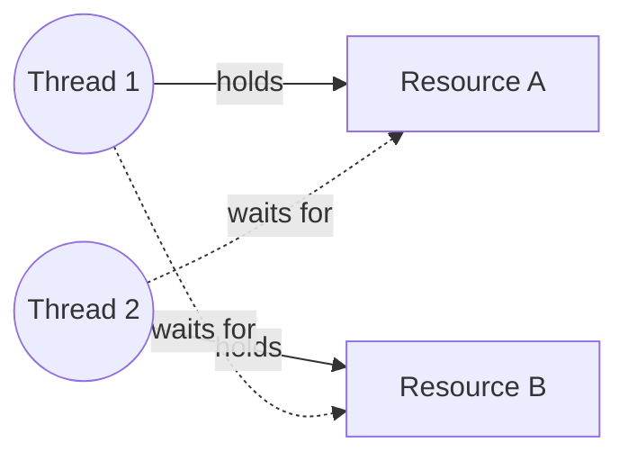

# سكشن 6: الـ Threads والـ Race Condition والـ Semaphores والـ Deadlock

> [!NOTE]
> السكشن ده تطبيق عملي على **Ch4 (Threads)** باستخدام **Python**. هنشوف إيه المشكلة لما كذا thread يوصلوا لنفس البيانات (**Race Condition**)، والحل (**Semaphore**)، ومشكلة **Deadlock**.

## 1. تشغيل Threads في Python

```python
import threading   # create and manage threads
import time        # simulate time-based operations

def print_1():
    print("Starting of a thread:", threading.current_thread().name)
    time.sleep(0.02)          # suspend this thread for 0.02 seconds
    print("Finishing of a thread:", threading.current_thread().name)

def print_2():
    print("Starting of a thread:", threading.current_thread().name)
    print("Finishing of a thread:", threading.current_thread().name)

a = threading.Thread(target=print_1, name="Thread-1")
b = threading.Thread(target=print_2, name="Thread-2")
a.start()
b.start()
```

**الناتج المتوقع:**
```
Starting of a thread: Thread-1
Starting of a thread: Thread-2
Finishing of a thread: Thread-2
Finishing of a thread: Thread-1
```

> [!TIP]
> Thread-2 **خلص قبل** Thread-1 مع إنه بدأ بعده، لأن Thread-1 عمل `sleep`. ده معناه إن الـ threads شغالين **concurrently**.

| الدالة | بتعمل إيه |
|---|---|
| `threading.Thread(target=f, name=..., args=(...))` | تعمل thread بيشغّل الدالة `f` |
| `.start()` | **تبدأ** تشغيل الـ thread |
| `.join()` | **تستنى** لحد ما الـ thread يخلص |
| `threading.current_thread().name` | اسم الـ thread الحالي |

## 2. حالة السباق — Race Condition

- بتحصل لما **process أو أكتر يوصلوا ويعدّلوا بيانات مشتركة في نفس الوقت**.
- **النتيجة النهائية بتعتمد على التوقيت** (مين اشتغل الأول).
- بتؤدي لنتايج **مش متوقعة ومش متسقة** (unpredictable and inconsistent).

> [!EXAMPLE]
> **balance = 100**
> - P1 قرا 100، وهيضيف +50.
> - P2 قرا 100 **في نفس الوقت**، وهيطرح -30.
> - P1 كتب **150**، وبعدين P2 كتب **70** فوقيها.
>
> النتيجة **70 ❌** والصح **120 ✅**، لأن تعديل P1 **ضاع**.



## 3. المنطقة الحرجة — Critical Section

- **جزء من الكود** بيتم فيه **الوصول للموارد المشتركة أو تعديلها** (variables, files, ...).
- **process واحدة بس** المفروض تنفّذه في المرة.
- الباقيين **لازم يستنوا** لحد ما يفضى.
- **الهدف:** **منع الـ race condition** وحماية اتساق البيانات المشتركة.

> [!IMPORTANT]
> **العلاقة بينهم:**
> - **Race Condition** ← **المشكلة**
> - **Critical Section** ← **المكان اللي المشكلة بتحصل فيه**
> - **Semaphore** ← **الحل**

## 4. الـ Semaphore

الـ **Semaphore** هو **آلية مزامنة (synchronization mechanism)** بتتحكم في الوصول لمورد مشترك.

> [!EXAMPLE]
> فكّر فيه كـ **إشارة مرور للـ processes**: بتسمح لـ **واحد (أو عدد معين)** يدخل الـ critical section، والباقي **يستنى** لحد ما المورد يفضى.

- بيستخدم **عداد (counter)** يتتبّع كام process تقدر توصل للمورد.
- **عمليتين أساسيتين:**

| العملية | الاسم التاني | في Python | بتعمل إيه |
|---|---|---|---|
| **wait()** | **P()** | `acquire()` | **تقلّل** العداد، ولو المورد **مش متاح** الـ process **تقف (block)** |
| **signal()** | **V()** | `release()` | **تزوّد** العداد، و**تصحّي** process مستنية لما المورد يتحرر |

**أهداف الـ Semaphore:**
- منع الـ **race conditions**.
- ضمان الـ **mutual exclusion** (process واحدة في المرة).
- وصول **آمن ومنظم** للموارد المشتركة.

### أنواع الـ Semaphores

| | **Binary Semaphore** | **Counting Semaphore** |
|---|---|---|
| قيمة العداد | **0 أو 1** بس | **أكبر من 1** |
| المعنى | **1** = المورد متاح · **0** = مش متاح | عدد الأماكن المتاحة |
| بيشتغل زي | **Lock** بسيط | إدارة **pool** من الموارد |
| مثال | thread واحد بس في الـ critical section | **5 أماكن في playroom**، أو عدد محدود من database connections |

### مثال Binary Semaphore: غرفة الكشف (Examination Room)

```python
import threading, time

examinationroom = threading.Semaphore(1)     # binary: one patient at a time

def enter_examinationroom(num):
    print(f"Patient {num} is waiting for his turn")
    examinationroom.acquire()                # wait() / P()
    print(f"Patient {num} is in the examination room")
    time.sleep(2)
    print(f"Patient {num} has left the examination room")
    examinationroom.release()                # signal() / V()

patients = []
for i in range(10):
    t = threading.Thread(target=enter_examinationroom, args=(i,))
    patients.append(t)
    t.start()
for t in patients:
    t.join()
```

### مثال Counting Semaphore: الـ Playroom (5 أماكن)

```python
import threading, time

playroom = threading.Semaphore(5)            # counting: only 5 players inside

def enter_playroom(num):
    print(f"Player {num} wants to enter the playroom")   # forming a queue
    playroom.acquire()                       # counter - 1, block if 0
    print(f"Player {num} entered the playroom")
    time.sleep(4)                            # stay 4 seconds
    print(f"Player {num} left the playroom")
    playroom.release()                       # counter + 1, wake a waiting player

players = [threading.Thread(target=enter_playroom, args=(i,)) for i in range(15)]
for p in players: p.start()
for p in players: p.join()                   # wait for all threads to finish
```

> [!NOTE]
> 15 لاعب وفيه 5 أماكن بس، فأول 5 يدخلوا والـ 10 الباقيين **يستنوا (blocked)**. وكل ما واحد يخرج (`release`) بيدخل واحد من اللي مستنيين.

### أخطاء شائعة في استخدام الـ Semaphore

| الخطأ | النتيجة |
|---|---|
| **من غير `wait()`** | كذا process يدخلوا الـ critical section مع بعض، فيحصل **Race Condition** وبيانات مش متسقة |
| **من غير `signal()`** | الـ semaphore يفضل **مقفول** والباقيين يستنوا للأبد، فيحصل **Deadlock** |
| **ترتيب غلط** (`signal` قبل `wait`) | دخول بدري، فيحصل **Inconsistency** أو **Starvation** (فيه processes عمرها ما تاخد دورها) |

## 5. الـ Deadlock (الجمود)

بيحصل لما **كل thread ماسك مورد ومستني مورد التاني ماسكه**، فـ**الاتنين يستنوا للأبد**.

```python
import threading, time

resource_a = threading.Lock()
resource_b = threading.Lock()

def thread_function_1():
    with resource_a:                         # Thread 1 locks A first
        print("Thread 1 acquired resource A")
        time.sleep(1)
        print("Thread 1 waiting for resource B")
        with resource_b:                     # ...then waits for B
            print("Thread 1 acquired resource B")

def thread_function_2():
    with resource_b:                         # Thread 2 locks B first
        print("Thread 2 acquired resource B")
        time.sleep(1)
        print("Thread 2 waiting for resource A")
        with resource_a:                     # ...then waits for A → DEADLOCK
            print("Thread 2 acquired resource A")

t1 = threading.Thread(target=thread_function_1)
t2 = threading.Thread(target=thread_function_2)
t1.start(); t2.start()
t1.join(); t2.join()                         # never finishes
```



> [!TIP]
> **الحل البسيط:** خلّي **كل الـ threads يمسكوا الموارد بنفس الترتيب** (A الأول وبعدين B)، فمش هيحصل انتظار دائري (circular wait).

## ✅ الخلاصة
- `Thread(target=...)`، و `start()` يبدأ، و `join()` يستنى.
- **Race condition** = نتيجة بتعتمد على التوقيت (balance 70 بدل 120).
- **Critical section** = كود بيوصل لبيانات مشتركة، و process واحدة بس في المرة.
- **Semaphore**: **wait()/P()/acquire()** ينقّص ويعمل block · **signal()/V()/release()** يزوّد ويصحّي.
- **Binary** (0/1 = lock) · **Counting** (> 1 = pool، زي playroom بـ 5 أماكن).
- من غير wait ← race · من غير signal ← deadlock · ترتيب غلط ← starvation.
- **Deadlock** = كل thread ماسك مورد ومستني التاني.
