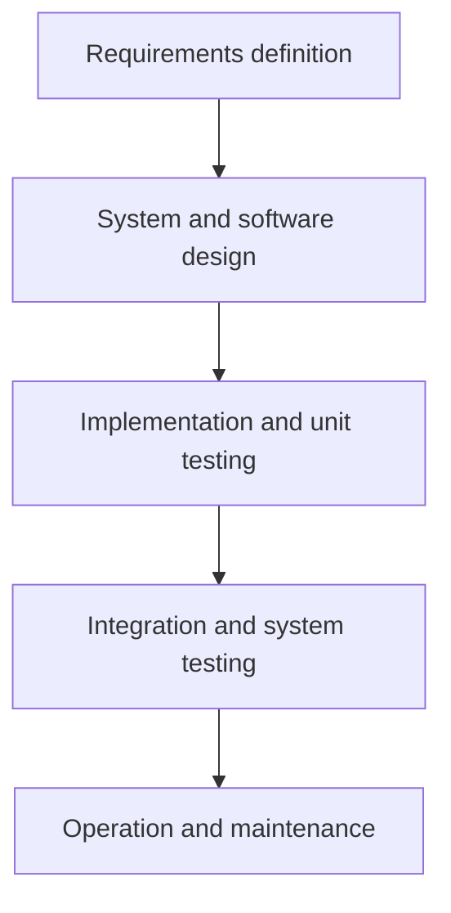

# منهجيات تطوير النظم — Chapter 2: System Development Methodologies

> [!NOTE]
> الشابتر ده عن **المنهجيات (Methodologies)** والـ **Techniques** والـ **Tools**، وعن **Software process models**: **Waterfall** و **Incremental** و **Spiral** و **Reuse-oriented**، وعن **Prototyping**، والفرق بين **Plan-driven** و **Agile**، وإزاي تختار المنهجية المناسبة.

---

## 1. المفاهيم الأساسية — Core Concepts

| العنصر | التعريف |
|---|---|
| **Methodologies** | **سلسلة طرق خطوة بخطوة** بتساعد في تطوير نظام المعلومات |
| **Techniques** | **عمليات** بيتبعها المحلل لضمان تحليل وتصميم **شامل وكامل** |
| **Tools** | **برامج كمبيوتر** بتساعد في تطبيق الـ techniques |

الثلاثة دول **بيشتغلوا مع بعض** لتكوين **أسلوب تنظيمي** لتحليل وتصميم النظم.

### Software Engineering Process
عملية بتتستخدم لإنشاء نظام معلومات.

### Software Development Methodology
- **تمثيل مجرد (abstract representation)** لعملية، بيوصفها من منظور معين.
- **مجموعة أنشطة منظمة** لازمة لتطوير نظام برمجي.
- **كل العمليات** فيها 4 أنشطة:
  1. **Specification:** تحديد إيه اللي النظام لازم يعمله.
  2. **Design and implementation:** تحديد تنظيم النظام وتنفيذه.
  3. **Validation:** التأكد إنه بيعمل اللي العميل عايزه.
  4. **Evolution:** تغيير النظام استجابة لاحتياجات العميل المتغيرة.

---

## 2. فئات المنهجيات — Plan-driven vs Agile

| | **Plan-driven** | **Agile** |
|---|---|---|
| الفكرة | **كل أنشطة العملية متخططة مسبقًا** والتقدم بيتقاس مقابل الخطة | **التخطيط تزايدي (incremental)**، أسهل تغيير العملية لتعكس المتطلبات المتغيرة |

> [!IMPORTANT]
> أغلب العمليات العملية فيها **عناصر من الاتنين**. **مفيش عمليات صح أو غلط**.

### Agile Modeling
- **Interactive and Incremental Modeling:** استخدم **النماذج المناسبة** · اعمل **عدة نماذج بالتوازي** · النمذجة في **زيادات صغيرة**.
- **Teamwork:** **مشاركة نشطة** من الـ stakeholders · شجّع **الملكية الجماعية** · انمذج **مع الآخرين** واعرض النماذج **علنًا**.

---

## 3. نماذج عمليات البرمجيات — Software Process Models

| النموذج | الوصف |
|---|---|
| **Waterfall model** | نموذج **plan-driven** بمراحل **منفصلة** للـ specification والتطوير |
| **Incremental development** | التخطيط تزايدي · الـ specification والتطوير والـ validation **متداخلين** · ممكن plan-driven أو agile |
| **Reuse-oriented software engineering** | النظام **بيتجمّع من مكونات موجودة** · ممكن plan-driven أو agile |

> في الواقع، أغلب النظم الكبيرة بتتطور بعملية فيها **عناصر من كل النماذج**.

---

## 4. نموذج الشلال — The Waterfall Model

**المراحل (5):**
1. **Requirements analysis and definition**
2. **System and software design**
3. **Implementation and unit testing**
4. **Integration and system testing**
5. **Operation and maintenance**

- **العيب الرئيسي:** صعوبة **استيعاب التغيير** بعد بدء العملية. من المبدأ لازم **كل مرحلة تخلص** قبل اللي بعدها.

### مشاكل الـ Waterfall
- التقسيم **الجامد** لمراحل منفصلة يصعّب الاستجابة لتغير متطلبات العميل.
- مناسب **فقط** لما **المتطلبات مفهومة كويس** والتغييرات **قليلة**.
- **قليل من نظم الـ business** متطلباتها مستقرة.
- بيتستخدم غالبًا في **مشاريع هندسة النظم الكبيرة** اللي النظام فيها بيتطور في **مواقع عدة**، وطبيعته الـ plan-driven بتساعد في تنسيق الشغل.

---

## 5. التطوير التزايدي — Incremental Development

الأنشطة (**Specification / Development / Validation**) **متزامنة (concurrent)** وبتطلّع **initial version** ← **intermediate versions** ← **final version**.

### فوائد الـ Incremental
- **تكلفة استيعاب** تغيّر المتطلبات **أقل**؛ كمية التحليل والتوثيق اللي بتتعاد **أقل بكتير** من الـ waterfall.
- **أسهل** تاخد **feedback من العميل** على الشغل المنجز (العملاء بيشوفوا demos).
- **تسليم ونشر أسرع** لبرنامج مفيد للعميل (يستفيد منه بدري).

### مشاكل الـ Incremental
- **العملية مش مرئية (not visible):** المديرين محتاجين **deliverables منتظمة** لقياس التقدم، ومش اقتصادي كتابة وثائق لكل نسخة.
- **بنية النظام بتتدهور** مع إضافة increments جديدة لو مفيش **refactoring**، والتغيير بقى صعب ومكلف.

### ميزة التسليم التزايدي — Incremental Delivery Advantages
- **قيمة للعميل** مع كل increment، فالوظائف متاحة **بدري**.
- الـ increments الأولى بتعمل كـ **prototype** تساعد في استخلاص متطلبات اللي بعدها.
- **مخاطرة أقل** لفشل المشروع ككل.
- الخدمات **الأعلى أولوية** بتاخد **أكبر قدر من الاختبار**.

---

## 6. النموذج الحلزوني — The Spiral Model

**القطاعات (Sectors) الأربعة:**

| القطاع | الوصف |
|---|---|
| **Objective setting** | تحديد **أهداف محددة** للمرحلة |
| **Risk assessment and reduction** | **تقييم المخاطر** ووضع أنشطة لتقليل المخاطر الرئيسية |
| **Development and validation** | اختيار **نموذج تطوير** للنظام (أي نموذج عام) |
| **Planning** | **مراجعة المشروع** والتخطيط للفة (loop) التالية |

**عيوب الـ Spiral:**
- لو **تنفيذ تحليل المخاطر** هيأثر كتير على أرباح المشروع، **ماينفعش** نستخدمه.
- المطورين لازم **يدوروا بنشاط** على المخاطر المحتملة ويحللوها **بدقة** عشان النموذج يشتغل.

---

## 7. النماذج الأولية — Software Prototyping

> **Prototype** = **نسخة أولية** من النظام بتتستخدم **لعرض المفاهيم وتجربة خيارات التصميم**.

**بيتستخدم في:**
- **Requirements engineering:** لـ **استخلاص (elicitation) والتحقق (validation)** من المتطلبات.
- **Design:** لاستكشاف الخيارات وتطوير **UI design**.
- **Testing:** لتشغيل **back-to-back tests**.

- الـ prototype **مش منتج كامل**، هو **replica وظيفي** أو **"toy implementation"** لفكرة.
- بيتطبق لما **العملاء مش عارفين المتطلبات بالظبط**.
- بيتعمل **قبل** التطوير الفعلي.
- طريقة **تكرارية (iterative)** بالتجربة والخطأ بين المطور والعميل.

**فوائد الـ Prototyping:** تحسين **usability** · تطابق أقرب مع **احتياجات المستخدمين الفعلية** · تحسين **جودة التصميم** · تحسين **maintainability** · تقليل **جهد التطوير**.

**عملية تطوير الـ prototype:** Establish prototype objectives ← **Define prototype functionality** ← **Develop prototype** ← **Evaluate prototype**، والمخرجات: Prototyping plan · Outline definition · Executable prototype · Evaluation report.

### Throw-away Prototypes

الـ prototype **بيتم رميه (throw-away)** بعد استخدامه لاستخلاص المتطلبات، وبعدين التصميم والتنفيذ الفعليين بيبدأوا من جديد.

---

## 8. هندسة البرمجيات الموجهة لإعادة الاستخدام — Reuse-oriented

الخطوات: **Requirements specification** ← **Component analysis** ← **Requirements modification** ← **System design with reuse** ← **Development and integration** ← **System validation**.

---

## 9. معايير اختيار المنهجية — Criteria for Selecting the Methodology

1. **Clear user requirements** (وضوح متطلبات المستخدم).
2. **Familiar technology** (تقنية مألوفة).
3. **Complexity** (التعقيد).
4. **Time schedule** (الجدول الزمني).
5. **Schedule visibility** (وضوح الجدول).

> [!EXAM]
> - **Waterfall:** مراحل جامدة · مناسب لمتطلبات واضحة ومستقرة · العيب: صعوبة التغيير.
> - **Incremental:** تغيير أرخص + feedback + تسليم أسرع · العيب: مش مرئية وبنية بتتدهور.
> - **Spiral:** 4 قطاعات (objective setting, risk assessment, development & validation, planning) · محوره **تحليل المخاطر**.
> - **Prototype:** نسخة أولية لاستخلاص/تحقق المتطلبات لما العميل مش عارف بالظبط عايز إيه.
