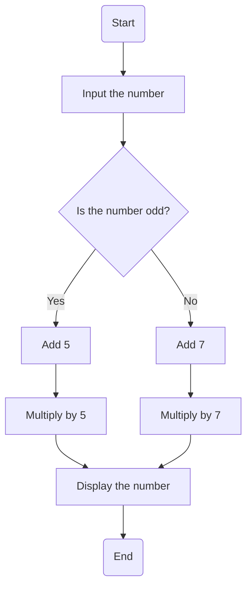

# Section: Activity Diagram

> [!NOTE]
> السكشن ده بيشرح **الـ Activity Diagram**: تعريفه، مكوناته (Initial state, Activity, Control flow, Fork, Join, Decision, Merge, Swim lanes, Final nodes)، وأمثلة (عملية بيع، ATM).

---

## 1. يعني إيه Activity Diagram؟

- **Behavioral diagram** مهم في UML بيوصف **الجوانب الديناميكية** للنظام.
- هو **نسخة متقدمة من الـ flow chart** بتنمذج **التدفق من نشاط لنشاط**.
- بيبين الـ **workflow من نقطة البداية للنهاية** وبيفصّل **مسارات القرار** الكتير في تقدم الأحداث.

## 2. المكونات — Components

| المكون | الوصف |
|---|---|
| **Initial state** (دايرة مصمتة) | **بداية** العملية أو الـ workflow |
| **Activity / Action** | الأنشطة اللي بتكوّن العملية، **اللبنات الأساسية** للـ diagram (بوصف قصير جوه الشكل) |
| **Control flow** (سهم) | **تدفق الشغل** من نشاط لنشاط |
| **Fork** | **بيقسّم** تدفق نشاط واحد لـ **نشاطين متزامنين** (مثال: Steaming Milk و Adding Coffee بالتوازي) |
| **Join** | **بيجمّع** نشاطين متزامنين ويرجعهم لتدفق **نشاط واحد في المرة** (مثال: Making Coffee) |
| **Decision node** | بيمثل **قرار** وله **مسارين على الأقل** مع نص الشرط (مثال: Is the number odd? Yes / No) |
| **Merge node** | بيجمع **تدفقات متعددة مش متزامنة** (concurrent) |
| **Swim lanes** | بتجمع **الأنشطة المرتبطة في عمود واحد** (أو صف)، **رأسية أو أفقية** (Activity Partition) |
| **Flow final node** | **نهاية تدفق واحد** معين (مش بيمثل نهاية كل التدفقات) |
| **Activity final / Final state** | **نهاية كل التدفقات** في النشاط (اكتمال كل تدفقات العملية) |

> [!IMPORTANT]
> **الفرق بين الاتنين:** الـ **flow final node** = نهاية **تدفق تحكم واحد**؛ الـ **activity final node** = نهاية **كل** تدفقات التحكم داخل الـ activity.

### مثال: Decision و Merge
مثال السلايد: **Input the number** ← **Is the number odd?**: لو **Yes** ← add 5 ← Multiply by 5 ← Display. لو **No** ← add 7 ← Multiply by 7 ← Display. والـ **merge** بيجمع الفرعين بعد القرار قبل ما يكملوا في تدفق واحد.

---

## 3. أمثلة

### مثال: Activity Diagram عام

العناصر: **Start State** · **Activity** · **Fork** · **Branch** · **Join** · **End State**.

### مثال: عملية بيع (Sale)

الخطوات: **Start sale** ← **scan barcode** ← **get description** ← `[First item]` **create list of items** / `[else]` **add items to list** ← **Give purchase** ← **Update database** ← `[stock less]` **add to stockless items list** ← **complete sale**. (القرارات بـ guards: `[First item]` / `[else]` و `[stock less]` / `[Else]`).

### مثال: ATM (Swimlanes: Customer و ATM Machine)

- **Customer:** **Enter pin**.
- **ATM Machine:** يتحقق: `[valid PIN]` ← **Enter amount** ← **Check account balance** (فيه **fork/join**) ← `[balance >= amount]` ← **Take money from slot** و **Debit account** ← **Show balance** ← **Eject card**. `[Invalid PIN]` ← مسار الرفض.
- بيستخدم: **branch (decision)**، **guard expression**، **fork**، **join**، **merge**، **swimlanes**.

> [!EXAM]
> - **Activity diagram** = flow chart متقدم بيبين الـ workflow ومسارات القرار.
> - **Fork** (تقسيم لتزامن) ↔ **Join** (تجميع) · **Decision** (شرط) ↔ **Merge** (تجميع بدائل).
> - **Swim lanes** = تجميع الأنشطة حسب الـ role/partition.
> - **Flow final** (نهاية تدفق واحد) vs **Activity final** (نهاية كل التدفقات).
