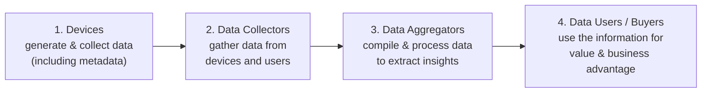

# مقدمة في تخزين المعلومات — Chapter 1: Introduction to Information Storage

> [!NOTE]
> أول محاضرة في Storage Technologies بتأسس للمادة كلها: الفرق بين **Data** و **Information**، وأنواع البيانات، والـ **Big Data**، وإزاي معماريات التخزين اتطورت (DAS ← NAS ← SAN)، ومكونات الـ **Data Center**، وأكبر التحديات في إدارة المعلومات.

**خريطة المحاضرة:**

1. تخزين المعلومات (Information Storage): Data، وأنواعها، و Big Data، و Information
2. تطور تقنيات ومعماريات التخزين (Evolution of Storage Technology and Architecture)
3. البنية التحتية لمركز البيانات (Data Center Infrastructure)
4. التحديات الرئيسية في إدارة المعلومات (Key Challenges)
5. الـ Virtualization والـ Cloud Computing

---

## 1. تخزين المعلومات — Information Storage

> **Information storage** is the method of saving digital or physical data so that it can be **accessed, updated, or managed** in the future.

يعني **تخزين المعلومات** = طريقة حفظ البيانات (رقمية أو فيزيائية) بحيث نقدر **نوصلها ونعدّلها وندير** فيها بعدين.

### 1.1 البيانات — Data

| النقطة | الشرح |
|---|---|
| **التعريف** | **مجموعة حقائق خام (raw facts)** بنستخدمها عشان نوصل لاستنتاجات |
| **طبيعتها** | **خام، مش متعالجة، ومن غير سياق** (raw, unprocessed, without context) |
| **أشكالها** | جوابات بخط اليد، كتب مطبوعة، صور رقمية... |
| **النهارده** | بتتحول لأشكال أسهل زي **e-mails** و **e-books** و **digital movies** |
| **في الكمبيوتر** | بتتخزن كـ **0s و 1s** (bits) |

### العوامل اللي زوّدت البيانات الرقمية (Growth of Digital Data)

1. **زيادة قدرات معالجة البيانات** (Increase in data processing capabilities).
2. **انخفاض تكلفة التخزين الرقمي** (Lower cost of digital storage).
3. **تكنولوجيا اتصالات أرخص وأسرع** (Affordable and faster communication technology).

- **أهمية البيانات وحساسيتها بتتغير مع الوقت**، وده بيأثر على حلول التخزين (hard disks, CDs, DVDs, USB flash drives).
- البيانات بتتخزن في **databases, files, memory, disks** كـ bits.

### 1.2 أنواع البيانات — Types of Data

| | **Structured Data** (منظمة) | **Unstructured Data** (غير منظمة) |
|---|---|---|
| الشكل | منظمة في **صفوف وأعمدة (rows and columns)** | **ملهاش شكل محدد** |
| بتتدار بـ | **DBMS** (Database Management System) | صعب استرجاعها وإدارتها |
| النسبة في الشركات | **~20%** | **أكتر من 80%** |
| أمثلة | جداول البنوك، سجلات الطلبة | **Checks, X-Rays, Manuals, Images, Forms, Contracts, Instant Messages, Documents, Web Pages, Rich Media, Invoices, Audio/Video**، وبيانات تواصل العملاء |

> [!EXAM]
> **أكتر من 80% من بيانات الشركات unstructured**، وعشان كده الشركات **مهتمة أساسًا بإدارة الـ unstructured data**.

### 1.3 البيانات الضخمة — Big Data

| النقطة | الشرح |
|---|---|
| **التعريف** | مجموعات بيانات **ضخمة جدًا** (structured و unstructured) **أكبر من قدرة الأدوات التقليدية** على التجميع والتخزين والإدارة والمعالجة بكفاءة |
| **المصادر** (Sources) | Business transactions, web pages, videos, images, emails, **social media** |
| **الاحتياج الأساسي** (Key Need) | تجميع وتحليل وتحديث **لحظي (real-time)** عشان اتخاذ القرار والـ **predictive modeling** |
| **الفرص** (Opportunities) | قيمة كبيرة من الـ **insights** والـ **analytics** وقرارات أحسن |

#### منظومة الـ Big Data — Big Data Ecosystem

### 1.4 المعلومات — Information

- **Information** = **الذكاء والمعرفة المستخرجة من البيانات** (intelligence and knowledge derived from data).
- **توافر المعلومات وحمايتها** حاجة أساسية لنجاح أي بيزنس، ومعاها التزامات قانونية وتنظيمية وتعاقدية.
- **الانقطاعات (outages)** في الصناعات المهمة بتكلّف **ملايين في الساعة**.
- المعلومات بتتخزن بشكل **منظم** (reports, documents, dashboards, knowledge bases) عشان تتفهم وتسترجع بسهولة.

| | **Data** | **Information** |
|---|---|---|
| إيه هي؟ | **اللي بنخزنه** (what you store) | **اللي بنطلع بيه** لما البيانات تتعالج وتسترجع **بسياق** |
| طبيعتها | raw facts | knowledge / intelligence |
| مثال | 40, 35, 38 | "درجات الطالب في الامتحانات بتتحسن" |

> [!TIP]
> **Data + Processing + Context = Information**

---

## 2. تطور تقنيات ومعماريات التخزين — Evolution of Storage Technology and Architecture

- زمان الشركات كانت بتستخدم **كمبيوترات وأجهزة تخزين مركزية (centralized)** في الـ data center.
- الـ **Open systems** خلّت كل قسم يبقى عنده **servers و storage خاصين بيه**، وده عمل معلومات **مش محمية، ومش متدارة، ومتقطعة (fragmented)**.
- عشان نحل ده، التخزين اتطور من **تخزين داخلي "غبي" (non-intelligent internal storage)** لـ **تخزين شبكي ذكي (intelligent networked storage)**.

### معماريات التخزين الرئيسية (Storage Architectures)

| # | المعمارية | الشرح |
|---|---|---|
| 1 | **DAS** (Direct-Attached Storage) | تخزين **متوصل مباشرة بالسيرفر** (internal أو external). **بسيط ورخيص** لكن **محدود في التوسع والمشاركة** |
| 2 | **JBOD** (Just a Bunch of Disks) | نوع من **multilevel configuration** للديسكات: **مجموعة ديسكات** في نظام أو array |
| 3 | **RAID** (Redundant Array of Independent Disks) | **بيجمع كذا ديسك** عشان يحسّن **الأداء والسعة والاعتمادية** (performance, capacity, reliability) |
| 4 | **NAS** (Network-Attached Storage) | تخزين **على مستوى الملفات (file-level)** متوصل عن طريق **LAN**. **مركزي، وقابل للتوسع، ورخيص** لمشاركة الملفات والـ backups |
| 5 | **SAN** (Storage Area Network) | **شبكة مخصصة عالية السرعة** (غالبًا **Fibre Channel**) بتقدّم تخزين **على مستوى الـ blocks (block-level)**. قابلة للتوسع، وأداءها عالي، وموثوقة، **لكن غالية** |
| 6 | **IP-SAN** (Internet Protocol SAN) | بتجمع **block-level storage** بتاع الـ SAN مع شبكات **IP (LAN/WAN)**. تجميع وتوافر **بتكلفة أقل** باستخدام البنية الـ IP الموجودة |

> [!EXAM]
> أهم مقارنة في المادة:
> - **NAS = file-level** عن طريق **LAN (Ethernet)**
> - **SAN = block-level** عن طريق **Fibre Channel** (شبكة مخصصة)
> - **IP-SAN = block-level** عن طريق **IP** (أرخص)
> - **DAS = متوصل مباشرة** بالسيرفر (بسيط بس مش بيتشارك)

### من Server-Centric لـ Information-Centric

| | **Early Stage: Server-Centric** | **Modern Stage: Information-Centric** |
|---|---|---|
| مكان التخزين | **جوه كل server** ومش بيتشارك | **مركزي** ومستقل عن السيرفرات |
| السعة | **محدودة**، والصيانة أو الترقية بتعمل **downtime** | **بتتوسع ديناميكيًا من غير ما توقف الخدمة** |
| المشاركة | مفيش | **متشارك بين كذا server** ويتوزع بمرونة |
| النتيجة | **"islands of information"** (جزر معلومات): متقطعة، ومش محمية، وغالية | إدارة معلومات **أسهل وأرخص** |

- **التطور مستمر (Ongoing Evolution)**: تقنيات التخزين بتتقدم عشان consolidation وحماية وتحسين أكتر، وعائد أعلى من البيانات.

---

## 3. البنية التحتية لمركز البيانات — Data Center Infrastructure

- الـ **Data centers** بتوفر **قدرات معالجة مركزية** للشركات، وبتدير الـ **mission-critical data**.
- فيها: **computers, storage systems, network devices, power backups, environmental controls** (تكييف وتحكم في البيئة).
- الشركات الكبيرة غالبًا عندها **أكتر من data center** عشان **disaster recovery** (التعافي من الكوارث).

### العناصر الأساسية الخمسة — Five Core Elements

| # | العنصر | دوره |
|---|---|---|
| 1 | **Application** | سوفتوير بيقدّم **منطق العمليات** (مثلًا: order processing) |
| 2 | **Database (DBMS)** | بينظّم ويدير البيانات في **جداول منظمة** |
| 3 | **Server & Operating System** | **المنصة** اللي بتشغّل الـ applications والـ databases |
| 4 | **Network** | **التواصل** بين الـ clients والـ servers والـ storage |
| 5 | **Storage Array** | جهاز **تخزين دائم (persistent)** للبيانات |

> [!IMPORTANT]
> العناصر دي **بتتدار كل واحد لوحده**، لكن **لازم تشتغل مع بعض** عشان تلبي احتياجات معالجة البيانات.

### مثال: نظام معالجة الطلبات (Order Processing System)

| الخطوة | اللي بيحصل |
|---|---|
| ① | العميل بيعمل **طلب** من الـ **AUI** (Application User Interface) على جهازه |
| ② | الـ client بيتصل بالسيرفر عن طريق **LAN** ويوصل للـ **DBMS** عشان يحدّث البيانات (اسم العميل، العنوان، طريقة الدفع، المنتجات، الكمية) |
| ③ | الـ **DBMS** بيستخدم **الـ server OS** عشان يقرا ويكتب البيانات في الـ database على الديسكات |
| ④ | الـ **Storage Network** بتوفر الاتصال بين السيرفر والـ storage array، وبتنقل أوامر القراءة والكتابة |
| ⑤ | الـ **Storage Array** بينفّذ العمليات اللازمة لتخزين البيانات على الديسكات |

### الخصائص الأساسية لعناصر الـ Data Center — Key Characteristics

| الخاصية | المعنى |
|---|---|
| **Availability** (التوافر) | البيانات متاحة **وقت ما تحتاجها** |
| **Security** (الأمان) | منع الوصول **غير المصرّح** |
| **Scalability** (قابلية التوسع) | تزوّد موارد **من غير ما توقف** الشغل |
| **Performance** (الأداء) | خدمة الطلبات **بسرعة** |
| **Data Integrity** (سلامة البيانات) | البيانات **تفضل صحيحة** زي ما اتكتبت |
| **Capacity** (السعة) | مساحة **كافية** للتخزين |
| **Manageability** (سهولة الإدارة) | إدارة **سهلة** للكل، وهي اللي بتربط باقي الخصائص |

> [!TIP]
> احفظهم: **"A-S-S-P-D-C-M"**: **A**vailability, **S**ecurity, **S**calability, **P**erformance, **D**ata integrity, **C**apacity, **M**anageability.

### إدارة البنية التحتية للتخزين — Managing Storage Infrastructure

| النشاط | الشرح |
|---|---|
| **1. Monitoring** (المراقبة) | تتبّع **مستمر** للأمان والأداء والوصول والسعة |
| **2. Reporting** (التقارير) | تقارير **دورية** عن الأداء والسعة والاستخدام، عشان القرارات وتوزيع التكلفة |
| **3. Provisioning** (التوفير) | توفير الهاردوير والسوفتوير والموارد اللازمة، وبيشمل: **Capacity Planning** (تلبية احتياجات المستقبل بتكلفة مناسبة) و **Resource Planning** (تحديد الموارد المطلوبة: أفراد، ومنشآت، وتكنولوجيا) |

---

## 4. التحديات الرئيسية في إدارة المعلومات — Key Challenges in Managing Information

| # | التحدي | الشرح |
|---|---|---|
| 1 | **Explosive Data Growth** | الـ digital universe **بيكبر بسرعة** بسبب النسخ المتكررة والـ backups وإعادة الاستخدام، فالتخزين والتوسع بقوا صعبين |
| 2 | **Dependency & Changing Value** | البيزنس **بيعتمد** على المعلومات أكتر، لكن **قيمتها بتتغير مع الوقت** ومحتاجة تقييم مستمر |
| 3 | **Data Quality & Integration** | ضمان **الدقة والاتساق** ودمج بيانات من أنظمة مختلفة |
| 4 | **Security, Privacy & Compliance** | حماية البيانات من الاختراق والالتزام بالقوانين (زي **GDPR**) |
| 5 | **Accessibility, Availability & Recovery** | المعلومات لازم تبقى متاحة **في أي وقت ومن أي مكان**، مع **backup و disaster recovery** قوي |
| 6 | **Cost & Resource Management** | موازنة تكلفة البنية التحتية والتخزين وتدريب المستخدمين مع التخطيط للنمو |

---

## 5. الـ Virtualization والـ Cloud Computing

### Virtualization

- تقنية بتعمل **تمثيل افتراضي (virtual representations)** للـ servers والـ storage والـ networks وغيرها.
- السوفتوير الافتراضي **بيقلّد وظايف الهاردوير** عشان يشغّل **كذا virtual machine في نفس الوقت على جهاز فعلي واحد**.
- الشركات بتستخدمها عشان **تستغل الهاردوير بكفاءة** وتاخد عائد أكبر من استثمارها.
- وهي **اللي بتشغّل خدمات الـ cloud computing**.

### Cloud Computing

- **توصيل موارد الحوسبة عند الطلب (on-demand) عبر الإنترنت بنظام الدفع حسب الاستخدام (pay-as-you-go)**.
- **بدل ما تشتري وتمتلك وتصون data center**، تستخدم خدمات (computing power, storage, databases) **وقت ما تحتاجها** من **cloud provider**.
- الـ Cloud بيستخدم الـ **virtualization كتقنية أساسية (core technology)**، وده بيسمح لكذا بيئة افتراضية تشتغل على **نفس الهاردوير المشترك**.

> [!IMPORTANT]
> **العلاقة:** Virtualization ← بتعمل hardware و OS افتراضي ← وده بيخلّي الـ cloud providers يقدموا **scalable services** (servers, storage, software) عبر الإنترنت.

---

## ✅ خلاصة المحاضرة في 10 نقط

1. **Information storage** = حفظ البيانات عشان access و update و manage بعدين.
2. **Data** = raw facts من غير سياق · **Information** = المعرفة المستخرجة من البيانات بعد المعالجة.
3. نمو البيانات بسبب: processing capabilities أعلى، وتخزين أرخص، واتصالات أسرع وأرخص.
4. **Structured** (rows/columns، DBMS، ~20%) · **Unstructured** (> 80% من بيانات الشركات).
5. **Big Data**: أكبر من الأدوات التقليدية، وال ecosystem: Devices ← Collectors ← Aggregators ← Users/Buyers.
6. المعماريات: **DAS, JBOD, RAID, NAS (file-level, LAN), SAN (block-level, FC), IP-SAN (block over IP)**.
7. **Server-centric** (islands of information) ← **Information-centric** (مركزي ومتشارك).
8. عناصر الـ Data Center الخمسة: **Application, DBMS, Server & OS, Network, Storage Array**.
9. الخصائص: **Availability, Security, Scalability, Performance, Data Integrity, Capacity, Manageability** · والإدارة: **Monitoring, Reporting, Provisioning**.
10. **Cloud** = on-demand و pay-as-you-go، وقايم على **virtualization**.
