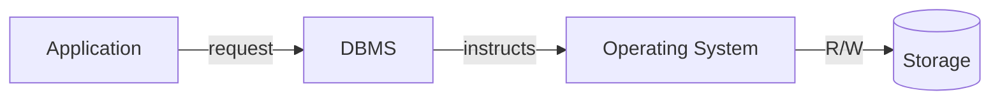
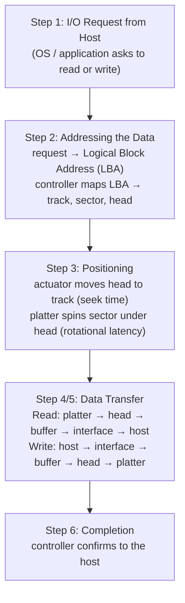

# تطور التخزين وبيئة مركز البيانات — Chapter 2: Storage Technologies & Data Center Environment

> [!NOTE]
> المحاضرة دي بتدخل جوه "البيئة" اللي بيشتغل فيها التخزين: الـ Application والـ DBMS والـ Host والـ Connectivity، وبعدين بتفصّص الـ **Hard Disk** من جوه (platter, spindle, heads, tracks, sectors) وإزاي نقيس أداءه، وفي الآخر DAS و NCQ و Flash drives.

**خريطة المحاضرة:**

1. تطور وسائط التخزين (Evolution of Storage)
2. التطبيقات في الـ Data Center (Application)
3. الـ DBMS
4. الـ Host (Compute)
5. الاتصال (Connectivity): Physical و Logical
6. وسائط التخزين (Storage Media): Tape و Optical و Solid state
7. مكونات الـ Disk Drive
8. أداء الـ Disk Drive
9. وصول الـ Host للبيانات (Host Access to Data)
10. الـ DAS
11. الـ Native Command Queuing (NCQ)
12. الـ Flash Drives ومقارنتها بالـ HDD

---

## 1. تطور وسائط التخزين — Evolution of Storage and Application

| # | الوسيط | الفترة | الميزة / الملاحظة |
|---|---|---|---|
| 1 | **Punch Cards** (الكروت المثقوبة) | **1890s – 1960s** | **أقدم شكل** للتخزين: البيانات **ثقوب** في كروت وبتتعالج **بالترتيب (sequentially)**. سعة قليلة وكفاءة ضعيفة |
| 2 | **Magnetic Tapes** (الشرائط المغناطيسية) | **1950s** | سعة أعلى و**بتتعاد استخدامها**. **لسه بتستخدم لحد النهارده** في الـ **archival و backup** لأنها **رخيصة ومتينة** |
| 3 | **Magnetic Disks (HDDs)** | **1960s** | **Random access** و **أسرع بكتير من الشرائط**، وفضلت الوسيط المسيطر لعقود |
| 4 | **SSDs** (Solid-State Drives) | — | مبنية بـ **NAND flash memory**: **أسرع بكتير**، و **متينة (مفيهاش أجزاء متحركة)**، و **موفرة للطاقة** |
| 5 | **Optical Storage** (CD, DVD, Blu-ray) | — | تخزين **محمول ورخيص** للميديا والـ backup، و**استخدامه قل** بسبب الـ cloud والـ flash |
| 6 | **Flash Memory** | — | صغيرة و **non-volatile**: في **USB drives والموبايلات والأنظمة المدمجة** |
| 7 | **NVMe Drives** (Non-Volatile Memory Express) | — | من **أحدث تقنيات التخزين**: **ultra-low latency** و **throughput عالي جدًا** مقارنة بـ SATA SSDs |

> [!TIP]
> الترتيب الزمني: **Punch cards (1890s) ← Magnetic tapes (1950s) ← HDDs (1960s) ← Optical ← Flash ← SSD ← NVMe**.

**التطبيقات:** تقنيات التخزين بتخدم enterprise databases، و virtualization، و big data، و **AI/ML**، و multimedia streaming، و **IoT**، والحوسبة الشخصية.

---

## 2. التطبيقات في بيئة الـ Data Center

| المصطلح | التعريف |
|---|---|
| **Data center environment** | **الظروف الفيزيائية المتحكَّم فيها** (حرارة **temperature**، رطوبة **humidity**، تدفق هواء **airflow**) جوه الـ data center عشان المعدات تشتغل بأمان وكفاءة |
| **Data center** | **منشأة مركزية** فيها البنية التحتية: servers, storage, networking devices, applications، وهي الأساس لتقديم خدمات الحوسبة والتخزين |
| **Application** | برنامج بيعمل عمليات حوسبة عن طريق **إرسال طلبات قراءة/كتابة (R/W requests)** للـ OS وأجهزة التخزين |

- الـ Applications **بتأثر مباشرة** على تصميم أنظمة التخزين وأدائها واحتياجات التوافر.
- ممكن تشتغل **فوق databases**، والـ databases بتستخدم خدمات الـ OS للقراءة والكتابة.

### تصنيفات الـ Applications في الـ Data Center

| الفئة | مثال |
|---|---|
| **Business applications** | email، **DSS** (Decision Support System) |
| **Infrastructure management** | resource management |
| **Data protection** | **backup** |
| **Security applications** | authentication، antivirus |

---

## 3. نظام إدارة قواعد البيانات — DBMS

- بيوفر **طريقة منظمة** لتخزين البيانات في **جداول متنظمة منطقيًا ومترابطة** (logically organized, interrelated tables).
- **بيحسّن** تخزين واسترجاع البيانات.
- لما الـ application يطلب بيانات، الـ DBMS **بيعالج الطلب ويأمر الـ OS** يجيب البيانات من التخزين.
- الـ DBMS **جسر (bridge) بين الـ applications والتخزين**.

---

## 4. الـ Host (Compute)

- الـ **host (compute system)** = **الكمبيوتر اللي الـ applications بتشتغل عليه** وبيخزن ويسترجع البيانات.
- ممكن يكون **physical** (desktop, server, laptop, mobile) أو **virtual machine** (compute virtualization).
- بيمثّل **موارد الحوسبة** (servers, CPUs, memory) اللي بتعالج الـ applications وبتدير الـ **I/O** من وإلى التخزين.
- الـ hosts الحديثة بتستخدم **virtualization و containers و cloud orchestration** عشان الـ scalability.

### مكونات الـ Host

| النوع | المكونات |
|---|---|
| **Hardware** | **CPU** (ALU, control unit, registers, cache) · **Storage** (RAM, ROM, disks) · **I/O devices** (keyboard, mouse, monitor) |
| **Software** | **OS** · **file system** · **logical volume manager (LVM)** · **device drivers** |

---

## 5. الاتصال — Connectivity

الـ **Connectivity** = **الرابط بين الـ hosts والأجهزة الطرفية** (storage, printers). والتركيز هنا على **host-to-storage**.

ليه **مكونين**:
1. **Physical**: الهاردوير اللي بيوصّل الـ host بالـ storage.
2. **Logical**: **البروتوكولات** اللي بتخلّي تبادل البيانات ممكن.

### المكونات الفيزيائية (Physical): Bus و Port و Cable

| المكون | الشرح |
|---|---|
| **Bus** | **مجموعة مسارات** بتنقل البيانات **جوه الكمبيوتر** (مثلًا CPU ↔ memory) |
| **Port** | **مخرج متخصص** لتوصيل الـ host بجهاز خارجي |
| **Cable** | بيوصّل الـ hosts بالأجهزة، **نحاس (copper) أو ألياف (fiber)** |

> [!NOTE]
> الـ **HBA (Host Bus Adapter)** هو كارت بيتركب في الـ host عشان يوصّله بالتخزين (زي كارت Fibre Channel).

### المكونات المنطقية (Logical): البروتوكولات

| البروتوكول | الشرح |
|---|---|
| **PCI** (Peripheral Component Interconnect) | **معيار كروت التوسعة** (network cards, modems)، بيوصّل الـ CPU بالأجهزة، و **Plug-and-play** (بيتعرف على الأجهزة ويظبطها لوحده) |
| **IDE/ATA** (Integrated Device Electronics / Advanced Technology Attachment) | **أشهر بروتوكول للديسكات الحديثة**: **أداء عالي بتكلفة قليلة** |
| **SCSI** (Small Computer System Interface) | **مفضّل في الأنظمة الـ high-end**، وأقل انتشارًا في الأجهزة الشخصية (**أغلى**). كان **parallel interface** واتطور لكذا معيار |

> [!EXAM]
> - **IDE/ATA** ← الأشهر، **أداء عالي وتكلفة قليلة**.
> - **SCSI** ← **high-end** و**أغلى**.
> - **PCI** ← كروت التوسعة و **plug-and-play**.

### طرق اتصال الـ hosts بالتخزين

| الطريقة | الشرح |
|---|---|
| **DAS** | **كابل مباشر** |
| **NAS** | **File-level** عن طريق **TCP/IP** (بروتوكولات **NFS, SMB**) |
| **SAN** | **Block-level** عن طريق **Fibre Channel أو iSCSI أو NVMe-over-Fabrics** |
| **Ethernet & InfiniBand** | اتصال **عالي السرعة** في الـ data centers الحديثة |

---

## 6. وسائط التخزين — Storage

**جهاز التخزين هو أهم مكون** في بيئة نظام التخزين.

| نوع الوسيط | أمثلة |
|---|---|
| **Magnetic** | Disks, tapes, diskettes |
| **Optical** | CD-ROMs |
| **Solid State** | Flash memory cards, SSDs |

### التخزين على الشرائط — Tape Storage

| ✅ المميزات | ❌ القيود |
|---|---|
| **Low cost** (رخيصة) | **Sequential access** ← الـ random access **بطيء** |
| **Mobility** (سهلة النقل) | **تخدم application واحد بس** في المرة |
| **High capacity** (في النسخ الحديثة) | **Management overhead عالي** |

**الاستخدام النهارده:** **Backup، archival، تخزين طويل المدى** لبيانات **نادرًا ما بنحتاجها**، ومعاها caching و disk integration و automation في الـ **tape libraries**.

### الأقراص الضوئية — Optical Disk Storage

- **الاستخدامات:** تخزين شخصي (صور، ملفات صغيرة)، وتوزيع البرامج (games, software)، و backup صغير.
- **القيود:** **سعة وسرعة قليلة** ← **مش مناسبة للـ enterprise data centers**.
- **الميزة:** **WORM (Write Once, Read Many)** ← بتضمن **سلامة البيانات (data integrity)**.

### Solid-state (flash / SSDs)

**حديثة، وأسرع، وأكثر اعتمادية**، **لكن أغلى**.

---

## 7. مكونات الـ Disk Drive

الـ disk drive بيستخدم **ذراع بيتحرك بسرعة** عشان يقرا ويكتب على **طبق (platter) مسطح** مغطّى بجزيئات مغناطيسية. البيانات بتتنقل من الـ platter عن طريق الـ **R/W head** للكمبيوتر. ولما كذا platter يتجمعوا مع الـ heads والـ controller، بنسمي الجهاز **HDD**. والبيانات تقدر **تتكتب وتتمسح عدد لا نهائي من المرات**.

**المكونات الأساسية الخمسة:** **platter، spindle، read/write head، actuator arm assembly، controller**.

| المكون | الشرح |
|---|---|
| **Platter** (الطبق) | **قرص دائري صلب** مغطّى بمادة مغناطيسية **على الوجهين**، والبيانات بتتخزن كـ 0s و 1s عن طريق **استقطاب (polarizing)** المجالات المغناطيسية. كذا platter بيلفّوا مع بعض في **HDA (Head Disk Assembly)** مقفول. **عدد الـ platters وسعة كل واحد بيحددوا السعة الكلية** |
| **Spindle** (المحور) | **بيمسك ويوصّل كل الـ platters**، وموتور بيلفّه **بسرعة ثابتة عالية**: **7,200 أو 10,000 أو 15,000 rpm**. قطر الـ platter حوالي **3.5 inches**، وعند **15,000 rpm** حافة الـ platter بتتحرك بحوالي **25% من سرعة الصوت** |
| **Read/Write (R/W) Heads** | **بتقرا وتكتب** على سطح كل platter: **head لكل سطح**. الكتابة **بتغيّر** الاستقطاب، والقراءة **بتكشفه**. الـ heads **بتطير فوق** الـ platter بفجوة هوا صغيرة اسمها **flying height**، ولما الديسك يقف بترتاح على **landing zone** متشحّمة جنب الـ spindle |
| **Actuator Arm Assembly** | **بيمسك الـ R/W heads ويحرّكها** للمكان الصح. **كل الـ heads متركبة على actuator واحد** وبتتحرك **مع بعض**. وكل platter ليه **2 heads** (head لكل وش) |
| **Controller** | **دايرة إلكترونية (circuit board) تحت الديسك** فيها microprocessor و memory و firmware. **بيدير** سرعة الموتور، وحركة الـ actuator، والتبديل بين الـ heads، والتواصل مع الـ host، و**بيحسّن** الوصول للبيانات |

> [!WARNING]
> **Head crash:** لو حصل عطل وخلّى الـ head **يلمس سطح الـ platter بره الـ landing zone**، بيخدش السطح ويبوّظ الـ head، وده **غالبًا بيضيّع البيانات**.

### الهيكل الفيزيائي: Tracks و Sectors و Cylinders

| المصطلح | الشرح |
|---|---|
| **Track** (مسار) | **دواير متحدة المركز (concentric rings)** على الـ platter، وكثافتها بتتقاس بـ **TPI (tracks per inch)** |
| **Sector** (قطاع) | تقسيم الـ track، وهو **أصغر وحدة تخزين ليها عنوان (smallest addressable unit)**، وعادةً **512 bytes** بيانات + **metadata** (sector, head, platter, track numbers) |
| **Cylinder** (أسطوانة) | **مجموعة الـ tracks اللي في نفس المكان** على كل أسطح الـ platters. ومكان الـ heads بيتحدد **برقم الـ cylinder** مش رقم الـ track |

> [!EXAM]
> **ليه الديسك 500GB بيظهر حوالي 465.7GB بس؟**
> لأن جزء من المساحة بيروح للـ **metadata** بتاعة كل sector، وكمان الشركات بتحسب الـ GB = 1000³ بدل 1024³. يعني الـ **usable capacity أقل من الـ unformatted size**.

### الـ Zoned Bit Recording (ZBR)

- الـ tracks اللي **بره (outer)** أطول من اللي **جوه (inner)**، فلو كلهم فيهم نفس عدد الـ sectors هنضيّع مساحة.
- **ZBR** بيقسّم الـ tracks لـ **مناطق (zones)**:
  - **الـ zones الخارجية فيها sectors أكتر**.
  - **الـ zones الداخلية فيها sectors أقل**.
  - **كل الـ tracks في نفس الـ zone ليها نفس عدد الـ sectors**.
- النتيجة: **استغلال أقصى لمساحة الديسك**.

---

## 8. أداء الـ Disk Drive — Disk Drive Performance

أداء الديسك = **قد إيه بيخلص عمليات الـ I/O بسرعة وكفاءة**، وبيتحدد بـ **3 عوامل**:

| العامل | التعريف | ملاحظة |
|---|---|---|
| **1. Seek Time** | الوقت اللي **الـ R/W head بياخده عشان يتحرك للـ track الصح** | كل ما يقل، الـ **random access** يتحسن |
| **2. Rotational Latency** | الوقت اللي **الـ platter بياخده عشان يلف لحد ما الـ sector المطلوب يبقى تحت الـ head** | **Average latency = ½ rotation time**، و **spindle أسرع = latency أقل** |
| **3. Data Transfer Rate** | **متوسط السرعة** اللي الديسك بيسلّم بيها البيانات للـ **HBA** | فيه **internal** (platter ↔ buffer) و **external** (buffer ↔ host interface) |

### مثال حسابي على الـ Rotational Latency

$$\text{Rotation time} = \frac{60}{\text{rpm}} \text{ seconds}, \qquad \text{Average latency} = \frac{1}{2} \times \frac{60}{\text{rpm}}$$

| rpm | زمن اللفة | **Average rotational latency** |
|---|---|---|
| 7,200 | 60/7200 = 8.33 ms | **4.17 ms** |
| 10,000 | 6 ms | **3 ms** |
| 15,000 | 4 ms | **2 ms** |

### مسار البيانات (Data Transfer)

| العملية | المسار |
|---|---|
| **Read** | platters ← R/W heads ← **drive's internal buffer** ← interface ← **host HBA** |
| **Write** | **host HBA** ← drive's interface ← **internal buffer** ← R/W heads ← platters |

- الـ **sustained external rate أقل** من الحد الأقصى النظري.

---

## 9. وصول الـ Host للبيانات — Host Access to Data

الوصول للبيانات على الديسك بيمر بكذا خطوة بينسّقها **الـ drive controller**:

> [!IMPORTANT]
> **LBA (Logical Block Address)**: الـ host بيطلب البيانات **بعنوان منطقي**، والـ **controller** هو اللي بيحوّله لمكان فيزيائي (**track, sector, head**).
> والأداء الكلي بيعتمد على **seek time + rotational latency + transfer rate**.

---

## 10. التخزين المتصل مباشرة — DAS (Direct-Attached Storage)

- تخزين **متوصل مباشرة بالكمبيوتر من غير شبكة**، **داخلي أو خارجي**.
- **أبسط شكل** للتخزين: HDDs، و SSDs، و USB drives.
- معظم السيرفرات والأجهزة فيها **HDD أو SSD داخلي**، وده DAS.
- **مش networked**: مفيش **Ethernet** ولا **Fibre Channel switches** زي NAS و SAN.

| ✅ المميزات | ❌ العيوب |
|---|---|
| **بسيط ورخيص** | **مش سهل يتشارك** بين كذا host |
| **وصول سريع** لنظام واحد | **توسع محدود** مقارنة بـ SAN و NAS |
| مناسب للـ **PCs** و **entry-level servers** | إدارة البيانات والـ backup **معتمدين على الـ host** |

---

## 11. الـ Native Command Queuing (NCQ)

**NCQ** = تقنية في ديسكات **SATA** بتحسّن الأداء عن طريق **إعادة ترتيب الأوامر** لأفضل تنفيذ.

### بيشتغل إزاي؟
- لما يوصل للديسك **كذا طلب قراءة/كتابة**، الـ NCQ بيخلّي الديسك **يعمل لهم queue ويرتّبهم**.
- **بدل ما ينفذهم بترتيب الوصول**، بيرتّبهم بحيث **يقلل حركة الـ head والـ rotational latency**.
- النتيجة: **seek time أقل و throughput أعلى**، خصوصًا تحت الضغط.

| ✅ الفوائد (Benefits) | ❌ القيود (Limitations) |
|---|---|
| **Higher Performance**: random I/O أحسن | بيشتغل أحسن مع **multi-threaded workloads** (طلبات كتير في نفس الوقت) |
| **Better Multitasking**: مثالي للسيرفرات | **فايدته قليلة أو معدومة** مع الـ **sequential access** (زي نسخ ملف) |
| **Extended Drive Life**: استهلاك ميكانيكي أقل | لازم **الـ host والديسك الاتنين يدعموه** |
| **Improved Efficiency**: latency أقل و throughput أعلى | |

> [!EXAMPLE]
> NCQ زي **الأسانسير الذكي**: بدل ما يطلع الدور 10 وينزل 2 ويطلع 8 بترتيب الضغط، بيوقف في 2 ثم 8 ثم 10 في طلعة واحدة.

---

## 12. الـ Flash Drives

- أجهزة تخزين **non-volatile** بتستخدم **ذاكرة أشباه موصلات (semiconductor / flash memory)** بدل الـ platters المغناطيسية.
- **بتحتفظ بالبيانات من غير كهربا**، ومنتشرة بسبب **السرعة والمتانة وسهولة الحمل**.
- أمثلة: **USB sticks، SSDs، memory cards**.

### مكونات الـ USB Flash Drive

| # | المكون |
|---|---|
| 1 | **USB connector** (Standard-A) بيوصّل بالكمبيوتر |
| 2 | **Mass storage controller** (microcontroller فيه ROM و RAM) |
| 3 | Test point |
| 4 | **Flash memory chip**: بيخزّن البيانات |
| 5 | **Crystal oscillator**: بيطلع الـ clock signal |
| 6 | LED: بيوضح نقل البيانات |
| 7 | Write-protect switch |
| 8 | Unpopulated space لشريحة ميموري تانية |

### الخصائص الأساسية
1. **No Moving Parts**: دواير إلكترونية، فهي **أسرع وأهدى وتستحمل الصدمات**.
2. **Interfaces**: **USB أو SATA أو PCIe (NVMe)**.
3. **أنواع الذاكرة:** **NAND و NOR flash**، و **NAND هي المسيطرة** في التخزين.

| ✅ المميزات | ❌ القيود |
|---|---|
| وصول أسرع (**low seek time، مفيش rotational latency**) | **تكلفة أعلى لكل GB** |
| خفيفة وصغيرة ومحمولة | **عدد محدود من دورات الكتابة/المسح** (wear-out)، ومتحسّن بـ **wear-leveling** |
| أكثر اعتمادية (مفيش استهلاك ميكانيكي) | **استرجاع البيانات أصعب** لو باظت |
| **موفرة للطاقة** | |

### مقارنة HDD و Flash Drive

| الخاصية | **HDD** | **Flash Drive (SSD/USB)** |
|---|---|---|
| **Storage Medium** | Magnetic platters | **NAND flash** (semiconductor) |
| **Moving Parts** | **آه** (spindle, actuator, heads) | **لأ** (إلكتروني) |
| **Speed** | أبطأ (seek + rotational latency) | **أسرع** (low latency, high IOPS) |
| **Durability** | بيتأثر بالصدمات والاهتزاز | **أمتن** |
| **Power** | أعلى (موتور) | **أقل** |
| **Noise** | **مسموع** | **صامت** |
| **Lifespan** | **أطول** في الكتابة المستمرة | دورات كتابة **محدودة** (wear-leveling) |
| **Capacity** | **سعات كبيرة بسعر أقل** (TBs) | أصغر وأغلى لكل GB |
| **Cost** | **أرخص لكل GB** | أغلى لكل GB |
| **Form Factor** | 2.5" و 3.5" | صغير (USB, M.2, NVMe, SD) |
| **Use Cases** | **Bulk storage، archival، servers** | **Laptops، mobile، gaming، OS boot drives** |

> [!TIP]
> **HDD** ← لما تحتاج **سعة كبيرة ورخيصة** (backups, archives) · **Flash** ← لما تحتاج **سرعة ومتانة وسهولة حمل**.

---

## ✅ خلاصة المحاضرة في 10 نقط

1. التطور: **Punch cards ← Tapes (1950s) ← HDDs (1960s) ← Optical ← Flash ← SSD (NAND) ← NVMe**.
2. **Data center environment** = temperature, humidity, airflow · والـ Application بيبعت R/W requests.
3. الـ **DBMS** جسر بين الـ applications والتخزين · والـ **Host** = hardware (CPU, storage, I/O) + software (OS, FS, LVM, drivers).
4. Connectivity: **Physical** (Bus, Port, Cable) + **Logical** (PCI plug-and-play, IDE/ATA الأشهر والأرخص، SCSI للـ high-end).
5. Tape: رخيص بس **sequential** و application واحد · Optical: **WORM** بس سعة قليلة.
6. مكونات الديسك: **Platter, Spindle (7200/10000/15000 rpm), R/W heads, Actuator arm, Controller**.
7. **Track** (TPI) ← **Sector** (512 bytes، أصغر وحدة) ← **Cylinder** (نفس الـ track على كل الـ platters) · **ZBR**: الـ zones الخارجية فيها sectors أكتر.
8. الأداء: **Seek time + Rotational latency (½ rotation) + Data transfer rate**.
9. Host access: Request ← **LBA** ← Positioning ← Transfer ← Completion · و **DAS** بسيط بس مش بيتشارك.
10. **NCQ** بيعيد ترتيب الأوامر في SATA · **Flash**: مفيش أجزاء متحركة، NAND، أسرع بس أغلى، و wear-leveling.
