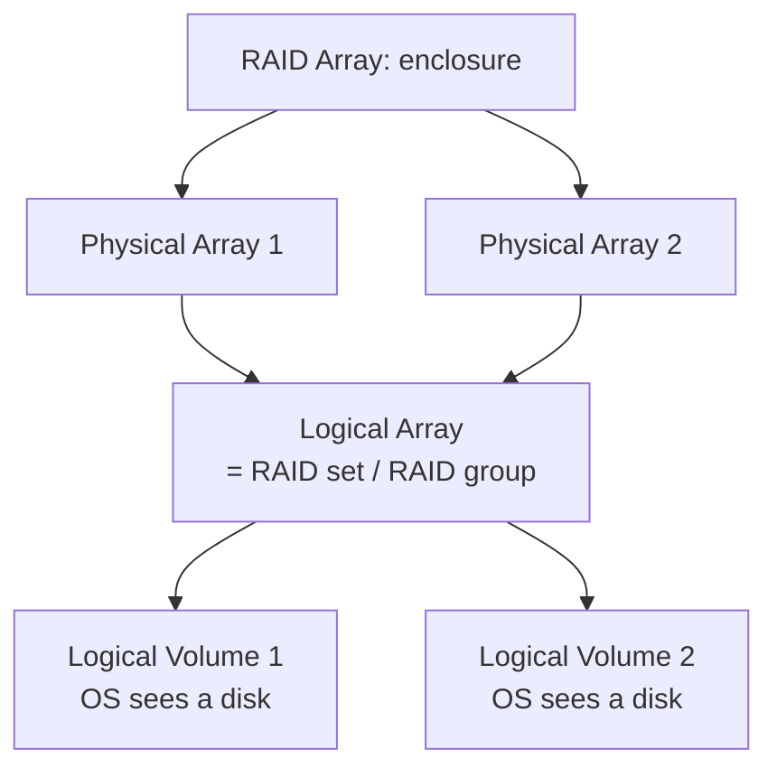
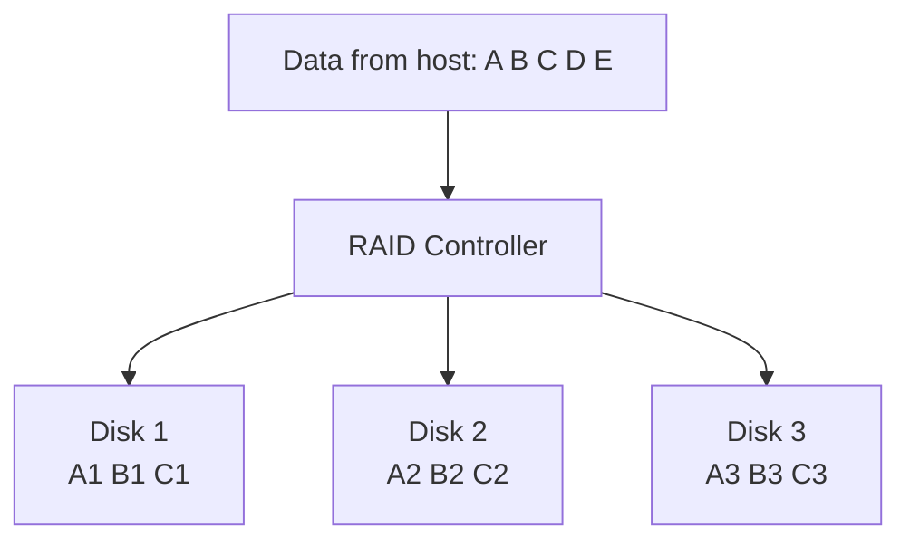
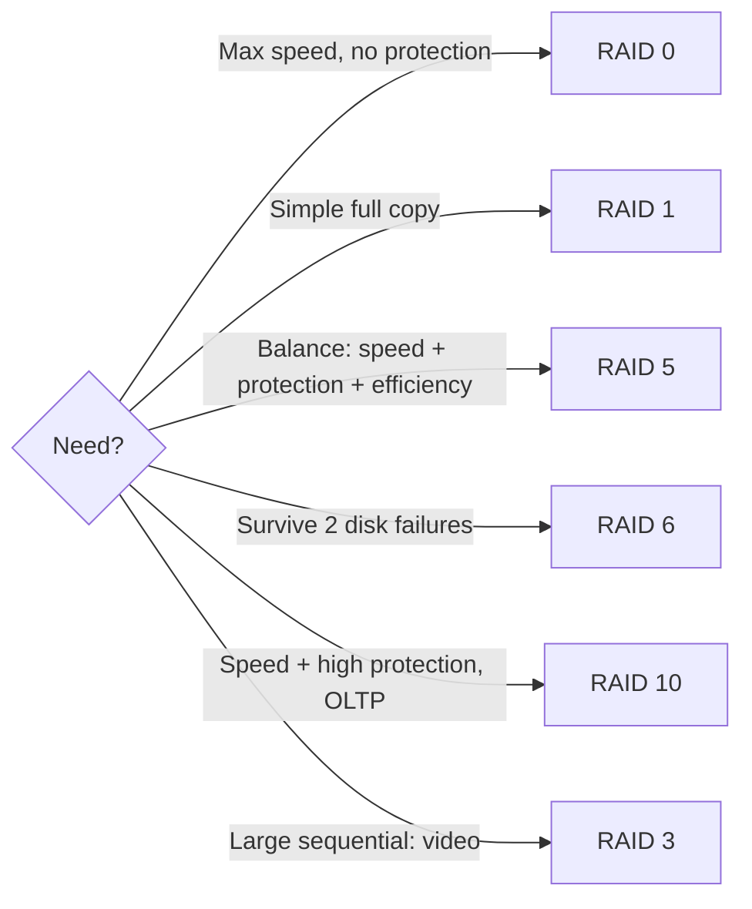

# حماية البيانات: RAID — Chapter 3: Data Protection — RAID

> [!NOTE]
> المحاضرة دي من **أهم محاضرات المادة** وبيجي منها أسئلة كتير جدًا. هنفهم **RAID** بيتعمل إزاي (Software و Hardware)، ومكوناته، والتقنيات التلاتة (**Striping و Mirroring و Parity**)، وكل **RAID level** بالتفصيل، وجدول المقارنة، والـ **Hot Spares**.

**خريطة المحاضرة:**

1. تنفيذ RAID (Implementation): Software و Hardware
2. مكونات الـ RAID Array
3. تقنيات RAID: Striping و Mirroring و Parity
4. مستويات RAID: 0، 1، 1+0، 0+1، 3، 4، 5، 6، 50
5. مقارنة الـ RAID levels
6. الـ Hot Spares

---

## 1. تنفيذ RAID — Implementation of RAID

### يعني إيه RAID؟

> **RAID** (Redundant Array of **Independent / Inexpensive** Disks) is a method of **combining multiple physical disks into a single logical unit** to improve **performance, reliability, or both**.

يعني بنجمّع **كذا ديسك فعلي** ونخليهم يبانوا **كديسك منطقي واحد**، عشان نحسّن **السرعة** أو **الاعتمادية** أو الاتنين.

بيتنفذ بطريقتين: **Software** و **Hardware**.

### 1.1 الـ Software RAID

- بيستخدم **سوفتوير على الـ host** يقدّم وظايف الـ RAID.
- بيتنفذ على **مستوى الـ OS**، و**من غير controller هاردوير مخصص**.
- بيستخدم **CPU cycles بتاعة الـ host** لوظايف الـ RAID (striping, mirroring, parity).
- **مميزاته:** **رخيص**، و**سهل في الإعداد** (Windows Disk Management, Linux)، و**بسيط**.

| ❌ عيوب الـ Software RAID (Limitations) |
|---|
| 1. **بيستهلك موارد الـ CPU** بتاعة الـ host |
| 2. **الأداء ممكن يقل** تحت الضغط العالي (heavy I/O) |
| 3. **مميزات RAID المتقدمة محدودة** |

### 1.2 الـ Hardware RAID

- **controller هاردوير متخصص** متركب **على الـ host أو على الـ array**.
- الـ controller **ليه processor و cache خاصين بيه** للتعامل مع وظايف الـ RAID.

**بيشتغل إزاي؟**
1. الـ **RAID controller** بيتوصل بالـ host عن طريق **PCI أو PCIe bus**.
2. الـ HDDs (أو SSDs) بتتوصل **بالـ controller**.
3. الـ controller **بيعمل كل وظايف الـ RAID** (striping, mirroring, parity) و**بيشيل الحمل عن الـ CPU** (offloading).

> [!NOTE]
> **Motherboard-Integrated RAID Controllers:** مازربوردات كتير فيها **RAID controller مدمج (onboard)**، وده **أرخص** من كارت منفصل. لكنها غالبًا **entry-level** وناقصها:
> 1. **Cache كبير**
> 2. **Battery backup units**
> 3. **مميزات متقدمة** (RAID 6، RAID 50، hot spares)
>
> فهي مناسبة للـ **PCs والسيرفرات الصغيرة**، لكن **مش للـ enterprise**. والـ enterprise محتاج **dedicated RAID cards**.

| ✅ مميزات الـ Hardware RAID | ❌ عيوبه |
|---|---|
| **أداء أعلى** (بيشيل الحمل عن الـ CPU) | **تكلفة أعلى** (هاردوير الـ controller) |
| بيدعم **RAID levels متقدمة** (5, 6, 10, 50) | **لو الـ controller باظ**، البيانات ممكن متبقاش متاحة **من غير هاردوير مطابق** |
| **Battery-backed cache** بيحسّن سرعة الكتابة والاعتمادية | |

| | **Software RAID** | **Hardware RAID** |
|---|---|---|
| مين بيعمل الشغل؟ | **CPU الـ host** | **Controller مخصص** (processor + cache) |
| التكلفة | **رخيص** | **غالي** |
| الأداء | يقل تحت الضغط | **أعلى** |
| المميزات المتقدمة | محدودة | RAID 5, 6, 10, 50 + battery cache |

---

## 2. مكونات الـ RAID Array — RAID Array Components

| المكون | الشرح |
|---|---|
| **RAID array** | **enclosure (حاوية)** فيها عدد من الـ HDDs والهاردوير والسوفتوير اللازم للـ RAID |
| **Physical arrays** (sub-enclosures) | حاويات أصغر جوه الـ array فيها **عدد ثابت من الـ HDDs**، وممكن power supplies |
| **Logical arrays** = **RAID set** = **RAID group** | **مجموعة ديسكات** جوه الـ array مربوطة **منطقيًا** |
| **Logical Volumes (LVs)** | تقسيم الـ logical arrays، والـ **OS بيشوفها كأنها ديسكات فعلية عادية** |

- **عدد الديسكات في الـ logical array بيعتمد على الـ RAID level**.
- ممكن **logical array واحد يمتد على كذا physical array**، أو **physical array واحد فيه كذا logical array**.

---

## 3. تقنيات RAID — RAID Techniques

**الـ RAID techniques** = الطرق اللي بتنظم البيانات على الديسكات، وبتحدد **توافر البيانات والأداء**. ساعات الـ array بيستخدم تقنية واحدة، وساعات مزيج. والاختيار بيتحدد حسب **احتياجات أداء التطبيق وتوافر البيانات**.

**التقنيات التلاتة الأساسية:** **Striping · Mirroring · Parity**

### 3.1 التوزيع — Striping

| المصطلح | الشرح |
|---|---|
| **RAID set** | مجموعة ديسكات |
| **Strip** | عدد محدد من **الـ blocks المتتالية جوه ديسك واحد** |
| **Stripe** | **مجموعة الـ strips المتراصة** على كل الديسكات في الـ RAID set |
| **Strip size** (= **stripe depth**) | **عدد الـ blocks في الـ strip**، يعني قد إيه هيتكتب على ديسك واحد قبل ما ينقل للتاني |
| **Stripe size** | **strip size × عدد الديسكات** في الـ RAID set |
| **Stripe width** | **عدد الـ data strips** في الـ stripe |

> [!EXAMPLE]
> 4 ديسكات، والـ strip size = 64 KB ← **stripe size = 64 × 4 = 256 KB**.

- الـ **Striping بيحسّن أداء الـ I/O** لأن البيانات متوزعة، والـ controller يقدر **يوصل لكذا ديسك في نفس الوقت**.
- **لكن مفيش حماية** إلا لو اتجمع مع **parity أو mirroring**.

### 3.2 النسخ المطابق — Mirroring

- البيانات بتتخزن على **ديسكين مختلفين**، فيبقى عندنا **نسختين**.
- لو ديسك وقع، البيانات **سليمة على التاني**، والـ controller **يكمّل يخدم الطلبات من الديسك السليم**.
- بيخلّي **الـ recovery من عطل الديسك أسرع**.

| النقطة | التفاصيل |
|---|---|
| **التكلفة** | محتاج **ضعف السعة** (expensive) |
| **الاستخدام** | مفضّل في **mission-critical applications** اللي **مينفعش فيها فقد بيانات** |
| **Read** | **أسرع** (القراءة من أي ديسك فيهم) |
| **Write** | **أبطأ** (كل كتابة بتتكرر على الديسكين) |
| **القيد** | مش بيوصل لسرعة الكتابة العالية بتاعة الـ striped RAID |

> [!WARNING]
> **الـ Mirroring حماية بيانات، لكنه مش بديل عن الـ backup!** لو مسحت ملف غلط أو فيروس بوّظه، **المسح هيتعمل على النسختين**.

### 3.3 التكافؤ — Parity

- طريقة **لحماية البيانات الـ striped من عطل ديسك من غير تكلفة الـ mirroring**.
- بنضيف **ديسك زيادة** للـ stripe width يشيل **الـ parity**، وهي **معادلة رياضية** بتسمح **بإعادة بناء البيانات الناقصة**.
- **Redundancy check** بيضمن حماية كاملة **من غير نسخة كاملة مكررة**.
- الـ parity ممكن تتخزن على **ديسك مخصص (dedicated)** أو **متوزعة على كل الديسكات (distributed)**.
- **حساب الـ parity شغلانة الـ RAID controller**.

#### مثال الشرح (بالجمع)

| | D1 | D2 | D3 | D4 | **P (مجموع)** |
|---|---|---|---|---|---|
| صف 1 | 3 | 1 | 2 | 3 | **9** |
| صف 2 | 1 | 1 | 2 | 1 | **5** |
| صف 3 | 2 | 3 | 1 | 3 | **9** |
| صف 4 | 1 | 1 | 3 | 2 | **7** |

لو **D3 باظ**، في صف 1: **D3 = P − (D1 + D2 + D4) = 9 − (3 + 1 + 3) = 2** ✓

#### في الحقيقة: XOR

الـ parity بيتحسب بـ **bitwise XOR** (⊕). XOR بيدّي **1 لو البتين مختلفين** و**0 لو زي بعض**.

| | القيمة |
|---|---|
| D1 | `1010` |
| D2 | `0110` |
| D3 | `0011` |
| **P = D1 ⊕ D2 ⊕ D3** | `1010 ⊕ 0110 = 1100`، و `1100 ⊕ 0011 = **1111**` |
| **لو D2 ضاع: D2 = D1 ⊕ D3 ⊕ P** | `1010 ⊕ 0011 = 1001`، و `1001 ⊕ 1111 = **0110**` ✓ |

| ✅ ميزة الـ Parity | ❌ عيبها |
|---|---|
| **أرخص من الـ mirroring** في الحماية | لازم **تتحسب من جديد مع كل تغيير** في البيانات، وده **بياخد وقت ويبطّأ الـ controller**، خصوصًا في **الكتابة** |

| | **Striping** | **Mirroring** | **Parity** |
|---|---|---|---|
| الهدف | **أداء** | **حماية (نسختين)** | **حماية بتكلفة أقل** |
| حماية؟ | ❌ | ✅ | ✅ |
| السعة المستخدمة | 100% | **50%** | (n−1)/n |
| الكتابة | **سريعة جدًا** | أبطأ (مرتين) | أبطأ (حساب parity) |

---

## 4. مستويات RAID — RAID Levels

الـ RAID levels = **تطبيقات معينة بتجمع التقنيات** بطرق مختلفة، ولكل level **مقايضة (trade-off)** بين **الأداء، وكفاءة التخزين، وتحمّل الأعطال**.

| Level | الوصف المختصر |
|---|---|
| **RAID 0** | Striped array with **no fault tolerance** |
| **RAID 1** | **Disk mirroring** |
| **RAID 3** | Parallel access array with **dedicated parity disk** |
| **RAID 4** | Striped array with independent disks and a **dedicated parity disk** |
| **RAID 5** | Striped array with independent disks and **distributed parity** |
| **RAID 6** | Striped array with independent disks and **dual distributed parity** |
| **Nested** | Combinations of RAID levels، مثلًا **RAID 1 + RAID 0** |

### RAID 0 — Striping

| النقطة | التفاصيل |
|---|---|
| **التقنية** | البيانات **striped** على كل الديسكات |
| **التخزين** | بيستخدم **السعة كاملة (100%)**، و**مفيش redundancy** |
| **الأداء** | القراءة والكتابة **بتتحسن مع زيادة الديسكات** (parallel access) |
| **مناسب لـ** | تطبيقات محتاجة **high I/O throughput** |
| **⚠️ القيد** | **مفيش fault tolerance: لو ديسك واحد وقع، كل البيانات بتضيع** |
| **Stripe size** | بيتحدد على مستوى الـ host (software RAID) أو حسب الشركة (hardware RAID) |

### RAID 1 — Mirroring

| النقطة | التفاصيل |
|---|---|
| **التقنية** | البيانات **mirrored** على **ديسكين على الأقل** |
| **Fault tolerance** | **عالي جدًا**: لو ديسك وقع، الـ mirror بيدّي **recovery فوري** |
| **التشغيل** | كل كتابة **بتتكرر على الديسكين** (شفافة للـ host في الـ hardware RAID) |
| **Read** | **أحسن** (من أي ديسك) |
| **Write** | **أبطأ** (مرتين) |
| **الاستخدام** | **High-availability** applications اللي **مينفعش فيها فقد بيانات** |

### Nested RAID — RAID 1+0 و RAID 0+1

- بيجمعوا **striping (RAID 0) + mirroring (RAID 1)** عشان **أداء عالي وحماية عالية**.
- محتاجين **عدد زوجي من الديسكات، و4 على الأقل**.
- مستخدمين في الـ data centers اللي محتاجة **سرعة وتحمّل أعطال**.

| | **RAID 1+0 (RAID 10)**: Striped Mirror | **RAID 0+1 (RAID 01)**: Mirrored Stripe |
|---|---|---|
| **العملية** | **Mirror الأول**، وبعدين **stripe** على الأزواج المتطابقة | **Stripe الأول**، وبعدين **mirror** للـ stripe كله |
| **لو ديسك وقع** | **بس الـ mirror بتاعه** محتاج rebuild (**recovery أسرع**) | **الـ stripe كله** بيعتبر باظ |
| **الـ Rebuild** | خفيف | **نسخ الـ stripe كله**: I/O تقيل، و**أبطأ**، و**عرضة أكتر لعطل ديسك تاني** |
| **الاعتمادية** | ✅ **أكثر اعتمادية** | ❌ **أقل اعتمادية** |
| **الأداء** | **ممتاز للـ random write-intensive** | |
| **الاستخدام** | **OLTP**، و large messaging systems، و databases محتاجة high I/O و random access و high availability | |

> [!EXAM]
> **RAID 10 أحسن من RAID 01**: في الـ 10 بتعيد بناء **الديسك اللي وقع بس من الـ mirror بتاعه**. في الـ 01 بتعيد **الـ stripe كله**.
> احفظ: **1+0 = mirror then stripe** · **0+1 = stripe then mirror**.

### RAID 3 — Byte-Level Striping with Dedicated Parity

| النقطة | التفاصيل |
|---|---|
| **التقنية** | البيانات **striped** (على مستوى الـ **byte**) على كذا ديسك |
| **Parity** | **ديسك مخصص (dedicated)** للـ parity، وبيسمح بإعادة البناء لو ديسك واحد وقع |
| **كفاءة التخزين** | مع **5 ديسكات: 4 data + 1 parity** ← محتاج **1.25×** سعة ديسكات البيانات |
| **التشغيل** | **دايمًا بيقرا ويكتب stripes كاملة** (مفيش partial updates)، والديسكات بتشتغل **بالتوازي** |
| **الأداء** | **bandwidth كويس لنقل كميات كبيرة** من البيانات |
| **⚠️ القيد** | **ديسك الـ parity ممكن يبقى bottleneck** في الكتابة |
| **الاستخدام** | **Large sequential I/O**: **video streaming، scientific computing** |

### RAID 4 — Block-Level Striping with Dedicated Parity

| النقطة | التفاصيل |
|---|---|
| **التقنية** | striping على مستوى الـ **block** على كل الديسكات **ماعدا ديسك parity مخصص** |
| **Parity** | للـ fault tolerance، ويعيد البناء لو ديسك وقع |
| **Reads** | **throughput كويس** (يقدر يقرا من ديسكات لوحدها) |
| **Writes** | معقولة، بس **ديسك الـ parity ممكن يبقى bottleneck** |
| **الاستخدام** | تطبيقات محتاجة **read performance كويس** و fault tolerance مقبول |

| | **RAID 3** | **RAID 4** |
|---|---|---|
| مستوى الـ striping | **Byte-level** | **Block-level** |
| الوصول | لازم يقرا/يكتب **stripe كامل** | **وصول مستقل لـ blocks معينة** (ديسك واحد ممكن) |
| الـ parity | dedicated disk | dedicated disk |

### RAID 5 — Block-Level Striping with Distributed Parity

| النقطة | التفاصيل |
|---|---|
| **التقنية** | زي RAID 4: **block-level striping** |
| **Parity** | **متوزعة على كل الديسكات** بدل ديسك مخصص، **فمفيش bottleneck** |
| **Fault tolerance** | **يستحمل عطل ديسك واحد** |
| **Read** | **عالي** (وصول متوازي) |
| **Write** | **أحسن من RAID 4** (مفيش bottleneck)، لكن حساب الـ parity لسه overhead |
| **الحد الأدنى** | **3 ديسكات** |
| **الاستخدام** | **General-purpose servers**، و file storage، وتطبيقات محتاجة **توازن** بين الأداء والحماية والكفاءة |

### RAID 6 — Block-Level Striping with Double Distributed Parity

| النقطة | التفاصيل |
|---|---|
| **التقنية** | زي RAID 5 (block-level striping) |
| **Parity** | **مجموعتين parity متوزعين**، فيستحمل **عطل ديسكين في نفس الوقت** |
| **الحد الأدنى** | **4 ديسكات** |
| **Read** | زي RAID 5، كويس |
| **Write** | **أبطأ من RAID 5** (parity زيادة = **write penalty أعلى**) |
| **Rebuild** | **أطول** من RAID 5 |
| **الاستخدام** | **Mission-critical**: لما الحماية أهم من سرعة الكتابة، خصوصًا مع **ديسكات كبيرة** |

### RAID 50 (RAID 5 + 0)

- **block-level striping مع distributed parity**: بيعمل **striping (RAID 0) على مجموعات RAID 5**.
- أداء أعلى من RAID 5 لوحده، و**يستحمل عطل ديسك واحد في كل مجموعة RAID 5**.
- محتاج **6 ديسكات على الأقل**.

---

## 5. مقارنة الـ RAID Levels — RAID Comparison

| RAID | Min. Disks | Storage Efficiency | Cost | Read Performance | Write Performance | **Write Penalty** |
|---|---|---|---|---|---|---|
| **0** | **2** | **100%** | Low | Very good (random & sequential) | **Very good** | **None** |
| **1** | **2** | **50%** | High | Good (أحسن من ديسك واحد) | Good، بس أبطأ من ديسك واحد (بيكتب مرتين) | Moderate |
| **3** | **3** | **(n−1)×100/n** | Moderate | Good random، **Very good sequential** | Poor–fair small random، **Good large sequential** | High |
| **4** | **3** | (n−1)×100/n | Moderate | **Very good random reads** | Poor–fair random، Fair–good sequential | High |
| **5** | **3** | (n−1)×100/n | Moderate | **Very good random**، good sequential | Fair random (parity overhead)، Fair–good sequential | High |
| **6** | **4** | **(n−2)×100/n** (أقل شوية من R5) | Moderate+ | Very good random، good sequential | Good small random، بس أبطأ (double parity) | **Very High** |
| **0+1** | **4** | **50%** | High | High | High، بس recovery أبطأ (rebuild الـ stripe كله) | Moderate |
| **1+0 (10)** | **4** | **50%** | High | High | High، و **rebuild سريع** (الـ mirror بس) | Moderate |

> [!EXAM]
> احسب الكفاءة:
> - **RAID 5 بـ 5 ديسكات** = (5−1)/5 = **80%**
> - **RAID 6 بـ 6 ديسكات** = (6−2)/6 = **66.7%**
> - **RAID 1 / 10 / 01** = **50%** · **RAID 0** = **100%**
>
> والـ **Write penalty**: RAID 0 = **None** · RAID 6 = **Very High**.

---

## 6. الديسكات الاحتياطية — Hot Spares

**Hot spare** = **ديسك احتياطي** في الـ RAID array بياخد **مكان ديسك وقع**، أوتوماتيك أو يدوي.

- **بيستبدل** الديسك اللي وقع **مؤقتًا** وبيحافظ على توافر البيانات.
- لازم يبقى **مساوي أو أكبر** من الديسك اللي وقع.
- بعض الأنظمة بتدعم **أكتر من hot spare**.
- **ضروري** في البيئات اللي **مينفعش فيها downtime أو فقد بيانات**.

### الـ Recovery بيتم إزاي؟

| النوع | الطريقة |
|---|---|
| **Parity RAID** (3, 4, 5, 6) | البيانات **بتتبني من جديد على الـ hot spare** باستخدام **الـ parity + الديسكات السليمة** |
| **Mirroring** (1, 10) | البيانات **بتتنسخ من الـ mirror السليم** للـ hot spare |

### بعد ما تحط ديسك جديد

1. يا إما **الـ hot spare يبقى بديل دائم** (ميبقاش spare، ولازم تعيّن spare جديد).
2. يا إما **البيانات تتنسخ من الـ hot spare للديسك الجديد**، والـ hot spare **يرجع standby**.

### أنواع الإعداد (Configuration Types)

| | **Automatic** | **User-Initiated** |
|---|---|---|
| مين بيقرر؟ | الـ **RAID controller** بيكتشف الديسك اللي بيبوظ (error rates عالية) | **الأدمن** بيقرر إمتى يبدأ الـ rebuild |
| إمتى؟ | **بينسخ البيانات للـ hot spare قبل العطل الفعلي** لو ممكن | مثلًا في **أوقات الضغط القليل (off-peak)** |
| الميزة | **حماية مستمرة** | **بيقلل تأثير الـ rebuild على الأداء** |
| العيب | — | **النظام بيبقى عرضة للخطر** لحد ما الـ rebuild يبدأ |

---

## ✅ خلاصة المحاضرة في 10 نقط

1. **RAID** = كذا ديسك ← logical unit واحد، عشان performance و/أو reliability.
2. **Software RAID**: على مستوى الـ OS، و CPU الـ host، ورخيص وسهل، بس بيستهلك CPU · **Hardware RAID**: controller ليه processor و cache، أسرع وبيدعم 5/6/10/50، بس غالي.
3. المكونات: RAID array ← physical arrays ← **logical arrays (RAID set/group)** ← **logical volumes** (الـ OS بيشوفها ديسكات).
4. **Striping**: strip ← stripe، و stripe size = strip size × disks، وأداء من غير حماية.
5. **Mirroring**: نسختين، read أسرع و write أبطأ، وضعف السعة، **ومش بديل للـ backup**.
6. **Parity**: **XOR**، بيعيد بناء البيانات، أرخص من mirroring، بس الكتابة أبطأ.
7. **RAID 0** مفيش حماية · **RAID 1** mirror · **RAID 10** (mirror ثم stripe) أحسن من **RAID 01** (stripe ثم mirror).
8. **RAID 3** byte + dedicated parity (video) · **RAID 4** block + dedicated parity · **RAID 5** block + distributed parity (3 disks، عطل 1).
9. **RAID 6** double parity (4 disks، عطل 2، write penalty very high) · **RAID 50** = stripe فوق RAID 5.
10. **Hot spare**: مساوي أو أكبر، والـ rebuild بالـ parity أو النسخ من الـ mirror، و Automatic أو User-initiated.
