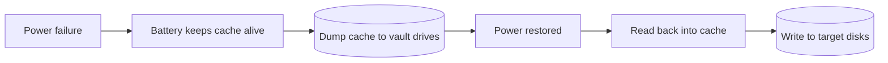

# نظام التخزين الذكي — Chapter 4: Intelligent Storage System

> [!NOTE]
> الـ RAID لوحده مكفّاش احتياجات أداء التطبيقات الحديثة، فظهر الـ **Intelligent Storage System (ISS)**. المحاضرة دي بتشرح مكوناته الأربعة (**Front end، Cache، Back end، Physical disks**)، والـ **cache** بالتفصيل (القراءة والكتابة والإدارة والحماية)، والـ **LUN**، والـ **Thick/Thin provisioning**، والفرق بين **High-end** و **Midrange** arrays.

**خريطة المحاضرة:**

1. مكونات الـ ISS: Front End (+ Command Queuing)
2. الـ Cache: الهيكل، والقراءة، والكتابة، والتنفيذ، والإدارة، والـ Flushing، والحماية
3. الـ Back End والـ Physical Disks والـ LUN
4. الـ Storage Provisioning: Thick و Thin
5. الـ Intelligent Storage Arrays: High-end و Midrange

---

## 1. يعني إيه Intelligent Storage System؟

- الـ **RAID** حسّن الأداء والاعتمادية، **لكن الـ HDDs حتى مع RAID مقدروش يلبّوا احتياجات أداء التطبيقات النهارده**.
- الـ **ISS** = **storage array متقدم** بيستخدم **سوفتوير متطور، وإدارة cache، وتقنيات virtualization** عشان يقدّم **أداء عالي، وقابلية توسع، وتوافر، وإدارة بيانات أوتوماتيك**.
- بيعدّي الـ RAID العادي عن طريق **إضافة ذكاء على مستوى الـ controller**.

### المكونات الأربعة

> [!EXAM]
> مكونات الـ ISS الأربعة بالترتيب: **Front end → Cache → Back end → Physical disks**.

---

## 2. الواجهة الأمامية — Front End

الـ **Front end** بيوصّل الـ storage system **بالـ host servers**، وبيتعامل مع **اتصالات الـ host، والـ caching، وتحسين الأوامر**.

| المكون | دوره |
|---|---|
| **Front-End Ports** | بيوفر **اتصالات فيزيائية/منطقية** للـ hosts · بينفذ **بروتوكولات النقل**: **SCSI, Fibre Channel, iSCSI** · بيدعم **redundancy** للـ high availability |
| **Front-End Controllers** | بيوجّه البيانات **بين الـ hosts والـ cache** عن طريق **internal data bus** · في الكتابة: الـ cache بيستلم البيانات، والـ controller **يبعت acknowledgment للـ host قبل ما يكتبها على الديسك** (للسرعة) · بيستخدم **command queuing algorithms** |

### ترتيب الأوامر في الـ Front End — Front-End Command Queuing

- تقنية متنفذة على **الـ front-end controllers**.
- بتحدد **ترتيب تنفيذ الأوامر**، فتقلل **حركة الـ head** وتحسّن الأداء.
- لما أمر يوصل، الخوارزمية بتدّيله **tag** بيحدد ترتيب تنفيذه.

| الخوارزمية | الفكرة | الأداء |
|---|---|---|
| **FIFO** (First In, First Out) | **الافتراضي**: بينفّذ **بترتيب الوصول** | **مش كفء** (مفيش تحسين) |
| **Seek Time Optimization** | بيعيد الترتيب عشان **يقلل حركة الـ head** (مثلًا A ← C ← B ← D بدل A ← B ← C ← D) | أحسن |
| **Access Time Optimization** | بيراعي **seek time + rotational latency** الاتنين | **الأحسن** |

> [!TIP]
> نفس فكرة **NCQ** اللي في Ch2، بس هنا بتحصل على مستوى **الـ front-end controller في الـ storage array**.

---

## 3. الـ Cache

### 3.0 ليه الـ Cache مهم؟

- الـ **Cache** = **ذاكرة أشباه موصلات (semiconductor memory)** البيانات بتتحط فيها **مؤقتًا** عشان **نقلل وقت خدمة الطلبات**.
- بيقلل **التأخير الميكانيكي** بتاع الديسك (**seek time + rotational latency**).
- بيعزل الـ hosts عن **أبطأ مكون** في النظام (الديسكات).

| | **Physical disk** | **Cache** |
|---|---|---|
| زمن الوصول | **few milliseconds** | **أقل من millisecond** |

### 3.1 هيكل الـ Cache — Structure of Cache

| الجزء | الشرح |
|---|---|
| **Data Store** | فيه **البيانات الفعلية** |
| **Tag RAM** | **metadata** بتتتبّع **مكان البيانات اللي في الـ cache على الديسك** |

**الـ Tag RAM فيه:**
- **Dirty bit flag**: بيوضح **البيانات اتكتبت (committed) على الديسك ولا لسه**.
- **Last access time**: بيساعد يحدد **البيانات اللي مش مستخدمة** عشان نفضّي مكانها.

- الـ cache متقسم **pages (slots)**، وده **أصغر وحدة حجز**.
- **حجم الـ page بيتظبط** حسب حجم الـ I/O بتاع التطبيق.

### 3.2 القراءة من الـ Cache — Read Operation

| | **Read Hit (Cache Hit)** | **Read Miss (Cache Miss)** |
|---|---|---|
| الحالة | البيانات **موجودة في الـ cache** (بندوّر عن طريق الـ tag RAM) | البيانات **مش موجودة** في الـ cache |
| اللي بيحصل | بتتبعت **مباشرة للـ host** | الـ **back-end controller** بيجيبها من الديسك ← بتتحط في الـ cache ← وبتتبعت للـ host |
| زمن الاستجابة | **~1 ms**، ومفيش disk operation | **أبطأ** (بسبب الوصول للديسك) |

### 3.3 الكتابة مع الـ Cache — Write Operations

الكتابة عن طريق الـ cache **أسرع بكتير** من الكتابة على الديسك مباشرة:
1. البيانات تتكتب في الـ cache ← **acknowledgment يرجع فورًا**.
2. من وجهة نظر الـ host، **الكتابة خلصت**.
3. بعدين النظام **ينقل (de-stage)** البيانات للديسك.

#### تقنيات الـ Write Caching

| | **Write-Back Cache** | **Write-Through Cache** | **Write-Around** (Cache Bypass / Write-Aside) |
|---|---|---|---|
| **بيشتغل إزاي** | cache ← **ack للـ host** ← بعدين de-stage للديسك | cache **و** ديسك فورًا ← **بعدين ack** | لو حجم الكتابة **أكبر من threshold** (**write-aside size**)، البيانات **تتجاوز الـ cache** وتروح للديسك على طول |
| **✅ المميزات** | **رد سريع جدًا**، وأداء عالي | **أأمن**، و**خطر فقد البيانات قليل جدًا** | **الكتابات الكبيرة المتتالية مش بتملا الـ cache**، فيفضل متاح للـ I/Os الصغيرة العشوائية |
| **❌ العيوب** | **خطر فقد البيانات** لو الـ cache باظ قبل الكتابة، ومحتاج **حماية إضافية** (battery-backed أو mirroring) | **أبطأ** (لازم يستنى الديسك) | — |

> [!EXAM]
> - **Write-back** = سريع بس فيه **خطر** ← محتاج battery / mirroring.
> - **Write-through** = **آمن** بس **أبطأ**.
> - **Write-around** = للكتابات **الكبيرة** عشان متملاش الـ cache.

### 3.4 تنفيذ الـ Cache — Cache Implementation

| | **Dedicated Cache** | **Global Cache** |
|---|---|---|
| **الفكرة** | الميموري **متقسمة**: جزء للقراءة وجزء للكتابة | **pool واحد** مشترك للقراءة والكتابة |
| **مثال** | 40% reads و 60% writes (**ثابت**) | **Static**: المستخدم يحدد النسب · **Dynamic**: النظام **يعدّل لوحده** حسب الحمل (write أكتر وقت الـ backup، read أكتر وقت الـ analytics) |
| **✅** | أداء **متوقع** لو نسب القراءة والكتابة معروفة | **أكفأ وأكثر مرونة**، وإدارته **أبسط** |
| **❌** | **ممكن يهدر ميموري** لو جزء مش مستخدم كفاية | — |

### 3.5 إدارة الـ Cache — Cache Management

الـ cache **محدود وغالي**، فبنستخدم **خوارزميات وحدود (thresholds)** لإدارته.

#### خوارزميات استرجاع صفحات الـ Cache (Reclaiming Cache Pages)

| الخوارزمية | بتفضّي إيه | الافتراض | الاستخدام |
|---|---|---|---|
| **LRU** (Least Recently Used) | الصفحات **اللي بقالها أطول وقت مستخدمتش** | البيانات **القديمة** غالبًا مش هنحتاجها تاني | **الأشهر** في معظم الأنظمة |
| **MRU** (Most Recently Used) | الصفحات **اللي اتستخدمت آخر حاجة** | البيانات دي **مش هنحتاجها قريب** | workloads معينة زي **sequential reads** |

> [!NOTE]
> في الـ LRU، لو الصفحة فيها **dirty data** (لسه متكتبتش على الديسك)، **بتتعمل لها flush الأول** قبل ما تتستخدم تاني.

### 3.6 الـ Cache Watermarking أو Flushing

- الـ **Flushing** = **نقل البيانات من تخزين سريع مؤقت (cache/buffer) لتخزين دائم أبطأ (HDD/SSD)**.
- الـ cache **سريع بس volatile** (ممكن يضيع لو الكهربا قطعت)، والديسك **أبطأ بس دائم**.
- الـ flushing **بيضمن إن البيانات المهمة تتكتب بأمان**.

| نوع الـ Flushing | **إمتى بيحصل** | **بيتصرف إزاي** | **الهدف** |
|---|---|---|---|
| **Idle / Ideal Flushing** (Low Watermark) | الـ cache **مستخدم بشكل متوسط** (مش مليان) | بيكتب **تدريجيًا وبهدوء** | يحافظ على الأداء ويمنع ضغط مستقبلي |
| **High Watermark Flushing** | الـ cache **قرب يتملي** | بيكتب **بشكل مكثف (aggressively)** عشان يفضّي مكان | يمنع **overflow** أو فقد بيانات |
| **Forced Flushing** (Coerced) | **يدوي** أو بسبب **حدث حرج** (shutdown، انقطاع كهربا) | بيعمل flush **فورًا** بغض النظر عن مستوى الـ cache | يضمن **أمان واتساق** البيانات |

> [!TIP]
> - **LWM** = Low Watermark · **HWM** = High Watermark.
> - تحت الـ LWM ← **idle flushing** هادي · فوق الـ HWM ← **high watermark flushing** مكثف · 100% أو طوارئ ← **forced**.

### 3.7 حماية بيانات الـ Cache — Cache Data Protection

الـ cache **volatile**، فالبيانات اللي **لسه متكتبتش (uncommitted)** ممكن تضيع وقت **انقطاع الكهربا** أو **عطل الـ controller/الميموري**. عشان كده عندنا آليتين:

| الآلية | الشرح |
|---|---|
| **Cache Mirroring** | **كل كتابة بتتكرر على كارتين ميموري مستقلين**، فلو module باظ البيانات موجودة في التاني. **بيحمي من عطل هاردوير الـ cache** |
| **Cache Vaulting** | محتوى الـ cache **بيتنقل بأمان لـ vault drives** وقت انقطاع الكهربا |

**الحلول (Solutions):**
1. **Battery Backup (BBU)**: بيخلّي الـ cache شغال **مؤقتًا**، بس **سعته محدودة**.
2. **Battery + Vaulting**: البطارية بتشغّل الـ cache **مدة كفاية** عشان يتنقل محتواه لـ vault drives.

**الاسترجاع (Recovery):** لما الكهربا ترجع ← البيانات تتقرا من الـ **vault drives** ← ترجع للـ **cache** ← تتكتب على **الديسكات المستهدفة**.

---

## 4. الواجهة الخلفية والديسكات — Back End & Physical Disks

### 4.1 الـ Back End

بيوفر **واجهة بين الـ cache والـ physical disks**:

| المكون | دوره |
|---|---|
| **Back-end ports** | بتتحكم في **نقل البيانات بين الـ cache والديسكات** |
| **Back-end controllers** | بتتواصل مع الديسكات في القراءة والكتابة · **تخزين مؤقت محدود** · **RAID** · **error detection/correction** |

- للحماية والتوافر العالي: **dual controllers** بـ **multiple ports**، فيبقى فيه **مسار بديل (alternate path)** للديسكات لو controller أو port وقع.
- الاعتمادية بتزيد لو الديسكات **dual-ported** (كل port بيتوصل بـ controller مختلف).
- الـ controllers المتعددة كمان بتساعد في **load balancing**.

### 4.2 الـ Physical Disk

- بيخزن البيانات **بشكل دائم (persistently)**.
- بيتوصل بالـ back end عن طريق **SCSI أو Fibre Channel**.
- الـ ISS بيسمح **بخليط** من ديسكات SCSI أو FC مع **IDE/ATA**.

### 4.3 الـ LUN (Logical Unit Number)

| النقطة | الشرح |
|---|---|
| **التعريف** | **logical volume** معمول من physical drives أو RAID groups، **وبيتعرض للـ host كأنه ديسك فعلي** |
| **الفايدة** | **استغلال أحسن للديسك**: بنحجز **المساحة المطلوبة بس** بدل الديسك كله |
| **مثال** | host محتاج **200 GB** ← ياخد **LUN بـ 200 GB** من ديسك **1 TB** ← ويفضل **800 GB** لـ hosts تانية |
| **مع RAID** | الـ LUNs = **شرائح (slices) من الـ RAID sets** متوزعة على كل الديسكات في الـ RAID group، وكل host بيشوف الـ LUN بتاعه **كـ volume مستقل**، والسعة المتاحة **بتعتمد على نوع الـ RAID** |
| **Meta-LUN** | **LUN أكبر** معمول **بتجميع كذا LUN**، بيوسّع السعة **من غير ما يوقف وصول الـ host** |
| **الإدارة** | الـ operating environment بتاع الـ ISS **بيربط الـ LUNs بأماكنها الفيزيائية** |

---

## 5. توفير التخزين — Storage Provisioning

**Storage provisioning** = **تخصيص موارد التخزين للـ hosts** حسب احتياجات السعة والتوافر والأداء. وبيتعمل بطريقتين:

| | **Traditional (Thick) Provisioning** | **Virtual (Thin) Provisioning** |
|---|---|---|
| **الفكرة** | **كل المساحة المطلوبة بتتحجز من الأول (upfront)** | المساحة بتتحجز **just-in-time**: **المستخدم فعلًا بس**، حتى لو الـ host شايف الحجم كله |
| **مثال** | host طلب **500 GB** ← الـ **500 GB كلها** اتحجزت فورًا | host طلب **500 GB** واستخدم **100 GB** ← **100 GB بس** اتحجزت |
| **✅** | **بسيط، وأداء متوقع** | **استغلال أحسن، وهدر أقل** |
| **❌** | **Underutilization**: الـ hosts غالبًا مش بتستخدم كل المساحة على طول | **خطر الـ over-provisioning**: ممكن السعة الفعلية تخلص لو مفيش مراقبة |

> [!EXAMPLE]
> **Thick** زي ما تحجز **قاعة أفراح كاملة لـ 500 فرد** وييجي 100 بس.
> **Thin** زي ما **تحجز كراسي على قد اللي جه فعلًا**، بس لازم تتابع عشان متخلصش الكراسي فجأة لو الناس جت كلها.

---

## 6. الـ Intelligent Storage Arrays

الـ ISS بيتقسم **نوعين**:

| | **High-end Storage Systems** | **Midrange Storage Systems** |
|---|---|---|
| **اسمها التاني** | **Active-Active arrays** | **Active-Passive arrays** |
| **موجهة لـ** | **Large enterprise** applications | **Small and medium-sized** enterprise applications |
| **الـ I/O للـ LUNs** | عن طريق **كل المسارات المتاحة** | عن طريق **المسارات الـ active بس** |
| **السعة والـ cache** | **كبيرة جدًا** | **أقل** |
| **الـ front-end ports** | **كتير** ومعاها بروتوكولات متعددة | **أقل** |
| **المعمارية** | **Fault-tolerant** | **controllerين**، كل واحد فيه cache و RAID controllers و disk drive interfaces |
| **الاتصال** | **Mainframe** و open systems | open systems |
| **I/Os متزامنة** | **كمية كبيرة جدًا** | أقل |
| **Replication** | local & remote | local & remote |

> [!EXAM]
> **High-end = Active-Active** (كل المسارات) · **Midrange = Active-Passive** (المسار الـ active بس).

---

## ✅ خلاصة المحاضرة في 10 نقط

1. **ISS** = array متقدم بسوفتوير و cache و virtualization، و**الذكاء في الـ controller**.
2. المكونات: **Front end → Cache → Back end → Physical disks**.
3. **Front end**: ports (SCSI, FC, iSCSI) + controllers (ack قبل الكتابة على الديسك) · و **Command queuing**: FIFO ← Seek time optimization ← **Access time optimization (الأحسن)**.
4. **Cache structure**: Data store + **Tag RAM** (dirty bit + last access time)، ومتقسم pages.
5. **Read hit** (~1 ms من الـ cache) vs **Read miss** (من الديسك).
6. **Write-back** (سريع وخطر) · **Write-through** (آمن وأبطأ) · **Write-around** (الكتابات الكبيرة تتجاوز الـ cache).
7. **Dedicated** (نسب ثابتة) vs **Global** (pool، static/dynamic، أكفأ) · **LRU** (الأشهر) vs **MRU** (sequential).
8. **Flushing**: Idle (LWM) · High watermark (HWM) · Forced (طوارئ) · والحماية: **Cache mirroring** + **Cache vaulting** (battery + vault drives).
9. **Back end**: ports + controllers (RAID, error correction)، و dual controllers ودايسكات dual-ported · **LUN** = logical volume يبان كديسك، و **Meta-LUN** = تجميع LUNs.
10. **Thick** (كله upfront، underutilization) vs **Thin** (just-in-time، over-provisioning) · **High-end = Active-Active** vs **Midrange = Active-Passive**.
