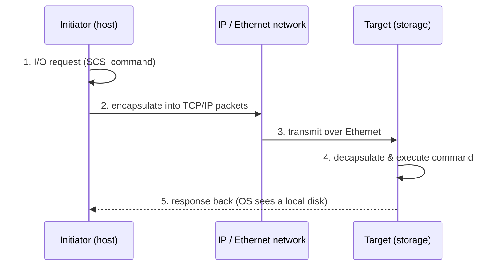

# شبكات منطقة التخزين — Chapter 5: Storage Area Networks (SAN)

> [!NOTE]
> الـ **SAN** هي الشبكة المخصصة اللي بتوصّل السيرفرات بالتخزين بسرعة عالية. هنشوف تطورها، ومكوناتها (ports, cables, switches, arrays, software)، وأنواع **Fibre Channel ports**، والـ **Zoning**، والـ **Topologies**، والبروتوكولات التلاتة اللي بتشغّل SAN على IP أو Ethernet: **iSCSI** و **FCIP** و **FCoE**.

**خريطة المحاضرة:**

1. نظرة عامة على الـ SAN وأنواعها
2. تطور الـ SAN
3. مكونات الـ SAN (5 عناصر)
4. أنواع الـ Fibre Channel Ports
5. معمارية الـ Fibre Channel
6. الـ Zoning
7. الـ FC Topologies: Core-Edge و Mesh
8. الـ iSCSI
9. الـ FCIP
10. الـ FCoE

---

## 1. نظرة عامة — SAN Overview

> A **dedicated, fast network** that gives storage devices network access is called a **Storage Area Network (SAN)**.

- الـ SAN بتتكوّن من **تقنيات وطوبولوجيات وبروتوكولات** بتوصّل **hosts و switches و storage elements و storage devices**.
- ممكن **تغطي كذا مكان (several locations)**.
- **الهدف الأساسي:** **نقل البيانات بين السيرفر وجهاز التخزين**.
- بتوصّل السيرفرات بالتخزين: **disk-based storage** و **tape libraries**.

### أنواع الـ SAN

| النوع | الوصف |
|---|---|
| **FC SAN** (Fibre Channel) | **أداء عالي، وغالية** |
| **iSCSI SAN** | **رخيصة وسهلة، بس أبطأ** |
| **FCoE SAN** (FC over Ethernet) | بتجمع **Ethernet + FC** وبتقلل الكابلات |
| **NVMe-oF SAN** (NVMe over Fabrics) | **الجيل الجاي**، و **ultra-fast** للـ flash storage |

---

## 2. تطور الـ SAN — The SAN and Its Evolution

- الـ SAN بتنقل البيانات بين **السيرفرات (hosts)** وأجهزة التخزين عن طريق **Fibre Channel switches**.
- بتسمح بـ **storage consolidation** (تجميع التخزين) و**مشاركة التخزين بين كذا سيرفر**.
- بتوصّل سيرفرات وتخزين **في أماكن جغرافية متفرقة**.
- بتوفر **بنية اتصال فيزيائية آمنة وقوية**، و**واجهة إدارة** بتنظم الاتصالات وتدير الـ storage والـ hosts.

| المرحلة | الوصف |
|---|---|
| **Early SAN: FC-AL** (Fibre Channel **Arbitrated Loop**) | الـ hosts والتخزين متوصلين عن طريق **hubs**، واتصال و bandwidth **محدودين**، فبيعمل **"SAN islands"** صغيرة معزولة |
| **Modern SAN: Switched Fabric** | **FC switches بدل الـ hubs**، فالأداء والـ scalability والوصول للبيانات على مستوى الشركة كلها اتحسنوا |

**الاتجاهات الحالية:**
- **IP-based SANs** بتوصّل SANs **بعيدة جغرافيًا** ببعض.
- بروتوكولات مشهورة: **iSCSI** و **FCIP** (Fibre Channel over IP).

> [!NOTE]
> الـ **FC** = تقنية شبكات **عالية السرعة** للـ SAN: بتستخدم **optical fiber** في الـ front-end و **copper** في الـ back-end، واتعملت عشان **نقل أسرع للبيانات** بين السيرفرات والتخزين.

---

## 3. مكونات الـ SAN — Components of SAN

**3 مكونات أساسية:** **Servers · Network infrastructure · Storage**

وبتتفصّل لـ **5 عناصر:**

### 3.1 الـ Node Ports

- في Fibre Channel، الأجهزة (**hosts, storage, tape libraries**) اسمها **nodes**.
- كل node **مصدر أو وجهة** للمعلومات.
- كل node محتاج **port واحد أو أكتر**، والـ ports دي **جزء من الـ HBA** والـ **storage front-end adapters**.
- الـ port بيشتغل **full-duplex**: فيه **Transmit (Tx) link** و **Receive (Rx) link**.

### 3.2 الكابلات — Cabling

| النوع | الاستخدام |
|---|---|
| **Copper cables** | **مسافات قصيرة (لحد 30m)** في الـ **back-end**، و signal-to-noise ratio كويس |
| **Optical fiber cables** | بتنقل البيانات **كإشارات ضوء**، وهي المستخدمة في اتصال الـ SAN |

#### أنواع الألياف الضوئية

| | **Multi-Mode Fiber (MMF)** | **Single-Mode Fiber (SMF)** |
|---|---|---|
| **الضوء** | **كذا شعاع** بزوايا مختلفة | **شعاع واحد** مستقيم في الـ core |
| **Core size** | **OM1 (62.5 µm)**، و **OM2 (50 µm)**، و **OM3 (50 µm، laser-optimized)** | **7–11 µm** (الأشهر **9 µm**) |
| **المشكلة** | **Modal dispersion** (الإشارة تضعف بسبب تصادم الأشعة) | **أقل توهين، ومفيش modal dispersion** |
| **المسافة** | **~500 m** | **لحد 10 km** |
| **الاستخدام** | **مسافات قصيرة** (جوه الـ data center) | **مسافات طويلة** |
| **الـ Transceivers** | **أرخص** | **أغلى** |

> [!EXAM]
> **MMF** = كذا شعاع، و **500m**، وأرخص، و modal dispersion · **SMF** = شعاع واحد، و **10km**، و **9 µm**، وأغلى.

#### الـ Connectors

| Connector | الوصف |
|---|---|
| **SC** (Standard Connector) | لحد **1 Gb/s** |
| **LC** (Lucent Connector) | لحد **4 Gb/s**، **أصغر**، و**الأشهر النهارده** |
| **ST** (Straight Tip) | من أوائل الـ FC، و **bayonet lock**، ومستخدم في **patch panels** |

### 3.3 أجهزة الربط — Interconnect Devices

| الجهاز | الوصف |
|---|---|
| **Hubs** | في **FC-AL**: بتوصّل الـ nodes في **logical loop** أو **physical star**. الـ **bandwidth مشترك** والبيانات بتعدي على كل نقطة. **مبقتش بتستخدم** بسبب الـ switches الرخيصة والسريعة |
| **Switches** | **أذكى** من الـ hubs، و **بتوجّه البيانات مباشرة** من port لـ port. كل node ليه **مسار مخصص (مش مشترك)**، فيحصل **bandwidth aggregation** |
| **Directors** | **نسخ أكبر وأقوى من الـ FC switches** للـ enterprise و data centers: **port count أعلى**، و **fault tolerance & redundancy**، ومناسبة للـ **mission-critical** |

### 3.4 الـ Storage Arrays

**دور الـ arrays:**
1. **سعة كبيرة** متشاركة بين كذا سيرفر.
2. **Storage consolidation** (تجميع أجهزة التخزين في نظام واحد).
3. **إدارة مركزية** للبيانات بدل إدارة ديسكات كل سيرفر لوحده.

**الـ SAN بتزوّد مميزات الـ arrays بـ:**
1. **High availability & redundancy**
2. **أداء أحسن** (parallel access وأقل bottlenecks)
3. **Business continuity** (backup، replication، disaster recovery)
4. **Multiple host connectivity**

### 3.5 برنامج إدارة الـ SAN — SAN Management Software

الـ **"مخ" الـ SAN (brain)**: **control center** وداشبورد مركزي لمراقبة وتحكم وتأمين الاتصال بين الـ hosts والـ arrays.

| القدرة (Key Capability) | الشرح |
|---|---|
| **Centralized View** | **console واحد** يشوف الـ SAN كلها |
| **Resource Management** | إدارة الـ storage devices والـ switches والـ servers والـ HBAs |
| **Device Mapping** | **خريطة** توصيل الـ arrays والسيرفرات والـ switches |
| **Monitoring & Alerts** | مراقبة مستمرة و**تنبيهات** عند الأعطال أو مشاكل الأداء |
| **Zoning** (Logical Partitioning) | تقسيم الـ SAN **منطقيًا لـ zones**، فالـ hosts المصرّح لها بس توصل لموارد معينة، وده بيحسّن **الأمان والأداء** |

---

## 4. منافذ الـ Fibre Channel — FC Ports

الـ **Ports** هي **حجر الأساس** في شبكة FC.

| Port | الاسم | الوصف |
|---|---|---|
| **N_port** | Node Port | **port الجهاز الطرفي** (HBA في الـ host أو port في الـ storage array)، **بيتوصل مباشرة بـ switch** |
| **NL_port** | Node Loop Port | **node port** في الـ **Arbitrated Loop (FC-AL)** |
| **E_port** | Expansion Port | **بيوصّل switchين ببعض**، والرابط بينهم اسمه **ISL (Inter-Switch Link)** |
| **F_port** | Fabric Port | **port في الـ switch بيتوصل بـ N_port**، ومينفعش يشارك في FC-AL |
| **FL_port** | Fabric Loop Port | **port في الـ switch بيتوصل بـ NL_ports** في loop، وبيوصّل الـ loop بالـ fabric، فيبقى **public loop**. أما الـ loop من غير switch فاسمه **private loop** |
| **G_port** | Generic Port | **مرن**: بيشتغل **E_port أو F_port** حسب اللي متوصل بيه |

> [!TIP]
> احفظها كده:
> - **أجهزة طرفية (End devices):** **N_port, NL_port**
> - **Switch ← جهاز:** **F_port, FL_port**
> - **Switch ← Switch:** **E_port** (ISL)
> - **Auto-detect:** **G_port**
>
> القاعدة: حرف **L** = Loop · **N** = Node · **F** = Fabric (switch) · **E** = Expansion.

---

## 5. معمارية الـ Fibre Channel — FC Architecture

- **true channel/network integration** بأجهزة ربط قياسية، وهي **أساس بنية الـ SAN**.
- تقنية شبكات **عالية السرعة** بتوصّل السيرفرات بالتخزين بـ **high bandwidth و low latency واعتمادية عالية**.

| الميزة | التفاصيل |
|---|---|
| **High speed** | من **1 Gb/s** لحد **128 Gb/s** |
| **Multiple media** | **Optical fiber** (front-end) + **Copper** (back-end قصير) |
| **Full duplex** | البيانات في **الاتجاهين في نفس الوقت** |
| **Scalable** | الـ fabric الواحد يدعم نظريًا **~15 مليون node** |
| **Standardized** | بيديره **ANSI T11 Technical Committee** |

---

## 6. الـ Zoning

> **Zoning** is an **FC switch function** that enables nodes within the fabric to be **logically segmented into groups** that can communicate with each other.

**بيشتغل إزاي؟**
1. لما جهاز (host أو storage) **يعمل log on** على الـ fabric، بيتسجل في الـ **name server**.
2. لما port يعمل log on، بيعمل **device discovery** مع الأجهزة المتسجلة.
3. الـ **zoning** بيتحكم في العملية دي: **أعضاء نفس الـ zone بس** يقدروا يعملوا link-level services مع بعض.

- الـ Zoning بيتستخدم **مع LUN masking** للتحكم في وصول السيرفرات للتخزين.

### هرم الـ Zoning — Hierarchy

| المستوى | الشرح |
|---|---|
| **Members** | **العناصر الأساسية** (hosts، storage ports، أو **WWNs**)، و**العضو ممكن يبقى في أكتر من zone** |
| **Zones** | **مجموعة members** يقدروا يوصلوا لبعض |
| **Zone Set** (Zone Configuration) | **مجموعة zones**، و**zone set واحد بس يبقى active في الـ fabric في أي وقت**، وتفعيله بيفعّل كل الـ zones اللي فيه |

### أنواع الـ Zoning

| النوع | على أساس | ✅ | ❌ |
|---|---|---|---|
| **Port Zoning** (**Hard Zoning**) | **عنوان الـ port الفيزيائي** في الـ switch | **آمن جدًا** | لو الجهاز اتنقل لـ port تاني **لازم تعدّل الـ zoning** (reconfiguration بعد أي تغيير) |
| **WWN Zoning** (**Soft Zoning**) | الـ **World-Wide Name** بتاع الجهاز (فريد وثابت) | **مرن وسهل**: الجهاز يتنقل من غير تعديل | **أقل أمانًا شوية** (الـ WWN ممكن يتزوّر: spoofing) |
| **Mixed Zoning** | **Port + WWN** مع بعض | **أمان + مرونة**: جهاز (WWN) معين يشتغل على port معين بس | — |

> [!EXAM]
> **Hard = Port** (آمن) · **Soft = WWN** (مرن) · **Mixed = الاتنين**.

---

## 7. طوبولوجيات الـ FC — FC Topologies

أشهر تصميمين: **Core-Edge** و **Mesh**.

### 7.1 الـ Core-Edge Fabric

| الطبقة (Tier) | الغرض | الأجهزة المتوصلة |
|---|---|---|
| **Edge Tier** | **توسع بتكلفة قليلة** | **الـ Hosts (servers)** |
| **Core Tier** | **Backbone عالي الأداء** | **أنظمة التخزين** والـ inter-switch traffic |

- **كل الترافيك بيعدي على الـ core أو بينتهي عنده**.
- **التخزين بيتوصل بالـ core، والسيرفرات بالـ edge**.
- **Scalability كويسة** و**تحكم مركزي**.

| النوع | الوصف |
|---|---|
| **Single-Core** | **core switch واحد**: بسيط بس **redundancy أقل** |
| **Dual-Core** | **core switchين**: **high availability و load balancing**، وكل edge switch لازم يتوصل بالـ coreين بـ **ISLs** |

### 7.2 الـ Mesh Topology

- **كل switch متوصل بـ switches تانية بـ ISLs**.
- **اتصال أحسن، و high availability، ومسارات احتياطية كتير**.

| | **Full Mesh** | **Partial Mesh** |
|---|---|---|
| **التوصيل** | **كل switch متوصل بكل switch** | مش كلهم متوصلين ببعض |
| **الـ Hops** | **hop واحد** (أقصى حد **ISL واحد**) | ممكن **أكتر من hop** |
| **مناسب لـ** | **عدد switches قليل (لحد 4)**، و traffic محلي | fabrics أكبر |
| **✅** | **redundancy عالي جدًا**، و **latency قليل** | أقل كابلات |
| **❌** | **مش scalable** (توصيلات كتير مع زيادة الـ switches) | latency أعلى |

---

## 8. الـ iSCSI

> **iSCSI** (Internet Small Computer System Interface) is an **IP-based standard** for connecting storage devices.

- بيعمل **encapsulation لأوامر SCSI جوه IP packets**، فينقل البيانات **لمسافات طويلة** ويشارك التخزين.
- بيستخدم **بنية الـ IP الموجودة**، **فمش محتاج fiber-optic ولا adapters** زي الـ FC SAN.
- الـ **client (iSCSI initiator)** بيوصل للـ **storage (iSCSI target)** عبر شبكة IP.
- بالنسبة للـ initiator، التخزين **بيبان كأنه متوصل محليًا (locally attached)**.

| المكون | الشرح |
|---|---|
| **Initiator** | الجهاز (غالبًا سيرفر) اللي **بيبدأ الطلبات** ويبعت أوامر SCSI عبر IP · **Software initiator**: في الـ OS ويستخدم **NIC عادي** · **Hardware initiator**: **iSCSI HBA** مخصص |
| **Target** | جهاز التخزين اللي **بيستقبل وينفذ** الأوامر (storage array، SAN، أو سيرفر) |

### iSCSI بيشتغل إزاي؟

| ✅ المميزات | ❌ العيوب |
|---|---|
| **Cost-effective**: Ethernet موجود ومفيش FC hardware غالي | **الأداء بيعتمد على سرعة الـ Ethernet** وممكن يبقى أقل من FC |
| **Flexible**: على LAN و WAN وحتى الإنترنت | **Network congestion** لو الترافيك مشترك مع الـ LAN |
| **Scalable**: تزوّد initiators و targets بسهولة | **Latency أعلى** من FC SAN |
| **Compatible**: معظم الـ OSs والـ hypervisors | **مخاطر أمنية** (IP attacks)، ومحتاج **CHAP أو IPsec** |
| أسهل في النشر والإدارة | ممكن يحتاج **شبكة تخزين مخصصة** |

---

## 9. الـ FCIP (Fibre Channel over IP)

- بروتوكول بيعمل **encapsulation لـ FC frames جوه IP packets** وينقلها على شبكة IP.
- **الاستخدام الأساسي:** **ربط SANs بعيدة جغرافيًا** باستخدام بنية الـ IP.

### FCIP بيشتغل إزاي؟
1. **Encapsulation:** FC frames ← IP packets (غالبًا TCP/IP).
2. **Transport:** عبر شبكة IP (LAN، WAN، الإنترنت) **لمسافات أبعد من حدود الـ fiber**.
3. **De-encapsulation:** عند الطرف التاني الـ IP header بيتشال، والـ FC frame يرجع للـ SAN switch.
4. **Communication:** الـ SANين **يشتغلوا كأنهم متوصلين مباشرة** (disaster recovery، remote backup، replication).

| ✅ المميزات | ❌ العيوب |
|---|---|
| **SAN extension لمسافات طويلة** عبر IP | **Latency أعلى** (encapsulation و WAN delays) |
| **توفير** باستخدام IP موجود بدل fiber مخصص | **Overhead** من معالجة TCP/IP |
| **Business continuity** (DR، remote replication) | **مخاطر أمنية** (محتاج IPsec أو VPN) |
| **متوافق** مع FC SANs الموجودة | تكلفة **WAN bandwidth** ممكن تبقى عالية |
| مرن على أي IP WAN (leased lines, MPLS, VPN, internet) | **تعقيد** في الإعداد والإدارة |

---

## 10. الـ FCoE (Fibre Channel over Ethernet)

- بروتوكول بيخلّي **FC communications تشتغل مباشرة على Ethernet**.
- بينقل ترافيك الـ FC على **Ethernet عالي السرعة موجود**، فيحصل **convergence** للتخزين والـ IP على **كابل وواجهة واحدة**.

### FCoE بيشتغل إزاي؟
1. **Encapsulation:** FC frames ← **Ethernet frames** (مش IP!).
2. **Transmission:** على **lossless Ethernet** باستخدام **DCB (Data Center Bridging)**.
3. **Decapsulation:** الـ Ethernet headers بتتشال والـ FC frames توصل للتخزين.
4. **Unified Fabric:** ترافيك **LAN و SAN على نفس البنية الفيزيائية**.

| ✅ المميزات | ❌ العيوب |
|---|---|
| **كابلات وهاردوير أقل** (LAN + SAN على Ethernet) | محتاج **lossless Ethernet (DCB)**، فالتكلفة والتعقيد يزيدوا |
| تكاليف تشغيل أقل | **مسافة محدودة** مقارنة بـ FC |
| دمج FC الموجود مع Ethernet الحديث | **اعتماد أكبر على Ethernet**، والـ congestion بيأثر على التخزين |
| **bandwidth عالي** (10/25/40/100 GbE) | محتاج **FCoE switches** و **CNAs** (Converged Network Adapters) |
| **fabric واحد** يبسّط الـ data center | تعقيد في الإعداد مقارنة بـ FC أو iSCSI |

### مقارنة البروتوكولات التلاتة

| | **iSCSI** | **FCIP** | **FCoE** |
|---|---|---|---|
| **بيغلّف إيه في إيه** | **SCSI commands ← IP packets** | **FC frames ← IP packets** | **FC frames ← Ethernet frames** |
| **الهدف** | تخزين block عبر IP رخيص | **ربط SANs بعيدة** | **دمج LAN و SAN** في الـ data center |
| **المسافة** | LAN/WAN/Internet | **طويلة جدًا (WAN)** | **قصيرة** (جوه الـ data center) |
| **محتاج** | NIC أو iSCSI HBA | FCIP gateways | **lossless Ethernet (DCB)** + **CNA** |

> [!EXAM]
> - **iSCSI** ← **SCSI over IP** (initiator / target).
> - **FCIP** ← **FC over IP** ← **distance** (ربط SANs).
> - **FCoE** ← **FC over Ethernet** ← **convergence** (كابل واحد، و DCB، و CNA).

---

## ✅ خلاصة المحاضرة في 10 نقط

1. **SAN** = شبكة **مخصصة وسريعة** بين السيرفرات والتخزين · الأنواع: FC (سريع وغالي) · iSCSI (رخيص وأبطأ) · FCoE · NVMe-oF.
2. التطور: **FC-AL (hubs، SAN islands)** ← **Switched fabric (FC switches)** ← IP-based SANs.
3. المكونات: **Node ports (Tx/Rx، full-duplex)، Cabling، Interconnect devices، Storage arrays، Management software**.
4. **MMF** (كذا شعاع، 500m، أرخص) vs **SMF** (شعاع واحد، 9µm، 10km، أغلى) · Connectors: **SC** (1Gb)، **LC** (4Gb، الأشهر)، **ST** (bayonet).
5. **Hubs** (shared، مبقتش بتستخدم) · **Switches** (dedicated path) · **Directors** (أكبر، و fault tolerant).
6. Ports: **N/NL** (end devices) · **F/FL** (switch ← device) · **E** (switch ← switch، **ISL**) · **G** (generic).
7. FC: **1–128 Gb/s**، و full duplex، و ~15M nodes، و **ANSI T11**.
8. **Zoning**: Members ← Zones ← **Zone set (واحد active)** · **Hard (port)** آمن · **Soft (WWN)** مرن · **Mixed**.
9. **Core-Edge** (hosts على الـ edge، والتخزين على الـ core، و single/dual core) · **Full mesh** (hop واحد، ≤ 4 switches) vs **Partial mesh**.
10. **iSCSI** = SCSI over IP · **FCIP** = FC over IP (مسافة) · **FCoE** = FC over Ethernet (DCB + CNA، convergence).
