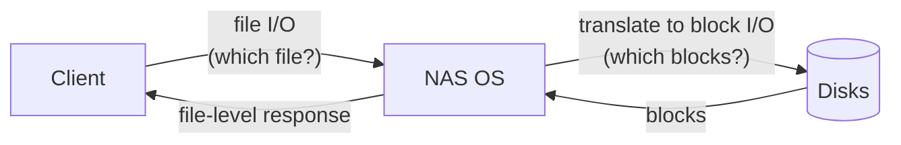
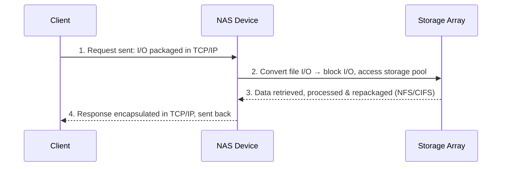

# التخزين المتصل بالشبكة — Chapter 6: Network-Attached Storage (NAS)

> [!NOTE]
> بعد الـ SAN (block-level)، المحاضرة دي عن الـ **NAS** اللي بيقدّم **file-level** على شبكة IP عادية. هنعرف الفرق بينه وبين السيرفر العادي، ومميزاته، وإزاي الـ **File I/O** بيشتغل، ومكوناته، ونوعين التنفيذ (**Integrated** و **Gateway**)، وإيه اللي بيأثر على أداءه، والـ **File-level virtualization**.

**خريطة المحاضرة:**

1. السيرفر العادي vs جهاز الـ NAS
2. مميزات الـ NAS (وعيوبه)
3. الـ NAS File I/O: File systems، والـ Mounting، والـ File sharing
4. مكونات الـ NAS
5. أنواع تنفيذ الـ NAS: Integrated و Gateway
6. خطوات الـ NAS I/O
7. العوامل اللي بتأثر على أداء الـ NAS
8. الـ File-Level Virtualization
9. مقارنة NAS و SAN

---

## 1. السيرفر العادي vs جهاز الـ NAS

> **Network-Attached Storage (NAS)** is an **IP-based file-sharing device** connected to a **LAN**.

- بيجمّع السيرفرات والتخزين، وبيسمح **بالوصول للبيانات ومشاركتها على مستوى الملفات (file-level)** بأقل مجهود إدارة، وبيقلل الـ **bottlenecks** اللي بتحصل في السيرفرات العادية.
- البروتوكولات: **TCP/IP**، و **NFS** (Network File System، لـ **UNIX**)، و **CIFS** (Common Internet File System، لـ **Windows**)، و **FTP**، فيحصل **cross-platform file sharing**.

| | **General-Purpose Server** | **NAS Device** |
|---|---|---|
| **الـ OS** | **OS عام (generic)** | **OS متخصص (optimized / real-time)** للـ file serving |
| **الوظيفة** | بيشغّل **applications كتير** | **مخصص للـ file services بس** (single-purpose) |
| **المكونات** | Applications, print drivers, file system, I/O, OS, network | File system + OS + Network (أخف) |
| **الأداء للملفات** | أقل | **أعلى**، و**بيخدم مستخدمين أكتر** |

- الـ NAS = **file server مخصص، سريع، و single-purpose**، ليه **OS وهاردوير وسوفتوير متحسّنين** للـ file I/O.
- بيدعم **interfaces متعددة**، وبيخدم **clients و servers**، و**مستخدمين أكتر** من الـ file servers التقليدية.
- بعض حلول الـ NAS فيها **native clustering** للـ high availability.

---

## 2. مميزات الـ NAS — Benefits of NAS

| الميزة | الشرح |
|---|---|
| **1. Efficiency** | بيشيل شغل الـ file-serving **عن السيرفرات العادية (offload)** |
| **2. Flexibility** | بيدعم **UNIX و Windows** clients ببروتوكولات **open-standard** |
| **3. Centralized storage** | **بيقلل التكرار**، ويسهّل الإدارة، ويحسّن حماية البيانات |
| **4. Simplified management** | **console مركزي** لإدارة الـ file systems |
| **5. Scalability** | بيتعامل مع حمل متزايد بأداء عالي و latency قليل |
| **6. High availability** | **Redundant networking، replication، clustering** للـ failover |
| **7. Security** | حماية البيانات و**تحكم في الوصول** |

> [!TIP]
> احفظهم: **E-F-C-S-S-H-S**: **E**fficiency, **F**lexibility, **C**entralized, **S**implified management, **S**calability, **H**igh availability, **S**ecurity.

### المميزات والعيوب العملية (من السلايد)

| ✅ مميزات | ❌ عيوب |
|---|---|
| **سهل جدًا** تشارك ملفات من أي مكان على الشبكة | **سرعة نقل الملفات أقل من الـ DAS** |
| موثوق وكفء، و**بيوفر وقت وفلوس** | محتاج **معرفة أساسية بالشبكات** |
| **إضافة ديسكات رخيصة** | المميزات **بتعتمد على شريحة الـ NAS والـ firmware** |
| بيتشارك بين **clients و servers كتير** | |
| **سهل في الاستخدام**: ركّب الـ NAS، وادّيله IP، واضبط الإعدادات، وجاهز | |
| **البيانات محمية**: معظم الأجهزة بتدعم **RAID** | |

---

## 3. الـ NAS File I/O

- الـ NAS بيستخدم **file-level access** في **كل عمليات الـ I/O**.
- الـ **File I/O** = طلب **high-level** بيحدد **الملف** المطلوب، **من غير ما يحدد الـ logical block address**.
- **الـ NAS OS** بيترجم طلب الـ **file I/O** لـ **block I/O** على الديسكات، ويجيب البيانات، وبعدين يرجّعها **file-level** للـ client.
- **الميزة:** الـ clients **مش محتاجين يديروا هيكل الديسك**، الـ NAS OS هو اللي بيتعامل معاه.

### 3.1 الـ File Systems
- **File system** = طريقة **منظمة لتخزين وتنظيم الملفات**.
- كتير منها بيحتفظ بـ **file access table** عشان يسهّل إيجاد الملفات.

### 3.2 الوصول للـ File System — Mounting

- الـ file system **لازم يتعمل له mount قبل ما نوصله**.
- الـ local file systems بتتعمل لها mount **أوتوماتيك وقت الإقلاع**.
- **Mounting** = **عمل رابط بين الـ file system والـ OS**.
- الملفات والفولدرات منظمة في **tree** بيبدأ من **mount point (root)**:
  - **الملفات** في **الأوراق (leaf nodes)**.
  - **الفولدرات** في **العقد الوسطية (intermediate nodes)**.
- **Unmounting** بينهي العلاقة بين المستخدم والـ file system.

### 3.3 مشاركة الملفات — File Sharing

- **File sharing** = **تخزين الملفات والوصول ليها عبر الشبكة**.
- **منشئ الملف (creator/owner)** بيحدد الصلاحيات: **read, write, execute, append, delete, list**.
- فيه **protection scheme** بيضمن **سلامة البيانات** لما كذا مستخدم يوصلوا لنفس الملف.

| طريقة المشاركة | الشرح |
|---|---|
| **FTP** (File Transfer Protocol) | client/server على **TCP**. الـ **FTP العادي مش آمن (unencrypted)**. أما **SFTP / FTPS** (FTP over **SSH**) فبيضيف **تشفير** |
| **DFS** (Distributed File System) | file system **موزّع على كذا host**: وصول موحّد، وإدارة كفء، وأمان |
| **Client/Server + File-Sharing Protocols** | الـ clients بيعملوا **mount لـ remote file systems** على file servers. البروتوكولات: **NFS (UNIX)** و **CIFS/SMB (Windows)** |

---

## 4. مكونات الـ NAS — Components of NAS

| # | المكون | الشرح |
|---|---|---|
| 1 | **NAS Head** (CPU + Memory) | **"مخ" الـ NAS**: بيتعامل مع طلبات الملفات، وبيشغّل الـ OS، وبيدير الـ I/O |
| 2 | **NICs** (Network Interface Cards) | **الاتصال بين الـ NAS وشبكة IP** (Gigabit Ethernet، Fast Ethernet، ATM، FDDI)، وممكن **أكتر من NIC** للـ redundancy والـ throughput |
| 3 | **Optimized OS** | متخصص للـ file serving، و**بيحوّل file-level لـ block-level** |
| 4 | **File-Sharing Protocols** | **NFS** ← UNIX/Linux · **CIFS/SMB** (Common Internet File System / Server Message Block) ← Windows، فيحصل cross-platform |
| 5 | **Industry-Standard Storage Protocols** | لتوصيل وإدارة الديسكات: **ATA، SCSI، Fibre Channel** |

> [!EXAM]
> **NFS = UNIX/Linux** · **CIFS/SMB = Windows**. والـ **NAS head = المخ (CPU + memory)**.

---

## 5. أنواع تنفيذ الـ NAS — NAS Implementations

| النوع | الوصف |
|---|---|
| **Integrated NAS** | **نظام متكامل (self-contained)**: **NAS head + storage + OS في شاسيه واحد**، و **plug-and-play** للمشاركة البسيطة |
| **Gateway NAS** | **NAS head(s) منفصل عن التخزين** (غالبًا **SAN**)، والـ NAS بيدّي **file-level عبر IP**، والتخزين تحته **block-level SAN**. مثالي للـ **scalability** والـ enterprise |

### A. الـ Integrated NAS (All-in-one)

| | |
|---|---|
| **المكونات** | NAS Head · **Internal/Direct storage** (SATA/SAS/SSD أو JBOD/RAID خارجي) · NICs · Optimized OS · بروتوكولات (NFS, CIFS/SMB, FTP) |
| **الاتصال** | **مباشرة بالـ LAN** عن طريق Ethernet (1G/10G/25G)، وممكن **Link Aggregation (LACP)** |
| **البيئة المستهدفة** | **مجموعات عمل وأقسام صغيرة ومتوسطة** |
| **الملاحظة** | **Scalability محدودة** بس **سهل جدًا في النشر** |

### B. الـ Gateway NAS (NAS Head + SAN Backend)

| | |
|---|---|
| **المكونات** | **NAS heads** (واحد أو أكتر) · **Front-end network (IP)** للـ clients (NFS/SMB) · **Back-end network (SAN)** (FC أو iSCSI) · **Storage subsystem (SAN)**: block-level (RAID, cache, LUNs) |
| **الاتصال** | **Front-end** (Clients ↔ NAS): IP/Ethernet · **Back-end** (NAS ↔ Storage): **FC SAN أو iSCSI** مع redundancy و multipathing |
| **البيئة المستهدفة** | **شركات متوسطة وكبيرة**، وبيئات عالية الأداء ومركزية |

| | **Integrated NAS** | **Gateway NAS** |
|---|---|---|
| التخزين | **جوه نفس الجهاز** | **منفصل (SAN)** |
| الـ Scalability | محدودة | **عالية** |
| السهولة | **plug-and-play** | أعقد |
| البيئة | **صغيرة ومتوسطة** | **متوسطة وكبيرة** |
| الـ Back-end | internal / direct | **FC SAN أو iSCSI** |

---

## 6. خطوات الـ NAS I/O — NAS I/O Operations

البروتوكولات **NFS و CIFS** بتتعامل مع طلبات الـ file I/O لـ file system بعيد بيديره الـ NAS:

| الخطوة | اللي بيحصل |
|---|---|
| **1. Request Sent** | الـ client بيغلّف الطلب في **TCP/IP** ويبعته للـ NAS |
| **2. Conversion to Block I/O** | الـ NAS **يحوّل الطلب لـ block-level I/O** ويوصل للتخزين |
| **3. Data Processing** | الـ NAS بيجيب البيانات ويعالجها ويرجّعها **بشكل file-level** (NFS أو CIFS) |
| **4. Response Sent** | الـ NAS بيغلّف الرد في **TCP/IP** ويبعته للـ client |

---

## 7. العوامل اللي بتأثر على أداء الـ NAS — Factors Affecting NAS Performance

- الـ NAS بيستخدم **شبكة IP**، فمشاكل **الـ bandwidth والـ latency** بتاعة IP بتأثر عليه.
- **ازدحام الشبكة (network congestion)** من **أكبر مصادر الـ latency**.

| # | العامل | الشرح |
|---|---|---|
| 1 | **Number of Hops** | كل **router hop** زيادة بيضيف تأخير معالجة IP |
| 2 | **Authentication Services** | تأخير لو الـ **LDAP** (Lightweight Directory Access Protocol) بطيء |
| 3 | **Retransmissions** | أخطاء الـ link، أو buffer overflows، أو **اختلاف إعدادات speed/duplex** بيخلّي الـ packets تتبعت تاني |
| 4 | **Overutilized Routers/Switches** | حمل عالي ← رد أبطأ، ومحتاج ترقية |
| 5 | **File/Directory Lookup & Metadata** | **فولدرات عميقة** أو layout سيء ← تأخير في إيجاد الملفات |
| 6 | **Overutilized NAS Devices** | طلبات كتير أو موارد قليلة ← وقت معالجة أطول |
| 7 | **Overutilized Clients** | **bottleneck في الـ client نفسه** (CPU، memory) |

---

## 8. الـ File-Level Virtualization

- **بيخبّي (abstracts) المكان الفعلي للملفات** عن المستخدمين والتطبيقات.
- بيعمل **logical view لكل الـ file systems**: المستخدمين بيوصلوا للملفات عن طريق **namespace واحد موحّد**، **بغض النظر عن مكانها الفعلي**.
- **بيشيل الاعتماد** بين بيانات الملف ومكانه الفيزيائي.

### بيشتغل إزاي؟
- **في الـ NAS التقليدي:** كل NAS أو file server ليه **directory tree وتخزين خاص بيه**، والـ clients لازم **يعرفوا السيرفر والمسار بالظبط** (مثلًا `\\server1\department\report.docx`).
- **مع الـ virtualization:** بيتضاف **virtualization layer** بيعمل حاجتين:
  - **يربط المسارات المنطقية بالأماكن الفعلية** (logical paths ← physical locations).
  - **يسمح للأدمن ينقل أو يجمّع أو يوسّع التخزين من غير ما يغيّر مسارات المستخدمين**.

| الجانب | **قبل** (Traditional) | **بعد** (Virtualized) |
|---|---|---|
| **File Access** | كل NAS مستقل، والـ clients **عارفين المكان بالظبط** | **Global namespace** (`\\company\shared\report.docx`) |
| **Storage Utilization** | **غير متوازن**: سيرفرات مليانة وسيرفرات فاضية | **Storage pooling**: كل السيرفرات pool منطقي واحد |
| **Migration** | محتاج **downtime** وإعادة ضبط يدوي | **File mobility**: نقل الملفات **من غير ما المستخدم يحس** |
| **Scalability** | **صعب** التوسع | **مرن** |
| **Administration** | **معقد ومستهلك للوقت** | تحسين التخزين **من غير تأثير على المستخدمين** |

---

## 9. مقارنة NAS و SAN

| | **NAS** | **SAN** |
|---|---|---|
| **مستوى الوصول** | **File-level** | **Block-level** |
| **مين بيدير الـ I/O** | **الـ NAS** (based on file level) | **السيرفر** (based on block level) |
| **الشبكة** | **Ethernet عادي** (LAN) | **شبكة مخصصة** (Fibre Channel)، switches وكابلات خاصة |
| **البروتوكولات** | **NFS، CIFS/SMB** | **FC، iSCSI** |
| **التكلفة** | **أرخص بكتير** | **أغلى** |
| **الوصول** | متوصل بكل الأجهزة والسيرفرات على الـ Ethernet | التخزين **متقسم ومتخصص لسيرفرات معينة** |
| **السهولة** | **أبسط** في التنفيذ | أعقد |

### أنواع الـ DAS حسب الـ Interface (للمراجعة)

| الـ Interface | ملاحظة |
|---|---|
| **IDE / PATA** | قديم، كابل عريض |
| **SATA** | الأشهر للـ HDD و SSD في الأجهزة الشخصية |
| **SCSI / SAS** | للسيرفرات (**SAS** = Serial-Attached SCSI) |
| **PCIe / NVMe** | الأسرع، للـ SSDs الحديثة |
| **USB** | خارجي ومحمول |

---

## ✅ خلاصة المحاضرة في 10 نقط

1. **NAS** = جهاز **file-sharing على IP متوصل بالـ LAN**، و **single-purpose** بـ OS متخصص.
2. البروتوكولات: **TCP/IP، NFS (UNIX)، CIFS/SMB (Windows)، FTP**.
3. المميزات: **Efficiency، Flexibility، Centralized، Simplified management، Scalability، High availability، Security** · العيوب: أبطأ من DAS، ومحتاج معرفة شبكات، وبيعتمد على الـ firmware.
4. **File I/O** بيحدد الملف من غير LBA، والـ **NAS OS** بيحوّله لـ **block I/O**.
5. **Mounting** = رابط بين الـ file system والـ OS (tree من mount point) · **Unmounting** بينهي العلاقة.
6. File sharing: **FTP** (مش آمن) / **SFTP** (SSH، مشفّر) · **DFS** · **NFS / CIFS**.
7. المكونات: **NAS head (المخ)، NICs، Optimized OS، NFS/CIFS، Storage protocols (ATA, SCSI, FC)**.
8. **Integrated NAS** (all-in-one، صغير ومتوسط) vs **Gateway NAS** (head + **SAN backend**، كبير).
9. NAS I/O: request (TCP/IP) ← **block I/O** ← process ← response · وعوامل الـ latency: hops، LDAP، retransmissions، routers، metadata، NAS، clients.
10. **File-level virtualization** = **global namespace** يخبّي المكان الفعلي ويسمح بنقل الملفات من غير downtime · **NAS = file + Ethernet + رخيص** vs **SAN = block + FC + غالي**.
