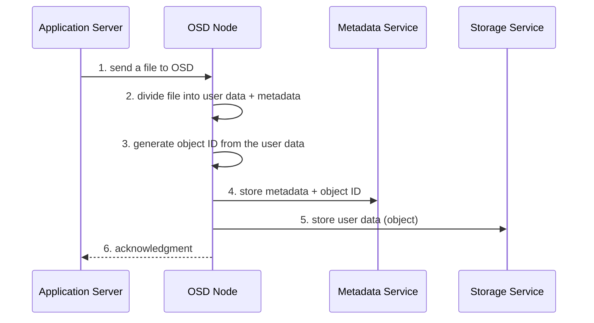
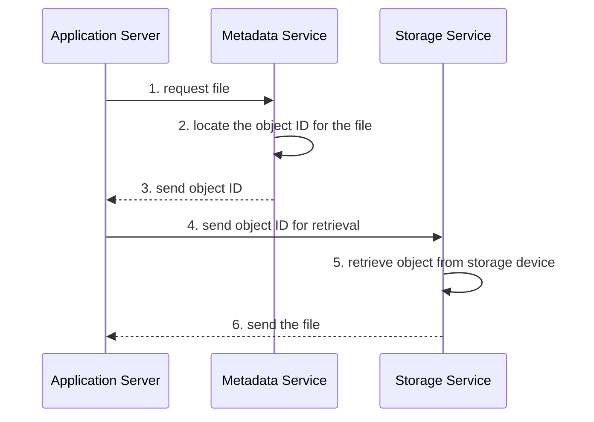

# التخزين الكائني والموحّد — Chapter 7: Object-Based & Unified Storage

> [!NOTE]
> بعد الـ **block storage** (SAN) والـ **file storage** (NAS)، المحاضرة دي عن النوع التالت: **Object storage**، وهو اللي بيشغّل الـ cloud زي **Amazon S3**. هنشرح الـ **OSD** ومكوناته وإزاي بيخزن ويسترجع، وحالتين استخدام: **Cloud storage** و **CAS**، وفي الآخر الـ **Unified storage** اللي بيجمع block و file و object في جهاز واحد.

**خريطة المحاضرة:**

1. مقدمة: أشكال تخزين البيانات (File و Block و Object)
2. الـ Object-Based Storage Devices (OSD)
3. حالات الاستخدام: Cloud-based Storage و CAS
4. استخدامات الـ CAS
5. الـ Unified Storage

---

## 1. مقدمة: أشكال تخزين البيانات — Data Storage Forms

فيه **3 طرق أساسية** لتسجيل وتخزين البيانات: **File Storage، Block Storage، Object Storage**.

### File Storage

- **File-level**: بينظم البيانات كـ **ملفات في فولدرات (hierarchy)**.
- الـ **Metadata** (بيانات بتوصف البيانات: الكاتب، التاريخ...) بتساعد نلاقي الملف.
- **الاستخدام:** **DAS و NAS** · **البروتوكولات:** **SMB / NFS** · **Cloud vendor:** **Amazon EFS** (Elastic File System).

### Block Storage

- بيقسّم البيانات لـ **blocks متساوية الحجم ومترتبة عشوائيًا**.
- كل block ليه **unique identifier**، والـ identifiers متخزنة في **lookup table**.
- الـ blocks بيوصلها **الـ OS**.
- **البروتوكولات:** **iSCSI، Fibre Channel، FCoE** · **الاستخدام:** **SAN** · **Cloud vendors:** **AWS EBS** (Elastic Block Storage)، و Google Cloud Persistent Disks.

### Object Storage

- **موصى بيه للكميات الكبيرة من البيانات الـ unstructured**.
- كل حاجة **object مستقل** فيه **identifier و data و attributes و metadata**.
- متخزنة في **بيئة flat**: كل الـ objects **في نفس المستوى**، و**مفيش فولدرات ولا sub-directories**.
- الوصول عن طريق **API**، والبروتوكول **REST over HTTP** · **Cloud vendor:** **Amazon S3** (Simple Storage Service).

| | **File** | **Block** | **Object** |
|---|---|---|---|
| **التنظيم** | ملفات في فولدرات (hierarchy) | blocks بـ IDs | objects في **flat space** |
| **البروتوكول** | **SMB / NFS** | **iSCSI / FC / FCoE** | **REST (HTTP)** |
| **الاستخدام** | DAS / **NAS** | **SAN** | **Cloud**، unstructured |
| **AWS** | **Amazon EFS** | **AWS EBS** | **Amazon S3** |

> [!EXAM]
> سؤال مشهور: **EFS = file** · **EBS = block** · **S3 = object**.

---

## 2. أجهزة التخزين الكائني — Object-Based Storage Devices (OSD)

> An **Object-Based Storage Device (OSD)** manages and stores data in the form of **objects** on a **flat address space** based on its **content and attributes**, rather than the name and location of blocks or files.

### كل Object فيه إيه؟

| الجزء | الشرح |
|---|---|
| **Data** | **المحتوى الفعلي** |
| **Metadata** | معلومات **بتوصف** الـ object (الحجم، تاريخ الإنشاء، الصلاحيات، المكان...) |
| **Unique Identifier (Object ID)** | **رقم فريد** بيتولد بخوارزمية متخصصة، وبيسمح **بالوصول المباشر** |

> [!WARNING]
> **الـ Metadata مش هي المحتوى!** المحتوى الفعلي اسمه **Data**، والـ metadata هي **وصف** للبيانات.

### الخصائص الأساسية (Key Characteristics)

| الخاصية | الشرح |
|---|---|
| **Self-describing objects** | الـ metadata بتخلّي الـ object **مستقل**، فالنظام مش معتمد على هرم الفولدرات ولا أماكن الـ blocks |
| **Flat namespace** | الوصول **بالـ ID** بدل مسار الملف أو عنوان الـ block |
| **Scalability** | بيدعم **كميات ضخمة جدًا من الـ unstructured data** (فيديوهات، صور، backups) |
| **Access method** | التطبيقات بتستخدم **object protocols** (**REST APIs، HTTP، S3**) **بدل ما تعمل mount لـ file system** |

### Hierarchical File System vs Flat Address Space

| | **Hierarchical File System** | **Flat Address Space** (OSD) |
|---|---|---|
| **التنظيم** | **ملفات وفولدرات** (شجرة) | **objects** في مستوى واحد |
| **الوصول** | filenames / **inodes** / مسار | **Object IDs** |
| **السعة** | محدودة | **عدد ضخم جدًا من الـ objects** |

### Traditional vs Object-based Storage Model

| الخاصية | **Traditional Storage Model** | **Object-Based Storage Model** |
|---|---|---|
| **Data Organization** | **block** (blocks ثابتة زي SAN) أو **file** (ملفات في فولدرات زي NAS) | **objects** = data + metadata + ID |
| **Access Protocols** | File (**NFS, SMB**) · Block (**iSCSI, FC**) | **RESTful APIs (HTTP/HTTPS)** |
| **Metadata** | **محدودة ومنفصلة** عن البيانات | **غنية ومتخزنة مع الـ object** |
| **Scalability** | **محدودة** (hierarchical) | **عالية جدًا** (flat namespace) |
| **Management** | **أعقد** (tiering و mapping يدوي) | **أبسط** (policy-driven، معتمد على الـ metadata) |
| **Best For** | **Databases، OS storage، structured data** | **Cloud، big data، backup، media، unstructured data** |

### مكونات الـ OSD — Key Components

| المكون | الشرح |
|---|---|
| **1. OSD Nodes** (Object Storage Nodes) | **الأجهزة اللي بتخزن الـ objects فعلًا**: كل node بيدير مجموعة ديسكات، ويتعامل مع التخزين والاسترجاع، وكل object فيه data + metadata + ID. ومسؤولة عن **replication و recovery و data distribution**. وكل node فيه **Metadata Service** و **Storage Service** |
| **2. Internal Network** | **شبكة الاتصال الداخلية** بين كل المكونات (clients، metadata servers، OSD nodes)، وغالبًا **Ethernet أو InfiniBand**. وظايفها: **تبادل البيانات، والـ synchronization والـ replication، والتنسيق** |
| **3. Storage** (Physical Disks / Storage Pool) | **الوسائط الفيزيائية (HDDs / SSDs)** اللي البيانات متخزنة عليها، وبتكوّن **storage pool** بيديره الـ OSD nodes |

### خطوات تخزين Object في الـ OSD

### خطوات استرجاع Object من الـ OSD

> [!TIP]
> لاحظ دور الـ **Metadata Service**: في التخزين بيحفظ الـ **metadata + ID**، وفي الاسترجاع بيدوّر على الـ **ID** ويدّيه للـ application. أما الـ **Storage Service** فهو اللي شايل **البيانات الفعلية**.

### مميزات الـ Object-based Storage

| الميزة | الشرح |
|---|---|
| **Security and Reliability** | الـ **Object ID الفريد** بيضمن سلامة البيانات وأصالتها، والـ **authentication** بيتعمل على مستوى جهاز التخزين |
| **Platform Independence** | الـ objects حاويات مجردة، فممكن تتشارك بين **منصات مختلفة**، وده بيخليها مناسبة للـ **cloud** |
| **Scalability** | الـ OSD nodes والتخزين **بيتوسعوا كل واحد لوحده** |
| **Manageability** | **ذكاء داخلي**، و **self-healing**، و **policy-based management** للمهام الروتينية |

---

## 3. حالات استخدام الـ Object Storage

### Use Case 1: التخزين السحابي — Cloud-based Storage

مزودي الـ cloud العامة والخاصة زي **Amazon S3** و **Microsoft Azure Blob Storage** و **Google Cloud Storage** **مبنيين على Object-Based Storage**.

| الخطوة | الشرح |
|---|---|
| **1. Data Upload** | لما ترفع ملف (مثلًا `photo.jpg`)، بيتحول لـ **object** فيه data + metadata + **Object ID**، ويتخزن في **object storage pool** موزّع على سيرفرات كتير |
| **2. Unique Object ID** | كل object ليه **ID فريد** بدل اسم الملف أو المسار، فيبقى فيه **وصول مباشر في flat address space** |
| **3. Access via REST APIs** | التطبيقات بتستخدم **RESTful APIs** (**PUT، GET، DELETE**) عبر HTTP/HTTPS، وبدل `/folder/file.txt` بنستخدم URL زي `https://s3.amazonaws.com/bucket_name/object_id` |
| **4. Metadata-Based Policies** | الـ metadata **بتدير البيانات** كمان |

#### سياسات الـ Metadata

| السياسة | الشرح |
|---|---|
| **Retention Policy** | **قد إيه البيانات تفضل** قبل ما تتمسح |
| **Tiering Policy** | **ينقل البيانات القديمة أو القليلة الاستخدام لتخزين أرخص** أوتوماتيك |
| **Replication Policy** | **ينسخ البيانات في مناطق جغرافية مختلفة** للـ redundancy و disaster recovery |

> [!EXAMPLE]
> **رفع فيديو على Amazon S3:**
> 1. S3 بيخزنه كـ **object**.
> 2. يدّيله **Object ID** فريد (مثلًا `a1b2c3d4e5`).
> 3. الـ metadata فيها: **video/mp4**، و **200 MB**، وتاريخ الرفع والصلاحيات، وإعدادات الـ retention والـ replication.
> 4. التطبيق يجيبه بعدين عن طريق **API call** أو **URL** بالـ Object ID.

| ميزة الـ Cloud | الفايدة |
|---|---|
| **Flat Address Space** | تخزين **مليارات** الـ objects من غير هرم فولدرات |
| **REST APIs** | **وصول عالمي** لأي تطبيق أو منصة |
| **Metadata Policies** | إدارة ذكية (retention، tiering، replication) |
| **Scalability** | يتوسع بسهولة مع زيادة البيانات |
| **Reliability** | الـ replication بيضمن **durability** و fault tolerance |

### Use Case 2: التخزين بعنوان المحتوى — Content Address Storage (CAS)

- **نوع متخصص** لتخزين **المحتوى الثابت اللي مبيتغيرش (fixed content)**: **صور طبية، مستندات قانونية، e-mails، backups**.
- الـ CAS بيتوصل عن طريق **CAS API** شغال على الـ **application server**.
- **بدل ما يخزن البيانات حسب مكانها** (زي الـ file systems)، **بيخزنها ويسترجعها حسب محتواها**.
- كل جزء بيانات ليه **Content Address (CA)**، وده بيتولد بـ **cryptographic hash function** (زي **MD5 أو SHA-1**) **من محتوى البيانات نفسه (binary)**.

#### الـ CAS بيشتغل إزاي؟

| العملية | الخطوات |
|---|---|
| **1. التخزين** | النظام بيحسب **hash** (MD5، SHA-1، SHA-256) من البيانات ← الـ hash ده يبقى الـ **Content Address** ← يخزن **الـ object والـ CA** في الـ index |
| **2. الاسترجاع** | التطبيق يبعت الـ **CA** للـ CAS عن طريق الـ **CAS API** ← النظام يرجّع البيانات بالظبط |
| **3. الـ CAS API** | `Store(content)` ← بيرجّع **CA** · `Retrieve(CA)` ← بيرجّع البيانات · `Verify(CA)` ← **بيتأكد من سلامة البيانات** |

> [!EXAMPLE]
> hash ملف = `d41d8cd98f00b204e9800998ecf8427e` ← **ده عنوانه في الـ CAS**.
> لو **bit واحد** اتغير في الملف، **الـ hash هيتغير تمامًا**، وده اللي بيضمن إن المحتوى **أصلي ومتعدّلش**.

#### المميزات الأساسية للـ CAS

| الميزة | الشرح |
|---|---|
| **Content Authenticity and Integrity** | العنوان متولد من المحتوى، فأي تغيير بيغيّر الـ hash، فيبقى فيه **أصالة ومنع تلاعب** |
| **Location Independence** | الوصول **بالـ content address** مش بالمسار |
| **Single Instance Storage (Deduplication)** | المحتوى المتطابق بيدّي **نفس الـ hash**، فبتتخزن **نسخة واحدة بس**، وده بيوفر مساحة |
| **Data Protection** | replication و backup و integrity checks |
| **Fast Record Retrieval** | **hash-based indexing** بيخلّي البحث سريع |
| **Load Balancing** | توزيع الحمل على **CAS nodes** |
| **Scalability** | يتوسع **أفقيًا** بإضافة nodes |
| **Self-Diagnosis and Repair** | **يكتشف الفساد ويصلحه** من النسخ المكررة |

> [!EXAMPLE]
> **أرشيف طبي:** مستشفى بتخزن صور **MRI** في CAS. كل صورة ليها hash فريد. لما الدكتور يطلبها بالـ CA، النظام بيضمن إن **المحتوى أصلي ومتغيرش**، وإن **مفيش نسخ مكررة**، وإن **سياسات الاحتفاظ** القانونية متطبقة.

---

## 4. استخدامات الـ CAS — CAS Use Cases

1. **Healthcare** (المستشفيات)
2. **Financial records and audits** (البنوك)
3. **Legal/compliance document storage**
4. **Email archiving**
5. **Long-term digital preservation**

---

## 5. التخزين الموحّد — Unified Storage

- **Unified storage** (واسمه كمان **multiprotocol storage**) = نظام تخزين بيدعم **file-level و block-level** من **نفس المنصة**.
- بيجمع **block و file و object** في **منصة واحدة**.
- بيدعم **بروتوكولات متعددة**.
- بيتدار من **واجهة إدارة واحدة**.
- بيخلّي الشركات **تجمع احتياجات SAN و NAS في جهاز واحد**، فيقل **التعقيد والتكلفة والـ overhead**.

### بيشتغل إزاي؟
- فيه **storage pool واحد** بيتوصل له:
  - **كملفات** ← بروتوكولات file (**NFS، CIFS/SMB**) زي NAS.
  - **كـ blocks** ← بروتوكولات block (**FC، iSCSI**) زي SAN.
- النظام **بيدير الطلبات ديناميكيًا** حسب التطبيق محتاج block ولا file.

### مكونات الـ Unified Storage

| المكون | الشرح |
|---|---|
| **1. Storage Controller** | **وحدة التحكم الأساسية**: بيدير كل عمليات البيانات والتواصل مع الديسكات، وبيتعامل مع **block-level I/O** الجاي من الـ NAS head أو الـ OSD node أو الـ application servers، وبيقدّم **virtualization و caching و RAID** |
| **2. NAS Head** | بيتعامل مع **file-level access**، وبيكلّم الـ clients بـ **CIFS (Windows) أو NFS (Linux/Unix)**، و**بيحوّل طلبات الملفات لـ block I/O** للـ storage controller |
| **3. OSD Node** | بيدير الـ **object-based storage**: بيسمح للـ web apps والـ cloud بتخزين واسترجاع **objects** عن طريق **REST أو SOAP أو API**، و**بيحوّل عمليات الـ objects لـ block I/O** |
| **4. Storage** (Disks / Pool) | **الطبقة الفيزيائية** (HDDs/SSDs)، و **storage pool مشترك** لكل الطبقات (block و file و object) |

> [!IMPORTANT]
> **الملاحظة الذهبية:** **كل الطرق بتنتهي بـ block I/O عند الـ Storage Controller**:
> - الـ **Application servers** بيبعتوا **block** مباشرة (iSCSI / FC / FCoE).
> - الـ **NAS head** بيحوّل **file ← block**.
> - الـ **OSD node** بيحوّل **object ← block**.

### الوصول للبيانات في الـ Unified Storage

| | **File-Level Access (NAS Mode)** | **Block-Level Access (SAN Mode)** |
|---|---|---|
| **البروتوكولات** | **NFS** (UNIX/Linux)، **SMB/CIFS** (Windows) | **Fibre Channel، iSCSI** |
| **بيشتغل إزاي** | التطبيقات بتشوف **ملفات وفولدرات**، والنظام بيقدّم **file system view** | التطبيقات بتشوف **raw blocks** (زي ديسك محلي)، والـ **OS أو التطبيق هو اللي بيدير الـ file system** |
| **مثال** | تعمل mount لفولدر مشترك (`\\Server\Share`) أو NFS export (`/mnt/share`) | **database server** بيشوف الـ **LUN** كأنه ديسك محلي |
| **الاستخدامات** | مشاركة الملفات، home directories، المستندات، التعاون | **Databases، virtualization (VMware/Hyper-V)**، workloads عالية الأداء |

---

## ✅ خلاصة المحاضرة في 10 نقط

1. أشكال التخزين: **File** (SMB/NFS، NAS، EFS) · **Block** (iSCSI/FC/FCoE، SAN، EBS) · **Object** (REST/HTTP، cloud، **S3**).
2. **OSD** = objects في **flat address space** حسب المحتوى والخصائص، وكل object = **Data + Metadata + Unique ID**.
3. الخصائص: **self-describing، flat namespace، scalability، access بالـ REST APIs بدل mount**.
4. **Traditional** (block/file، NFS/SMB/iSCSI/FC، metadata محدودة، databases) vs **Object** (REST، metadata غنية، scalable جدًا، unstructured).
5. مكونات الـ OSD: **OSD nodes** (replication، recovery، distribution) + **Internal network** (Ethernet/InfiniBand) + **Storage pool**.
6. التخزين: file ← data + metadata ← ID ← metadata service ← storage service ← ack · والاسترجاع: request ← metadata service يلاقي الـ ID ← storage service يرجّع الملف.
7. المميزات: **Security & reliability، Platform independence، Scalability، Manageability (self-healing)**.
8. **Cloud storage** (S3، Azure Blob، Google Cloud Storage): Object ID + REST (PUT/GET/DELETE) + policies: **Retention، Tiering، Replication**.
9. **CAS** = للمحتوى **الثابت**، والعنوان = **hash** (MD5/SHA-1) من المحتوى، و API: Store/Retrieve/Verify، ومميزاته: **integrity، dedup، self-repair** (مستشفيات، بنوك، e-mail archiving).
10. **Unified storage** (multiprotocol) = block + file + object في منصة واحدة: **Storage controller** (block I/O) + **NAS head** (file ← block) + **OSD node** (object ← block) + storage pool.
