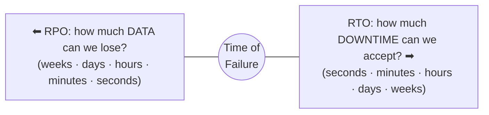

# استمرارية الأعمال — Chapter 8: Introduction to Business Continuity

> [!NOTE]
> المحاضرة دي عن إزاي الشركة **تفضل شغالة** لما يحصل عطل أو كارثة. هنتعلم **Information Availability** وإزاي نحسبها (**MTBF و MTTR**)، وتكلفة الـ downtime، والمصطلحات المهمة (**RPO و RTO**)، ودورة حياة الـ BC planning، وتحليل الأعطال، والـ **BIA**، والحلول التقنية.

**خريطة المحاضرة:**

1. يعني إيه Business Continuity؟ وليه محتاجينها؟
2. الـ Information Availability: التعريف، وأسباب عدم التوافر، والقياس (MTTR و MTBF)، وتأثير الـ downtime
3. مصطلحات الـ BC: Disaster recovery، Disaster restart، RPO، RTO
4. دورة حياة الـ BC Planning (5 مراحل)
5. تحليل الأعطال (Failure Analysis): SPOF، Fault tolerance، Multipathing
6. تحليل تأثير الأعمال (BIA)
7. الحلول التقنية للـ BC

---

## 1. يعني إيه Business Continuity (BC)؟

> **Business Continuity** is the discipline of ensuring that an organization can **continue operating with minimal disruption** during and after **unexpected events**.

- بتشمل **الاستعداد** و**الاستجابة** و**التعافي** من انقطاع التطبيقات أو أي حادثة بتأثر على الشغل.
- حلول الـ BC بتتعامل مع **عدم توافر الخدمة** و**ضعف أداء التطبيقات** الاتنين.
- **عملية متكاملة على مستوى الشركة كلها** بتضمن وصول مستمر للمعلومات والأنظمة، واسمها **information availability**.

> [!IMPORTANT]
> **Business Continuity = Proactive planning + Reactive recovery**
> يعني **خطوات وقائية قبل** ما المشكلة تحصل + **استرجاع فعّال بعد** ما تحصل.

### ليه محتاجين Business Continuity؟

- الشركة **تفضل شغالة** وقت الأزمات و**ترجع بسرعة**.
- **تقلل الـ downtime** و**الخسائر المالية**.
- **تحمي ثقة العملاء**.
- **تضمن توافر الخدمات الحرجة**.
- **الالتزام بالقوانين** (compliance).
- **مرونة أكبر** للشركة عن طريق الاستعداد للمخاطر.

---

## 2. توافر المعلومات — Information Availability (IA)

> **IA** refers to the ability of an infrastructure to **function according to business expectations** during its specified time of operation.

يعني **الناس** (موظفين، عملاء، موردين، شركاء) **يقدروا يوصلوا للمعلومات وقت ما يحتاجوها**.

### المعايير التلاتة للـ IA

| المعيار | الشرح |
|---|---|
| **Reliability** (الاعتمادية) | المكونات **تشتغل من غير أعطال** تحت ظروف معينة لمدة معينة |
| **Accessibility** (إمكانية الوصول) | المعلومات متاحة **في المكان الصح وللمستخدم الصح** |
| **Timeliness** (التوقيت المناسب) | المعلومات متاحة **وقت ما نحتاجها** |

> [!EXAM]
> **Reliability · Accessibility · Timeliness**، و"**Profitability**" **مش** منهم.

### أسباب عدم توافر المعلومات (Causes of Information Unavailability)

| السبب | النسبة | أمثلة |
|---|---|---|
| **Planned Outages** (انقطاع مخطط) | **80%** | **Competing workloads، backup، reporting، data warehouse extracts، application and data restore** |
| **Unplanned Outages** (انقطاع مش مخطط) | **20%** | **Database corruption، component failure، human error** |
| **Disaster** (كارثة) | **< 1%** | **طبيعية أو بشرية**: فيضان، حريق، زلزال، مبنى ملوّث |

> [!WARNING]
> الفخ المشهور: **أغلب الانقطاعات (80%) مخططة** مش كوارث! والـ **backup** نفسه بيعتبر **planned outage**، أما **database corruption** فده **unplanned**.

### قياس الـ IA — MTTR و MTBF

الـ IA بيتقاس بمقارنة **قد إيه النظام شغال (uptime)** مقابل **قد إيه واقف (downtime)**.

| | **MTTR** (Mean Time To Repair) | **MTBF** (Mean Time Between Failures) |
|---|---|---|
| **التعريف** | **متوسط الوقت اللازم لإصلاح العطل** وإرجاع النظام للتشغيل | **متوسط الوقت اللي النظام بيشتغل فيه بشكل طبيعي بين عطلين** |
| **بيمثّل** | **Downtime** | **Uptime** |
| **الأحسن** | **أقل = توافر أعلى** | **أعلى = اعتمادية وتوافر أعلى** |
| **بيشمل** | **Detection time** (اكتشاف العطل) + **Diagnosis time** (تحديد السبب) + **Repair time** (الإصلاح) + **Restoration time** (الرجوع للعمل كاملًا) | قد إيه النظام شغال من غير انقطاع، وقد إيه هو موثوق |

### حساب الـ IA

$$IA = \frac{\text{System Uptime}}{\text{System Uptime} + \text{System Downtime}}$$

$$IA = \frac{MTBF}{MTBF + MTTR}$$

> [!EXAMPLE]
> **مثال:** سيرفر بيشتغل في المتوسط **720 ساعة** قبل ما يعطل (MTBF)، والإصلاح بياخد **8 ساعات** (MTTR):
>
> $$IA = \frac{720}{720 + 8} = \frac{720}{728} \approx 0.989 = 98.9\%$$
>
> لو قللنا الـ MTTR لـ **2 ساعة** ← $IA = \frac{720}{722} \approx 99.7\%$. يعني **تقليل وقت الإصلاح بيزوّد التوافر**.

### تأثير الـ Downtime — Impact of Downtime

**Downtime** = أي فترة النظام أو الخدمة فيها **مش متاحة**، وتأثيره = **مجموع الخسائر** بسببه.

| التأثير | أمثلة |
|---|---|
| **Lost Productivity** | عدد الموظفين المتأثرين × ساعات التوقف × أجر الساعة |
| **Lost Revenue** | خسائر مباشرة، تعويضات، إيرادات مستقبلية، فواتير، استثمارات |
| **Damaged Reputation** | العملاء، الموردين، الأسواق المالية، البنوك، الشركاء |
| **Financial Performance** | الاعتراف بالإيرادات، الـ cash flow، الخصومات، التصنيف الائتماني، سعر السهم |
| **Other Expenses** | موظفين مؤقتين، تأجير معدات، ساعات إضافية، شحن إضافي، سفر |

### متوسط تكلفة الـ Downtime في الساعة

$$\text{Avg. Cost of Downtime/hour} = \text{Avg. Productivity Loss/hour} + \text{Avg. Revenue Loss/hour}$$

$$\text{Productivity Loss/hour} = \frac{\text{Total salaries and benefits of all employees per week}}{\text{Average working hours per week}}$$

$$\text{Revenue Loss/hour} = \frac{\text{Total revenue of the organization per week}}{\text{Average number of hours per week the organization is open}}$$

> [!EXAMPLE]
> **مثال:** شركة مرتبات موظفيها **100,000 جنيه** في الأسبوع، وبيشتغلوا **40 ساعة**. وإيرادها **700,000 جنيه** في الأسبوع، وفاتحة **70 ساعة**:
> - Productivity loss = 100,000 ÷ 40 = **2,500 جنيه/ساعة**
> - Revenue loss = 700,000 ÷ 70 = **10,000 جنيه/ساعة**
> - **Cost of downtime = 2,500 + 10,000 = 12,500 جنيه/ساعة**

---

## 3. مصطلحات الـ BC — BC Terminology

| المصطلح | الشرح | التقنية |
|---|---|---|
| **Disaster Recovery** (التعافي من الكوارث) | عملية **منسّقة لاستعادة** الأنظمة والبيانات والبنية بعد كارثة، عن طريق **استرجاع نسخة قديمة وتطبيق الـ logs عليها** لحد نقطة اتساق معروفة | **Backup** |
| **Disaster Restart** (إعادة التشغيل) | **إعادة التشغيل** باستخدام **نسخ mirrored متسقة** من البيانات والتطبيقات | **Replication** |

> [!EXAM]
> **Disaster Recovery ← Backup** · **Disaster Restart ← Replication (mirrored copies)**.

### الـ RPO و الـ RTO

| | **RPO** (Recovery Point Objective) | **RTO** (Recovery Time Objective) |
|---|---|---|
| **التعريف** | **النقطة الزمنية** اللي لازم نرجّع البيانات ليها بعد العطل | **أقصى وقت** لازم الأنظمة ترجع فيه بعد العطل |
| **بيحدد** | **أقصى فقد بيانات مقبول** (maximum tolerable **data loss**) | **أقصى downtime مقبول** |
| **بيركز على** | **البيانات** (data) | **التطبيق** (application) |
| **الاتجاه** | **لورا** من وقت العطل (قد إيه البيانات بترجع ورا) | **لقدام** من وقت العطل (قد إيه لحد ما نرجع) |
| **مثال** | **RPO = 1 ساعة** ← لازم backup **كل ساعة على الأقل** فمنخسرش أكتر من ساعة بيانات | **RTO = 4 ساعات** ← كل الأنظمة الحرجة **ترجع خلال 4 ساعات**، ولو زاد يبقى فيه خسائر كبيرة |
| **بيأثر على** | **تكرار الـ backup** | **سرعة استجابة الـ IT** وسرعة رجوع الأنظمة |

> [!TIP]
> **RPO = Point = البيانات** (هنخسر بيانات قد إيه؟) · **RTO = Time = الوقت** (هنقف قد إيه؟)

---

## 4. دورة حياة تخطيط الـ BC — BC Planning (BCP) Lifecycle

الـ **BCP** بيضمن إن الشركة **تكمّل شغلها وقت الأزمات وترجع بسرعة**، ومحتاج **منهج منظم**، وفيه شركات بتخصص **موارد مخصوص** للخطط دي.

| المرحلة | الأنشطة |
|---|---|
| **1. Establishing objectives** (تحديد الأهداف) | تحديد **متطلبات الـ BC** · تقدير **النطاق والميزانية** · اختيار **فريق BC** من خبراء كل الأقسام (داخلي أو خارجي) · عمل **BC policies** |
| **2. Analyzing** (التحليل) | جمع معلومات عن البيانات والعمليات والبنية والاعتماديات · تحديد **الاحتياجات الحرجة وأولويات الاسترجاع** · **تحليل المخاطر (risk analysis)** واستراتيجيات تقليلها · **عمل BIA** · **تحليل التكلفة والعائد** · تقييم البدائل |
| **3. Designing and developing** (التصميم والتطوير) | **هيكل الفريق والأدوار** (فرق للطوارئ، وتقييم الضرر، واسترجاع البنية والتطبيقات) · تصميم **استراتيجيات حماية البيانات** · **سيناريوهات الطوارئ** · **إجراءات الاستجابة** · تفاصيل **إجراءات الاسترجاع وإعادة التشغيل** |
| **4. Implementing** (التنفيذ) | تنفيذ **إدارة المخاطر** (backup، replication، إدارة الموارد) · تجهيز **مواقع الـ DR** · **redundancy لكل مورد** عشان مفيش single point of failure |
| **5. Training, testing, assessing, and maintaining** | **تدريب** الموظفين على الـ backup والـ replication والطوارئ والاسترجاع · **تقييم الضرر** ومراجعة الخطط · **اختبار الخطة بانتظام** · تقييم التقارير · **تحديث الخطة** مع أي تغيير |

> [!TIP]
> احفظ الترتيب: **E-A-D-I-T**: **E**stablish ← **A**nalyze ← **D**esign ← **I**mplement ← **T**rain/Test.

> [!EXAM]
> الـ **BIA** بيتعمل في مرحلة **Analyzing** (المرحلة التانية).

---

## 5. تحليل الأعطال — Failure Analysis

**Failure analysis** = فحص الـ data center أو النظام عشان نحدد **المكونات المعرضة للعطل**، ونطبّق **fault tolerance** (redundancy و backups).

### 5.1 نقطة الفشل الوحيدة — Single Point of Failure (SPOF)

> **SPOF** = failure of a component that can **terminate the availability of the entire system** or IT service.

**أمثلة:** **سيرفر رئيسي من غير backup**، أو **router واحد من غير مسار بديل**.

**الحل:** **fault-tolerant mechanism + Backup + Redundancy**.

### 5.2 تحمّل الأعطال — Fault Tolerance

| الطريقة | بتحمي من إيه |
|---|---|
| **Multiple HBAs** | عطل **HBA** واحد |
| **Multiple fabrics** | عطل **switch** |
| **Multiple storage array ports** | زيادة توافر الـ array |
| **RAID** | عطل **ديسك** |
| **Storage array في remote site** | عطل **الموقع المحلي كله** |
| **Server (host) clustering** | عطل **سيرفر** |

> [!NOTE]
> **Server Clustering:** سيرفرين أو أكتر في **cluster** بيوصلوا لنفس الـ volumes، وبيتبادلوا **heartbeats** عشان كل واحد يعرف حالة التاني. **لو سيرفر وقع، التاني ياخد الحمل كله**.

### 5.3 برامج المسارات المتعددة — Multipathing Software

- **مسارات متعددة** بتزوّد التوافر عن طريق **path failover**.
- لو السيرفر عنده **مسار I/O واحد** والمسار ده وقع ← **مفيش وصول للبيانات**.
- **المسارات الاحتياطية** بتمنع إن المسار يبقى **SPOF**.
- كمان بتحسّن **أداء الـ I/O** عن طريق **load sharing** واستغلال أحسن للسيرفر والتخزين والمسارات.

---

## 6. تحليل تأثير الأعمال — Business Impact Analysis (BIA)

- الـ **BIA** بيحدد ويقيّم **التأثير المالي والتشغيلي والخدمي** للانقطاعات على العمليات الحرجة.
- بيقيّم **مرونة البنية** اللي بتدعم الـ IA، ويطلع **تقرير** بالحوادث وتأثيرها.
- التأثير بيتقاس **بالفلوس أو الوقت**.
- النتايج بتساعد الشركة **ترتّب الأولويات** وتطبّق إجراءات تقلل المخاطر.

### مهام الـ BIA (8 مهام)

| # | المهمة |
|---|---|
| 1 | تحديد **العمليات الحرجة** للشركة |
| 2 | تحديد **خصائص كل عملية** (applications، databases، hardware، software) |
| 3 | تقدير **تكلفة العطل** لكل عملية |
| 4 | حساب **أقصى انقطاع مقبول (maximum tolerable outage)** وتحديد **RTO و RPO** لكل عملية |
| 5 | تحديد **أقل موارد** لازمة لتشغيل العمليات |
| 6 | تحديد **استراتيجيات الاسترجاع وتكلفتها** |
| 7 | تحسين **استراتيجية الـ backup والاسترجاع** حسب الأولويات |
| 8 | تحليل **جاهزية الـ BC الحالية** وتحسين التخطيط المستقبلي |

---

## 7. الحلول التقنية للـ BC — BC Technology Solutions

بعد تقييم تأثير الانقطاع، الشركات بتصمم حلول استرجاع:

1. **Fault tolerant configuration**: عشان نمنع الـ **SPOF**.
2. **Multi-pathing software**.
3. **Backup and replication**: نسخة أو أكتر من البيانات الأصلية.

| الاستراتيجية | الشرح |
|---|---|
| **Backup and Recovery** | زمان كانت على **tape**، ودلوقتي على **ديسكات كبيرة** عشان الاسترجاع يبقى أسرع. وتكرارها بيعتمد على **RPO و RTO** ومعدل تغير البيانات |
| **Local Storage Array Replication** | نسخ **جوه نفس الـ array**، والنسخ دي ممكن ترجّع بيانات اتبوّظت |
| **Remote Storage Array Replication** | نسخ **لموقع بعيد**، فالشغل يكمّل لو الـ array الأساسي ضاع |
| **Host-Based Replication** | الـ applications أو الـ **LVM** (Logical Volume Managers) بيحتفظوا بنسخ محلية أو بعيدة |

> [!TIP]
> الفرق المهم: الـ **Backup** نسخة **في وقت معين** (point-in-time)، أما الـ **Replication** فبيضمن **وصول مستمر للبيانات تقريبًا لحظيًا (near real-time)**.

---

## ✅ خلاصة المحاضرة في 10 نقط

1. **BC** = الشركة تكمّل بأقل تعطيل · **BC = Proactive planning + Reactive recovery**.
2. **IA** = البنية تشتغل حسب توقعات البيزنس · معاييرها: **Reliability، Accessibility، Timeliness**.
3. أسباب عدم التوافر: **Planned 80%** (backup، reporting) · **Unplanned 20%** (corruption، component failure، human error) · **Disaster < 1%**.
4. **MTTR** = وقت الإصلاح (downtime: detection + diagnosis + repair + restoration)، والأقل أحسن · **MTBF** = الوقت بين الأعطال (uptime)، والأعلى أحسن.
5. **IA = Uptime / (Uptime + Downtime) = MTBF / (MTBF + MTTR)**.
6. **Cost of downtime/hr = Productivity loss/hr + Revenue loss/hr**.
7. **Disaster recovery ← backup** · **Disaster restart ← replication** · **RPO = أقصى فقد بيانات** · **RTO = أقصى downtime**.
8. BCP lifecycle: **Establishing objectives ← Analyzing (BIA) ← Designing & developing ← Implementing ← Training, testing, assessing & maintaining**.
9. **SPOF** ← الحل: fault tolerance (multiple HBAs، fabrics، ports، RAID، remote site، **clustering + heartbeats**) + **multipathing** (path failover + load sharing).
10. **BIA**: العمليات الحرجة، والتكلفة، و RTO/RPO، والموارد، والاستراتيجيات · والحلول: **backup، local replication، remote replication، host-based (LVM)**.
