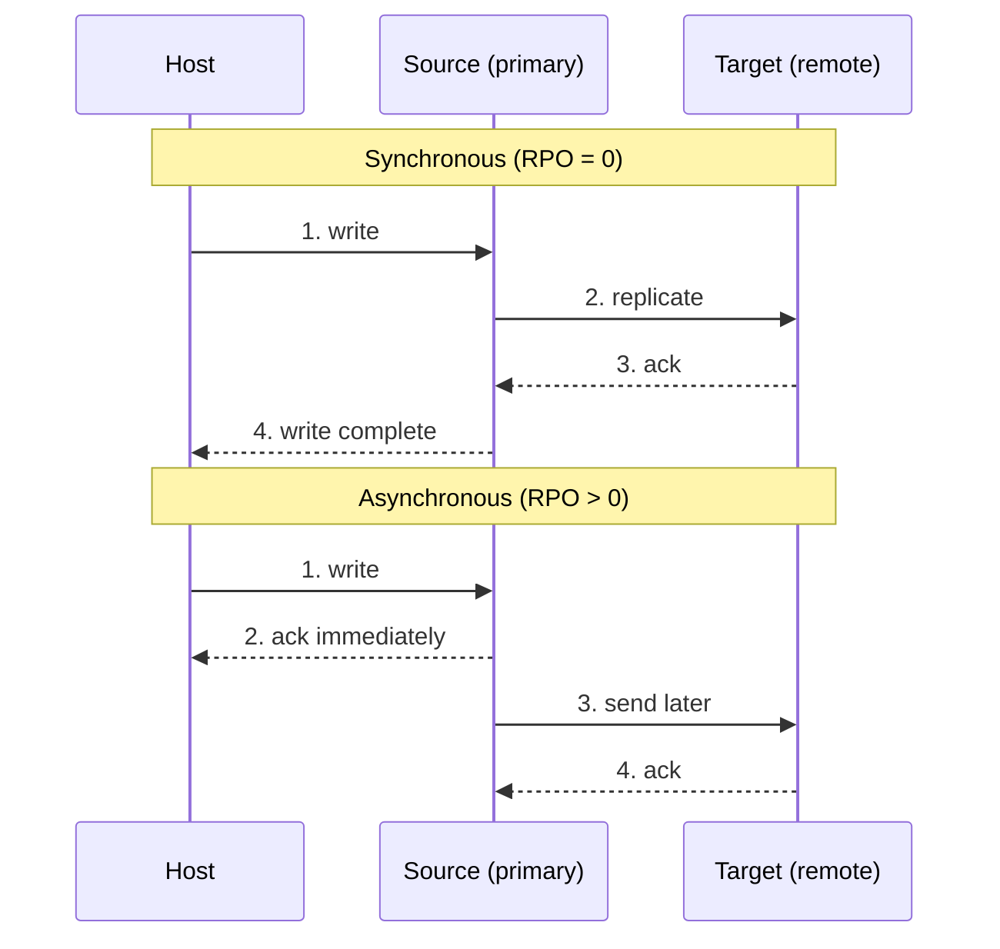

# النسخ المحلي والبعيد — Chapter 10: Local & Remote Replication

> [!NOTE]
> آخر محاضرة في Storage عن الـ **Replication**: يعني نعمل **نسخة مطابقة (replica)** من البيانات. هنشوف **Source و Target**، واستخدامات النسخ المحلية، وأهمية **الاتساق (consistency)**، وتقنيات النسخ المحلي (**host-based** و **array-based**)، والنسخ البعيد (**Synchronous** و **Asynchronous**)، والـ **SAN-based remote replication**.

**خريطة المحاضرة:**

1. يعني إيه Replication؟ Source و Target
2. استخدامات الـ Local Replicas
3. اتساق البيانات (Data Consistency)
4. تقنيات النسخ المحلي: Host-based (FS، LVM، Snapshot) و Array-based (Full-volume، Pointer-based full، Pointer-based virtual)
5. النسخ البعيد (Remote Replication) وأنواعه
6. الـ SAN-Based Remote Replication

---

## 1. يعني إيه Replication؟

> **Replication** is a process of creating an **exact copy (replica)** of data.

| النوع | الوصف |
|---|---|
| **Local replication** | نسخ البيانات **جوه نفس الـ array أو نفس الـ data center** |
| **Remote replication** | نسخ البيانات **لموقع بعيد (remote site)** |

### Source و Target

| المصطلح | التعريف |
|---|---|
| **Production host** | الـ host اللي **بيوصل للبيانات** من LUN أو أكتر على الـ array |
| **Source LUNs** | الـ LUNs دي اسمها **source LUNs** أو **production LUNs** أو **source** |
| **Target LUNs** (Replicas) | الـ LUNs اللي **البيانات بتتنسخ عليها** |

- **الوصول والتحديثات:** الـ targets ممكن **hosts تانية توصلها** للـ backup أو الـ testing، و**التعديل على الـ target مش بيأثر على الـ source**.
- **Synchronization:** الـ targets ممكن **تتزامن تاني تدريجيًا (incrementally resynchronized)** مع الـ source عشان يبقوا متطابقين.

---

## 2. استخدامات الـ Local Replicas

| الاستخدام | الشرح |
|---|---|
| **1. Alternate source for backup** | نعمل الـ backup **من الـ replica بدل الـ production LUNs**، فبيقل الضغط عليها و**مفيش backup window** |
| **2. Fast recovery** | **استرجاع سريع** من عطل جزئي أو كامل في الـ source، فبيقل الـ downtime (**RTO**) |
| **3. Testing platform** | **تجربة التطبيقات أو الترقيات** على الـ replica قبل تطبيقها على الـ source |
| **4. Data migration** | تسهيل **نقل البيانات** بين أنظمة أو أجهزة التخزين |

> [!TIP]
> احفظهم: **B-R-T-M**: **B**ackup، **R**ecovery، **T**esting، **M**igration.

---

## 3. اتساق البيانات — Data Consistency

- معظم الـ file systems والـ databases **مش بتكتب البيانات على الديسك فورًا**. البيانات **بتتخزن مؤقتًا في ميموري الـ host (buffer)** الأول.
- **لو عملنا replica والبيانات لسه في الـ buffer**، البيانات دي **مش هتبقى في الـ replica**، والنتيجة:
  1. **بيانات ناقصة**.
  2. **Replica مش متسقة (inconsistent)**.
  3. **أخطاء** لما نستخدم الـ replica في الاسترجاع أو الـ testing.

> **Consistent replica** = **all data buffered in the host has been properly written to disk** before the replica is created.

يعني الـ replica المتسقة **كاملة وصحيحة، ومطابقة للـ source، وتنفع للـ backup والـ recovery والـ testing من غير أخطاء**.

> [!IMPORTANT]
> **الاتساق (consistency) هو المتطلب الأساسي لكل تقنيات الـ replication**، لأن:
> 1. الهدف إن يبقى عندنا **نسخة موثوقة ودقيقة**.
> 2. التطبيقات لازم **تشتغل صح على الـ replica**.
> 3. الاسترجاع **معتمد على إن الـ replica كاملة ومستقرة**.

---

## 4. تقنيات النسخ المحلي — Local Replication Technologies

| النوع | مين بيعمل الـ replication | الأنواع |
|---|---|---|
| **Host-based** | **الـ host/server نفسه** (CPU، memory، software) | **File System–based**، **Volume/Block-based (LVM mirroring)**، **Snapshot-based** |
| **Storage array–based** | **الـ storage array** (بيشيل الحمل عن الـ host) | **Full-volume mirroring**، **Pointer-based full-volume**، **Pointer-based virtual** |

### 4.1 الـ Host-Based Replication

الـ replication بيتعمل **بالسيرفر نفسه** باستخدام **CPU وميموري وسوفتوير** السيرفر، يعني **السيرفر هو اللي بيقرر** ينسخ إيه وإزاي.

| | **File System–Based** | **Volume/Block-Based (LVM Mirroring)** | **Snapshot-Based** |
|---|---|---|---|
| **المستوى** | **ملفات / فولدرات** | **Blocks** (volumes أو ديسكات كاملة) | **Point-in-time** لـ volume أو FS |
| **بيشتغل إزاي** | نسخ الملفات من فولدر الـ source للـ target، **real-time أو scheduled** | **كل كتابة على الـ primary volume بتتكتب كمان على الـ secondary** (mirroring) | لقطة في لحظة معينة، وممكن تتنسخ لـ host تاني |
| **✅** | **بسيط وسهل**، وممكن تختار **الملفات المهمة بس** | **شفاف للتطبيقات**، و**ينسخ النظام كله** (OS + apps) | **سريع في العمل والاسترجاع**، وممكن يتجمع مع replication |
| **❌** | **file level بس**، وممكن **ميلقطش الملفات المفتوحة**، وبيستهلك CPU | **بيستهلك CPU و memory و I/O** الـ host، وبيأثر على الأداء مع الـ I/O العالي | **بياخد مساحة**، ومش مناسب لبيانات **ضخمة جدًا** لفترات طويلة |

### 4.2 الـ Storage Array–Based Replication

- الـ replication بيتعمل **بالـ OS بتاع الـ array نفسه**، **من غير CPU أو memory السيرفر**.
- فهو **أسرع، وأكفأ، وأقل استهلاكًا لموارد الـ host** من الـ host-based.
- مستخدم كتير في الـ **enterprise** (local و remote).
- الـ source والـ replica ممكن يبقوا على **نفس الـ array أو array بعيد**.

#### 1. الـ Full-Volume Mirroring

| | |
|---|---|
| **بيشتغل إزاي** | **الـ volume كله بيتنسخ** على الـ target · أثناء **الـ sync الأولي الـ target مش متاح** · بعد **الفصل (detach)** يبقى **PIT replica** · بيدعم **incremental resynchronization**: لما يتربطوا تاني، **التغييرات بس** بتتنسخ |
| **✅** | **نسخة كاملة مطابقة** للـ source، وتنفع backup كامل أو نقطة استرجاع |
| **❌** | **الـ target مش متاح وقت الـ sync الأولي** · محتاج **سعة مساوية للـ source** |

#### 2. الـ Pointer-Based Full-Volume Replication

- بيدّي **نسخة كاملة** من الـ source على الـ target.
- الـ target **متاح فورًا** للـ BC host بعد بداية الـ session.
- الـ **PIT** بيتحدد بوقت تفعيل الـ session.
- الـ target **على الأقل بحجم الـ source**.
- ليه **وضعين (modes)**:

| | **a. CoFA (Copy on First Access)** (deferred) | **b. Full Copy** |
|---|---|---|
| **الفكرة** | **مش بينسخ البيانات كلها** وقت عمل الـ replica. **بينسخ بس الـ blocks اللي حد وصلها** (على الـ source أو الـ target) | **PIT copy** بتتعمل فورًا، وبعدين **كل البيانات بتتنسخ في الخلفية** |
| **الـ target** | **متاح فورًا** من غير انتظار sync | **متاح فورًا** للـ recovery والقراءة والتقارير |
| **✅** | الـ replica **جاهزة فورًا**، و**أسرع** من full-volume copy | متاح فورًا، والنسخ في الخلفية **مش بيعطّل الشغل**، و PIT متسق |
| **❌** | — | **إدارة الـ pointers معقدة شوية**، والأداء ممكن يتأثر لو فيه **كتابات كتير** أثناء النسخ |

**الـ CoFA بيشتغل إزاي؟**

| الحدث | اللي بيحصل |
|---|---|
| **Write to Source** (أول كتابة بعد التفعيل) | البيانات **الأصلية** في العنوان ده **بتتنسخ للـ target الأول**، وبعدين البيانات الجديدة تتكتب على الـ source، فالـ target يحافظ على بيانات وقت التفعيل |
| **Write to Target** (أول كتابة) | البيانات الأصلية **بتتنسخ من الـ source للـ target**، وبعدين البيانات الجديدة تتكتب على الـ target |
| **Read from Target** (أول قراءة) | البيانات الأصلية **بتتنسخ من الـ source للـ target** وتبقى متاحة للـ BC host |

#### 3. الـ Pointer-Based Virtual Replication

- **الـ target مش بيخزن كل البيانات**. فيه **pointers** بتشاور على البيانات اللي على الـ source.
- لما **أول كتابة** تحصل (**CoFW: Copy on First Write**):
  1. **الـ block الأصلي بيتنسخ لـ save location**.
  2. **وبعدين التعديل يتطبق على الـ source**.
- **لو الـ source بقى invalid، الـ target كمان بيبقى invalid**.
- **مثالي لتوفير المساحة** والتغييرات التدريجية.

| ✅ المميزات | ❌ العيوب |
|---|---|
| **مساحة تخزين أقل بكتير** | **الـ target معتمد على الـ source**: لو الـ source وقع **الـ replica مش هتنفع** |
| **إنشاء ونشر سريع جدًا** | |
| **مثالي للـ testing** أو **replicas خفيفة كتير** | |

### مقارنة تقنيات الـ Array-Based

| | **Full-Volume Mirroring** | **Pointer-Based Full-Volume** | **Pointer-Based Virtual** |
|---|---|---|---|
| **الـ target متاح فورًا؟** | ❌ (بعد الـ sync) | ✅ | ✅ |
| **مساحة الـ target** | **= الـ source** | **≥ الـ source** | **صغيرة** (save location بس) |
| **معتمد على الـ source؟** | لأ (نسخة كاملة) | لأ (بعد ما النسخ يخلص) | **آه** |
| **الآلية** | نسخ كامل + resync | CoFA أو Full copy | **CoFW + pointers** |

> [!EXAM]
> - **CoFA** = Copy on First **Access** ← **pointer-based full-volume**.
> - **CoFW** = Copy on First **Write** ← **pointer-based virtual**.
> - **Full-volume mirroring** ← الـ target **مش متاح** أثناء الـ sync الأولي.

---

## 5. النسخ البعيد — Remote Replication

**Remote replication** = عمل **نسخ من المعلومات في مواقع بعيدة**، بيساعد الشركات تقلل مخاطر الانقطاعات الإقليمية بسبب كوارث **طبيعية أو بشرية**. ووقت الكارثة، **الشغل ينتقل للموقع البعيد**، وكمان الـ replicas البعيدة ممكن تتستخدم في **عمليات تانية**.

### ليه مهم؟

**بيحمي من:** الكوارث الطبيعية (حريق، فيضان، زلزال)، وأعطال الهاردوير، والأخطاء البشرية، والـ **Ransomware** والهجمات الإلكترونية.

**بيسمح بـ:** **استرجاع سريع** · **تشغيل الشغل من موقع DR** · **أقل downtime وفقد بيانات**.

### أنواع الـ Remote Replication

| | **Synchronous Replication** | **Asynchronous Replication** |
|---|---|---|
| **الكتابة** | البيانات بتتكتب على **الموقع الأساسي والبعيد في نفس الوقت** | بتتكتب على **الأساسي الأول**، وبعدين تتبعت للبعيد **بعد تأخير بسيط** (ثواني أو دقايق) |
| **إمتى الكتابة تخلص** | **لما الطرفين يأكدوا** | الـ host بياخد **ack فورًا** |
| **فقد البيانات** | **صفر (RPO = 0)** | **فقد بسيط ممكن (RPO > 0)** |
| **الـ Bandwidth** | **عالي** | **مش محتاج bandwidth عالي** |
| **المسافة** | **قصيرة (< 100–200 km)** | **طويلة** (حتى بين الدول) |
| **✅** | **أعلى حماية، ومفيش فقد بيانات** | **مسافات طويلة، وأرخص، ومفيش تأثير على أداء الموقع الأساسي** |
| **❌** | **تكلفة عالية، و latency أعلى** مع المسافات الطويلة | **فقد بيانات بسيط ممكن** |

> [!TIP]
> **Sync** = "مش هقولك خلصت غير لما **الاتنين** يكتبوا" (آمن جدًا، بس بطيء على المسافات الطويلة).
> **Async** = "خلصت! وهبعت النسخة **بعدين**" (سريع وبعيد، بس ممكن تضيع آخر حاجة).

---

## 6. الـ SAN-Based Remote Replication

- تقنية بتنسخ البيانات **لموقع بعيد عبر SAN**.
- الـ replication بيحصل **على مستوى شبكة التخزين**، **مش على مستوى السيرفر أو التطبيق**.
- مستخدمة في **الشركات الكبيرة** لحماية البيانات وتنفيذ خطط الـ **DR**.
- بيتحكم فيها **الـ storage array** أو **SAN management software**، **من غير تدخل مباشر من السيرفرات**.

### بيشتغل إزاي؟

| العنصر | الشرح |
|---|---|
| **Source (LUN/Volume)** | وحدة التخزين الأصلية على الـ **primary SAN** |
| **Target (Replica LUN/Volume)** | وحدة تخزين على **SAN بعيد** (غالبًا data center تاني) |
| **Replication Mechanism** | غالبًا **block level**، و**الـ blocks المتغيرة بس** بتتبعت، والأداء بيعتمد على **الـ latency والـ bandwidth** |
| **Replication Modes** | **Synchronous** (كل كتابة بتتأكد بعد ما تتكتب على الـ target، و RPO = 0، ومحتاج شبكة سريعة) · **Asynchronous** (نسخ في **فترات مجدولة**، و RPO > 0، وأنسب للمسافات الطويلة والـ bandwidth القليل) |

### أنواع الـ SAN-Based Replication

| النوع | المستوى | ✅ المميزات | ❌ العيوب |
|---|---|---|---|
| **Full-Volume Replication** | **الـ volume كله** | **نسخة كاملة مطابقة**، و **restore فوري** | **محتاج تخزين كبير و bandwidth عالي** |
| **Block-Level Replication** | **blocks فردية** | **موفر للمساحة، وأسرع، وبيدعم التحديثات التدريجية** | **إدارة أعقد** |
| **Snapshot / Point-in-Time** | **نقطة زمنية** | **إنشاء واسترجاع سريع، وتأثير قليل على الأداء** | **معتمد على الـ source**، وممكن يحتاج مساحة زيادة |

---

## ✅ خلاصة المحاضرة في 10 نقط

1. **Replication** = نسخة مطابقة · **Local** (نفس الـ array أو الـ data center) · **Remote** (موقع بعيد).
2. **Source / production LUNs** ← **Target LUNs (replicas)**: تعديل الـ target مش بيأثر على الـ source، وفيه incremental resync.
3. استخدامات الـ local replicas: **Backup source** (مفيش backup window) · **Fast recovery** (RTO) · **Testing** · **Migration**.
4. **Consistency** = كل اللي في الـ buffer اتكتب على الديسك قبل الـ replica، وهو **المتطلب الأساسي** (dependent write I/O).
5. **Host-based**: **FS-based** (ملفات، بسيط، ممكن يفوّت الملفات المفتوحة) · **LVM mirroring** (blocks، شفاف، بيستهلك موارد) · **Snapshot** (PIT سريع).
6. **Array-based**: بالـ OS بتاع الـ array، أسرع ومن غير موارد الـ host.
7. **Full-volume mirroring**: الـ target **مش متاح** وقت الـ sync، و**سعة = الـ source**، و detached = PIT، و incremental resync.
8. **Pointer-based full-volume**: متاح فورًا · **CoFA** (ينسخ اللي اتوصل له بس) أو **Full copy** (في الخلفية).
9. **Pointer-based virtual**: **pointers + CoFW + save location** · مساحة قليلة وسريع · **لو الـ source وقع الـ replica بايظة**.
10. **Synchronous** (الطرفين مع بعض، **RPO = 0**، < 200 km، غالي) vs **Asynchronous** (تأخير، **RPO > 0**، مسافات طويلة، أرخص) · **SAN-based remote replication**: block level، والـ array هو اللي بيتحكم.
